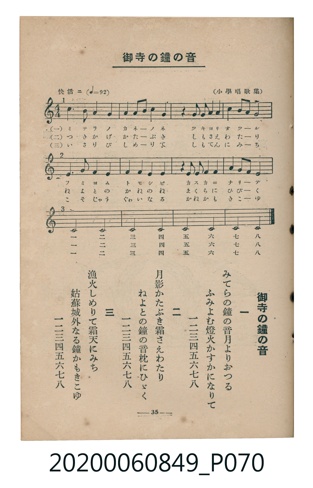

# 御寺の鐘の音

> Re:Shōka 使用 AI 協助辨識與重建樂譜，可能會有錯誤。歡迎回報。

- **鋼琴伴奏版**：<br><audio controls src="otera_no_kane.mp3"></audio>

- 出處：（小學唱歌集）
- 臺灣教育會公認《新定兒童唱歌》高等科女子用（2020.006.0849）

## 說明

原書資訊與歌詞全文（對應 P070.jpg，書頁 p. 35，高一輪唱第 1 首）：
調性與拍號：ハ長調（無升降記號）、4/4 拍（三部輪唱，快活ニ ♩=92）
出處註記：（小學唱歌集）


## 歌詞

```text
一
みてらの鐘の音月よりおつる
ふみよむ燈火かすかになりて
一二三四五六七八

二
月影かたぶき霜さえわたり
ねよとの鐘の音枕にひゞく
一二三四五六七八

三
漁火しめりて霜天にみち
姑蘇城外なる鐘かもきこゆ
一二三四五六七八
```

## ABC

<div class="abc-score" data-abc-src="otera_no_kane.abc" aria-label="五線譜載入中"></div>

[下載 ABC 原始檔](otera_no_kane.abc)

## TMD 檔案連結

- [主旋律 TMD 檔案](otera_no_kane.tmd) [[在 TMD Studio 編輯](https://tmdlang.github.io/Tmd-TS/#tmd=s7IKdvYPcrWy4qpTUCpJTLdSSM7PyUlNLsnMz7MqzsjMK0nNjM_KTMmPL87Iz05Ugisry88pzU21ys4vyY9PzyzKKY43MjAyiDcwMIs3sDCxRCgszi8tSk61Kk7OyM_PiS9JrShJys_PRpePL0hMT7UKMDA3QMgUFOWXpeYl5gF1FxSBXJIC1o5QkFqWmZIKki5OTsyLL0stykzLTE1BcmNqUTHYHxArSooS84qTizILQJ5DqMovKsnITy9KLMiotMrILC7JL8pMTsyJz07MQ_JuSUYq0Ldp-TnZOflFqejiRak5melohgIF8qxy8_OSSoEhp8SlpaXwdN_Cp-t3PW5c93LCDBA5f7OClhaXoq2CpRGXva2CM5eNib6JHciIp-27Xsyc-n7PrPd7Op5u6H-6dsfTKRufre15Obvt_Z5OsC0v2nc9b1z8bOrMF02bns1pftq65sWq3scNXc-mbXi6btbT1knPVy-FaHrc0P1y9YznazufL5_4dOnmp2snPJ-yAmgwKL70gPGlB4ovsLFc-loKttQCXAoKCk_75j-bvePF5vYXK7pedLQDHfNi5bynrSueTWsH-6z3WXunAijS9bIK0t_v6QEqfrmgUaFAT8HYFMgFOvvJjoYXe1YBPfJ8zRoFQ4WXy6YBXQoMGJDpL1btf9awHGRud--LmfOBoo-b-19O3Q4UB5r-vGXh0972lzN7X6yYAZbtfNzQCAxgBaBqoPSTHZ0vm1dAzAZa9XT_6mdbdj9u7lZ4NHOlraURUDnYA-CIeLFiN9AQXNHBBVIIdCeIety4_3HjssdNncix_GxOx-MmIOp63AhESx43dUOUbgWpBkk0PG_veN64-nFj9-PGmWASyF4F1rAMaviTXT1AFz-dPfvJrilPW9c-2QGM8dUQm3f1gCigJU_3bgRrnv-4cdvjxt6Xc-Y8bpz6uBFoQT9IsKkLYu1akJ2NK1BcOA-oDmjnpsdN8x439hO2cwc4dJ7taQQ7e_rjpkaIa4F2Pl2yEmwWMCAWgoNw-cQXM9qfzu97umQa2FfdYGu7Hzc1AR35uHHy46Y2vBYC5ShPjVCgoKXPxeWbCMyZAZmJefmGDjUGNdUgGxRsLLTswAxgHgCmNVC6W9ijoGGoCdICEq9RMIxT0AVCcwUzIGkKxDVglhlQBCwFETIAs0yhUiARsCRIF0gBCNaADfQxrFF43DwfLPK4uQ2IV4JZfWBNj5tWg3m9QLwHKgrigeTiwewWoJq1QHoFmLcKqgtEg-XAukBmINloBFTRuARiYyPQ5MZuMGsSRC-UNx-it3EbVBXcxsbpQPObgPRUMK8DamM_sq6mLlQbjUHmtkBtnAqVf9y4GWrjdBCvqRFJLzARYbERJPa4aTJUFzhkGvdD3bkQbiNy_O3qAcefEVL8GYOVmSqYAEkQuwbMgvEgIqDYMwZCmAwkikF6ILpRIw8UEKDgBnkeEg0LIE5sBgXO4-ZFYGdvB7Mhjgd7Cxi1j5t2wqMYFOwgPWDvAyMSEnVtWKJuLcS-pg4gG2xf4zqUqAPJQ8QgbFgw7gPifqC-TjAPZCtIzyZoVECCERSN6BEHcjNIzVwgnvG4qRnMATkMJDnhcRM4UYKjF5izwS6D-AViazfYFVC3AaMRog2UoEAmQ6Ic4UuUzNcJjjxj5MwHVQijyRSBRx4wg0PFgEkFrh5oM5QNLIUQorumwERbIVEAUQsKD4goZj6jqfnAyKGV-fBoWNv5dF8rJCcBK05Idfl864Rnc-craFgoAKvB5-sbkOIHlHGQIZki8PgBJSFUtWSJwOODquYBw59a5o0GH0Xm1SJX50Y4qnN4Ut7RAEzEwLbb03U9SHW8yWhqpmpqHm1BjbagRltQoy2o0RYUrNpBbjuN1ja0qfyNCVf-oHbsrh5gXIy2YEdbsKNNptEm02iTabTJNNpkGvgmE7Ai17VTANXlCkBamQsA)]
- [鋼琴伴奏 TMD 檔案](otera_no_kane_piano.tmd) [[在 TMD Studio 編輯](https://tmdlang.github.io/Tmd-TS/#tmd=s7IKdvYPcrWy4qpTUCpJTLdSSM7PyUlNLsnMz7MqzsjMK0nNjM_KTMmPL87Iz05Ugisry88pzU21ys4vyY9PzyzKKY43MjAyiDcwMIs3sDCxRCgszi8tSk61Kk7OyM_PiS9JrShJys_PRpePL0hMT7UKMDA3QMgUFOWXpeYl5gF1FxSBXJIC1o5QkFqWmZIKki5OTsyLL0stykzLTE1BcmNqUTHYHxArSooS84qTizILQJ5DqMovKsnITy9KLMiotMrILC7JL8pMTsyJz07MQ_JuYhFQc3pqbmpeiVVBZmJefnxicnJ-bkFiXiZIDKGwJAOoyCotPyc7J78oFV28KDUnMx3NdqBAnlVufl5SKTCIlbi0tBSe7lv4dP2ux43rXk6YASLnb36_p-Nl957nE7Y82bPl6dL-550d7_d0KmhpcSnaKlgacdnbKjhz2Zjom9iBzH3avuvFzKnv98wC6nq6of_p2h1Pp2x8trbn5ew2oC6w1S_adz1vXPxs6swXTZuezWl-2rrmxarexw1dz6ZteLpu1tPWSc9XL4VoetzQ_XL1jOdrO58vn_h06eanayc8n7ICaDAotvWAsa0Him2wsVy-iUCPBIACx9ChxqCmmksBCGwstOzADH0thedr1jzZ0fBiYY-ChqGmgpY-WLxGwTBOQRcIzRXMgKQpENeAWWZAEbAURMgAzDKFSoFEwJIgXSAFIFgDNtDHsEbhcfN8sMjj5jYgXglm9YE1PW5aDeb1AvEeqCiIB5KLB7NbgGrWAukVYN4qqC4QDZYD6wKZgWSjEVBF4xKIjY1Akxu7waxJEL1Q3nyI3sZtUFVwGxunA81vAtJTwbwOqI39yLqaulBtNAaZ2wK1cSpU_nHjZqiN00G8pkYkvY8bl2GxEST2uGkyVBc4ZBr3Q925EG4jcvzt6gHHnxFS_BmDlZkqmABJELsGzILxICKg2DMGQpgMJIpBeiC6USMPFBCg4AZ5HhINCyBObAYFzuPmRWBnbwezIY4HewsYtY-bdsKjGBTsID1g7wMjEhJ1bViibi3EvqYOIBtsX-M6lKgDyUPEIGxYMO4D4n6gvk4wD2QrSM8maFRAghEUjegRB3IzSM1cIJ7xuKkZzAE5DCQ54XETOFGCo_dxIzjhNUH8ArG1G-wKqNuA0QjRBkpQIJMhUY7wJUrm6wRHnjFy5oMqhNFkisAjD5jBoWLApAJXD7QZyn46ezZCdNcUmGgrJAogakHhARHFzGc0NR8YObQyHx4Nazuf7muF5KTHDY1Ag182r3i-dcKzufMVNCwUgOX18_UNSPEDyjjIkEwRePyAkhCqWrJE4PFBVfOA4U8t80aDjyLzapGrcyMc1Tk8Ke9oACZiYHvh6boepDreZDQ1UzU1j7agRltQoy2o0RbUaAsKVu0gt51GaxvaVP7GhCt_UDt2Vw8wLkZbsKMt2NEm02iTabTJNNpkGm0yDXyTCaUi9_FAqslNoDV5jUJ1Qa2CYTwokiEkMCOh8CA0RAzGg8rBYnOY6CaaBwpXXTsFUNAqAGllLgA)]

## 分析

```text
================================================================================
📊 TMD Song Profile: [ 御寺の鐘の音 ]
================================================================================
⏱  Duration:       0:52 (52.2s), 20 measures total
🎼 Key & Tempo:    首調基準 C, != 92.0 BPM, <4/4>
   - 分析範圍：      由實際發聲的音符與和弦推測調性；播放脈絡另行呈現
🎤 人聲音域:    C4 (MIDI 60) – C5 (MIDI 72) [跨度: 12 個半音 / 1.0 個八度, 難度: easy]
   - 最低音:  C4 in [Main #1 @ m.9, 0:20]
   - 最高音: C5 in [Main #1 @ m.1, 0:00]
   - 適合: soprano, mezzo-soprano, contralto, tenor, baritone, bass
🏛  結構:      Main (52.2s)
⚡ 編曲密度:        Peak 3 軌道同時演奏
🗝  調性診斷：       C 大調（純淨自然大調，未偵測到可信轉調）
   - 風格氣質:    純淨自然大調（陽光明朗、易唱易記，無明顯調外色彩）
   - 轉調歷程:    全曲維持單一推測調性（未偵測到可信轉調）
   - 核心骨幹音:  C, E, G, A, F
   - 調性數值:    C 大調 [相關度: 0.91, 穩定度: High, 自然音純度: 100.0%]
   - 候選調性 (K-S): C 大調 (0.91), A 小調 (0.72), F 大調 (0.58)
   - 五度圈歷程:   +0
   - 各段落調性細節:
     • [Main #1]: C 大調 (r: 0.91, 自然音純度: 100.0%)

  [ 五度圈游移軌跡 ]
              [C ]*
         F            G  
      Bb               D  
      Eb               A  
         Ab           E  
            Db       B  
               F# 
     (* = active key center)

  [ 十二半音累積音高分佈 ]
     C  : ████████████████████████  42.4%
     C# :                            0.0%
     D  :                            0.0%
     D# :                            0.0%
     E  : █████████                 16.3%
     F  : ███████                   12.0%
     F# :                            0.0%
     G  : ███████                   13.0%
     G# :                            0.0%
     A  : ███████                   13.0%
     A# :                            0.0%
     B  : ██                         3.3%
--------------------------------------------------------------------------------
Assignment 軌道音域：
  - Piano1        : C4 – C5 (12 個半音 / 1.0 個八度, 41 個音符)
  - Piano2        : C4 – C5 (12 個半音 / 1.0 個八度, 41 個音符)
  - Piano3        : C4 – C5 (12 個半音 / 1.0 個八度, 41 個音符)
================================================================================
```


## 原書掃描頁




