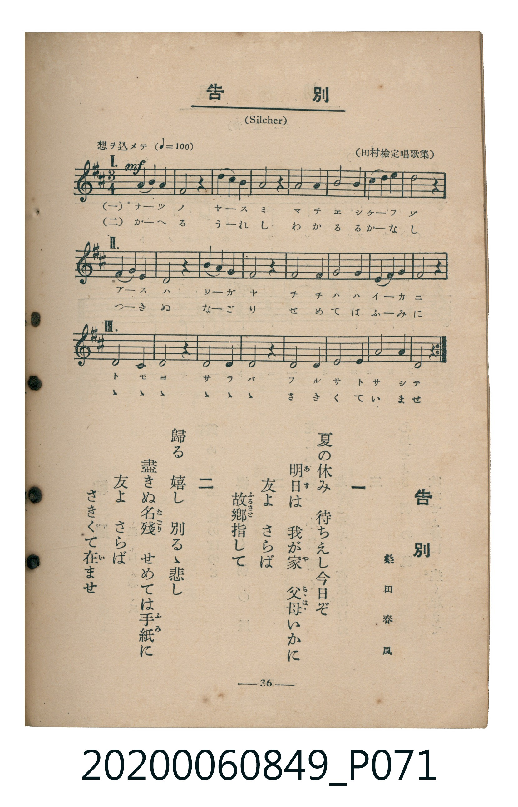

# 告別

> Re:Shoka 使用 AI 協助辨識與重建樂譜，可能會有錯誤。歡迎回報。

<audio controls src="kokubetsu.mp3"></audio>

- 詞：桑田春風
- 曲：F. Silcher
- 出處：（田村檢定唱歌集）
- 臺灣教育會公認《新定兒童唱歌》高等科女子用（2020.006.0849）

## 說明

原書資訊與歌詞全文（對應 P071.jpg，書頁 p. 36，高一輪唱第 2 首）：
調性與拍號：ニ長調（2 升記號）、3/4 拍（三部輪唱，想ヲ込メテ ♩=100）
出處註記：（田村檢定唱歌集）

## 跨冊／重複收錄參照

> 同曲異詞＋同名異曲（《新定兒童唱歌》五年級〈告別〉、《唱歌帖》P042〈螢の光〉與 P197〈送別の歌〉同採蘇格蘭民謠 *Auld Lang Syne* 旋律；高等科女子用〈告別〉為同名異曲）

- **[同名異曲]** 《新定兒童唱歌》尋常科第五學年用（2020.006.0847.0005）：[**〈告別〉**](../../grade_5_2020.006.0847.0005/4_19_kokubetsu/index.md)（`F` / `4/4` — [原始 TMD](../../grade_5_2020.006.0847.0005/4_19_kokubetsu/kokubetsu.tmd)）
- **[參照]** 楊金土手抄《唱歌帖》第 3 冊・I（2020.006.0843）：[**〈螢の光〉**](../../../shokacho/vol_03/p042_hotaru_no_hikari/index.md)（`F` / `4/4` — [原始 TMD](../../../shokacho/vol_03/p042_hotaru_no_hikari/hotaru_no_hikari.tmd)）
- **[參照]** 楊金土手抄《唱歌帖》第 10 冊・X（2020.006.0843）：[**〈送別の歌 (送別之歌)〉**](../../../shokacho/vol_10/p197_sobetsu_no_uta/index.md)（`F` / `2/4` — [原始 TMD](../../../shokacho/vol_10/p197_sobetsu_no_uta/sobetsu_no_uta.tmd)）
- 總表：[跨冊重複與同名歌曲總索引](../../../duplicate_songs.md)

## 歌詞

```text
一
夏の休み　待ちえし今日ぞ
明日（あす）は我が家（や）　父母（ちゝはゝ）いかに
友よさらば　故郷（ふるさと）指して

二
歸る嬉し　別るゝ悲し
盡きぬ名殘（なごり）　せめては手紙（ふみ）に
友よさらば　さきくて在（い）ませ
```

## ABC

```abc
X:1
T:告別
C:曲：F. Silcher
M:3/4
L:1/16
Q:1/4=100
K:D
V:V1 name="Part1" snm="Par"
V:V2 name="Part2" snm="Par"
V:V3 name="Part3" snm="Par"
[V:V1]
!mf! A,6 B,2 A,4 | F,8 z4 | A,6 B,2 A,4 | F,8 z4 |
B,8 B,4 | A,8 A,4 | G,4 C4 C4 | D8 z4 |
F,6 G,2 F,4 | D,8 z4 | F,6 G,2 F,4 | D,8 z4 |
G,8 G,4 | F,8 F,4 | E,6 D,2 E,2 G,2 | F,8 z4 |
D,8 D,4 | D,8 z4 | D,8 D,4 | D,8 z4 |
D,8 D,4 | D,8 D,4 | A,8 A,,4 | D,8 z4 |
z12 | z12 | z12 | z12 |
z12 | z12 | z12 | z12 |
z12 | z12 | z12 | z12 |
z12 | z12 | z12 | z12 |
!mf! A,6 B,2 A,4 | F,8 z4 | A,6 B,2 A,4 | F,8 z4 |
B,8 B,4 | A,8 A,4 | G,4 C4 C4 | D8 z4 |
F,6 G,2 F,4 | D,8 z4 | F,6 G,2 F,4 | D,8 z4 |
G,8 G,4 | F,8 F,4 | E,6 D,2 E,2 G,2 | F,8 z4 |
D,8 D,4 | D,8 z4 | D,8 D,4 | D,8 z4 |
D,8 D,4 | D,8 D,4 | A,8 A,,4 | D,8 z4 |
z12 | z12 | z12 | z12 |
z12 | z12 | z12 | z12 |
z12 | z12 | z12 | z12 |
z12 | z12 | z12 | z12 |
[V:V2]
z12 | z12 | z12 | z12 |
z12 | z12 | z12 | z12 |
!mf! A,6 B,2 A,4 | F,8 z4 | A,6 B,2 A,4 | F,8 z4 |
B,8 B,4 | A,8 A,4 | G,4 C4 C4 | D8 z4 |
F,6 G,2 F,4 | D,8 z4 | F,6 G,2 F,4 | D,8 z4 |
G,8 G,4 | F,8 F,4 | E,6 D,2 E,2 G,2 | F,8 z4 |
D,8 D,4 | D,8 z4 | D,8 D,4 | D,8 z4 |
D,8 D,4 | D,8 D,4 | A,8 A,,4 | D,8 z4 |
z12 | z12 | z12 | z12 |
z12 | z12 | z12 | z12 |
z12 | z12 | z12 | z12 |
z12 | z12 | z12 | z12 |
!mf! A,6 B,2 A,4 | F,8 z4 | A,6 B,2 A,4 | F,8 z4 |
B,8 B,4 | A,8 A,4 | G,4 C4 C4 | D8 z4 |
F,6 G,2 F,4 | D,8 z4 | F,6 G,2 F,4 | D,8 z4 |
G,8 G,4 | F,8 F,4 | E,6 D,2 E,2 G,2 | F,8 z4 |
D,8 D,4 | D,8 z4 | D,8 D,4 | D,8 z4 |
D,8 D,4 | D,8 D,4 | A,8 A,,4 | D,8 z4 |
z12 | z12 | z12 | z12 |
z12 | z12 | z12 | z12 |
[V:V3]
z12 | z12 | z12 | z12 |
z12 | z12 | z12 | z12 |
z12 | z12 | z12 | z12 |
z12 | z12 | z12 | z12 |
!mf! A,6 B,2 A,4 | F,8 z4 | A,6 B,2 A,4 | F,8 z4 |
B,8 B,4 | A,8 A,4 | G,4 C4 C4 | D8 z4 |
F,6 G,2 F,4 | D,8 z4 | F,6 G,2 F,4 | D,8 z4 |
G,8 G,4 | F,8 F,4 | E,6 D,2 E,2 G,2 | F,8 z4 |
D,8 D,4 | D,8 z4 | D,8 D,4 | D,8 z4 |
D,8 D,4 | D,8 D,4 | A,8 A,,4 | D,8 z4 |
z12 | z12 | z12 | z12 |
z12 | z12 | z12 | z12 |
z12 | z12 | z12 | z12 |
z12 | z12 | z12 | z12 |
!mf! A,6 B,2 A,4 | F,8 z4 | A,6 B,2 A,4 | F,8 z4 |
B,8 B,4 | A,8 A,4 | G,4 C4 C4 | D8 z4 |
F,6 G,2 F,4 | D,8 z4 | F,6 G,2 F,4 | D,8 z4 |
G,8 G,4 | F,8 F,4 | E,6 D,2 E,2 G,2 | F,8 z4 |
D,8 D,4 | D,8 z4 | D,8 D,4 | D,8 z4 |
D,8 D,4 | D,8 D,4 | A,8 A,,4 | D,8 z4 |
```

## TMD 檔案連結

- [主旋律 TMD 檔案](kokubetsu.tmd) [[在 TMD Studio 編輯](https://tmdlang.github.io/Tmd-TS/#tmd=s7IKdvYPcrWy4qpTUCpJTLdSSM7PyUlNLsnMz7MqzsjMK0nNjM_KTMmPL87Iz05Ugisry88pzU21ys4vyY9PzyzKKY43MjAyiDcwMIs3sDCxRCgszi8tSk61Kk7OyM_PiS9JrShJys_PRsgXFOWXpeYl5gHVFBSB7EsBK0IoSC3LTEkFSaemZJbkF2Um5iC5IrWoGOxSsCXxJUWJecXJRZkFIOcjVJVkpAKdmpqbDxHW0lJ4OrHracdSBS0tLkVbBUMDAy57WwUXLhtjfRM7kK4XK-e93zPr2cKJz6dseDZj6ctFK8CGPZu9CSjspqcQnJmTnJFaBBZ82r7rxcypQPH3ezpAyudOfLZq0dN1s55O2fhsbc_L2W3v93SCFb5o3_W8cfGzqTNfNG16Nqf5aeuaF6t6Hzd0PZu2AaS8ddLz1Ushmh43dL9cPeP52s7nyyc-Xbr56doJz6esABoPCmE9YAjrgUIYbCyXvpaCLbUAl4KCwtO--c9m73ixuf3Fiq4XHe1AxwDD4mnrimfT2oEOeLqh91l7p0KAgbmhXlZB-vs9PUDFLxc0KhToKRibAblAZz_Z0fBizyqgR56vWaNgpPBy2TSgS4HBAzL9xar9zxqWg8zt7n0xcz5Q9HFz98up24HiIO8pPO0F2jsDLNP5uKERGB0KQJVAqSc7Ol82r4CYC7K1efPj5k0v9u153LzwcXObwqOZK22BsQjUBfYDOEZerNgNNAt_vHCBlAMdDNa1pP9x47oneyY-btz_uKHh6b7Wx40LHzd2PG6c_mR317PpSx83zgOpezajD8gBGvq4selx40yQSxvXP-sAaut5um4bSLypBez8hucd256tB7keZFDTXKAyIAlW3_K4sftx42qwtf3dj5uAKqY-bgJKbABqeza19WXzdrC2rY-bgOqmPm4Exn7ns552oFseNy6DuHpXD9g1a3cA1TxdA9Q7HeTqjqUgLU1znzVtAoqAVDyfDfRF7-PGNU8n9D5bBwwQoLmrHjdOedzUBXHm48bZj5sageaC_NHZ_XwL0E9guxuBkQI0F4czwe4CmgsMtWVP54CSJ9BfYA37gCaC9FCeIqFAQUufi8s3MTPPKiCxqMTQocagRqEaZIOCjYWWHZgBzAfA9AZKewt7FDQ89TRBekASQJW5abUKpvEKukBoFg9h1SgYQwR0FQzAXALyUKOA0hBBMAOuSxemyQREmcOJGgVDFEOQXbqrB-JSFKdCLQUaA2YB9aO6koA81BSwK6DqULwC1WQE4QP1AllANRieRQnRTqg7URwKtxfMwHAnfmlCZkD5SIGL1RS4K9d2AjMrJEyBhQakqHi-dcKzufMVNAzNFJ5u6H--vgHJ8SDtMEgCbwjrrkXKPkYONdoWhPMPqLTfve1l4yYFC2gIvmzY9LQVWPB1jmatkZe1UDIVLEUMeJ5CTtfGwHRtaEZKwoaXDaMpe8SkbGCK0bVTACUaBSRamYsLAA)]
- [鋼琴伴奏 TMD 檔案](kokubetsu_piano.tmd) [[在 TMD Studio 編輯](https://tmdlang.github.io/Tmd-TS/#tmd=s7IKdvYPcrWy4tLSUng6setpx9L3ezpedu95PmHLkz1bni7tf97Z8X5Pp4KWFpeirYKhgQGXva2CC5eNsb6JHVedgtKLlfPe75n1bOHE51M2PJux9OWiFUog4WezNwGF3fQUgjNzkjNSi8CCT9t3vZg5FSgOtAKkfO7EZ6sWPV036-mUjc_W9ryc3Qa0CKzwRfuu542Ln02d-aJp07M5zU9b17xY1fu4oevZtA0g5a2Tnq9eCtH0uKH75eoZz9d2Pl8-8enSzU_XTng-ZQXQeCMDIwM9AwMzPQMLE0uwsVy-iZl5VgGJRSWGDjUGNQrVXApAYGOhZQdmAAVy02oVTOMVdIHQLB7CqlEwhgjoKhiAuQTkoUYBpSGCYAZcly5MkwmIMocTNQqGWAyBmgxUC2YBFaE6hYA81BSwVVB1KO6FajKC8IF6gSygGhw-gpsNZmC4Bb80ITOgfKRQwmMKiA2DJPCGsO5apLRr5FCjbTGaeEcTL7kJyBiYgAzNRlPQ0EtB8FjMTMzL9_FArsRM4LEI1BNtGAvGcI4BbnFEKEWbAGWBGE0pyC3RpvFALojAonXUQlpYCE4UUBbULjQh7GrBLEj6AZFIyoGpR9dOAZSAFJBoZS4uAA)]

## 分析

```text
================================================================================
📊 TMD Song Profile: [ 告別 ]
================================================================================
⏱  Duration:       2:24 (144.0s), 80 measures total
🎼 Key & Tempo:    首調基準 D, != 100.0 BPM, <3/4>
   - 分析範圍：      由實際發聲的音符與和弦推測調性；播放脈絡另行呈現
🎤 人聲音域:    A2 (MIDI 45) – D4 (MIDI 62) [跨度: 17 個半音 / 1.4 個八度, 難度: challenging]
   - 最低音:  A2 in [Main #1 @ m.23, 0:40]
   - 最高音: D4 in [Main #1 @ m.8, 0:12]
   - 適合: tenor, baritone, bass
🏛  結構:      Main (72.0s) -> Main (72.0s)
⚡ 編曲密度:        Peak 3 軌道同時演奏
🗝  調性診斷：       D 大調（純淨自然大調，未偵測到可信轉調）
   - 風格氣質:    純淨自然大調（陽光明朗、易唱易記，無明顯調外色彩）
   - 轉調歷程:    全曲維持單一推測調性（未偵測到可信轉調）
   - 核心骨幹音:  D, F#, A, G, B
   - 調性數值:    D 大調 [相關度: 0.94, 穩定度: High, 自然音純度: 100.0%]
   - 候選調性 (K-S): D 大調 (0.94), B 小調 (0.62), F# 小調 (0.56)
   - 五度圈歷程:   +2 -> +2
   - 各段落調性細節:
     • [Main #1]: D 大調 (r: 0.94, 自然音純度: 100.0%)
     • [Main #2]: D 大調 (r: 0.94, 自然音純度: 100.0%)

  [ 五度圈游移軌跡 ]
               C  
         F            G  
      Bb              [D ]*
      Eb               A  
         Ab           E  
            Db       B  
               F# 
     (* = active key center)

  [ 十二半音累積音高分佈 ]
     C  :                            0.0%
     C# : ██                         3.2%
     D  : ████████████████████████  38.9%
     D# :                            0.0%
     E  : ██                         3.2%
     F  :                            0.0%
     F# : ██████████████            22.2%
     G  : █████                      8.7%
     G# :                            0.0%
     A  : ███████████               17.5%
     A# :                            0.0%
     B  : ████                       6.3%
--------------------------------------------------------------------------------
Assignment 軌道音域：
  - Part1         : A2 – D4 (17 個半音 / 1.4 個八度, 92 個音符)
  - Part2         : A2 – D4 (17 個半音 / 1.4 個八度, 92 個音符)
  - Part3         : A2 – D4 (17 個半音 / 1.4 個八度, 92 個音符)
================================================================================
```


## 原書掃描頁




