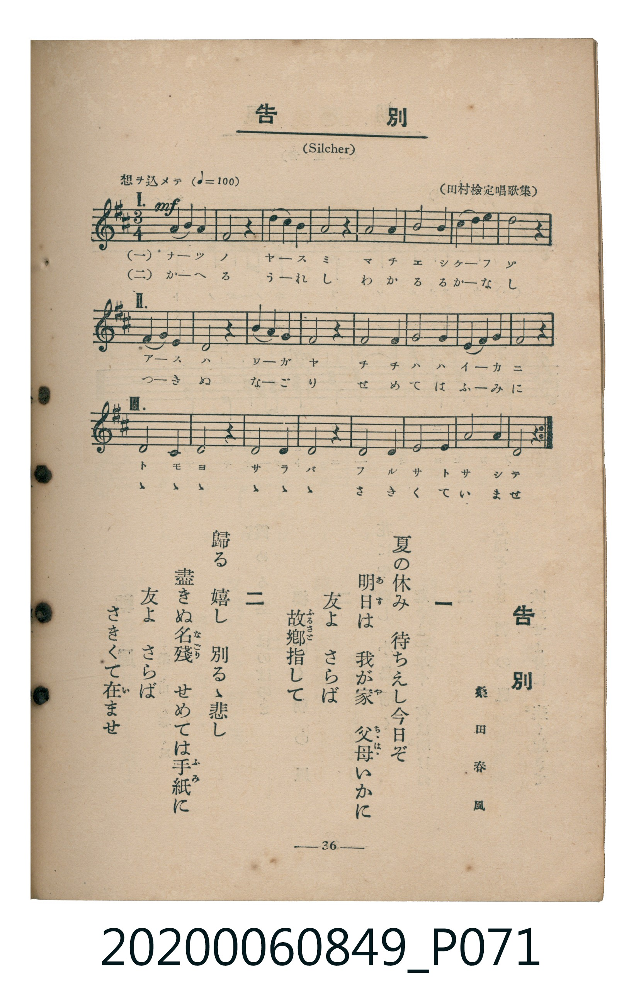

# 告別

> Re:Shōka 使用 AI 協助辨識與重建樂譜，可能會有錯誤。歡迎回報。

- **鋼琴伴奏版**：<br><audio controls src="kokubetsu.mp3"></audio>

- 詞：桑田春風
- 曲：F. Silcher
- 出處：（田村檢定唱歌集）
- 臺灣教育會公認《新定兒童唱歌》高等科女子用（2020.006.0849）

## 說明

原書資訊與歌詞全文（對應 P071.jpg，書頁 p. 36，高一輪唱第 2 首）：
調性與拍號：ニ長調（2 升記號）、3/4 拍（三部輪唱，想ヲ込メテ ♩=100）
出處註記：（田村檢定唱歌集）


## 歌詞

```text
一
夏の休み　待ちえし今日ぞ
明日（あす）は我が家（や）　父母（ちゝはゝ）いかに
友よさらば　故郷（ふるさと）指して

二
歸る嬉し　別るゝ悲し
盡きぬ名殘（なごり）　せめては手紙（ふみ）に
友よさらば　さきくて在（い）ませ
```

## ABC

<div class="abc-score" data-abc-src="kokubetsu.abc" aria-label="五線譜載入中"></div>

[下載 ABC 原始檔](kokubetsu.abc)

## TMD 檔案連結

- [主旋律 TMD 檔案](kokubetsu.tmd) [[在 TMD Studio 編輯](https://tmdlang.github.io/Tmd-TS/#tmd=s7IKdvYPcrWy4qpTUCpJTLdSSM7PyUlNLsnMz7MqzsjMK0nNjM_KTMmPL87Iz05Ugisry88pzU21ys4vyY9PzyzKKY43MjAyiDcwMIs3sDCxRCgszi8tSk61Kk7OyM_PiS9JrShJys_PRpePL0hMT7UKMDA3RMgUFOWXpeYl5gF1FxSBXJIC1o5QkFqWmZIKki5OTsyLL0stykzLTE1BcmNqUTHYHxArSooS84qTizILQJ5DqMovKsnITy9KLMiotMrILC7JL8pMTsyJz07MQ_JuSUYq0LepufnoejPTM_OsclMzszKx-A0qXZ5aXJJalBefm5qTn1KJIV2SmAkMXFAAlyfG5yZm5uUk5gF9oaWl8HRi19OOpQpaWlyKtgqGBgZc9rYKLlw2xvomdiBDXqyc937PrGcLJz6fsuHZjKUvF60Am_1s9iagsJueQnBmTnJGahFY8Gn7rhczpwLF3-_pACmfO_HZqkVP1816OmXjs7U9L2e3vd_TCVb4on3X88bFz6bOfNG06dmc5qeta16s6n3c0PVs2gaQ8tZJz1cvhWh63ND9cvWM52s7ny-f-HTp5qdrJzyfsgJoPCgh6AETgh4oIYCN5dLXUrClFuBSUFB42jf_2ewdLza3v1jR9aKjHegYYFg8bV3xbFo70AFPN_Q-a-9UAKUmvayC9Pd7eoCKXy5oVCjQUzA2A3KBzn6yo-HFnlVAjzxfs0bBSOHlsmlAlwKDB2T6i1X7nzUsB5nb3fti5nyg6OPm7pdTtwPFQd5TeNoLtHcGWKbzcUMjMDoUgCqBUk92dL5sXgExF2Rr8-bHzZte7NvzuHnh4-Y2hUczV9oCYxGoC-wHcIy8WLEbaBb-eOECKQc6GKxrSf_jxnVP9kx83Lj_cUPD032tjxsXPm7seNw4_cnurmfTlz5unAdS92xGH5ADNPRxY9Pjxpkglzauf9YB1NbzdN02kHhTC9j5Dc87tj1bD3I9yKCmuUBlQBKsvuVxY_fjxtVga_u7HzcBVUx93ASU2ADU9mxq68vm7WBtWx83AdVNfdwIjP3OZz3tQLc8blwGcfWuHrBr1u4Aqnm6Bqh3OsjVHUtBWprmPmvaBBQBqXg-G-iL3seNa55O6H22DhggQHNXPW6c8ripC-LMx42zHzc1As0F-aOz-_kWoJ_AdjcCIwVoLg5ngt0FNBcYasuezgElT6C_wBr2AU0E6aE8RUKBgpY-F5cvMP9aBWQm5uUbOtQY1FSDbFCwsdCyAzOA-QCY3kBpb2GPgoanniZID0iiRqE6N61WwVRBV8EMiEF0jYIxkARBAzDPMA5ImUMV1ICVICRhPIhGkAoQhKgE6QFrNgIRUIPgWsHW-xjWKDxu7gLyHzfvAZMtYKWPm_ugauOh_CUINU07oWLz0dTMg_IfNzdCRJpWwESatkNFNiLZNRUqtg_ZHIi7jIDijd0ItY07oGpBYkh2NrYhuasHKjYdVU1TP8wVYBORTYGw0O1ahc0ccLKGReSuHkhEosQkKNpMgNgIrN0QqhkST7DIBcmjRzCMB6JrwCpAEKISZBbMXDR9iAhsWoQUCLDIgXkaFjnrkdSsgYqBIhVZDSjaUCIQbgqEBbILOSGshqpCiRSkCERS29gLUdsIshs5AkGBDVMzBWoHKEEiq5kNc0UT1F2Ny2AijSB_gUS2IpmzHyoGch_2CNzRCY1AlBiExZkpxGLUKITxQDR-OVCkgSAkIaBmURR9SHmwA-ahZlBkgkRgeQeWikEehKhYCVUxAVUFOD9BVEAjBkkPyHwUEViOBNZP2CMPkXeboHphboRFC9y-pk6oyAZcKuDRj8iLoCgEiYBKHIgIqBxAjm60aFvbCaz1ILkPWPtC6tznWyc8mztfQcPQTOHphv7n6xuQYhMUxDBIBx48MkHORqihOQ8eZfS2dzSY6WJvLXLjwghH4wKeN3Y0AHMFsBH5dF0PUovDYjR3DEjuGG33jbb7Rtt94EAdbfch9I22-8hq96G0-EartIFtiRgTbomAWum7eoBxNto-H22f05o32tAbbeiNNvRGG3qjDT1YUA6Vhh6wWaFrpwBqWSgAaWUuAA)]
- [鋼琴伴奏 TMD 檔案](kokubetsu_piano.tmd) [[在 TMD Studio 編輯](https://tmdlang.github.io/Tmd-TS/#tmd=s7IKdvYPcrWy4qpTUCpJTLdSSM7PyUlNLsnMz7MqzsjMK0nNjM_KTMmPL87Iz05Ugisry88pzU21ys4vyY9PzyzKKY43MjAyiDcwMIs3sDCxRCgszi8tSk61Kk7OyM_PiS9JrShJys_PRpePL0hMT7UKMDA3RMgUFOWXpeYl5gF1FxSBXJIC1o5QkFqWmZIKki5OTsyLL0stykzLTE1BcmNqUTHYHxArSooS84qTizILQJ5DqMovKsnITy9KLMiotMrILC7JL8pMTsyJz07MQ_JuYhFQc3pqbmpeiVVBZmJefnxicnJ-bkFiXiZIDKGwJAOoyCo1Nx_dksz0zDyr3NTMrEwsgQCVLk8tLkktyovPTc3JT6nEkC5JzATGAigmyhPjcxMz83IS84De1dJSeDqx62nH0vd7Ol5273k-YcuTPVueLu1_3tnxfk-ngpYWl6KtgqGBAZe9rYILl42xvokdyOQXK-e93zPr2cKJz6dseDZj6ctFK8AWPpu9CSjspqcQnJmTnJFaBBZ82r7rxcypQHGgFSDlcyc-W7Xo6bpZT6dsfLa25-XsNqBFYIUv2nc9b1z8bOrMF02bns1pftq65sWq3scNXc-mbQApb530fPVSiKbHDd0vV894vrbz-fKJT5dufrp2wvMpK4DGg5KRHjAZ6YGSEdhYLl-gV60CQKFu6FBjUFPNpQAENhZadmCGvpbC8zVrnuxoeLGwR0HDU09TQUsfLFGjUJ2bVqtgqqCrYAbEILpGwRhIgqABmGcYB6TMoQpqwEoQkjAeRCNIBQhCVIL0gDUbgQioQXCtYOt9DGsUHjd3AfmPm_eAyRaw0sfNfVC18VD-EoSapp1QsfloauZB-Y-bGyEiTStgIk3boSIbkeyaChXbh2wOxF1GQPHGboTaxh1QtSAxJDsb25Dc1QMVm46qpqkf5gqwicimQFjodq3CZg4XckTu6oFEJEpMgqLNBIiNwNoNoZoh8QSLXJA8egTDeCC6BqwCBCEqQWbBzEXTh4jApkVIgQCLHJinYZGzHknNGqgYKFKR1YCiDSUC4aZAWCC7kBPCaqgqlEhBikAktY29ELWNILuRIxAU2DA1U6B2gBIksprZMFc0Qd3VuAwm0gjyF0hkK5I5-6FiIPdhj8AdndAIRIlBWJyZQixGjUIYD0TjlwNFGghCEgJqFkXRh5QHO2AeagZFJkgElndgqRjkQYiKlVAVE1BVgPMTRAU0YpD0gMxHEYHlyGZQDsIWeYi82wTVC3MjLFrg9jV1QkU24FIBj35EXgRFIUgEVOJAREDlAHJ0o0Xb2s6n-1ohue9xQyMwCl82r3i-dcKzufMVNAzNFJ5u6H--vgEpNkFBDIN04MEjE-RshBqa8-BRRm97R4OZLvbWIjcujHA0LuB5Y0cDMFcAWy9P1_UgtTgsRnPHgOSO0XbfaLtvtN0HDtTRdh9C32i7j6x2H0qLb7RKG9iWiDHhlgiolb6rBxhno-3z0fY5rXmjDb3Rht5oQ2-0oTfa0IMF5VBp6KE0K3w8kNoVJtB2BbAQLahVMIwHqTcFksBQBrMN4CwQiUvUCMwGkcC4wmYGLHGMmj9A5gNTgK6dAigRKABpZS4A)]

## 分析

```text
================================================================================
📊 TMD Song Profile: [ 告別 ]
================================================================================
⏱  Duration:       1:12 (72.0s), 40 measures total
🎼 Key & Tempo:    首調基準 D, != 100.0 BPM, <3/4>
   - 分析範圍：      由實際發聲的音符與和弦推測調性；播放脈絡另行呈現
🎤 人聲音域:    A3 (MIDI 57) – E5 (MIDI 76) [跨度: 19 個半音 / 1.6 個八度, 難度: challenging]
   - 最低音:  A3 in [Main #1 @ m.17, 0:30]
   - 最高音: E5 in [Main #1 @ m.7, 0:12]
   - 適合: soprano, mezzo-soprano, contralto, tenor, baritone, bass
🏛  結構:      Main (72.0s)
⚡ 編曲密度:        Peak 3 軌道同時演奏
🗝  調性診斷：       D 大調（純淨自然大調，未偵測到可信轉調）
   - 風格氣質:    純淨自然大調（陽光明朗、易唱易記，無明顯調外色彩）
   - 轉調歷程:    全曲維持單一推測調性（未偵測到可信轉調）
   - 核心骨幹音:  D, A, F#, E, G
   - 調性數值:    D 大調 [相關度: 0.99, 穩定度: High, 自然音純度: 100.0%]
   - 候選調性 (K-S): D 大調 (0.99), B 小調 (0.67), A 大調 (0.58)
   - 五度圈歷程:   +2
   - 各段落調性細節:
     • [Main #1]: D 大調 (r: 0.99, 自然音純度: 100.0%)

  [ 五度圈游移軌跡 ]
               C  
         F            G  
      Bb              [D ]*
      Eb               A  
         Ab           E  
            Db       B  
               F# 
     (* = active key center)

  [ 十二半音累積音高分佈 ]
     C  :                            0.0%
     C# : ██                         3.2%
     D  : ████████████████████████  31.7%
     D# :                            0.0%
     E  : ███████                    9.5%
     F  :                            0.0%
     F# : █████████████             17.5%
     G  : ███████                    9.5%
     G# :                            0.0%
     A  : ██████████████            19.0%
     A# :                            0.0%
     B  : ███████                    9.5%
--------------------------------------------------------------------------------
Assignment 軌道音域：
  - Piano1        : A3 – E5 (19 個半音 / 1.6 個八度, 45 個音符)
  - Piano2        : A3 – E5 (19 個半音 / 1.6 個八度, 45 個音符)
  - Piano3        : A3 – E5 (19 個半音 / 1.6 個八度, 45 個音符)
================================================================================
```


## 原書掃描頁




