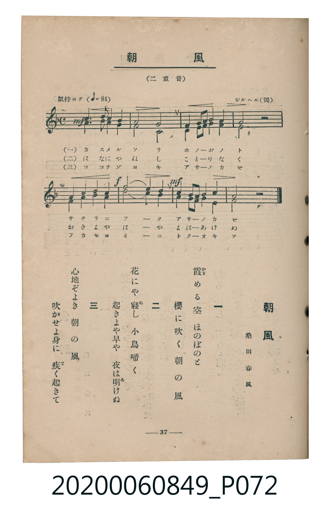

# 朝風

> Re:Shōka 使用 AI 協助辨識與重建樂譜，可能會有錯誤。歡迎回報。

- **鋼琴伴奏版**：<br><audio controls src="asakaze.mp3"></audio>

- 詞：桑田春風
- 曲：F. Silcher（シルヘル）
- 臺灣教育會公認《新定兒童唱歌》高等科女子用（2020.006.0849）

## 說明

原書資訊與歌詞全文（對應 P072.jpg，書頁 p. 37，高一重音第 1 首）：
調性與拍號：ヘ長調（1 降記號）、4/4 拍（二重音，氣持ヨク ♩=84）


## 歌詞

```text
一
霞（かす）める空　ほのぼのと
櫻に吹く　朝の風

二
花にや寢（ね）し　小鳥啼く
起きよや早や　夜は明（あ）けぬ

三
心地ぞよき　朝の風
吹かせよ身に　疾（と）く起きて
```

## ABC

<div class="abc-score" data-abc-src="asakaze.abc" aria-label="五線譜載入中"></div>

[下載 ABC 原始檔](asakaze.abc)

## TMD 檔案連結

- [主旋律 TMD 檔案](asakaze.tmd) [[在 TMD Studio 編輯](https://tmdlang.github.io/Tmd-TS/#tmd=s7IKdvYPcrWy4qpTUCpJTLdSSM7PyUlNLsnMz7MqzsjMK0nNjM_KTMmPL87Iz05Ugisry88pzU21ys4vyY9PzyzKKY43MjAyiDcwMIs3sDCxRCgszi8tSk61Kk7OyM_PiS9JrShJys_PRsgXFOWXpeYl5gHVFBSB7EsBK0IoSC3LTEkFSaemZJbkF2Um5iC5IrWoGOxSsCXxJUWJecXJRZkFIOcjVJVkpAKdWp6aCGQUIYSBZqVn5lnlpmZmZWJxGFS6PLW4JLUoLz43NSc_pRJDuiQxExgyoNApT4zPTczMy0nMS1Hi0tJSeDZn7stFKxS0tLgUbRUsTLjsbRXcuGxM9E3sQGa8WDnv_Z5ZzxZOfD5lw7MZS4EqwUY_m70JKOympxCcmZMMdO37PR2Pm7Y_bl79uHkGkHy_pxOs7EX7rueNi59NnfmiadOzOc1PW9e8WNX7uKHr2bQNT9fNeto66fnqpU-nbHy2tudxQ_fL1TOer-18vnzi06Wbn66d8HzKCqCpoNjSA8aWHii2wMZy6Wsp2FILcCkoKDztm_9s9o4Xm9tfrOh60dEOdAzQ009bVzyb1g50wNMNvc_aOxUCDMyN9LIK0t_v6QEqfrmgUaFAT8HYHMgFOvvJjoaX7b0v529-vmaNgqHCy2XTgC4Fhg_I9Ber9j9rWA4yt7v3xcz5QFFgEL2cuh0oDjQdqHhm74sVM8AynY8bGoHhrgBUCZR6sqsHYijIyg2Ln_U0Pm5e8bhpvcKjmSttLUyAyrlA5gPtBlEv5wDjqeNxY_fjxpkgk5oaHzd1P1-563FDw-PG3Y8b1z1u3AMmV4BUP1sNFFr9dMLOx439QBXAJACUA8YtxMRdPWCHd20Eqnnc1PJ0_SKw0WtB5jZOB6p_uqH_5ealT6cCTewHK926_XFj7-MmYBpoeTZ9JZAEKVoy53Hj-mcz-sCam8CaJz5uXAN1dSc46Pc3P52z4XHjPJBeoAnITgFJgxwI9NFsoPSLXatBzmloeD5tH9hEYOoAmtgPtbtxGUgD5QkCChS09Lm4fIHZxCogsajE0KHGoKYaZIGCjYWWHZgBTIXA2AaG_ouFPSDVILEaherctFpgCtBVMAZiXQUTMF2jYATm6YJlQOwasLgJEJtC1SLUGEDpGnBAwezZ1YNiD8wgmDFAm4EWgwyDWKsLcQnELph7QDyIYpAIql21SN41It27EAONwHSNgnk81FxTEAPMQ3UymjKivGwGNwsRiiBPQ0IaIgJ2D9Q-sHqQUjAf7BIcHte1UwD5XQFIK3MBAA)]
- [鋼琴伴奏 TMD 檔案](asakaze_piano.tmd) [[在 TMD Studio 編輯](https://tmdlang.github.io/Tmd-TS/#tmd=s7IKdvYPcrWy4tLSUng2Z-7LRSve7-l42b3n-YQtT_Zsebq0_3lnx_s9nQpaWlyKtgoWJlz2tgpuXDYm-iZ2XHUKSi9Wznu_Z9azhROfT9nwbMZSoHYlkPCz2ZuAwm56CsGZOckZqUVAMx83bX_cvPpx8wwgCTQQrOxF-67njYufTZ35omnTsznNT1vXvFjV-7ih69m0DU_XzXraOun56qVPp2x8trbncUP3y9Uznq_tfL584tOlm5-unfB8CsilRgZGBnoGBmZ6BhYmlmBjuXwTM_OsAjIT8_KDPBxqDGqquRSAwMZCyw7M0NdSeL5mzZMdDS8W9iho6YPFahSqc9NqFQwVdBWMgVhXwQRM1ygYgXm6YBkQuwYsbgLEplC1CDUGULqGC9meXT0o9sAMghkDtBloMcgwiLW6EJdA7IK5B8SDKAaJoNpVi-xhH2QPm0A9DNQVD1QabRgLNsI0HsaLNo2PhciCWWgKQEIGQAsgRpggKYo2gWqDqgJpAsnDjAQ7FGYJyAigG3XtFEDOVMBCK3MBAA)]

## 分析

```text
================================================================================
📊 TMD Song Profile: [ 朝風 ]
================================================================================
⏱  Duration:       0:22 (22.9s), 8 measures total
🎼 Key & Tempo:    首調基準 F, != 84.0 BPM, <4/4>
   - 分析範圍：      由實際發聲的音符與和弦推測調性；播放脈絡另行呈現
🎤 人聲音域:    F4 (MIDI 65) – C5 (MIDI 72) [跨度: 7 個半音 / 0.6 個八度, 難度: easy]
   - 最低音:  F4 in [Main #1 @ m.1, 0:00]
   - 最高音: C5 in [Main #1 @ m.3, 0:07]
   - 適合: soprano, mezzo-soprano, contralto, tenor, baritone, bass
🏛  結構:      Main (22.9s)
⚡ 編曲密度:        Peak 2 軌道同時演奏
🗝  調性診斷：       F 大調（純淨自然大調，未偵測到可信轉調）
   - 風格氣質:    純淨自然大調（陽光明朗、易唱易記，無明顯調外色彩）
   - 轉調歷程:    全曲維持單一推測調性（未偵測到可信轉調）
   - 核心骨幹音:  F, G, A, E, C
   - 調性數值:    F 大調 [相關度: 0.77, 穩定度: High, 自然音純度: 100.0%]
   - 候選調性 (K-S): F 大調 (0.77), C 大調 (0.60), D 小調 (0.52)
   - 五度圈歷程:   -1
   - 各段落調性細節:
     • [Main #1]: F 大調 (r: 0.77, 自然音純度: 100.0%)

  [ 五度圈游移軌跡 ]
               C  
        [F ]*          G  
      Bb               D  
      Eb               A  
         Ab           E  
            Db       B  
               F# 
     (* = active key center)

  [ 十二半音累積音高分佈 ]
     C  : ████████                   8.9%
     C# :                            0.0%
     D  : ███                        3.6%
     D# :                            0.0%
     E  : ████████████              14.3%
     F  : ████████████████████████  27.7%
     F# :                            0.0%
     G  : ██████████████████        20.5%
     G# :                            0.0%
     A  : ███████████████           17.0%
     A# : ███████                    8.0%
     B  :                            0.0%
--------------------------------------------------------------------------------
Assignment 軌道音域：
  - Part1         : F4 – C5 (7 個半音 / 0.6 個八度, 24 個音符)
  - Part2         : C4 – A4 (9 個半音 / 0.8 個八度, 24 個音符)
================================================================================
```


## 原書掃描頁




