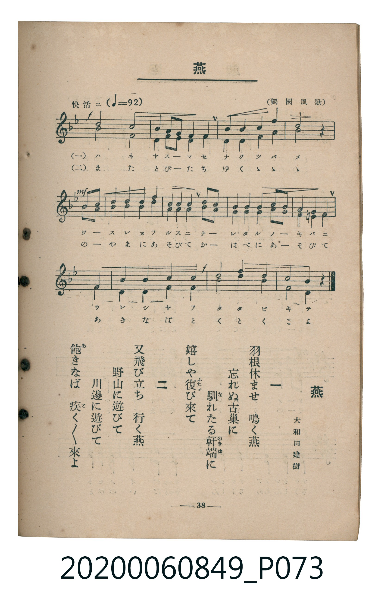

# 燕

<audio controls src="tsubame.mp3"></audio>

- 詞：大和田建樹
- 曲：（獨國風歌）
- 臺灣教育會公認《新定兒童唱歌》高等科女子用（2020.006.0849）

## 說明

原書資訊與歌詞全文（對應 P073.jpg，書頁 p. 38，高一重音第 2 首）：
調性與拍號：ヘ長調（1 降記號）、4/4 拍（二重音，快活ニ ♩=92）
出處註記：（獨國風歌）

## 歌詞

```text
一
羽根休ませ　鳴く燕
忘れぬ古巢に　馴（な）れたる軒端（のきば）に
嬉しや復（ふたゝ）び來て

二
又飛び立ち　行く燕
野山に遊びて　川邊に遊びて
飽（あ）きなば疾（と）く〳〵來よ
```

## ABC

```abc
X:1
T:燕
C:曲：（獨國風歌）
M:4/4
L:1/16
Q:1/4=92
K:F
V:V1 name="Part1" snm="Par"
V:V2 name="Part2" snm="Par"
[V:V1]
!f! c8 c8 | B4 A2 G2 A4 F4 | B4 B4 c4 e4 | !mf! c8 z4 A2 B2 |
c4 c4 c4 d4 | c4 B4 A4 G2 A2 | B4 B4 B4 c2 B2 | A4 G4 A4 C4 |
F4 G4 A4 B4 | !f! c8 f4 d4 | A8 F4 z4 | !f! c8 c8 |
B4 A2 G2 A4 F4 | B4 B4 c4 e4 | !mf! c8 z4 A2 B2 | c4 c4 c4 d4 |
c4 B4 A4 G2 A2 | B4 B4 B4 c2 B2 | A4 G4 A4 C4 | F4 G4 A4 B4 |
!f! c8 f4 d4 | A8 F4 z4 |
[V:V2]
!f! A8 F8 | D4 C2 C2 F4 F4 | F4 F4 E4 C4 | !mf! A8 z4 F2 G2 |
A4 A4 A4 B4 | A4 G4 F4 E2 F2 | G4 G4 G4 A2 G2 | F4 E4 F4 C4 |
F4 E4 F4 D4 | !f! A8 A4 B4 | C8 F4 z4 | !f! A8 F8 |
D4 C2 C2 F4 F4 | F4 F4 E4 C4 | !mf! A8 z4 F2 G2 | A4 A4 A4 B4 |
A4 G4 F4 E2 F2 | G4 G4 G4 A2 G2 | F4 E4 F4 C4 | F4 E4 F4 D4 |
!f! A8 A4 B4 | C8 F4 z4 |
```

## TMD 檔案連結

- [主旋律 TMD 檔案](tsubame.tmd)
- [鋼琴伴奏 TMD 檔案](tsubame_piano.tmd)

## 分析

```text
================================================================================
📊 TMD Song Profile: [ 燕 ]
================================================================================
⏱  Duration:       0:57 (57.4s), 22 measures total
🎼 Key & Tempo:    首調基準 F, != 92.0 BPM, <4/4>
   - 分析範圍：      由實際發聲的音符與和弦推測調性；播放脈絡另行呈現
🎤 人聲音域:    C4 (MIDI 60) – F5 (MIDI 77) [跨度: 17 個半音 / 1.4 個八度, 難度: challenging]
   - 最低音:  C4 in [Main #1 @ m.8, 0:20]
   - 最高音: F5 in [Main #1 @ m.10, 0:24]
   - 適合: soprano, mezzo-soprano, contralto, tenor, baritone, bass
🏛  結構:      Main (28.7s) -> Main (28.7s)
⚡ 編曲密度:        Peak 2 軌道同時演奏
🗝  調性診斷：       F 大調（純淨自然大調，未偵測到可信轉調）
   - 風格氣質:    純淨自然大調（陽光明朗、易唱易記，無明顯調外色彩）
   - 轉調歷程:    全曲維持單一推測調性（未偵測到可信轉調）
   - 核心骨幹音:  A, C, F, A#, G
   - 調性數值:    F 大調 [相關度: 0.90, 穩定度: High, 自然音純度: 100.0%]
   - 候選調性 (K-S): F 大調 (0.90), A 小調 (0.75), C 大調 (0.64)
   - 五度圈歷程:   -1 -> -1
   - 各段落調性細節:
     • [Main #1]: F 大調 (r: 0.90, 自然音純度: 100.0%)
     • [Main #2]: F 大調 (r: 0.90, 自然音純度: 100.0%)

  [ 五度圈游移軌跡 ]
               C  
        [F ]*          G  
      Bb               D  
      Eb               A  
         Ab           E  
            Db       B  
               F# 
     (* = active key center)

  [ 十二半音累積音高分佈 ]
     C  : ███████████████████████   23.2%
     C# :                            0.0%
     D  : █████                      4.8%
     D# :                            0.0%
     E  : █████                      5.4%
     F  : ████████████████████      20.2%
     F# :                            0.0%
     G  : ██████████                 9.5%
     G# :                            0.0%
     A  : ████████████████████████  23.8%
     A# : █████████████             13.1%
     B  :                            0.0%
--------------------------------------------------------------------------------
Assignment 軌道音域：
  - Part1         : C4 – F5 (17 個半音 / 1.4 個八度, 82 個音符)
  - Part2         : C4 – A#4 (10 個半音 / 0.8 個八度, 82 個音符)
================================================================================
```


## 原書掃描頁




