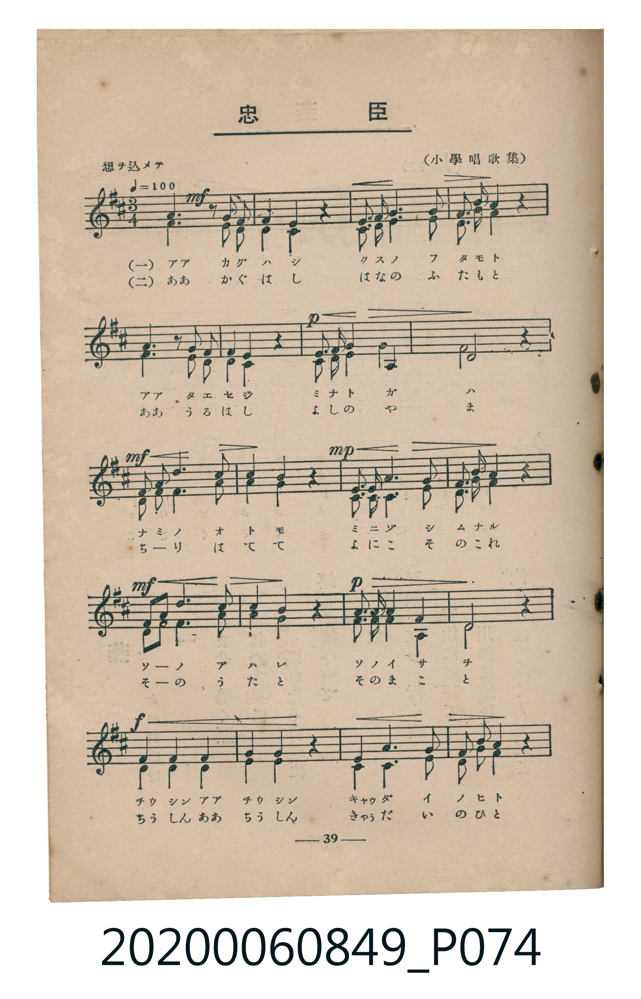
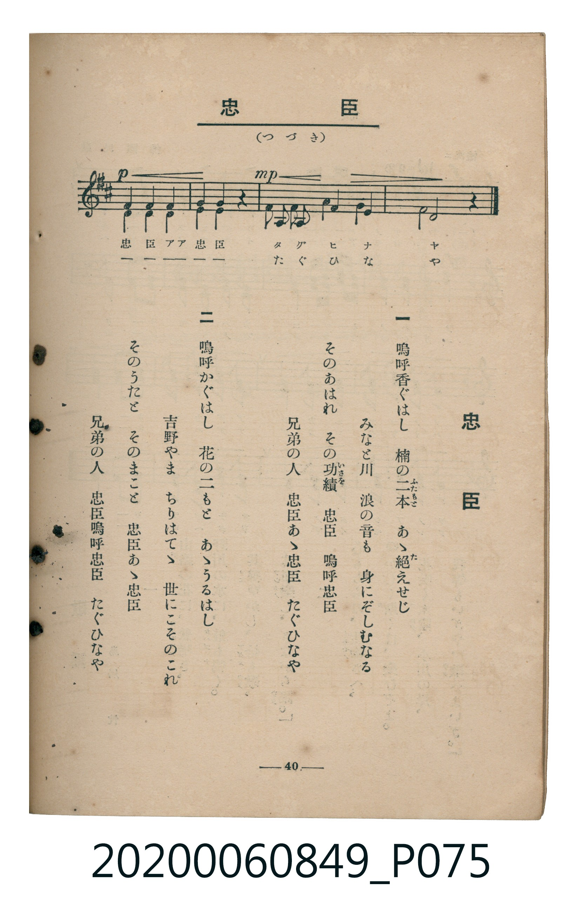

# 忠臣

<audio controls src="chushin.mp3"></audio>

- 出處：（小學唱歌集）
- 臺灣教育會公認《新定兒童唱歌》高等科女子用（2020.006.0849）

## 說明

原書資訊與歌詞全文（對應 P074.jpg – P075.jpg，書頁 pp. 39–40，高一重音第 3 首）：
調性與拍號：ロ短調（2 升記號）、3/4 拍（想ヲ込メテ ♩=100）
出處註記：（小學唱歌集）

## 歌詞

```text
一
嗚呼香ぐはし　楠の二本（ふたもと）　あゝ絶（た）えせじ
みなと川　浪の音も　身にぞしむなる
そのあはれ　その功績（いさを）　忠臣　嗚呼忠臣
兄弟の人　忠臣あゝ忠臣　たぐひなや

二
嗚呼かぐはし　花の二もと　あゝうるはし
吉野やま　ちりはてゝ　世にこそのこれ
そのうたと　そのまこと　忠臣あゝ忠臣
兄弟の人　忠臣嗚呼忠臣　たぐひなや
```

## ABC

```abc
X:1
T:忠臣
M:3/4
L:1/16
Q:1/4=100
K:Bm
V:V1 name="Part1" snm="Par"
V:V2 name="Part2" snm="Par"
[V:V1]
!mf! D6 z2 B,2 C2 | F4 F4 z4 | E2 E2 F6 E2 | D2 E2 F4 z4 |
B6 z2 G2 E2 | D4 C4 z4 | !p! E2 E2 B,4 C4 | B,8 z4 |
!mf! D2 D2 F6 G2 | F4 E4 z4 | !mp! D2 D2 E6 F2 | E2 D2 C4 z4 |
!mf! F2 G2 A6 F2 | G4 F4 z4 | !p! E2 E2 B,4 C4 | B,8 z4 |
!f! D4 D4 D4 | E4 E4 z4 | D4 F6 G2 | F2 E2 F4 z4 |
!p! E4 E4 E4 | F4 F4 z4 | !mp! E2 E2 B4 F4 | B,8 z4 |
!mf! D6 z2 B,2 C2 | F4 F4 z4 | E2 E2 F6 E2 | D2 E2 F4 z4 |
B6 z2 G2 E2 | D4 C4 z4 | !p! E2 E2 B,4 C4 | B,8 z4 |
!mf! D2 D2 F6 G2 | F4 E4 z4 | !mp! D2 D2 E6 F2 | E2 D2 C4 z4 |
!mf! F2 G2 A6 F2 | G4 F4 z4 | !p! E2 E2 B,4 C4 | B,8 z4 |
!f! D4 D4 D4 | E4 E4 z4 | D4 F6 G2 | F2 E2 F4 z4 |
!p! E4 E4 E4 | F4 F4 z4 | !mp! E2 E2 B4 F4 | B,8 z4 |
[V:V2]
!mf! B,6 z2 G,2 ^A,2 | D4 B,4 z4 | C2 C2 D6 C2 | B,2 C2 D4 z4 |
D6 z2 E2 C2 | B,4 F,4 z4 | !p! A,2 A,2 G,4 F,4 | B,8 z4 |
!mf! B,2 B,2 D6 E2 | D4 C4 z4 | !mp! B,2 B,2 A,6 A,2 | G,2 G,2 F,4 z4 |
!mf! D2 E2 F6 D2 | E4 D4 z4 | !p! A,2 A,2 G,4 F,4 | B,8 z4 |
!f! G,4 G,4 G,4 | A,4 A,4 z4 | B,4 D6 E2 | D2 C2 D4 z4 |
!p! C4 C4 C4 | D4 D4 z4 | !mp! A,2 A,2 D4 C4 | B,8 z4 |
!mf! B,6 z2 G,2 ^A,2 | D4 B,4 z4 | C2 C2 D6 C2 | B,2 C2 D4 z4 |
D6 z2 E2 C2 | B,4 F,4 z4 | !p! A,2 A,2 G,4 F,4 | B,8 z4 |
!mf! B,2 B,2 D6 E2 | D4 C4 z4 | !mp! B,2 B,2 A,6 A,2 | G,2 G,2 F,4 z4 |
!mf! D2 E2 F6 D2 | E4 D4 z4 | !p! A,2 A,2 G,4 F,4 | B,8 z4 |
!f! G,4 G,4 G,4 | A,4 A,4 z4 | B,4 D6 E2 | D2 C2 D4 z4 |
!p! C4 C4 C4 | D4 D4 z4 | !mp! A,2 A,2 D4 C4 | B,8 z4 |
```

## TMD 檔案連結

- [主旋律 TMD 檔案](chushin.tmd) [[在 TMD Studio 編輯](https://tmdlang.github.io/Tmd-TS/#tmd=s7IKdvYPcrWy4tLSUni6f8GL9sUKWlpcirYKhgYGXPa2Ci5c2amVtgpOuVw2xvomdlx1CkpP23e9mDn1_Z5Z7_d0PN3Q_3TtjqdTNj5b2_Nydtv7PZ1KICUv2nc9b1z8bOrMF02bns1pftq65sWq3scNXc-mbXi6btbT1knPVy-FaHrc0P1y9YznazufL5_4dOnmp2snPJ-yAmiwkYGRgZ6BgZmegYWJJdhYLn0tBVtqAS4FBYWnffOfzd7xYnP7ixVdLzragY55sXLe09YVz6a1g33W-6y9UyHAwNxEL6sgXeFRw2QQxxTEeb-nB6jz5YJGhYICPQVjS6CciQFQEOiTJzsaXrb3vpy_-fmaNQrGCi-XTQM6HhhWIAtfrNr_rGE5yKru3hcz5wNFHzevfT5_LVAc5GOFp71Ap8wAy3Q-bmgEhrcCUCVQ6lnz5sfNm17s2_O4eeHj5jaFRzNX2gLjB6gM7A9wfLxYsRuoGVescIEUAt0GVj991tOJe14um_m4ccLjxvWPG6c_bmh4tnTB48Z1T3b1PJuzBmjC48atjxvnP25qetwIjA2gaxoeNzY9bpr7fOs2sCzYiY1AxuzHjTNAhj5u3P-4cRVQ9dPtc0HGbQWy1wGDAWREQ8OLXasfNwLRPJBlTUCzVj1u6oZomwtUBzIb6JAmYGoAyoFEnnbNf75jH9iqlseNUx83TYK4ApJEQQywJyBcsKdaW57umQ_2wi6EOrCb4XpAPgJ5eRPY_hZImOzqQYTJ48Zu5DB50bUREiaQcIAHwuPGNqDzIcrAmid0vmzvA5r4uHEfWNHCx01dYOllINUNDU92TAN7fzLMu5OBfkX2fhvYaRAbICL7wKpBIphewelf5EDB4l-gNspzDhQoaOlzcfkmZuZZBSQWlRg61BjUKFSDbFCwMTTTsgOzgBkWmAuAqe7Fwh6QepAYUFVuWq2CoYIuHBoAsVk8kDAHETXAXAMRh9EgeRCsgRpgBGSDMEweBEH8GrCpyDIIncju2dWD4h4zNKeYoBgHgmB3YXNJdUEt3DVgH6CoBhoNYyKbj-mgHZ3YAwiEkT0JchkieECWYnVULtBVMO0wRbDwhIQeSAaLp5Dc9HT2bEw3gQwAucEUw1CQKL4oo1JA7ZqC6iikhIROQzyKL5xgKrGHMMFk9LR1LapjoF5EthJGE07T4EiDhxCaYrzhU4uUDY1IzYYo5oITP0jAVB2SEWEhBFeF7mpwDIIJ5PwMzcaILA2TJCo7opcMoABBNhEcMPgypCnYCyAC7BkU9RRlSbBWMIHsRmKLClAEI0wAuw8GwRxgJoK7GYv_COVN9KIPBEFiiHyAGQtUDjMsuRNuGiajBhEGcAa60-AWYw9wwokLWyaFRxEmAxGPOAMLFI2I0MKIdkJZVddOAZRbFZBoZS4uAA)]
- [鋼琴伴奏 TMD 檔案](chushin_piano.tmd) [[在 TMD Studio 編輯](https://tmdlang.github.io/Tmd-TS/#tmd=s7IKdvYPcrWy4tLSUni6f8GL9sXv93S87N7zfMKWJ3u2PF3a_7yz4_2eTgUtLS5FWwVDAwMue1sFF67s1EpbBadcLhtjfRM7rjoFpaftu17MnPp-zyyg9qcb-p-u3fF0ysZna3tezm4DalcCKXnRvut54-JnU2e-aNr0bE7z09Y1L1b1Pm7oejZtw9N1s562Tnq-eilE0-OG7perZzxf2_l8-cSnSzc_XTvh-ZQVQIONDIwM9AwMzPQMLEwswcZy-SZm5lkFZCbm5Qd5ONQY1ChUcykAgY2hmZYdmKWvpfB8zZonOxpeLOxR0NIHiwFV5abVKhgq6MKhARCbxQMJcxBRo2AMFYfRIHkQrIEaYARkgzBMHgRB_BqwqcgyCJ3I7tnVg-IeMzSnmKAYB4Jgd2FzSXVBLdw1YB-gqAYaDWMim4_poB2d2AMIhJE9CXIZInhAlmJ1VC7QVTDtMEWw8ISEHkgGi6eQ3PR09mxMN4EMALnBFMNQkCi-KKNSQO2aguoopISETkM8ii-cYCqxhzDBZPS0dS2qY6BeRLYSRhNO0-BIg4cQmmK84VOLnBF9UDKiCTQfgvTHK0SbxefGQklkEQOQ80A843igNIhAk8U0wwhiBlwXyAgjhDRRZkDdgWIGWNoU5AwQAUxWSJKwWIOpMIQrALKIdgBYgwlIP4ioUTCF2Qi3HtN1aEbgDStCrgDGlq6dAijCFJBoZS4uAA)]

## 分析

```text
================================================================================
📊 TMD Song Profile: [ 忠臣 ]
================================================================================
⏱  Duration:       1:26 (86.4s), 48 measures total
🎼 Key & Tempo:    首調基準 D, != 100.0 BPM, <3/4>
   - 分析範圍：      由實際發聲的音符與和弦推測調性；播放脈絡另行呈現
🎤 人聲音域:    B3 (MIDI 59) – B4 (MIDI 71) [跨度: 12 個半音 / 1.0 個八度, 難度: easy]
   - 最低音:  B3 in [Main #1 @ m.1, 0:01]
   - 最高音: B4 in [Main #1 @ m.5, 0:07]
   - 適合: soprano, mezzo-soprano, contralto, tenor, baritone, bass
🏛  結構:      Main (43.2s) -> Main (43.2s)
⚡ 編曲密度:        Peak 2 軌道同時演奏
🗝  調性診斷：       B 小調（純淨自然小調，未偵測到可信轉調）
   - 風格氣質:    純淨自然小調（陰鬱抒情、旋律集中，無明顯調外色彩）
   - 轉調歷程:    全曲維持單一推測調性（未偵測到可信轉調）
   - 核心骨幹音:  D, B, F#, E, C#
   - 調性數值:    B 小調 [相關度: 0.91, 穩定度: High, 自然音純度: 99.6%]
   - 候選調性 (K-S): B 小調 (0.91), D 大調 (0.74), F# 小調 (0.52)
   - 五度圈歷程:   +5 -> +5
   - 各段落調性細節:
     • [Main #1]: B 小調 (r: 0.91, 自然音純度: 99.6%, 調外音: A#)
     • [Main #2]: B 小調 (r: 0.91, 自然音純度: 99.6%, 調外音: A#)

  [ 五度圈游移軌跡 ]
               C  
         F            G  
      Bb               D  
      Eb               A  
         Ab           E  
            Db      [B ]*
               F# 
     (* = active key center)

  [ 十二半音累積音高分佈 ]
     C  :                            0.0%
     C# : ████████████              10.6%
     D  : ████████████████████████  21.2%
     D# :                            0.0%
     E  : ████████████████          14.4%
     F  :                            0.0%
     F# : ████████████████████      17.8%
     G  : █████████                  8.1%
     G# :                            0.0%
     A  : ████████                   7.2%
     A# :                            0.4%
     B  : ███████████████████████   20.3%
--------------------------------------------------------------------------------
Assignment 軌道音域：
  - Part1         : B3 – B4 (12 個半音 / 1.0 個八度, 134 個音符)
  - Part2         : F#3 – F#4 (12 個半音 / 1.0 個八度, 134 個音符)
================================================================================
```


## 原書掃描頁






