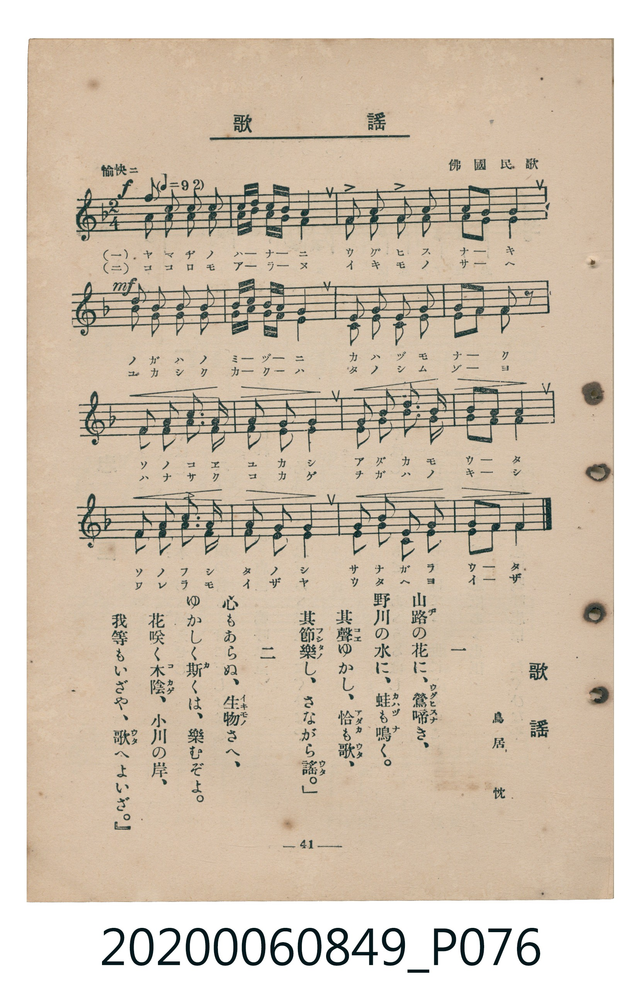

# 歌謠

<audio controls src="kayo.mp3"></audio>

- 詞：鳥居忱
- 曲：佛國民歌
- 臺灣教育會公認《新定兒童唱歌》高等科女子用（2020.006.0849）

## 說明

原書資訊與歌詞全文（對應 P076.jpg，書頁 p. 41，高一重音第 4 首）：
調性與拍號：ヘ長調（1 降記號）、2/4 拍（二重音，愉快ニ ♪=92）

## 歌詞

```text
一
山路（やまぢ）の花に、鶯（うぐひす）啼（な）き、
野川の水に、蛙（かはづ）も鳴（な）く。
其聲（こゑ）ゆかし、恰（あだか）も歌（うた）、
其節樂（ふしたの）し、さながら謠（うた）。

二
心もあらぬ、生物（いきもの）さへ、
ゆかしく斯（か）くは、樂むぞよ。
花咲く木陰（こかげ）、小川の岸、
我等もいざや、歌（うた）へよいざ。
```

## ABC

```abc
X:1
T:歌謠
C:曲：佛國民歌
M:2/4
L:1/16
Q:1/4=92
K:F
V:V1 name="Part1" snm="Par"
V:V2 name="Part2" snm="Par"
[V:V1]
!f! c2 a2 f2 f2 | g a b g f4 | g2 g2 a2 a2 | g2 a2 g4 |
!mf! c2 a2 f2 f2 | g a b g f4 | g2 g2 a2 a2 | g2 e2 f2 z2 |
f2 g2 a2 f2 | g2 e2 f2 f2 | g2 a2 b2 g2 | a2 b2 c4 |
c2 a2 f2 f2 | g2 a2 g2 g2 | f2 d2 c2 b2 | a2 g2 f4 |
!f! c2 a2 f2 f2 | g a b g f4 | g2 g2 a2 a2 | g2 a2 g4 |
!mf! c2 a2 f2 f2 | g a b g f4 | g2 g2 a2 a2 | g2 e2 f2 z2 |
f2 g2 a2 f2 | g2 e2 f2 f2 | g2 a2 b2 g2 | a2 b2 c4 |
c2 a2 f2 f2 | g2 a2 g2 g2 | f2 d2 c2 b2 | a2 g2 f4 |
[V:V2]
!f! a2 f2 f2 f2 | e f g e f4 | e2 e2 f2 f2 | e2 f2 e4 |
!mf! a2 f2 f2 f2 | e f g e f4 | c2 c2 d2 d2 | c2 c2 F2 z2 |
d2 c2 d2 d2 | c2 c2 d2 d2 | e2 f2 g2 e2 | f2 g2 a4 |
a2 f2 f2 f2 | e2 f2 e2 e2 | d2 g2 f2 d2 | f2 e2 f4 |
!f! a2 f2 f2 f2 | e f g e f4 | e2 e2 f2 f2 | e2 f2 e4 |
!mf! a2 f2 f2 f2 | e f g e f4 | c2 c2 d2 d2 | c2 c2 F2 z2 |
d2 c2 d2 d2 | c2 c2 d2 d2 | e2 f2 g2 e2 | f2 g2 a4 |
a2 f2 f2 f2 | e2 f2 e2 e2 | d2 g2 f2 d2 | f2 e2 f4 |
```

## TMD 檔案連結

- [主旋律 TMD 檔案](kayo.tmd)
- [鋼琴伴奏 TMD 檔案](kayo_piano.tmd)

## 分析

```text
================================================================================
📊 TMD Song Profile: [ 歌謠 ]
================================================================================
⏱  Duration:       0:41 (41.7s), 32 measures total
🎼 Key & Tempo:    首調基準 F, != 92.0 BPM, <2/4>
   - 分析範圍：      由實際發聲的音符與和弦推測調性；播放脈絡另行呈現
🎤 人聲音域:    E4 (MIDI 64) – D5 (MIDI 74) [跨度: 10 個半音 / 0.8 個八度, 難度: easy]
   - 最低音:  E4 in [Main #1 @ m.8, 0:09]
   - 最高音: D5 in [Main #1 @ m.15, 0:18]
   - 適合: soprano, mezzo-soprano, contralto, tenor, baritone, bass
🏛  結構:      Main (20.9s) -> Main (20.9s)
⚡ 編曲密度:        Peak 2 軌道同時演奏
🗝  調性診斷：       F 大調（純淨自然大調，未偵測到可信轉調）
   - 風格氣質:    純淨自然大調（陽光明朗、易唱易記，無明顯調外色彩）
   - 轉調歷程:    全曲維持單一推測調性（未偵測到可信轉調）
   - 核心骨幹音:  F, G, A, E, C
   - 調性數值:    F 大調 [相關度: 0.83, 穩定度: High, 自然音純度: 100.0%]
   - 候選調性 (K-S): F 大調 (0.83), D 小調 (0.62), C 大調 (0.60)
   - 五度圈歷程:   -1 -> -1
   - 各段落調性細節:
     • [Main #1]: F 大調 (r: 0.83, 自然音純度: 100.0%)
     • [Main #2]: F 大調 (r: 0.83, 自然音純度: 100.0%)

  [ 五度圈游移軌跡 ]
               C  
        [F ]*          G  
      Bb               D  
      Eb               A  
         Ab           E  
            Db       B  
               F# 
     (* = active key center)

  [ 十二半音累積音高分佈 ]
     C  : ███████                   10.3%
     C# :                            0.0%
     D  : ██████                     7.9%
     D# :                            0.0%
     E  : ████████                  11.9%
     F  : ████████████████████████  34.1%
     F# :                            0.0%
     G  : ████████████              17.5%
     G# :                            0.0%
     A  : ███████████               15.1%
     A# : ██                         3.2%
     B  :                            0.0%
--------------------------------------------------------------------------------
Assignment 軌道音域：
  - Part1         : E4 – D5 (10 個半音 / 0.8 個八度, 124 個音符)
  - Part2         : F3 – A4 (16 個半音 / 1.3 個八度, 124 個音符)
================================================================================
```


## 原書掃描頁




