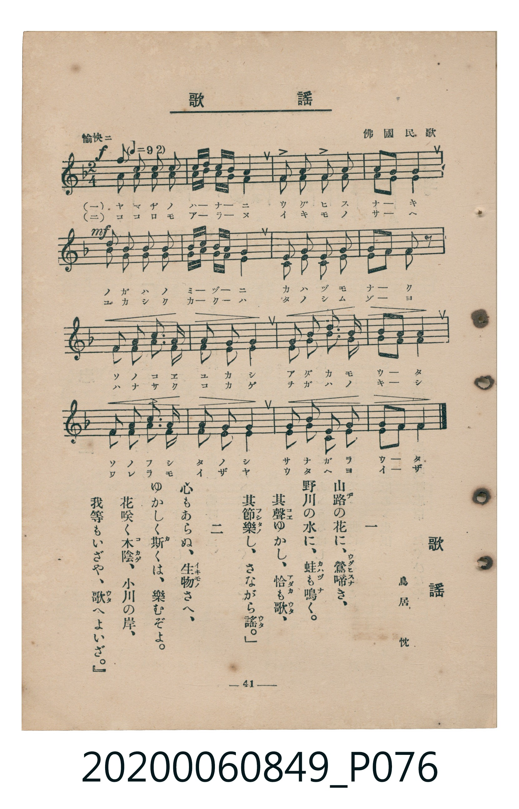

# 歌謠

> Re:Shōka 使用 AI 協助辨識與重建樂譜，可能會有錯誤。歡迎回報。

- **鋼琴伴奏版**：<br><audio controls src="kayo.mp3"></audio>

- 詞：鳥居忱
- 曲：佛國民歌
- 臺灣教育會公認《新定兒童唱歌》高等科女子用（2020.006.0849）

## 說明

原書資訊與歌詞全文（對應 P076.jpg，書頁 p. 41，高一重音第 4 首）：
調性與拍號：ヘ長調（1 降記號）、2/4 拍（二重音，愉快ニ ♪=92）


## 歌詞

```text
一
山路（やまぢ）の花に、鶯（うぐひす）啼（な）き、
野川の水に、蛙（かはづ）も鳴（な）く。
其聲（こゑ）ゆかし、恰（あだか）も歌（うた）、
其節樂（ふしたの）し、さながら謠（うた）。

二
心もあらぬ、生物（いきもの）さへ、
ゆかしく斯（か）くは、樂むぞよ。
花咲く木陰（こかげ）、小川の岸、
我等もいざや、歌（うた）へよいざ。
```

## ABC

```abc
X:1
T:歌謠
C:曲：佛國民歌
M:2/4
L:1/16
Q:1/4=92
K:F
V:V1 name="Part1" snm="Par"
V:V2 name="Part2" snm="Par"
[V:V1]
!f! c2 A2 F2 F2 | G A B G F4 | G2 G2 A2 A2 | G2 A2 G4 |
!mf! c2 A2 F2 F2 | G A B G F4 | G2 G2 A2 A2 | G2 E2 F2 z2 |
F2 G2 A2 F2 | G2 E2 F2 F2 | G2 A2 B2 G2 | A2 B2 c4 |
c2 A2 F2 F2 | G2 A2 G2 G2 | F2 d2 c2 B2 | A2 G2 F4 |
[V:V2]
!f! A2 F2 F2 F2 | E F G E F4 | E2 E2 F2 F2 | E2 F2 E4 |
!mf! A2 F2 F2 F2 | E F G E F4 | C2 C2 D2 D2 | C2 C2 F,2 z2 |
D2 C2 D2 D2 | C2 C2 D2 D2 | E2 F2 G2 E2 | F2 G2 A4 |
A2 F2 F2 F2 | E2 F2 E2 E2 | D2 G2 F2 D2 | F2 E2 F4 |
```

## TMD 檔案連結

- [主旋律 TMD 檔案](kayo.tmd) [[在 TMD Studio 編輯](https://tmdlang.github.io/Tmd-TS/#tmd=s7IKdvYPcrWy4qpTUCpJTLdSSM7PyUlNLsnMz7MqzsjMK0nNjM_KTMmPL87Iz05Ugisry88pzU21ys4vyY9PzyzKKY43MjAyiDcwMIs3sDCxRCgszi8tSk61Kk7OyM_PiS9JrShJys_PRsgXFOWXpeYl5gHVFBSB7EsBK0IoSC3LTEkFSaemZJbkF2Um5iC5IrWoGOxSsCXxJUWJecXJRZkFIOcjVJVkpAKdmltanJmMEASalJ6ZZ5WbmpmVicVZUOny1OKS1KK8-NzUnPyUSiUuLS2FZ2t7XqxZoKClxaVoq2BpxGVvq-DGZWOkb2IH0vxi5bz3e2a93Lz06cbWp_s3gg18NnsTUOzJ3tlP53Q_2zARaABY-EX7rueNi59NnfmiadOzOc1PW9e8WNX7uKHr2bQNT9fNeto66fnqpU-nbAQqf9zQ_XL1jOdrO58vn_h06eanayc8n7Li_Z4OUJDrAYNcDxTk7_d0KnFx6Wsp2FILcCkoKDztm_9s9o4Xm9tfrOh60dEO8vzKeU9bVzyb1g50wNMNvc_aOxUCDMzN9LIK0t_v6QEqfrmgUaFAT8HEEMgFOvvJjoaX7b0v529-vmaNgonCy2XTgC4FhgfI9Ber9j9rWA4yt7v3xcz5QNHHzTNeTt0OFAeabqjwcmbvixUzwDKdjxsagYGsAFQJlHqyqwdiKMjKls6n-1c_bu5WeDRzla2lEVAtF8hwoMVgH2zc-GL7eqCex00tjxv3PW5cBDKscd2Lro2PG1cDTX25DSzb2Pa4ccLjxk2PG2cCFTydugcsuAqsGBgtjSCzXrb3Pd0-F6j52YYtEM0vZgNVA9V1P25c_7hxKUh1U9PLzVuQNPc_bmgCO6R124tGYEoASkx-3DQRrBRoJ1DndKBBzxo3gKWaHjcuAApCDAIGN8xp0CCAGvR8fcOzFU1gua0g_Y3zgY4C2wYy63HjVKDljxt7Hjd1AtMqqhFNkMDZ1QM2an8z0BqQrU1AvWuAep9Pmf-8cyVYCzC4esGyEJOBZu6AugDh8Mb-Z9MgwQd2MtCzwHAA-mYF0MSGx43zHjd1QL0PDO-nk4Ch2_9szoqXMyGenQw2ZRLEa0839EMC9-kmmD3POiYCUz3YDUDHTAPFINBstEABugpoCUQBxCrKkz4UKGjpc3H5JgILgoDEohJDhxqDGoVqkA0KNoZmWnZgFjDHAVM2MLG9WNgDUg8SA6pKq1UwVdBVMAZiQyiuUTAC8k2AJIgHgiARXTAGqQNhiAiIBaLBasDxBbNmVw-qNbkU2WMeD9VigGHRjk4Ui0CKYPphdiDpRwiBFJhAFdfAeSAnYnjm6ezZKHZg8wciLCAGgsTNoAaCDIZYAZKD-5WrFinOjEiMM2T7IW4A-tEQaAGYgoUm2N9onodzwQziYo4420xBBoIJMziBLGoIIgjGIFgbHlOQReF-gUcyagogGJVYPYYUPFAzwdbBIg9qN1wNSoTq2imA4lQBSCtzcQEA)]
- [鋼琴伴奏 TMD 檔案](kayo_piano.tmd) [[在 TMD Studio 編輯](https://tmdlang.github.io/Tmd-TS/#tmd=s7IKdvYPcrWy4tLSUni2tufFmgXv93S87N7zfMKWJ3u2PF3a_7yz4_2eTgUtLS5FWwVLIy57WwU3LhsjfRM7rjoFpRcr573fM-vl5qVPN7Y-3b9RCST2bPYmoNiTvbOfzul-tmEi0FSw8Iv2Xc8bFz-bOvNF06Znc5qftq55sar3cUPXs2kbnq6b9bR10vPVS59O2QhU_rih--XqGc_Xdj5fPvHp0s1P1054PmUF0FlGBkYGegYGZnoGFiaWQEcpcXH5JmbmWQVkJublB3k41BjUKFRzKQCBjaGZlh2Ypa-l8HzNmic7Gl4s7FHQ0geLAVWl1SqYKugqGAOxIRTXKBgB-SZAEsQDQZCILhiD1IEwRATEAtFgNVzI1uzqQbUmlyJ7zOOhWgwwLNrRiWIRSBFMP8wOJP0IIZACE6jiGjgP5EQMzzydPRvFDmz-QIQFxECQuBnUQJDBECtAcnC_ctUix5oPSqyZQCMNaFC8QrRhLMjWeBws03ggk4Bqs_hcGBuoBKbaBChjAleDYIFNhJuF1WiIElQDwIqBntK1UwD5SwGJVubiAgA)]

## 分析

```text
================================================================================
📊 TMD Song Profile: [ 歌謠 ]
================================================================================
⏱  Duration:       0:20 (20.9s), 16 measures total
🎼 Key & Tempo:    首調基準 F, != 92.0 BPM, <2/4>
   - 分析範圍：      由實際發聲的音符與和弦推測調性；播放脈絡另行呈現
🎤 人聲音域:    E4 (MIDI 64) – D5 (MIDI 74) [跨度: 10 個半音 / 0.8 個八度, 難度: easy]
   - 最低音:  E4 in [Main #1 @ m.8, 0:09]
   - 最高音: D5 in [Main #1 @ m.15, 0:18]
   - 適合: soprano, mezzo-soprano, contralto, tenor, baritone, bass
🏛  結構:      Main (20.9s)
⚡ 編曲密度:        Peak 2 軌道同時演奏
🗝  調性診斷：       F 大調（純淨自然大調，未偵測到可信轉調）
   - 風格氣質:    純淨自然大調（陽光明朗、易唱易記，無明顯調外色彩）
   - 轉調歷程:    全曲維持單一推測調性（未偵測到可信轉調）
   - 核心骨幹音:  F, G, A, E, C
   - 調性數值:    F 大調 [相關度: 0.83, 穩定度: High, 自然音純度: 100.0%]
   - 候選調性 (K-S): F 大調 (0.83), D 小調 (0.62), C 大調 (0.60)
   - 五度圈歷程:   -1
   - 各段落調性細節:
     • [Main #1]: F 大調 (r: 0.83, 自然音純度: 100.0%)

  [ 五度圈游移軌跡 ]
               C  
        [F ]*          G  
      Bb               D  
      Eb               A  
         Ab           E  
            Db       B  
               F# 
     (* = active key center)

  [ 十二半音累積音高分佈 ]
     C  : ███████                   10.3%
     C# :                            0.0%
     D  : ██████                     7.9%
     D# :                            0.0%
     E  : ████████                  11.9%
     F  : ████████████████████████  34.1%
     F# :                            0.0%
     G  : ████████████              17.5%
     G# :                            0.0%
     A  : ███████████               15.1%
     A# : ██                         3.2%
     B  :                            0.0%
--------------------------------------------------------------------------------
Assignment 軌道音域：
  - Part1         : E4 – D5 (10 個半音 / 0.8 個八度, 62 個音符)
  - Part2         : F3 – A4 (16 個半音 / 1.3 個八度, 62 個音符)
================================================================================
```


## 原書掃描頁




