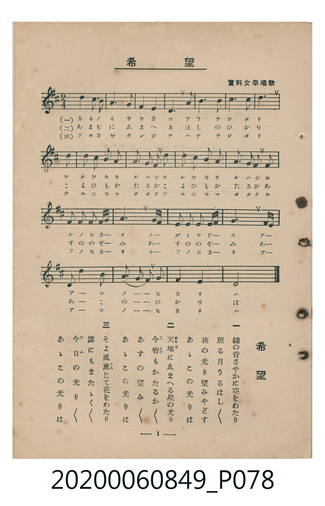

# 希望

> Re:Shoka 使用 AI 協助辨識與重建樂譜，可能會有錯誤。歡迎回報。

<audio controls src="kibo.mp3"></audio>

- 出處：實科女學唱歌
- 臺灣教育會公認《新定兒童唱歌》高等科女子用（2020.006.0849）

## 說明

原書資訊與歌詞全文（對應 P078.jpg，書頁 p. 1，高二第一學期第 1 首）：
調性與拍號：ト長調（1 升記號）、2/4 拍

## 歌詞

```text
一
鐘の音さやかに空をわたり
照る月うるはしく
夜の光り望みやどす
あゝこの光りは

二
天地（あめつち）にゑまへる星の光り
今宵（こよひ）もかたるかく
あすの望みかく
あゝこの光りは

三
そよ風薫（くん）じて花をわたり
露にもまたかく
今日（けふ）の光りかく
あゝこの光りは
```

## ABC

```abc
X:1
T:希望
M:2/4
L:1/16
Q:1/4=96
K:G
V:V1 name="Piano" snm="Pia"
[V:V1]
!mf! B4 B2 A2 | G6 E2 | D4 D4 | D6 G2 |
B4 B2 A2 | G8 | A8 | B6 G2 |
G2 A2 B2 c2 | d4 B4 | G6 G2 | G2 A2 B2 c2 |
d4 B4 | D6 D2 | E2 F2 G2 A B | B6 G F |
E2 F2 G2 A B | A6 F E | D4 G4 | B2 A4 G2 |
B4 A4 | G8 |
```

## TMD 檔案連結

- [主旋律 TMD 檔案](kibo.tmd) [[在 TMD Studio 編輯](https://tmdlang.github.io/Tmd-TS/#tmd=s7IKdvYPcrWy4qpTUCpJTLdSSM7PyUlNLsnMz7MqzsjMK0nNjM_KTMmPL87Iz05Ugisry88pzU21ys4vyY9PzyzKKY43MjAyiDcwMIs3sDCxRCgszi8tSk61Kk7OyM_PiS9JrShJys_PRsgXFOWXpeYl5gHVFBSB7EsBK0IoSC3LTEkFSaemZJbkF2Um5iC5IrWoGOxSsCXxJUWJecXJRZkFIOcjVJVkpAKdmpqbDxHW0lJ4uqPn2ZzZClpaXIq2CpZmXPa2Cu5cNkb6JnYgTU_bd72YOfX9nllP1y97vnzi06Wbn67d8XTKxmdre8CGvmjf9bxx8bOpM180bXo2p_lp65oXq3ofN3Q9m7bh6bpZT1snPV-9FKL8cUP3y9Uznq_thBkz4fmUFe_3dIDCSg8YVnqgsHq_p1OJi0tfS8GWWoBLQUHhad_8Z7N3vNjc_mJF14uOdqBjXqyc97R1xbNp7UAHPN3Q-6y9UyHAwNxCL6sg_f2eHqDilwsaFQr0FAyBPKCrn-zqeb5mzZMdDUDPP5szH8hWMFR4uWwa0LnAoAFZ8WLV_mcNy0GGd_e-mDkfKPq4uePl1O1AcaAVhgpPe4GWzwDLdD5uaAQGrwJQJRdIK9BYEPVywozHjetezt_8uHHq46aWx43djxtXP1-563HTpMdN_Y8b5z9u6gKpe966_HFT97M5HY8b24CMx43rHzdOf9zYD_bokjlAM562dgLVAiP1ceN-sEkrHzfOBEk_bmx63DT3ceNkuCKgbogbdvVA9K98OmcD0MFglY2PG5c8blwIcnHj6sdNEx837nvcuANk-Yz5cBPAund3PV23Faxt8uMmILkJpKepCewHoLuBJBCBXQgyuHEmUDfUeSgSONy2oxOiYC7Q7JeLVryYthpsVf_jpslgtwHDbdmLro3oAfVyziawu4EWAt0NdDHMKqBzn01fCjYD6Cegu4FmwO3E7x6gBOVJEgoUtPS5uHwTM_OsAjIT8_IdagxqFKpBNijYGJpp2YFZwJwASXgvFvaA0lTTaoXHzb1A3KdQA2E1bQWzlgBZq8GsbiBrL5i1Eog3gVnrQWTTfjB7lYLG4-Y2TZDtIBuAduam1SoYK-iCIYg2AuIaYAKHiICgWTxYyBREgSCcgSQGgiA9NQTMgmgDiaOKwHTBzQFHPiwEdvVAQ6AZFAItQN-sBeJlYB-BRPrBPtwOZLXBxfCpWoHwP8gykHNADjCB-AnJAxDHIXsA4klidKGEDZiD6qkdncie6gPiSeBofNy8BxpVEFEwr2kfkDUfEtXNnXDRnUC8CMyDewgcW-YgAuJIY4zQBUpiV4YcLUApoBIUFz-dPRuWECF2Pm7aDHYpxJUQPAnsLpAvVoHl-hEugwcILDwhDoPZipp8YKJYkg9XLReXrp0CKPMoAGllLi4A)]
- [鋼琴伴奏 TMD 檔案](kibo_piano.tmd) [[在 TMD Studio 編輯](https://tmdlang.github.io/Tmd-TS/#tmd=s7IKdvYPcrWy4tLSUni6o-fZnNnv93S87N7zfMKWJ3u2PF3a_7yz4_2eTgUtLS5FWwVLMy57WwV3LhsjfRM7rjoFpaftu17MnPp-z6yn65c9Xz7x6dLNT9fueDpl47O1PUog-Rftu543Ln42deaLpk3P5jQ_bV3zYlXv44auZ9M2PF0362nrpOerl0KUP27ofrl6xvO1nTBjJjyfsgLoFiMDIwM9AwMzPQMLE0ugS5S4uHwTM_OsAjIT8_KDPBxqDGoUqrkUgMDG0EzLDszS11J4vmbNkx0NLxb2KGjpg8WAqnLTahWMFXTBEEQbAXGNgiFUBATN4sFCpiAKBOEMJDEQBOmpIWAWRBtIHFUEpgtuDheym3f1oLgZpABkBEiTCcQdSJZCDES2FOIwYnSh-AfMQXXIjk4Uh4BDxhxEQAw3xvAJUBK7MuQgAEoBlaDY9HT2bBSb4A6D-QtiEcwU1KCHiWIJeq5a5JTig5JSLAgklIJaBcN4kEuMwSTQdBSeaXy8glE80DNgCs4HyhlgqDUDygHZQEEgCQwMcACYQIIBVSPedIDHNXAepuVYnY3FNrTINgYqBHkOqBJEIXsCZAeGNE6DMeMWrBAWGCZALpANDA2QsSBJsFOhoQpxPJCERqaunQIoPhWAtDIXFwA)]

## 分析

```text
================================================================================
📊 TMD Song Profile: [ 希望 ]
================================================================================
⏱  Duration:       0:27 (27.5s), 22 measures total
🎼 Key & Tempo:    首調基準 G, != 96.0 BPM, <2/4>
   - 分析範圍：      由實際發聲的音符與和弦推測調性；播放脈絡另行呈現
🎤 人聲音域:    D4 (MIDI 62) – D5 (MIDI 74) [跨度: 12 個半音 / 1.0 個八度, 難度: easy]
   - 最低音:  D4 in [Main #1 @ m.3, 0:02]
   - 最高音: D5 in [Main #1 @ m.10, 0:11]
   - 適合: soprano, mezzo-soprano, contralto, tenor, baritone, bass
🏛  結構:      Main (27.5s)
⚡ 編曲密度:        Peak 1 軌道同時演奏
🗝  調性診斷：       G 大調（純淨自然大調，未偵測到可信轉調）
   - 風格氣質:    純淨自然大調（陽光明朗、易唱易記，無明顯調外色彩）
   - 轉調歷程:    全曲維持單一推測調性（未偵測到可信轉調）
   - 核心骨幹音:  G, B, D, A, E
   - 調性數值:    G 大調 [相關度: 0.86, 穩定度: High, 自然音純度: 100.0%]
   - 候選調性 (K-S): G 大調 (0.86), B 小調 (0.69), D 大調 (0.68)
   - 五度圈歷程:   +1
   - 各段落調性細節:
     • [Main #1]: G 大調 (r: 0.86, 自然音純度: 100.0%)

  [ 五度圈游移軌跡 ]
               C  
         F           [G ]*
      Bb               D  
      Eb               A  
         Ab           E  
            Db       B  
               F# 
     (* = active key center)

  [ 十二半音累積音高分佈 ]
     C  : ██                         2.3%
     C# :                            0.0%
     D  : █████████████████         19.3%
     D# :                            0.0%
     E  : ███                        4.0%
     F  :                            0.0%
     F# : ███                        3.4%
     G  : ████████████████████████  27.8%
     G# :                            0.0%
     A  : ████████████████          18.2%
     A# :                            0.0%
     B  : ██████████████████████    25.0%
--------------------------------------------------------------------------------
Assignment 軌道音域：
  - Piano         : D4 – D5 (12 個半音 / 1.0 個八度, 56 個音符)
================================================================================
```


## 原書掃描頁




