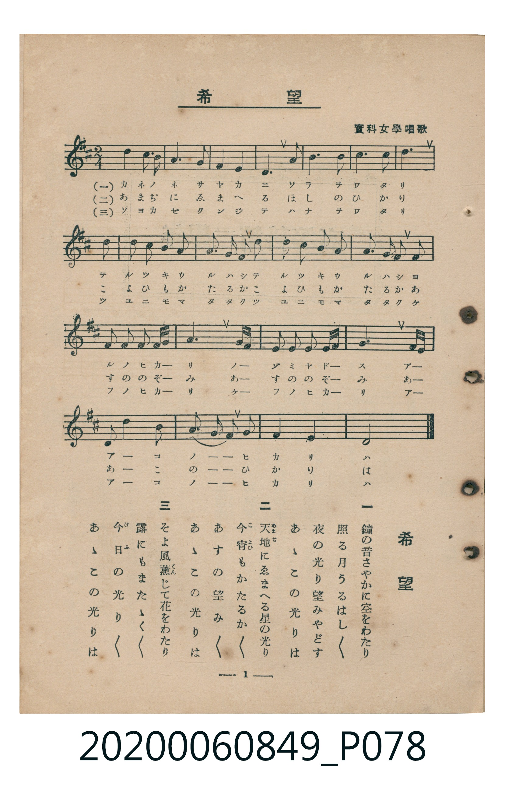

# 希望

> Re:Shōka 使用 AI 協助辨識與重建樂譜，可能會有錯誤。歡迎回報。

- **鋼琴伴奏版**：<br><audio controls src="kibo.mp3"></audio>

- 出處：實科女學唱歌
- 臺灣教育會公認《新定兒童唱歌》高等科女子用（2020.006.0849）

## 說明

原書資訊與歌詞全文（對應 P078.jpg，書頁 p. 1，高二第一學期第 1 首）：
調性與拍號：ト長調（1 升記號）、2/4 拍


## 歌詞

```text
一
鐘の音さやかに空をわたり
照る月うるはしく
夜の光り望みやどす
あゝこの光りは

二
天地（あめつち）にゑまへる星の光り
今宵（こよひ）もかたるかく
あすの望みかく
あゝこの光りは

三
そよ風薫（くん）じて花をわたり
露にもまたかく
今日（けふ）の光りかく
あゝこの光りは
```

## ABC

<div class="abc-score" data-abc-src="kibo.abc" aria-label="五線譜載入中"></div>

[下載 ABC 原始檔](kibo.abc)

## TMD 檔案連結

- [主旋律 TMD 檔案](kibo.tmd) [[在 TMD Studio 編輯](https://tmdlang.github.io/Tmd-TS/#tmd=s7IKdvYPcrWy4qpTUCpJTLdSSM7PyUlNLsnMz7MqzsjMK0nNjM_KTMmPL87Iz05Ugisry88pzU21ys4vyY9PzyzKKY43MjAyiDcwMIs3sDCxRCgszi8tSk61Kk7OyM_PiS9JrShJys_PRsgXFOWXpeYl5gHVFBSB7EsBK0IoSC3LTEkFSaemZJbkF2Um5iC5IrWoGOxSsCXxJUWJecXJRZkFIOcjVJVkpAKdmpqbjyoMNCs9M8-qJDET6DeQ_8oT43MTM_NyEvNSlLi0tBSe7uh5Nme2gpYWl6KtgqUZl72tgjuXjZG-iR3IjKftu17MnPp-z6yn65c9Xz7x6dLNT9fueDpl47O1PWA7XrTvet64-NnUmS-aNj2b0_y0dc2LVb2PG7qeTdvwdN2sp62Tnq9eClH-uKH75eoZz9d2woyZ8HzKivd7OkAhqgcMUT1QiL7f06nExaWvpWBLLcCloKDwtG_-s9k7Xmxuf7Gi60VHO9AxL1bOe9q64tm0dqADnm7ofdbeqRBgYG6hl1WQ_n5PD1DxywWNCgV6CoZAHtDVT3b1PF-z5smOBqDnn82ZD2QrGCq8XDYN6Fxg0ICseLFq_7OG5SDDu3tfzJwPFH3c3PFy6nagONAKQ4WnvUDLZ4BlOh83NAKDVwGokgukFWgsiHo5YcbjxnUv529-3Dj1cVPL48bux42rn6_c9bhp0uOm_seN8x83dYHUPW9d_rip-9mcjseNbUDG48b1jxunP27sB3t0yRygGU9bO4FqgZH6uHE_2KSVjxtngqQfNzY9bpr7uHEyXBFQN8QNu3og-lc-nbMB6GCwysbHjUseNy4Eubhx9eOmiY8b9z1u3AGyfMZ8uAlg3bu7nq7bCtY2-XETkNwE0tPUBPYD0N1AEojALgQZ3DgTqBvqPBQJHG7b0QlRMBdo9stFK15MWw22qv9x02Sw24DhtuxF10b0gHo5ZxPY3UALge4GuhhmFdC5z6YvBZsB9BPQ3UAz4Hbidw9QgvIkCQUKWvpcXL7ArGgVkJmYl-9QY1BTDbJAwcbQTMsOzAJmBEi6e7GwB5SkmlYrPG7uBeI-hRoIq2krmLUEyFoNZnUDWXvBrJVAvAnMWg8im_aD2asUNB43t2mCLAfZUKNQnZtWq2CsoAuGINoIiGuA6RsiAoJm8WAhUxAFgnAGkhgIgvTUEDALog0kjioC0wU3Bxz3sBDY1QMNgWZQCLQAfbMWiJeBfQQS6Qf7cDuQ1QYXw6dqBcL_IMtAzgE5wATiJyQPQByH7AGIJ4nRhRI2YA6qp3Z0InuqD4gngaPxcfMeaFRBRMG8pn1A1nxIVDd3wkV3AvEiMA_uIXBsmYMIiCONMUIXKIldGXK0AKWASlBc_HT2bFhChNj5uGkz2KUQV0LwJLC7QL5YBZbrR7gMHiCw8IQ4DGYravKBiWJJPly1XFy6dgqgvKMApJW5AA)]
- [鋼琴伴奏 TMD 檔案](kibo_piano.tmd) [[在 TMD Studio 編輯](https://tmdlang.github.io/Tmd-TS/#tmd=s7IKdvYPcrWy4tLSUni6o-fZnNnv93S87N7zfMKWJ3u2PF3a_7yz4_2eTgUtLS5FWwVLMy57WwV3LhsjfRM7rjoFpaftu17MnPp-z6yn65c9Xz7x6dLNT9fueDpl47O1PUog-Rftu543Ln42deaLpk3P5jQ_bV3zYlXv44auZ9M2PF0362nrpOerl0KUP27ofrl6xvO1nTBjJjyfsgLoFiMDIwM9AwMzPQMLE0ugS5S4uHwTM_OsAjIT8_KDPBxqDGqquRSAwMbQTMsOzNLXUni-Zs2THQ0vFvYoaOmDxWoUqnPTahWMFXTBEEQbAXGNgiFUBATN4sFCpiAKBOEMJDEQBOmpIWAWRBtIHFUEpgtuDheym3f1oLgZpABkBEiTCcQdSJZCDES2FOIwYnSh-AfMQXXIjk4Uh4BDxhxEQAw3xvAJUBK7MuQgAEoBlaDY9HT2bBSb4A6D-QtiEcwU1KCHiWIJeq5a5ITig5xQLAikk4JaBcN4kEOMwSTQcBSeaXy8glE80C9gCs4HyhlgqDUDygHZQEEgCQwLsP9NIKGAqhFvMsDjGjgP03KszsZiG1pcGwMVgjwHVAmikD0BsgNDGqfBmFELVggLDBMgF8gGhgbIWJAk2KnQUIU4HkhC41LXTgEUnQpAWpkLAA)]

## 分析

```text
================================================================================
📊 TMD Song Profile: [ 希望 ]
================================================================================
⏱  Duration:       0:27 (27.5s), 22 measures total
🎼 Key & Tempo:    首調基準 G, != 96.0 BPM, <2/4>
   - 分析範圍：      由實際發聲的音符與和弦推測調性；播放脈絡另行呈現
🎤 人聲音域:    D4 (MIDI 62) – D5 (MIDI 74) [跨度: 12 個半音 / 1.0 個八度, 難度: easy]
   - 最低音:  D4 in [Main #1 @ m.3, 0:02]
   - 最高音: D5 in [Main #1 @ m.10, 0:11]
   - 適合: soprano, mezzo-soprano, contralto, tenor, baritone, bass
🏛  結構:      Main (27.5s)
⚡ 編曲密度:        Peak 1 軌道同時演奏
🗝  調性診斷：       G 大調（純淨自然大調，未偵測到可信轉調）
   - 風格氣質:    純淨自然大調（陽光明朗、易唱易記，無明顯調外色彩）
   - 轉調歷程:    全曲維持單一推測調性（未偵測到可信轉調）
   - 核心骨幹音:  G, B, D, A, E
   - 調性數值:    G 大調 [相關度: 0.86, 穩定度: High, 自然音純度: 100.0%]
   - 候選調性 (K-S): G 大調 (0.86), B 小調 (0.69), D 大調 (0.68)
   - 五度圈歷程:   +1
   - 各段落調性細節:
     • [Main #1]: G 大調 (r: 0.86, 自然音純度: 100.0%)

  [ 五度圈游移軌跡 ]
               C  
         F           [G ]*
      Bb               D  
      Eb               A  
         Ab           E  
            Db       B  
               F# 
     (* = active key center)

  [ 十二半音累積音高分佈 ]
     C  : ██                         2.3%
     C# :                            0.0%
     D  : █████████████████         19.3%
     D# :                            0.0%
     E  : ███                        4.0%
     F  :                            0.0%
     F# : ███                        3.4%
     G  : ████████████████████████  27.8%
     G# :                            0.0%
     A  : ████████████████          18.2%
     A# :                            0.0%
     B  : ██████████████████████    25.0%
--------------------------------------------------------------------------------
Assignment 軌道音域：
  - Piano         : D4 – D5 (12 個半音 / 1.0 個八度, 56 個音符)
================================================================================
```


## 原書掃描頁




