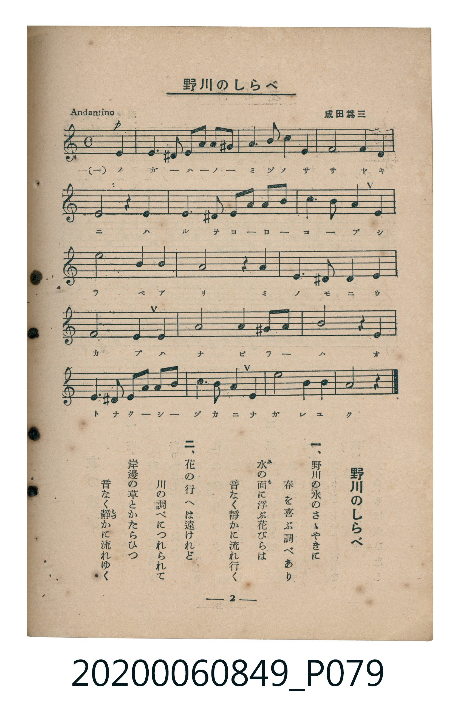

# 野川のしらべ

> Re:Shōka 使用 AI 協助辨識與重建樂譜，可能會有錯誤。歡迎回報。

- **鋼琴伴奏版**：<br><audio controls src="nogawa_no_shirabe.mp3"></audio>

- 曲：成田為三
- 臺灣教育會公認《新定兒童唱歌》高等科女子用（2020.006.0849）

## 說明

原書資訊與歌詞全文（對應 P079.jpg，書頁 p. 2，高二第一學期第 2 首）：
調性與拍號：イ短調（無升降記號）、4/4 拍（Andantino，弱起第 4 拍進入）


## 歌詞

```text
一、
野川の水のさゝやきに
春を喜ぶ調べあり
水（み）の面（も）に浮ぶ花びらは
音なく靜（しづ）かに流れ行く

二、
花の行へは遠けれど
川の調べにつれられて
岸邊の草とかたらひつ
音なく靜かに流れゆく
```

## ABC

<div class="abc-score" data-abc-src="nogawa_no_shirabe.abc" aria-label="五線譜載入中"></div>

[下載 ABC 原始檔](nogawa_no_shirabe.abc)

## TMD 檔案連結

- [主旋律 TMD 檔案](nogawa_no_shirabe.tmd) [[在 TMD Studio 編輯](https://tmdlang.github.io/Tmd-TS/#tmd=s7IKdvYPcrWy4qpTUCpJTLdSSM7PyUlNLsnMz7MqzsjMK0nNjM_KTMmPL87Iz05Ugisry88pzU21ys4vyY9PzyzKKY43MjAyiDcwMIs3sDCxRCgszi8tSk61Kk7OyM_PiS9JrShJys_PRsgXFOWXpeYl5gHVFBSB7EsBK0IoSC3LTEkFSaemZJbkF2Um5iC5IrWoGOxSsCXxJUWJecXJRZkFIOcjVJVkpAKdmpdYUlqUii5anliSWoQQBJqfnplnVZKYCfQvyM_lifG5iZl5OYl5KUpcWloKL9v7nm6f-7hx3ePG6Y-bOh837lTQ0uJStFWwMOGyt1Vw5rIx0TexA5n3bPam93tmPeuY8HzKhudNu57s6ARb86J91_PGxc-mznzRtOnZnOanrWterOp93ND1bNqGp-tmPW2d9Hz10qdTNj5b2_O4ofvl6hnP13Y-Xz7x6dLNT9cCTVrxfk8HKKD1gAGtBwro93uAxnLpaynYUgtwKSgoPO2b_2z2jheb21-s6HrR0Q50zIuV8562rng2rR3ogKcbep-1dyoEGJhb6mUVpL_f0wNU_HJBo0KBnoIRkAd09ZNdPc_XrHmyo-Hp2h3P5swHshWMFF4umwZ0LjBQQFa8WLX_WcNykOHdvS9mzgeKPm5a8nz-WqA40IrnLQuf9ra_nNn7YsUMsGzn44ZGYMgqAFUDpR3zUhLzSjLz8oG2Pd2z8cXW7SAbwLIvGzY9bV0K1MAFsgXoAqBGEAsecc82bAFH39THTXMfN7U8bux93LgapOLZjKWPmyY9nTbnceM2oCuAUfu4selxUxdYbsMWoLWPG4FuA8b5updzF4G4TU1g7upnW4HmbXvRtfFx42ZwolgPtnH-5seNqx439r-cOwesefrjRpDDHjd2g_U0Pm7qebGwB6gA4tRdwBgHOxVs0Dqw1A6gWS8bFzxunAhU_LhxJThywN6AuXD148YlIDmgtSAVy8AqNu142dQFUtQLtG0F2ML5YIdtAqpGdxuyex43tYHcA1RBeUKCAgUtfS4uX2AesgrITMzLd6gxqFGoBtmgYGNopmUHZgHTLyQan27of76-AZQYmvtAGkGSNQoGCrpgiE5XF9QqGEPZNeBABJkESXjA4AOnqTUKj5v3AHE_lO4D0zVAcj4Qt0JEmraCRIDk4-YlQHotwmqY8SBopA4kQAJmQGwK4oAYNWASBs2hoiAIdxowZSJUIMsYYXX8LlCyAIdBN9jhIMeuBuJNQLwC6o21MG80bYaKTAOyt2N3OHKYIRyF02sgDPJHjYJhHA6vwSXQgr0T5vKVQBfNBLpoEdj1q8DBDWKBgn8REAN91rQM4VojZItAENMisP3YfAQTR_WRCchHpmimobj26ezZsEQCCl1g-EHDuguIJwMxyA-QpAJMPE2rEK5FdwnMXoRLkJMEsgOQUg0u72BP0LumwEK2A-LCpvWQeAfGOcyVwMQM9gko1XSB0wYo8YPwMjBvPRHJmoi4hwcmqhLkAMAdEOhZuIarlotL104BVEAoAGllLi4A)]
- [鋼琴伴奏 TMD 檔案](nogawa_no_shirabe_piano.tmd) [[在 TMD Studio 編輯](https://tmdlang.github.io/Tmd-TS/#tmd=s7IKdvYPcrWy4tLSUnjZ3vd0-9zHjeseN05_3NT5uHHn-z0dL7v3PJ-w5cmeLU-X9j_v7Hi_p1NBS4tL0VbBwoTL3lbBmcvGRN_EjqtOQenZ7E3v98x61jHh-ZQNz5t2PdnRqQQSftG-63nj4mdTZ75o2vRsTvPT1jUvVvU-buh6Nm3D03WznrZOer566dMpG5-t7Xnc0P1y9YznazufL5_4dOnmp2uBJq0AOsHIwMhAz8DATM_AwsQS6AAlLi7fxMw8q4DMxLz8IA-HGoMahWouBSCwMTTTsgOz9LUUnu7Z-GLr9qcb-p-vb1DQ0gcL1ygYKOiCITpdXVCrYAxl13DBzHi-Zs2THQ0vFvYgDIApAkEjdSABEjADYlMQB8SoAZMwaA4VBUG4BQomSCqQZYywOmFXD04nIPsBYTxOR4IwyEU1CoZxOBwJl0ALhk4UNxghawdBTO1gU7G5EyaO6k4TkDtN0UxDccPT2bNR3IBuPsw0hPnIEYFsLFJc4XIk9sSwawpxiYGIcIZ7EVUJsgdwewQ9-dZw1SLnCh-UXGFBTKZAxngzACinmMXHKxjHKxiCSRQO0Kl45IyAXJCQCUwmXsEciE3VITTeVI9hLtSt5DjGgEDiRnUmGhcY7WjuBvGxugauEIv_0FMzNkNhfKB78XoTj4PwJV_yQg5sOlQEaywiJFHSFDCF6topgBKpApBW5uICAA)]

## 分析

```text
================================================================================
📊 TMD Song Profile: [ 野川のしらべ ]
================================================================================
⏱  Duration:       0:48 (48.6s), 17 measures total
🎼 Key & Tempo:    首調基準 C, != 84.0 BPM, <4/4>
   - 分析範圍：      由實際發聲的音符與和弦推測調性；播放脈絡另行呈現
🎤 人聲音域:    D4 (MIDI 62) – D5 (MIDI 74) [跨度: 12 個半音 / 1.0 個八度, 難度: easy]
   - 最低音:  D4 in [Main #1 @ m.4, 0:10]
   - 最高音: D5 in [Main #1 @ m.8, 0:20]
   - 適合: soprano, mezzo-soprano, contralto, tenor, baritone, bass
🏛  結構:      Main (48.6s)
⚡ 編曲密度:        Peak 1 軌道同時演奏
🗝  調性診斷：       A 小調（純淨自然小調，未偵測到可信轉調）
   - 風格氣質:    純淨自然小調（陰鬱抒情、旋律集中，無明顯調外色彩）
   - 轉調歷程:    全曲維持單一推測調性（未偵測到可信轉調）
   - 核心骨幹音:  A, E, B, C, D
   - 調性數值:    A 小調 [相關度: 0.78, 穩定度: Moderate, 自然音純度: 95.0%]
   - 候選調性 (K-S): A 小調 (0.78), A 大調 (0.68), E 大調 (0.68)
   - 五度圈歷程:   +3
   - 各段落調性細節:
     • [Main #1]: A 小調 (r: 0.78, 自然音純度: 95.0%, 調外音: D#, F#, G#)

  [ 五度圈游移軌跡 ]
               C  
         F            G  
      Bb               D  
      Eb              [A ]*
         Ab           E  
            Db       B  
               F# 
     (* = active key center)

  [ 十二半音累積音高分佈 ]
     C  : ███████████               11.7%
     C# :                            0.0%
     D  : █████                      5.0%
     D# : ██                         2.5%
     E  : ███████████████████████   25.8%
     F  : ███                        3.3%
     F# : █                          0.8%
     G  : ██                         1.7%
     G# : ██                         1.7%
     A  : ████████████████████████  26.7%
     A# :                            0.0%
     B  : ███████████████████       20.8%
--------------------------------------------------------------------------------
Assignment 軌道音域：
  - Piano         : D4 – D5 (12 個半音 / 1.0 個八度, 58 個音符)
================================================================================
```


## 原書掃描頁




