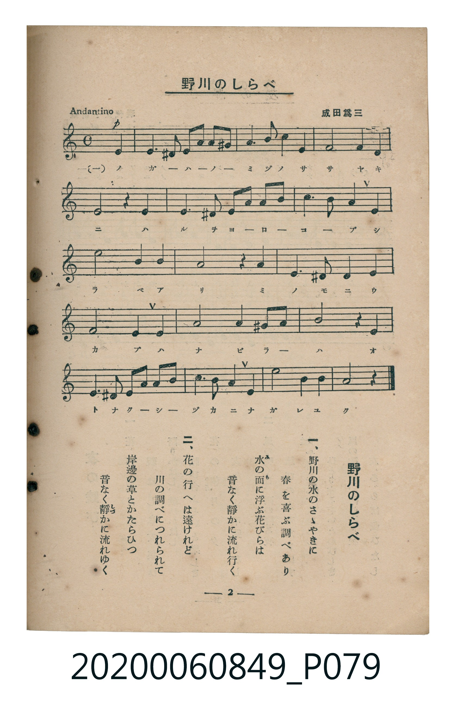

# 野川のしらべ

<audio controls src="nogawa_no_shirabe.mp3"></audio>

- 曲：成田為三
- 臺灣教育會公認《新定兒童唱歌》高等科女子用（2020.006.0849）

## 說明

原書資訊與歌詞全文（對應 P079.jpg，書頁 p. 2，高二第一學期第 2 首）：
調性與拍號：イ短調（無升降記號）、4/4 拍（Andantino，弱起第 4 拍進入）

## 歌詞

```text
一、
野川の水のさゝやきに
春を喜ぶ調べあり
水（み）の面（も）に浮ぶ花びらは
音なく靜（しづ）かに流れ行く

二、
花の行へは遠けれど
川の調べにつれられて
岸邊の草とかたらひつ
音なく靜かに流れゆく
```

## ABC

```abc
X:1
T:野川のしらべ
C:曲：成田為三
M:4/4
L:1/16
Q:1/4=84
K:C
V:V1 name="Piano" snm="Pia"
[V:V1]
!p! z4 z4 z4 e4 | e6 ^d2 e2 a2 ^g2 a2 | a6 b2 a4 e4 | f8 e4 d4 |
e8 z4 e4 | e6 ^d2 e2 a2 a2 b2 | c6 b2 a4 c4 | d8 a4 c4 |
b8 z4 b4 | e6 ^f2 g4 a4 | b8 e4 b4 | a8 a4 ^g2 a2 |
b8 z4 e4 | e6 ^d2 e2 a2 a2 b2 | c6 b2 a4 a4 | c8 b4 b4 |
a8 z4 z4 |
```

## TMD 檔案連結

- [主旋律 TMD 檔案](nogawa_no_shirabe.tmd)
- [鋼琴伴奏 TMD 檔案](nogawa_no_shirabe_piano.tmd)

## 分析

```text
================================================================================
📊 TMD Song Profile: [ 野川のしらべ ]
================================================================================
⏱  Duration:       0:48 (48.6s), 17 measures total
🎼 Key & Tempo:    首調基準 C, != 84.0 BPM, <4/4>
   - 分析範圍：      由實際發聲的音符與和弦推測調性；播放脈絡另行呈現
🎤 人聲音域:    D4 (MIDI 62) – D5 (MIDI 74) [跨度: 12 個半音 / 1.0 個八度, 難度: easy]
   - 最低音:  D4 in [Main #1 @ m.4, 0:10]
   - 最高音: D5 in [Main #1 @ m.8, 0:20]
   - 適合: soprano, mezzo-soprano, contralto, tenor, baritone, bass
🏛  結構:      Main (48.6s)
⚡ 編曲密度:        Peak 1 軌道同時演奏
🗝  調性診斷：       A 小調（純淨自然小調，未偵測到可信轉調）
   - 風格氣質:    純淨自然小調（陰鬱抒情、旋律集中，無明顯調外色彩）
   - 轉調歷程:    全曲維持單一推測調性（未偵測到可信轉調）
   - 核心骨幹音:  A, E, B, C, D
   - 調性數值:    A 小調 [相關度: 0.78, 穩定度: Moderate, 自然音純度: 95.0%]
   - 候選調性 (K-S): A 小調 (0.78), A 大調 (0.68), E 大調 (0.68)
   - 五度圈歷程:   +3
   - 各段落調性細節:
     • [Main #1]: A 小調 (r: 0.78, 自然音純度: 95.0%, 調外音: D#, F#, G#)

  [ 五度圈游移軌跡 ]
               C  
         F            G  
      Bb               D  
      Eb              [A ]*
         Ab           E  
            Db       B  
               F# 
     (* = active key center)

  [ 十二半音累積音高分佈 ]
     C  : ███████████               11.7%
     C# :                            0.0%
     D  : █████                      5.0%
     D# : ██                         2.5%
     E  : ███████████████████████   25.8%
     F  : ███                        3.3%
     F# : █                          0.8%
     G  : ██                         1.7%
     G# : ██                         1.7%
     A  : ████████████████████████  26.7%
     A# :                            0.0%
     B  : ███████████████████       20.8%
--------------------------------------------------------------------------------
Assignment 軌道音域：
  - Piano         : D4 – D5 (12 個半音 / 1.0 個八度, 58 個音符)
================================================================================
```


## 原書掃描頁




