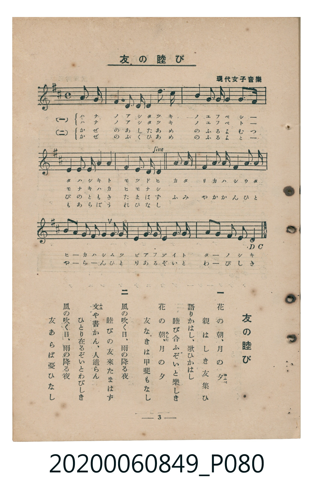

# 友の睦び

> Re:Shōka 使用 AI 協助辨識與重建樂譜，可能會有錯誤。歡迎回報。

<audio controls src="tomo_no_mutsubi.mp3"></audio>

- 出處：現代女子音樂
- 臺灣教育會公認《新定兒童唱歌》高等科女子用（2020.006.0849）

## 說明

原書資訊與歌詞全文（對應 P080.jpg，書頁 p. 3，高二第一學期第 3 首）：
調性與拍號：ニ長調（2 升記號）、4/4 拍（含 D.C. al Fine 返始曲式，弱起第 4 拍進入）
勘誤註記：原譜第 6 小節第 3 拍「シ／ん」誤植為八分音符符尾，依 4/4 拍號與對應詞句修正為四分音符。


## 歌詞

```text
一
花の朝（あした）、月の夕（ゆふべ）
親はしき友集ひ
語りかはし、歌ひかはし
睦び合ふぞいと樂しき
花の朝、月の夕
友なきは甲斐もなし

二
風の吹く日、雨の降る夜
睦びの友來たまはず
文（ふみ）や書かん、人遣らん
ひとり在るぞいとわびしき
風の吹く日、雨の降る夜
友あらば憂ひなし
```

## ABC

```abc
X:1
T:友の睦び
M:4/4
L:1/16
Q:1/4=92
K:D
V:V1 name="Piano" snm="Pia"
[V:V1]
!mf! z4 z4 z4 F2 F2 | D6 A,2 A,2 D2 B3 A | A6 F2 G2 E2 D3 F | E4 E2 E2 F4 G4 |
F4 E2 E2 D4 A2 A2 | A4 B2 d2 A4 F3 A | A2 F2 G2 E2 F4 F3 F | D4 F2 F2 E4 E2 F2 |
G2 B2 A2 G2 F4 F2 F2 | D6 A,2 A,2 D2 B3 A | A6 F2 G2 E2 D3 F | E4 E2 E2 F4 G4 |
F4 E2 E2 D4 z4 |
```

## TMD 檔案連結

- [主旋律 TMD 檔案](tomo_no_mutsubi.tmd) [[在 TMD Studio 編輯](https://tmdlang.github.io/Tmd-TS/#tmd=s7IKdvYPcrWy4qpTUCpJTLdSSM7PyUlNLsnMz7MqzsjMK0nNjM_KTMmPL87Iz05Ugisry88pzU21ys4vyY9PzyzKKY43MjAyiDcwMIs3sDCxRCgszi8tSk61Kk7OyM_PiS9JrShJys_PRsgXFOWXpeYl5gHVFBSB7EsBK0IoSC3LTEkFSaemZJbkF2Um5iC5IrWoGOxSsCXxJUWJecXJRZkFIOcjVJVkpAKdmlaUmZqXAvRTAUIGaFx6Zp5VSWIm0HsgL5YnxucmZublJOalKHFpaSk87e9-3Lju-dxljxs3K2hpcSnaKlgacdnbKrhw2Zjom9iBTHravuvFzKnv98x63r_vye7FT5dufrp2wsv5m5-taALb9KJ91_PGxc-mznzRtOnZnOanrWterOp93ND1bNqGp-tmPW2d9Hz10qdTNj5b2_O4ofvl6hnP13Y-Xz4RYszzKSve7-kABa0eMGj1QEH7fk-nEheXvpaCLbUAl4KCwtO--c9m73ixuf3Fiq4XHe1Ax7xYOe9p64pn09qBDni6ofdZe6dCgIGFgV5WQfr7PT1AxS8XNCoU6CkYA3lAVz_Z1fN8zZonOxqert3xbM58IFvBWOHlsmlA5wKDBmTFi1X7nzUsBxne3fti5nyg6OPm7pdTtwPFQX5UeNoLtHwGWKbzcUMjMHgVgCpBtk9YreCi56ynkJij4JaZl6rwYv-Up8u7n83e9HRPP9D2p3s2vti6HWQjWMfLhk1PW5cCDQH7q3vGi1VLXqzYDTQaaCPQmy_WzgEpNVN4uqH_-foGiEOB2h439Dxu2v5-T__jpsmPG3qBup4t6X3etOtp6-qnHW3A-Hy-ZhkQPd2wD2jlk31zFaAOBDoY6CdICIHCrH_pk_3rnq1dDNI6ezZc6-OGJi6Qg4AhBA6Mro3AhPVszlyg_x43Nj1unP64EerxZ3OAIuueLgEmqY7HTW2PG7c-btwJ9c6LZaseN64Hq-4Fps2Xs4HSmyCBO-9xU9fjRmByBUsDjQGmp8ZNcBGQIkg6fjoBaD7QzHmPG1seN64AJlOIeSjOQnYHOBxBGQFody_QtOdTNj2bNuFxE1AfUGQ6xFu7ekDUy0UrQHom7Hzc2P9s-lKgKS9ng0Rezux93NT9dMkchDNA6vq7n-wD-mD-48Z9YFeC0wkkyYGdCEwYnY-bWoCJDeQPULw0Ptm162Xj4sdNQPHJINVgP64A-v3pHCAJdCTUW4-b-sGWwHxGlMvAvmwCGd644Vkb0H9As8FeBMpRns-gQEFLn4vLF1jKWAVkJublO9QY1ChUg2xQsDE007IDs4DZG5KqIYkUnFf6FR43dynoA33cDcRzQMaAlNYoGCjogiE6XZ2bVgtM27pgXAOOJpDBkGz6bN1WYCg7KoBpUBZ93Nyn8LhpERBvB-L9QMtagPRaoPlgmeZlQDwViGdCVDR3gGTA6oAOA-tZCxNtBpoC0t3cCcSTgDKrwSrhDjaEOhAETeNhBEjUDCIGVGOKpAbkfhMgNoKqAonUgHkgCKJBGKQKBEEqQbAGLgJTAbMXZDYIo4bJrh5ImDghh8kqiOvhfgSGAtAnID8C_dW8B1W2eQHY3yDZyZCwBIVY0z4gXoISYkB94NCGhJoGqHDThBgDjGF4MMGCABQohnFQN8PCAxFKyKED8zGEBoUSzM-wdIAcauB0AdYLsgJkFoiNbAaWlNMJCSVwgQwpiF-0bwaXyySnI2CIgNIKSKYLmn5AIbkaHr6gEATJbB88aQeWuWq4arm4dO0UQBlZAUgrc3EBAA)]
- [鋼琴伴奏 TMD 檔案](tomo_no_mutsubi_piano.tmd) [[在 TMD Studio 編輯](https://tmdlang.github.io/Tmd-TS/#tmd=s7IKdvYPcrWy4tLSUnja3_24cd3zucseN25-v6fjZfee5xO2PNmz5enS_uedHe_3dCpoaXEp2ipYGnHZ2yq4cNmY6JvYcdUpKD1t3_Vi5tT3e2Y979_3ZPfip0s3P1074eX8zc9WNCmB5F-073reuPjZ1JkvmjY9m9P8tHXNi1W9jxu6nk3b8HTdrKetk56vXvp0ysZna3seN3S_XD3j-drO58snQox5PmUF0C1GBkYGegYGZnoGFiaWQJcocXH5JmbmWQVkJublB3k41BjUKFRzKQCBjaGZlh2YpQ_00Z6NL7Zuf7qh__n6BgUtfbBwjYKBgi4YotPVuWm1CsZABgjXcMEMeb5mzZMdDc_WbUWYYAjVAYKm8TACJGoGEQOqMUVSAzLQBIiNoKpAIjVgHgiCaBAGqQJBkEoQrIGLwFTA7AWZDcKojtzVg-JImANATjKMg-qAuQbhRmS3weyD0CA3wmyEBQuym8HBBNYLsgJkFoiNbAaWgOwEuhEYoS56znoKiTkKbpl5qeCUNViCFpYYarhqkdOYD0oasyAmiSFjvKmpOregVsEwHuRTYzAJYZvEK5jFg0IEScY0Pl7BCKwAyAcGBIRrDhdF0gaSA2tCkgOSBvgTDbIZyBbDZKDGmUEMB1FAA7E5EeomYPoAMsDyyBpBPHSXEE4adAwiYOTr2imA4l8BSCtzcQEA)]

## 分析

```text
================================================================================
📊 TMD Song Profile: [ 友の睦び ]
================================================================================
⏱  Duration:       0:33 (33.9s), 13 measures total
🎼 Key & Tempo:    首調基準 D, != 92.0 BPM, <4/4>
   - 分析範圍：      由實際發聲的音符與和弦推測調性；播放脈絡另行呈現
🎤 人聲音域:    A3 (MIDI 57) – D5 (MIDI 74) [跨度: 17 個半音 / 1.4 個八度, 難度: challenging]
   - 最低音:  A3 in [Main #1 @ m.2, 0:03]
   - 最高音: D5 in [Main #1 @ m.6, 0:14]
   - 適合: soprano, mezzo-soprano, contralto, tenor, baritone, bass
🏛  結構:      Main (33.9s)
⚡ 編曲密度:        Peak 1 軌道同時演奏
🗝  調性診斷：       D 大調（純淨自然大調，未偵測到可信轉調）
   - 風格氣質:    純淨自然大調（陽光明朗、易唱易記，無明顯調外色彩）
   - 轉調歷程:    全曲維持單一推測調性（未偵測到可信轉調）
   - 核心骨幹音:  F#, A, D, E, G
   - 調性數值:    D 大調 [相關度: 0.80, 穩定度: Moderate, 自然音純度: 100.0%]
   - 候選調性 (K-S): D 大調 (0.80), F# 小調 (0.69), A 大調 (0.64)
   - 五度圈歷程:   +2
   - 各段落調性細節:
     • [Main #1]: D 大調 (r: 0.80, 自然音純度: 100.0%)

  [ 五度圈游移軌跡 ]
               C  
         F            G  
      Bb              [D ]*
      Eb               A  
         Ab           E  
            Db       B  
               F# 
     (* = active key center)

  [ 十二半音累積音高分佈 ]
     C  :                            0.0%
     C# :                            0.0%
     D  : ████████████████          18.7%
     D# :                            0.0%
     E  : ████████████████          18.7%
     F  :                            0.0%
     F# : ████████████████████████  27.6%
     G  : ████████                   9.4%
     G# :                            0.0%
     A  : ██████████████████        20.3%
     A# :                            0.0%
     B  : █████                      5.2%
--------------------------------------------------------------------------------
Assignment 軌道音域：
  - Piano         : A3 – D5 (17 個半音 / 1.4 個八度, 72 個音符)
================================================================================
```


## 原書掃描頁




