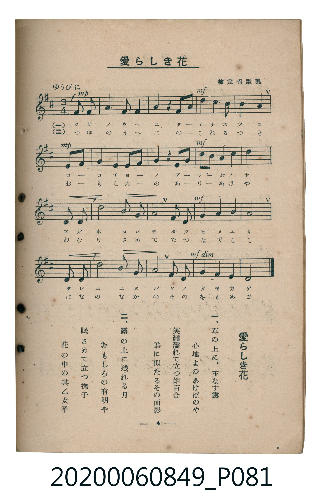

# 愛らしき花

<audio controls src="airashiki_hana.mp3"></audio>

- 出處：檢定唱歌集
- 臺灣教育會公認《新定兒童唱歌》高等科女子用（2020.006.0849）

- note

原書資訊與歌詞全文（對應 P081.jpg，書頁 p. 4，高二第一學期第 4 首）：
調性與拍號：ニ長調（2 升記號）、3/4 拍（ゆうびに，弱起第 3 拍進入）

## 歌詞

```text
一、
草の上に、玉なす露
心地よのあけぼのや
笑顔濡れて立つ姫百合
誰に似たるその面影

二、
露の上に殘れる月
おもしろの有明や
眠さめて立つ撫子
花の中の其乙女子（をとめご）
```

## 原書掃描頁



## 調性分析

```text
================================================================================
📊 TMD Song Profile: [ 愛らしき花 ]
================================================================================
⏱  Duration:       0:34 (34.8s), 17 measures total
🎼 Key & Tempo:    首調基準 D, != 88.0 BPM, <3/4>
   - 分析範圍：      由實際發聲的音符與和弦推測調性；播放脈絡另行呈現
🎤 人聲音域:    C#4 (MIDI 61) – D5 (MIDI 74) [跨度: 13 個半音 / 1.1 個八度, 難度: moderate]
   - 最低音:  C#4 in [Main #1 @ m.16, 0:32]
   - 最高音: D5 in [Main #1 @ m.4, 0:06]
   - 適合: soprano, mezzo-soprano, contralto, tenor, baritone, bass
🏛  結構:      Main (34.8s)
⚡ 編曲密度:        Peak 1 軌道同時演奏
🗝  調性診斷：       A 調性不明確（流行色彩大調，未偵測到可信轉調）
   - 風格氣質:    流行大調（略帶和弦色彩音與裝飾副屬和弦）
   - 轉調歷程:    全曲維持單一推測調性（未偵測到可信轉調）
   - 核心骨幹音:  A, D, E, F#, B
   - 調性數值:    A 調性不明確 [相關度: 0.87, 穩定度: Ambiguous, 自然音純度: 93.5%]
   - 候選調性 (K-S): A 大調 (0.87), D 大調 (0.86), F# 小調 (0.70)
   - 五度圈歷程:   +3
   - 各段落調性細節:
     • [Main #1]: A 調性不明確 (r: 0.87, 自然音純度: 93.5%, 調外音: G)

  [ 五度圈游移軌跡 ]
               C  
         F            G  
      Bb               D  
      Eb              [A ]*
         Ab           E  
            Db       B  
               F# 
     (* = active key center)

  [ 十二半音累積音高分佈 ]
     C  :                            0.0%
     C# : ██████████                 9.2%
     D  : ████████████████████      18.5%
     D# :                            0.0%
     E  : ███████████████████       17.4%
     F  :                            0.0%
     F# : ██████████████████        16.3%
     G  : ███████                    6.5%
     G# :                            0.0%
     A  : ████████████████████████  21.7%
     A# :                            0.0%
     B  : ███████████               10.3%
--------------------------------------------------------------------------------
Assignment 軌道音域：
  - Piano         : C#4 – D5 (13 個半音 / 1.1 個八度, 51 個音符)
================================================================================
```

## ABC

```abc
X:1
T:愛らしき花
C:TMD (Chen, Chih-Han / aguai)
M:3/4
L:1/16
Q:1/4=88
K:D

V:V1 name="Piano" snm="Pia"

[V:V1]
!mp! z4 z4 f2 f2 | a6 f2 d4 | !mf! e4 z4 f2 a2 | d4 c3 b a4 |
!mp! b8 a2 b2 | a6 f2 d2 f2 | !mf! e4 z4 f2 a2 | d2 f2 e6 c2 |
d8 e2 e2 | !f! b8 g2 e2 | a8 f2 d2 | !mf! e4 f4 g4 |
a8 e2 e2 | !f! c8 a2 g2 | f8 d2 d2 | !mf! !p! g4 e4 c4 |
d8 z4 |
```

- [主旋律 TMD 檔案](airashiki_hana.tmd)
- [鋼琴伴奏 TMD 檔案](airashiki_hana_piano.tmd)
