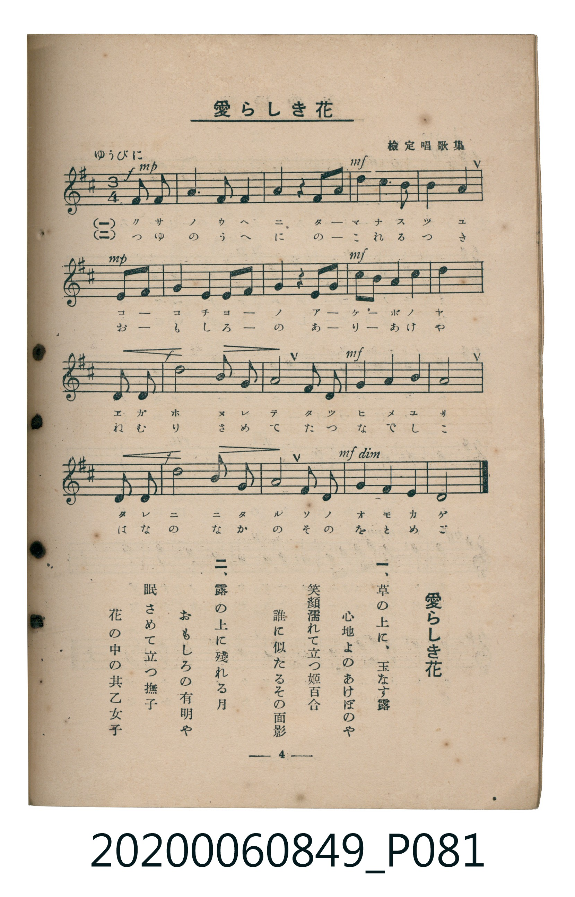

# 愛らしき花

> Re:Shōka 使用 AI 協助辨識與重建樂譜，可能會有錯誤。歡迎回報。

<audio controls src="airashiki_hana.mp3"></audio>

- 出處：檢定唱歌集
- 臺灣教育會公認《新定兒童唱歌》高等科女子用（2020.006.0849）

## 說明

原書資訊與歌詞全文（對應 P081.jpg，書頁 p. 4，高二第一學期第 4 首）：
調性與拍號：ニ長調（2 升記號）、3/4 拍（ゆうびに，弱起第 3 拍進入）


## 歌詞

```text
一、
草の上に、玉なす露
心地よのあけぼのや
笑顔濡れて立つ姫百合
誰に似たるその面影

二、
露の上に殘れる月
おもしろの有明や
眠さめて立つ撫子
花の中の其乙女子（をとめご）
```

## ABC

```abc
X:1
T:愛らしき花
M:3/4
L:1/16
Q:1/4=88
K:D
V:V1 name="Piano" snm="Pia"
[V:V1]
!mp! z4 z4 F2 F2 | A6 F2 D4 | !mf! E4 z4 F2 A2 | d4 c3 B A4 |
!mp! B8 A2 B2 | A6 F2 D2 F2 | !mf! E4 z4 F2 A2 | d2 F2 E6 c2 |
d8 E2 E2 | !f! B8 G2 E2 | A8 F2 D2 | !mf! E4 F4 G4 |
A8 E2 E2 | !f! c8 A2 G2 | F8 D2 D2 | !mf! !p! G4 E4 C4 |
D8 z4 |
```

## TMD 檔案連結

- [主旋律 TMD 檔案](airashiki_hana.tmd) [[在 TMD Studio 編輯](https://tmdlang.github.io/Tmd-TS/#tmd=s7IKdvYPcrWy4qpTUCpJTLdSSM7PyUlNLsnMz7MqzsjMK0nNjM_KTMmPL87Iz05Ugisry88pzU21ys4vyY9PzyzKKY43MjAyiDcwMIs3sDCxRCgszi8tSk61Kk7OyM_PiS9JrShJys_PRsgXFOWXpeYl5gHVFBSB7EsBK0IoSC3LTEkFSaemZJbkF2Um5iC5IrWoGOxSsCXxJUWJecXJRZkFIOcjVJVkpAKdWpCTmIdkLNCk9Mw8q9zUzKxMJGdpaSk8a5n9uKnzceP0x429L7o2KmhpcSnaKlhYcNnbKrhw2Rjrm9iBTHnavuvFzKnv98x6tmrR03Wznk7Z-Gxtz8vZbWArXrTvet64-NnUmS-aNj2b0_y0dc2LVb2PG7qeTdsAUts66fnqpRAdjxu6X66e8Xxt5_PlE58u3fx07YTnU1a839MBCk49YHDqgYLz_Z5OJS4ufS0FW2oBLgUFhad985_N3vFic_uLFV0vOtqBjnmxct7T1hXPprUDHfB0Q--z9k6FAAMLQ72sgvT3e3qAil8uaFQo0FMwAfKArn6yq-f5mjVPdjQ8Xbvj2Zz5QLaCicLLZdOAzgWGC8iKF6v2P2tYDjK8u_fFzPlA0cfN3S-nbgeKg_yo8LQXaPkMsEzn44ZGYNgqAFUCpR43tT1uBKLNjxtXAy17umfji63bQRYYgxS8bNj0tHUpUA8XyBKgA4B6wdb1AuNt3ZMdXUBdQKHnfUDuqseNM1_O2QT28P7mp3M2PG7qACp63Nj0uHHi48Y9IHZTC0j6-ZqJLxdOebZ_4eOmnseNy56v7n7cuOTp8tXPZ-57OqED4p0NQJOf7AFqmv-4CSg9F6j75dxFT_duhLhkFzA-wS4B2gh3ybN1M0AmNnU_mwM25XFj1-MmoO3THzf1AhU9m9P5bEYfzA1zFjxunPq4qRHugGeTVgMTBdj2ro1gM9cCyaet257snAlJMODgmvS4cQVY2xRQsABVU55GoEBBS5-LyzcRmFkCMhPz8h1qDGoUqkE2KNgYmmnZgVnApAmJoqcb-p-vbwDFc9N6hcdNW0GaQQpqFAwUdMEQRlfnFtQCY1MXjGvAwQcyBpKgXizsAaeVPqAZyxQeN88AGgBMOUDefiC9B8ybB8RdQJGdQLoFLLJMQeNx02aQAk2EvaZQ-0AQZJUhlF2jYIThojSIi0BaahQM46Di5mDSDG5SDZCNMBPuF5A0SALVL7t6oH4BO6wRiFfAfQDy3SIYr2kjmPW4eQ5YBiS_BOQfoPKmNQT8Aw5CovwD4sLUwfyG5FUYBCkBYbR46YTFy2yg63qAeA3YnW3QeIHEwiQgXgiODRBvFcgPIElkP1QDHYYehiYwK1F8iOxLoD6Qj2DOBwnDNEKiBV0jVl88nT0b5gtgeoKmKZBLVwNZe2Fh37QKyALGTdNqMG8TqtshKQIBQRaDnFEDdxQMgtyN5HaYW2F-qAamG_N4uAdgaRMGYTFZw1XLxaVrpwDKhQpAWpmLCwA)]
- [鋼琴伴奏 TMD 檔案](airashiki_hana_piano.tmd) [[在 TMD Studio 編輯](https://tmdlang.github.io/Tmd-TS/#tmd=s7IKdvYPcrWy4tLSUnjWMvtxU-fjxumPG3tfdG18v6fjZfee5xO2PNmz5enS_uedHe_3dCpoaXEp2ipYWHDZ2yq4cNkY65vYcdUpKD1t3_Vi5tT3e2Y9W7Xo6bpZT6dsfLa25-XsNiWQ5Iv2Xc8bFz-bOvNF06Znc5qftq55sar3cUPXs2kbQGpbJz1fvRSi43FD98vVM56v7Xy-fOLTpZufrp3wfMoKoEOMDIwM9AwMzPQMLEwsgc5Q4uLyTczMswrITMzLD_JwqDGoUajmUgACG0MzLTswS19L4emejS-2bn-6of_5-gYFLX2wcI2CgYIuGMLo6tyCWgVjIAOEa7hgmp-vWfNkR8OLhT0InaZQHSAIUmwIZdcoGGGYmQYxE6SlRsEwDipuDibN4CbVANkIM-GuAUmDJFBds6uHoGvAXiDKNSAuTB3MZUgOhUGQEhBGC5dOFJdUA41H94cJTCOKO5HdCtQHchfMESBhmEZI0KBrxOqWp7NnY7gFEsoICDIIZGwN3BIYBLkDyS0wu2FuqgbGhXk83EGw-IZBWPjWcNUiJ0gflARpQUx6hGG8yQ-cNAzjFUzjFYyRSGBAxccrGMUDXQqmgCoMgIImQB5YMVjQDEgBlaOrBfGAivElMzIthFKo-iEq8SYlUDSgGg-lsJkEUwnkAYWBDBMk1wFVYfchRpIhzU4joBwoOKE6QGkEzbNAEhadwISha6cAShsKQFqZiwsA)]

## 分析

```text
================================================================================
📊 TMD Song Profile: [ 愛らしき花 ]
================================================================================
⏱  Duration:       0:34 (34.8s), 17 measures total
🎼 Key & Tempo:    首調基準 D, != 88.0 BPM, <3/4>
   - 分析範圍：      由實際發聲的音符與和弦推測調性；播放脈絡另行呈現
🎤 人聲音域:    C#4 (MIDI 61) – D5 (MIDI 74) [跨度: 13 個半音 / 1.1 個八度, 難度: moderate]
   - 最低音:  C#4 in [Main #1 @ m.16, 0:32]
   - 最高音: D5 in [Main #1 @ m.4, 0:06]
   - 適合: soprano, mezzo-soprano, contralto, tenor, baritone, bass
🏛  結構:      Main (34.8s)
⚡ 編曲密度:        Peak 1 軌道同時演奏
🗝  調性診斷：       A 調性不明確（流行色彩大調，未偵測到可信轉調）
   - 風格氣質:    流行大調（略帶和弦色彩音與裝飾副屬和弦）
   - 轉調歷程:    全曲維持單一推測調性（未偵測到可信轉調）
   - 核心骨幹音:  A, D, E, F#, B
   - 調性數值:    A 調性不明確 [相關度: 0.87, 穩定度: Ambiguous, 自然音純度: 93.5%]
   - 候選調性 (K-S): A 大調 (0.87), D 大調 (0.86), F# 小調 (0.70)
   - 五度圈歷程:   +3
   - 各段落調性細節:
     • [Main #1]: A 調性不明確 (r: 0.87, 自然音純度: 93.5%, 調外音: G)

  [ 五度圈游移軌跡 ]
               C  
         F            G  
      Bb               D  
      Eb              [A ]*
         Ab           E  
            Db       B  
               F# 
     (* = active key center)

  [ 十二半音累積音高分佈 ]
     C  :                            0.0%
     C# : ██████████                 9.2%
     D  : ████████████████████      18.5%
     D# :                            0.0%
     E  : ███████████████████       17.4%
     F  :                            0.0%
     F# : ██████████████████        16.3%
     G  : ███████                    6.5%
     G# :                            0.0%
     A  : ████████████████████████  21.7%
     A# :                            0.0%
     B  : ███████████               10.3%
--------------------------------------------------------------------------------
Assignment 軌道音域：
  - Piano         : C#4 – D5 (13 個半音 / 1.1 個八度, 51 個音符)
================================================================================
```


## 原書掃描頁




