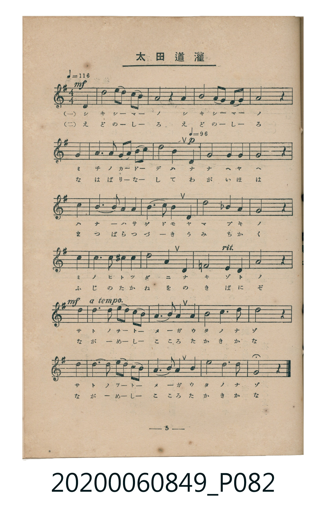
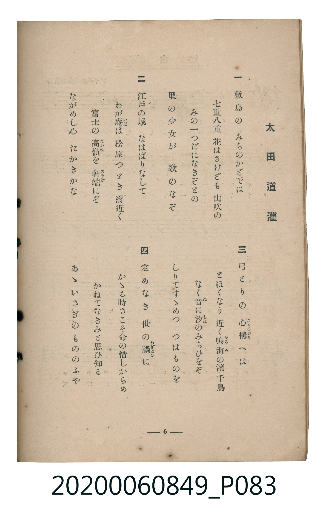

# 太田道灌

> Re:Shoka 使用 AI 辨識樂譜，可能會有錯誤。歡迎回報。

<audio controls src="ota_dokan.mp3"></audio>

- 臺灣教育會公認《新定兒童唱歌》高等科女子用（2020.006.0849）

## 說明

原書資訊與歌詞全文（對應 P082–P083.jpg，書頁 pp. 5–6，高二第一學期第 5 首）：
調性與拍號：ト長調（1 升記號）、4/4 拍（♩=116，中段轉 ♩=96，末段 a tempo，弱起第 4 拍進入）

## 歌詞

```text
一
敷島の　みちのかどでは
七重八重　花はさけども　山吹の
みの一つだになきぞとの
里の少女が　歌のなぞ

二
江戸の城　なはばりなして
わが庵（いほ）は　松原つゞき　海近く
富士の高嶺（たかね）を　軒端（のきば）にぞ
ながめし心　たかきかな

三
弓とりの　心構（こゝろがま）へは
とほくなり　近く鳴海（なるみ）の濱千鳥
なく音（ね）に汐（しほ）のみちひをぞ
しりてすゝめつ　つはものを

四
定めなき　世の禍（わざはひ）に
かゝる時さこそ命の惜しからめ
かねてなきみと思ひ知る
あゝいさぎのもののふや
```

## ABC

```abc
X:1
T:太田道灌
M:4/4
L:1/16
Q:1/4=116
K:G
V:V1 name="Piano" snm="Pia"
[V:V1]
!mf! z4 z4 z4 D4 | B8 d3 B A2 G2 | A8 z4 A4 | B8 A3 G E2 D2 |
G8 z4 G4 | A6 A2 A2 B2 d2 e2 | [Q:1/4=96] !p! d8 B4 D4 | G8 A4 G4 |
A8 z4 B4 | d6 e2 d4 B2 d2 | e6 d2 B4 d4 | e8 _B4 A4 |
G8 z4 B4 | e6 e2 ^d4 e4 | f8 B4 B4 | G8 A6 F2 |
[Q:1/4=116] !mf! G8 z4 B4 | d6 B2 d2 B2 A2 G2 | A6 B2 G4 E4 | B8 A6 B2 |
d8 z4 B4 | d6 B2 d2 B2 A2 G2 | A6 B2 G4 B4 | e8 d6 B2 |
G8 z4 z4 |
```

## TMD 檔案連結

- [主旋律 TMD 檔案](ota_dokan.tmd) [[在 TMD Studio 編輯](https://tmdlang.github.io/Tmd-TS/#tmd=s7IKdvYPcrWy4qpTUCpJTLdSSM7PyUlNLsnMz7MqzsjMK0nNjM_KTMmPL87Iz05Ugisry88pzU21ys4vyY9PzyzKKY43MjAyiDcwMIs3sDCxRCgszi8tSk61Kk7OyM_PiS9JrShJys_PRsgXFOWXpeYl5gHVFBSB7EsBK0IoSC3LTEkFSaemZJbkF2Um5iC5IrWoGOxSsCXxJUWJecXJRZkFIOcjVJVkpAKdmpFZDNReqcSlpaXwdMmq51M2vGyc_LyxR0FLi0vRVsHQ0IzL3lbBncvGRN_EDqT3Rfuu542Ln02d-aJp07M5zU9b17xY1fu4oevZtA1P18162jrp-eqlT6dsfLa253FD98vVM56v7Xy-fOLTpZufrp3wfMqK93s6QEGiBwwSPVCQvN_TqcTFpa-lYEstwKWgoPC0b_6z2TtebG5_saLrRUc70DEvVs572rri2bR2oAOebuh91t6pEGBgYfSoYTKQMtbLKkh_v6cHqOflgkaFggI9BVOgjBlQCOiDJ7t6nq9Z82RHw9O1O57NmQ9kK5gqvFw2Dej093tmgax7sWr_s4blIIu6e1_MnA8Ufdzc8XLqdqA40DpDhae9QIfMAMt0Pm5oBAalAlAlUOrRzJW2wCAG2vNkx9pn67a-2NupABKzBAk9m7MaKKSQqFCSmluQDxR4umfji63bQfaD9b9s2PS0dSnQSC6QG4DuA1HPpm5_unnb48Z1jxsaHjfuf9y4EMRu7H7cuPJx4_LHjeshaptftvc-bV0NJIHqXnRtBEo8bpz6uHEiSF1TE1Dw6caNTyfsBGoGaQCbtA5oxePGJY8bFzxuXP24cdXjxt7HjfMeN66AKnrZ3gNkPd0AiuzHjcDobwAlApDtQKXzII7c1QN25Mb5zzp2gBTP7wO7E6gAaP-Gx01dYPb0x43LwNY29QMNerprKzCoHje2PG7cDQpAoFKg0XP3ASMZ5JwmoBNAvni2dfuL_UD394MTwPqep4uBjlwHjL-n23aB9QNVA4NhLciIpkkgb-8GptX1YCmgG4F-2QA2HahrHsTPQJf0PG5qBLrn6f5msDshRgCVAslV0GDvBNu3ZzIoIEDuB4U8UP2z5d1goyc_bpr7uAmoBRgU-8AWAD0OjgVwyO0GOhhkE1An0EVg97_cvAXoF7BmoDjQJmAiAmpb92z_xqe9zS83L4W7rv_l_M1gdWBPNa5-tnECmAsMP0hIAf0FSQKbQF6G-Ws62J3LHjfOBLsN6MElYN8Bo3Y9KPKB2pomgX33dPZsMLVuFlgZOMobGp7smAZU83wZKAWDowjIBUbfJogjIHZ0g43ufjYTaBwwXQFDZ-7TiXtBvmieA3YgUAEwHhphqhvXgl0ESVRAN6941jAXaOTz-UuBpkAUNYGMBKUCoHl9YEeCnQpCWx83tYAUUV56QIGClj4Xl29iZp5VQGZiXr5DjUGNQjXIBgUbQzMtOzALWGhBcuTTDf3P1zeAcn3TdpBGkGSNgoGCLhii09W5abUKpvFQXg04nEFmQcqYFwt7wAatBSb-7QqPm_cA8TwwXQMk-8CiQBZOeY3HzfM1EY4whloDg6Zg0ljBCEgagqwHs5AhzJkwcUwzIDKGCmYgP4A9UgM2C5spMHFUb-7qgXqzuRHqqdVQr3TCvdIOxP1A3AXmdQHxDCBeAubNAHmzH8mbyJ4AsUEY5GyQd83ADoR4HAFhnqoGVnKWZrUK1QXIkYLhH5gFcP_gDDeYwWgR2wnzMcgnIJ8C_da0FYg3gX0E8vciuP9AEToNHMlYIxXZLyDfwfgwH9eARWEQJAJzFEwlqgqwXh00n-KOU6w-BJYUMB8C47N5EhB3AHEL2AcNQNwNi0tw0t0Hlof5rmkrku-QXQb2nToSB-Iyc3THo7sMZ_yBoDn-JAtKEcA6GZgkQBkVe3TumgLzLMiTIA9vgkYriA9JwAshIk1rgHgZ2OP7oWohwbAP3ePI0QqLShCNPa-CZGBeAOdEiMexZ1aEFsycgD9aW9dSw6dU8CMibtGTLrqZuKMWRtdw1XJx6dopgAp4BSCtzMUFAA)]
- [鋼琴伴奏 TMD 檔案](ota_dokan_piano.tmd) [[在 TMD Studio 編輯](https://tmdlang.github.io/Tmd-TS/#tmd=s7IKdvYPcrWy4tLSUni6ZNXzKRteNk5-3tjzfk_Hy-49zydsebJny9Ol_c87O97v6VTQ0uJStFUwNDTjsrdVcOeyMdE3seOqU1B60b7reePiZ1Nnvmja9GxO89PWNS9W9T5u6Ho2bcPTdbOetk56vnrp0ykbn63tedzQ_XL1jOdrO58vn_h06eanayc8n7ICaJmRgZGBnoGBmZ6BhYkl0ColLi7fxMw8q4DMxLz8IA-HGoMahWouBSCwMTTTsgOz9IFO3rPxxdbtTzf0P1_foKClDxauUTBQ0AVDdLo6N61WwTQeyqvhgpnyfM2aJzsaXizsQRhhDFUEg6Zg0ljBCEgagjSDWcgQZglMHNMMiIyhghnIBWBn1IDNwmYKTBzVkbt6UByJ7AQQG4RBloIcawY2HuJsBIQ5qRoYjZZmtQrVBcgBguEamAVw1-D0NcxgtEDtRHEvsmtA7oPxYW6uAYvCIEgEZixMJaoKsF4dNLfiDlOsbnw6ezaKG5HNB7tRHYkDMd8c3Qno5uMMRxA0xx_xoJgBZjBg1IASK_Zg3TUFZ7DCghJEY0-rIBmY5eCUCHEy9sSK0IKZlvAHa-taKrkREaroUY9uJu5AhdE1XLXI5YoPSrliQUyxgozxFiDVucCsZRgPyl3GYBKZDQyP-HgFo3hgYgBTIB7UTBR1qKpQ5YBsbM5AKyIw7cFrHnK5gOkcIr2ArwjAbZwJ0ACgiAmYhEsZoMsYATlmECtBclBHABUDSexBgpHDgVqAJgMVA0kUDjAXALkgDwHNA1EgLixeUFyBsBbkCKzBCM3EsIDEl4GJDWOEY0G2ojgdLAtyHFKg4I8Z9BxKrCNwRw22QIFHCcR-YPbTtVMA5UAFIK3MxQUA)]

## 分析

```text
================================================================================
📊 TMD Song Profile: [ 太田道灌 ]
================================================================================
⏱  Duration:       0:56 (56.0s), 25 measures total
🎼 Key & Tempo:    首調基準 G, != 116.0 BPM, <4/4>
   - 分析範圍：      由實際發聲的音符與和弦推測調性；播放脈絡另行呈現
🎤 人聲音域:    D4 (MIDI 62) – F#5 (MIDI 78) [跨度: 16 個半音 / 1.3 個八度, 難度: moderate]
   - 最低音:  D4 in [Main #1 @ m.1, 0:01]
   - 最高音: F#5 in [Main #1 @ m.15, 0:32]
   - 適合: soprano, mezzo-soprano, tenor, baritone
🏛  結構:      Main (56.0s)
⚡ 編曲密度:        Peak 1 軌道同時演奏
🗝  調性診斷：       G 調性不明確（純淨自然大調，未偵測到可信轉調）
   - 風格氣質:    純淨自然大調（陽光明朗、易唱易記，無明顯調外色彩）
   - 轉調歷程:    全曲維持單一推測調性（未偵測到可信轉調）
   - 核心骨幹音:  B, D, G, A, E
   - 調性數值:    G 調性不明確 [相關度: 0.78, 穩定度: Ambiguous, 自然音純度: 97.8%]
   - 候選調性 (K-S): G 大調 (0.78), D 大調 (0.76), B 小調 (0.70)
   - 五度圈歷程:   +1
   - 各段落調性細節:
     • [Main #1]: G 調性不明確 (r: 0.78, 自然音純度: 97.8%, 調外音: D#, A#)

  [ 五度圈游移軌跡 ]
               C  
         F           [G ]*
      Bb               D  
      Eb               A  
         Ab           E  
            Db       B  
               F# 
     (* = active key center)

  [ 十二半音累積音高分佈 ]
     C  :                            0.0%
     C# :                            0.0%
     D  : █████████████████████     19.9%
     D# : █                          1.1%
     E  : █████████████             12.4%
     F  :                            0.0%
     F# : ███                        2.8%
     G  : █████████████████████     19.9%
     G# :                            0.0%
     A  : █████████████████████     19.9%
     A# : █                          1.1%
     B  : ████████████████████████  22.8%
--------------------------------------------------------------------------------
Assignment 軌道音域：
  - Piano         : D4 – F#5 (16 個半音 / 1.3 個八度, 84 個音符)
================================================================================
```


## 原書掃描頁






