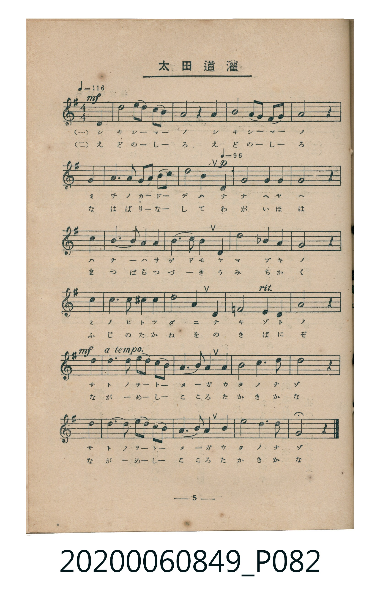
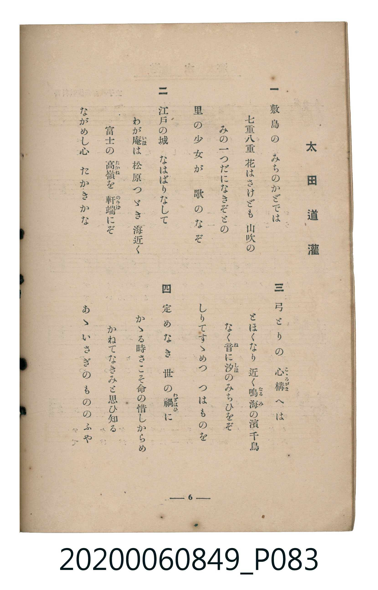

# 太田道灌

> Re:Shōka 使用 AI 協助辨識與重建樂譜，可能會有錯誤。歡迎回報。

- **鋼琴伴奏版**：<br><audio controls src="ota_dokan.mp3"></audio>

- 臺灣教育會公認《新定兒童唱歌》高等科女子用（2020.006.0849）

## 說明

原書資訊與歌詞全文（對應 P082–P083.jpg，書頁 pp. 5–6，高二第一學期第 5 首）：
調性與拍號：ト長調（1 升記號）、4/4 拍（♩=116，中段轉 ♩=96，末段 a tempo，弱起第 4 拍進入）


## 歌詞

```text
一
敷島の　みちのかどでは
七重八重　花はさけども　山吹の
みの一つだになきぞとの
里の少女が　歌のなぞ

二
江戸の城　なはばりなして
わが庵（いほ）は　松原つゞき　海近く
富士の高嶺（たかね）を　軒端（のきば）にぞ
ながめし心　たかきかな

三
弓とりの　心構（こゝろがま）へは
とほくなり　近く鳴海（なるみ）の濱千鳥
なく音（ね）に汐（しほ）のみちひをぞ
しりてすゝめつ　つはものを

四
定めなき　世の禍（わざはひ）に
かゝる時さこそ命の惜しからめ
かねてなきみと思ひ知る
あゝいさぎのもののふや
```

## ABC

<div class="abc-score" data-abc-src="ota_dokan.abc" aria-label="五線譜載入中"></div>

[下載 ABC 原始檔](ota_dokan.abc)

## TMD 檔案連結

- [主旋律 TMD 檔案](ota_dokan.tmd) [[在 TMD Studio 編輯](https://tmdlang.github.io/Tmd-TS/#tmd=s7IKdvYPcrWy4qpTUCpJTLdSSM7PyUlNLsnMz7MqzsjMK0nNjM_KTMmPL87Iz05Ugisry88pzU21ys4vyY9PzyzKKY43MjAyiDcwMIs3sDCxRCgszi8tSk61Kk7OyM_PiS9JrShJys_PRsgXFOWXpeYl5gHVFBSB7EsBK0IoSC3LTEkFSaemZJbkF2Um5iC5IrWoGOxSsCXxJUWJecXJRZkFIOcjVJVkpAKdmpFZDNReiRAGmpWemWdVkpgJ9BvIf-WJ8bmJmXk5iXkpSlxaWgpPl6x6PmXDy8bJzxt7FLS0uBRtFQwNzbjsbRXcuWxM9E3sQEa9aN_1vHHxs6kzXzRtejan-Wnrmhereh83dD2btuHpullPWyc9X7306ZSNz9b2PG7ofrl6xvO1nc-XT3y6dPPTtROeT1nxfk8HKOD0gAGnBwq493s6lbi49LUUbKkFuBQUFJ72zX82e8eLze0vVnS96GgHOubFynlPW1c8m9YOdMDTDb3P2jsVAgwsjB41TAZSxnpZBenv9_QA9bxc0KhQUKCnYAqUMQMKAX3wZFfP8zVrnuxoeLp2x7M584FsBVOFl8umAZ3-fs8skHUvVu1_1rAcZFF374uZ84Gij5s7Xk7dDhQHWmeo8LQX6JAZYJnOxw2NwKBUAKoESj2audIWGMRAe57sWPts3dYXezsVQGKWIKFnc1YDhRQSFUpScwvygQJP92x8sXU7yH6w_pcNm562LgUayQVyA9B9IOrZ1O1PN2973LjucUPD48b9jxsXgtiN3Y8bVz5uXP64cT1EbfPL9t6nrauBJFDdi66NQInHjVMfN04EqWtqAgo-3bjx6YSdQM0gDWCT1gGteNy45HHjgseNqx83rnrc2Pu4cd7jxhVQRS_be4CspxtAkf24ERj9DaBEALIdqHQexJG7esCO3Dj_WccOkOL5fWB3AhUA7d_wuKkLzJ7-uHEZ2NqmfqBBT3dtBQbV48aWx427QQEIVAo0eu4-YCSDnNMEdALIF8-2bn-xH-j-fnACWN_zdDHQkeuA8fd02y6wfqBqYDCsBRnRNAnk7d3AtLoeLAV0I9AvG8CmA3XNg_gZ6JKex02NQPc83d8MdifECKBSILkKGuydYPv2TAYFBMj9oJAHqn-2vBts9OTHTXMfNwG1AINiH9gCoMfBsQAOud1AB4NsAuoEugjs_pebtwD9AtYMFAfaBExEQG3rnu3f-LS3-eXmpXDX9b-cvxmsDuypxtXPNk4Ac4HhBwkpoL8gSWATyMswf00Hu3PZ48aZYLcBPbgE7Dtg1K4HRT5QW9MksO-ezp4NptbNAisDR3lDw5Md04Bqni8DpWBwFAG5wOjbBHEExI5usNHdz2YCjQOmK2DozH06cS_IF81zwA4EKgDGQyNMdeNasIsgiQro5hXPGuYCjXw-fynQFIiiJpCRoFQANK8P7EiwU0Fo6-OmFpAiyksPKFDQ0ufi8gUWjlYBmYl5-Q41BjXVIAsUbAzNtOzALGCZBcmQTzf0P1_fAMr0TdtB-kCSNQoGCrpgiE5X56bVKpjGQ3k14GAGmQUpYl4s7AEbtBaY9rcrPG7eA8TzwHQNkOwDiwJZOOU1HjfP10Q4whhqDQyagkljBSMgaQiyHsxChjBnwsQxzYDIGCqYgfwA9kgN2CxspsDEUb25qwfqzeZGqKdWQ73SCfdKOxD3A3EXmNcFxDOAeAmYNwPkzX4kbyJ7AsQGYZCzQd41AzsQ4nEEhHmqWhFY1tYqVBcgxwmGd2Dmw72DM9hg5qLFayfMwyCPgDwK9FrTViDeBPYQyNuL4N4Dxec0cBxjjVNkr4A8B-PDPFwDFoVBkAjMUTCVqCrAenXQfIo7SrH6EFhOwHwIjM7mSUDcAcQtYB80AHE3LCrBKXcfWB7mu6atSL5DdhnYd-pIHIjLzNEdj-4ynPEHgub4UywwQQArZGCKAGVT7LG5awrMryA_gvy7CRqrID4k-S6EiDStAeJlYH_vh6qFhMI-dH8jxyosJkE09pwKkoH5AJwPIf7GnlURWjDzAf5YbV1LDZ9SwY-IqEVPuehm4o5ZGF3DVcvFpWunACrdFYC0MhcA)]
- [鋼琴伴奏 TMD 檔案](ota_dokan_piano.tmd) [[在 TMD Studio 編輯](https://tmdlang.github.io/Tmd-TS/#tmd=s7IKdvYPcrWy4tLSUni6ZNXzKRteNk5-3tjzfk_Hy-49zydsebJny9Ol_c87O97v6VTQ0uJStFUwNDTjsrdVcOeyMdE3seOqU1B60b7reePiZ1Nnvmja9GxO89PWNS9W9T5u6Ho2bcPTdbOetk56vnrp0ykbn63tedzQ_XL1jOdrO58vn_h06eanayc8n7ICaJmRgZGBnoGBmZ6BhYkl0ColLi7fxMw8q4DMxLz8IA-HGoOaai4FILAxNNOyA7P0gS7es_HF1u1PN_Q_X9-goKUPFq5RMFDQBUN0ujo3rVbBNB7Kq-GCmfJ8zZonOxpeLOxBGGEMVQSDpmDSWMEISBqCNINZyBBmCUwc0wyIjKGCGcgFYGfUgM3CZgpMHNWRu3pQHInsBBAbhEGWghxrBjYe4mwEhDmpWtHW0qxWoboAOTwwHAMzH-4YnJ6GmYsWpp0ozkV2DMh5MD7MyTVgURgEicCMhalEVQHWq4PmVtxBitWNT2fPRnEjsvlgN6ojcSDmm6M7Ad18nOEIgub44x0YMcDcBYwZUFLFHqq7puAMVVhIgmjsKRUkA7MbnA4hLsaeVBFaMFMS_lBtXUslNyICFT3m0c3EHaYwuoarFrlQ8UEuVCyIKVOQMd7SozoXmLEM40F5yxhMIrOBwREfr2AUD0wKYArEg5qJog5VFaockI3NGWjlA6Y9eM1DKhQwXUOkD_Dlf9zGmQANAIqYgEm4lAG6jBGQYwaxEiQHdQRQMZDEHiIY2RuoBWgyUDGQROEA8wCQC_IQ0DwQBeLCogXFFQhrQY7AForQHAwLR3y5l9ggRrgVZCmKy8GyILchhQn-iEHPnsQ6AnfMYAsTeIxA7AfmPV07BVD2UwDSylwA)]

## 分析

```text
================================================================================
📊 TMD Song Profile: [ 太田道灌 ]
================================================================================
⏱  Duration:       0:56 (56.0s), 25 measures total
🎼 Key & Tempo:    首調基準 G, != 116.0 BPM, <4/4>
   - 分析範圍：      由實際發聲的音符與和弦推測調性；播放脈絡另行呈現
🎤 人聲音域:    D4 (MIDI 62) – F#5 (MIDI 78) [跨度: 16 個半音 / 1.3 個八度, 難度: moderate]
   - 最低音:  D4 in [Main #1 @ m.1, 0:01]
   - 最高音: F#5 in [Main #1 @ m.15, 0:32]
   - 適合: soprano, mezzo-soprano, tenor, baritone
🏛  結構:      Main (56.0s)
⚡ 編曲密度:        Peak 1 軌道同時演奏
🗝  調性診斷：       G 調性不明確（純淨自然大調，未偵測到可信轉調）
   - 風格氣質:    純淨自然大調（陽光明朗、易唱易記，無明顯調外色彩）
   - 轉調歷程:    全曲維持單一推測調性（未偵測到可信轉調）
   - 核心骨幹音:  B, D, G, A, E
   - 調性數值:    G 調性不明確 [相關度: 0.78, 穩定度: Ambiguous, 自然音純度: 97.8%]
   - 候選調性 (K-S): G 大調 (0.78), D 大調 (0.76), B 小調 (0.70)
   - 五度圈歷程:   +1
   - 各段落調性細節:
     • [Main #1]: G 調性不明確 (r: 0.78, 自然音純度: 97.8%, 調外音: D#, A#)

  [ 五度圈游移軌跡 ]
               C  
         F           [G ]*
      Bb               D  
      Eb               A  
         Ab           E  
            Db       B  
               F# 
     (* = active key center)

  [ 十二半音累積音高分佈 ]
     C  :                            0.0%
     C# :                            0.0%
     D  : █████████████████████     19.9%
     D# : █                          1.1%
     E  : █████████████             12.4%
     F  :                            0.0%
     F# : ███                        2.8%
     G  : █████████████████████     19.9%
     G# :                            0.0%
     A  : █████████████████████     19.9%
     A# : █                          1.1%
     B  : ████████████████████████  22.8%
--------------------------------------------------------------------------------
Assignment 軌道音域：
  - Piano         : D4 – F#5 (16 個半音 / 1.3 個八度, 84 個音符)
================================================================================
```


## 原書掃描頁






