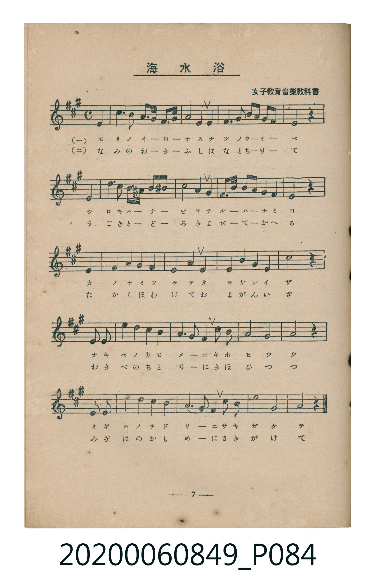
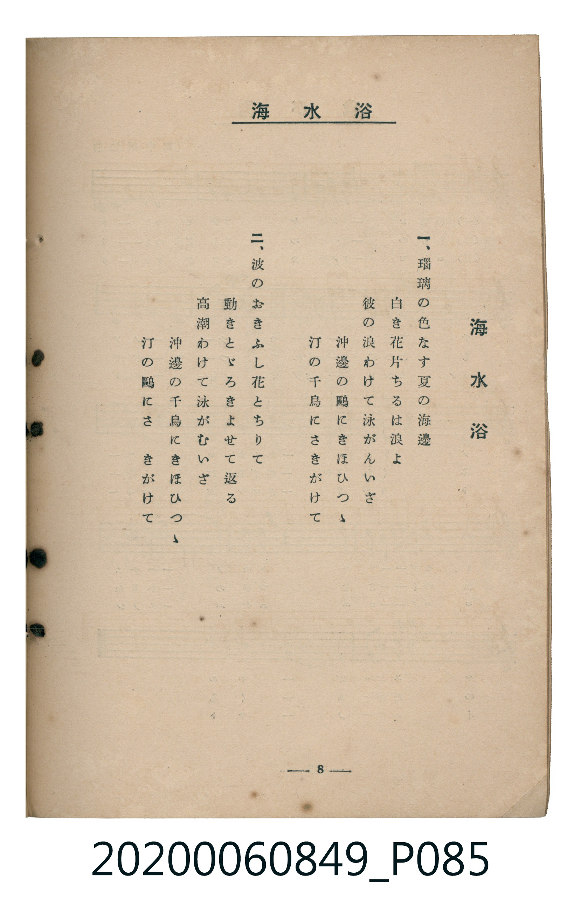

# 海水浴

> Re:Shoka 使用 AI 協助辨識與重建樂譜，可能會有錯誤。歡迎回報。

<audio controls src="kaisuiyoku.mp3"></audio>

- 出處：女子教育音樂教科書
- 臺灣教育會公認《新定兒童唱歌》高等科女子用（2020.006.0849）

## 說明

原書資訊與歌詞全文（對應 P084–P085.jpg，書頁 pp. 7–8，高二第一學期第 6 首）：
調性與拍號：イ長調（3 升記號）、4/4 拍（弱起第 4 拍進入）

## 歌詞

```text
一、
瑠璃（るり）の色なす夏の海邊
白き花片（はなびら）ちるは浪よ
彼の浪わけて泳がんいざ
沖邊の鷗（かもめ）にきほひつゝ
汀（みぎは）の千鳥にさきがけて

二、
波のおきふし花とちりて
動きとゞろきよせて返る
高潮わけて泳がむいざ
沖邊の千鳥にきほひつゝ
汀の鷗にさきがけて
```

## ABC

```abc
X:1
T:海水浴
M:4/4
L:1/16
Q:1/4=96
K:A
V:V1 name="Piano" snm="Pia"
[V:V1]
!mf! z4 z4 z4 E4 | c6 B2 c3 B A2 B2 | A8 F4 F4 | F6 G2 c2 B2 A2 F2 |
E8 z4 E4 | e6 c2 A3 G B2 ^A2 | B8 B4 B4 | B2 e2 c3 B A4 G4 |
E8 z4 E4 | F4 G4 A4 F4 | E8 A4 A4 | G4 B4 A4 c4 |
B8 z4 E2 E2 | e4 d4 c4 B4 | A6 G2 F4 d2 B2 | A8 G8 |
F8 z4 E2 E2 | c4 d4 c4 B4 | A6 G2 F4 d2 B2 | e8 G8 |
A8 z4 z4 |
```

## TMD 檔案連結

- [主旋律 TMD 檔案](kaisuiyoku.tmd) [[在 TMD Studio 編輯](https://tmdlang.github.io/Tmd-TS/#tmd=s7IKdvYPcrWy4qpTUCpJTLdSSM7PyUlNLsnMz7MqzsjMK0nNjM_KTMmPL87Iz05Ugisry88pzU21ys4vyY9PzyzKKY43MjAyiDcwMIs3sDCxRCgszi8tSk61Kk7OyM_PiS9JrShJys_PRsgXFOWXpeYl5gHVFBSB7EsBK0IoSC3LTEkFSaemZJbkF2Um5iC5IrWoGOxSsCXxJUWJecXJRZkFIOcjVJVkpAKdWp5YklqELlhckF8EtEtLS-HZ1u3PNmx5tnWLgpYWl6KtgqUZl72tgiOXjYm-iR1I19P2XS9mTn2_Z9bTpZufrp3wbOrMF02bXs7f_GxFE5D9fPnEZ7N3gI1_0b7reeNiiPyzOc1PW9e8WNX7uKHr2bQNT9fNeto66fnqpU-nbHy2tudxQ_fL1TOer-0E6oaY-nzKivd7OkBBqQcMSj1QUL7f06nExaWvpWBLLcCloKDwtG8-0L0vNre_WNH1oqMd6JgXK-c9bV3xbFo70AFPN_Q-a-9UCADa_6hhMpAy1csqSH-_pweo5-WCRoWCAj0Fc6CMBVAI6IMnu3qer1nzZEfD07U7ns2ZD2QrmCm8XDYN6HRgeIGse7Fq_7OG5SCLuntfzJwPFH3ctOTl1O1AcaB1xgpPe4EOmQGW6Xzc0AgMcwWgSpBL9mx8sXU7yESwyMuGTU9blwIVcYFMBdoIVAxiPZ-44PmkZqD6x03dj5u6QKY0rnvRuelx46rHjTOfLukHcoEx_LKpC6x65t7Hjb0vujY-7wT59nHjerC6zY-bgO4F6lwIMqVx_bOtqx43dYBDa-8esAFAPtCkiY8blz3bvPlxY8_jpsmPG1seN04DKXq2aRrQfKC6l9ung00FuqTpcVMj2MjVQAsfN-5-3Ah00pLHTXPBGjY2gNXtf9zYB7QO4uinvc0vNy8Fa5gK1tMDsRDi4V3ANAP28LPNi4CKHzcC7QOq2fq4cTrQO48bV4AdDxRcBnZ2N8SIFY-b5j1uAjJ6gf553DgbKP1i_xSgJ0GKgPH3bO86DI81YPEYktuweQbidSxOB0pTnmqhQEFLn4vLNzEzzyogMzEv36HGoEahGmSDgo2hmZYdmAXMLJB083RD__P1wECe9bh5NUgjSLJGwUBBFwzR6erctFoF03gorwYc4iCzIGn7xcIesEGrFB439ykAky-Q3gPEa8F0DZDsAoruBNMgXgtU3TKouvlwdTMVNB43bddEOMgYaiUIGgExhG-kYAjl14BZyNAM5ko4owbBBEFzEAdkDkg_SDdYtgbhPRiEeR6Hv3f1wPwN9GcTyK_9UP8AfQv1z2QgXgnEjWDeaqg8srr5YJkVIH-vRvK3KZI7QG6F-BLodLCj1cEOBjGRIYwPoyEqQCYhhxo8CCBKSPX1jk6Yr4ExCPXB4-b1IF80bQSy2oD0KqifHjetAdKbwSkCJL8N5EtgImlai-RTeNzAHQVzJVIEYrgSpgZG1yC0w7wPk4IlIcwAQ_EqmEDx69PZs2F-nQlNsaAYXAT23UJoHHZD4342WHQSOHVD0rgGOGia1mGJVRM0pyFiDDk1g30EDwSQHuwpHu5zGERL8ER49cmuKTCvghInKGobgbgT7BVQtoZ5dSvYu6DIBEYtMMJB8m2Y2ZUyDyInfhweRA8D9AKrhquWi0vXTgFUHCoAaWUuLgA)]
- [鋼琴伴奏 TMD 檔案](kaisuiyoku_piano.tmd) [[在 TMD Studio 編輯](https://tmdlang.github.io/Tmd-TS/#tmd=s7IKdvYPcrWy4tLSUni2dfuzDVuebd3yfk_Hy-49zydsebJny9Ol_c87O97v6VTQ0uJStFWwNOOyt1Vw5LIx0Tex46pTUHravuvFzKnv98x6unTz07UTnk2d-aJp08v5m5-taAKyny-f-Gz2DiWQwhftu543LobIP5vT_LR1zYtVvY8bup5N2_B03aynrZOer176dMrGZ2t7Hjd0v1w94_naTqBuiKnPp6wAOsrIwMhAz8DATM_AwsQS6CQlLi7fxMw8q4DMxLz8IA-HGoMahWouBSCwMTTTsgOz9LUUnu7Z-GLr9qcb-p-vb1DQ0gcL1ygYKOiCITpdnZtWq2AaD-XVcMFMeb5mzZMdDS8W9iCMMIYqAkEjIIbwjRQMofwaMAsZmsHMhTNqEEwQNAdxQOaA9IN0g2VrEA6CQZhzcbh0Vw-KS02RdIJMh7gLaBnYGnWwFSAmMoTxYTREBcgkZH_CHQ1RQqo7d3SiuBMeFnAjYXYgBRiGHTA1MLoGoR3meJgULMowvYviUDCB4tKns2djDVETNIMRoYUc92D3wL0A0oM9fcDdDYNoyYMIhz7ZNQVrIqXMocgJCIdD0f2CnrFquGqR86sPSn61ICa7ImO8GbM6t6BWwTAeFDrGYBKZXaNgEg8WMYGSIK-AjUSVQNVjCpQyArPBJFwPvlyHbIIZUAuQBQxaIInbOJgEUCtQnRGQA9IIFUQ1EcjGGhSoOQrqJagJUFdABXGZB1NtjqIJ4iTiQgI9t0DsAZsFZcO9hGI61GFACQOoTXApVDeh6QNxsEYIal6gnjMgxsBMhAcdxAXAdK5rpwBK6gpAWpmLCwA)]

## 分析

```text
================================================================================
📊 TMD Song Profile: [ 海水浴 ]
================================================================================
⏱  Duration:       0:52 (52.5s), 21 measures total
🎼 Key & Tempo:    首調基準 A, != 96.0 BPM, <4/4>
   - 分析範圍：      由實際發聲的音符與和弦推測調性；播放脈絡另行呈現
🎤 人聲音域:    E4 (MIDI 64) – E5 (MIDI 76) [跨度: 12 個半音 / 1.0 個八度, 難度: easy]
   - 最低音:  E4 in [Main #1 @ m.1, 0:01]
   - 最高音: E5 in [Main #1 @ m.6, 0:12]
   - 適合: soprano, mezzo-soprano, contralto, tenor, baritone, bass
🏛  結構:      Main (52.5s)
⚡ 編曲密度:        Peak 1 軌道同時演奏
🗝  調性診斷：       E 大調（純淨自然大調，未偵測到可信轉調）
   - 風格氣質:    純淨自然大調（陽光明朗、易唱易記，無明顯調外色彩）
   - 轉調歷程:    全曲維持單一推測調性（未偵測到可信轉調）
   - 核心骨幹音:  E, A, B, F#, G#
   - 調性數值:    E 大調 [相關度: 0.89, 穩定度: Moderate, 自然音純度: 95.3%]
   - 候選調性 (K-S): E 大調 (0.89), A 大調 (0.83), F# 小調 (0.60)
   - 五度圈歷程:   +4
   - 各段落調性細節:
     • [Main #1]: E 大調 (r: 0.89, 自然音純度: 95.3%, 調外音: D, A#)

  [ 五度圈游移軌跡 ]
               C  
         F            G  
      Bb               D  
      Eb               A  
         Ab          [E ]*
            Db       B  
               F# 
     (* = active key center)

  [ 十二半音累積音高分佈 ]
     C  :                            0.0%
     C# : ████████████              10.7%
     D  : █████                      4.0%
     D# :                            0.0%
     E  : ████████████████████████  21.3%
     F  :                            0.0%
     F# : ███████████████           13.3%
     G  :                            0.0%
     G# : █████████████             11.7%
     A  : ████████████████████████  21.0%
     A# : █                          0.7%
     B  : ████████████████████      17.3%
--------------------------------------------------------------------------------
Assignment 軌道音域：
  - Piano         : E4 – E5 (12 個半音 / 1.0 個八度, 75 個音符)
================================================================================
```


## 原書掃描頁






