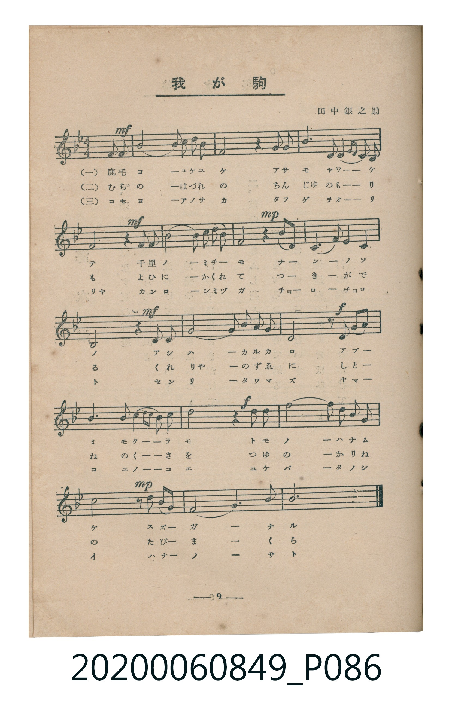
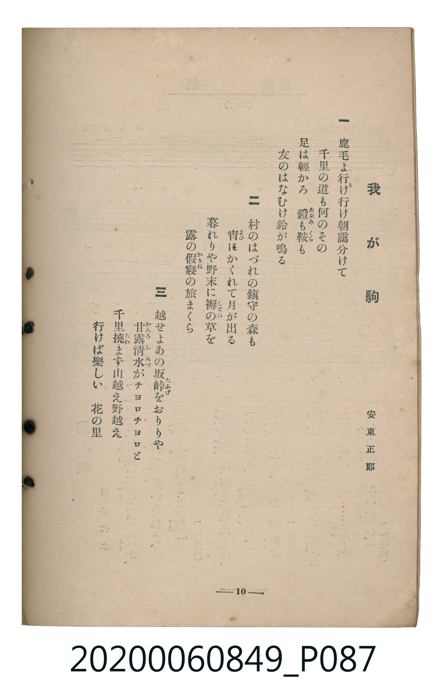

# 我が駒

<audio controls src="waga_koma.mp3"></audio>

- 詞：安東正郎
- 曲：田中銀之助
- 臺灣教育會公認《新定兒童唱歌》高等科女子用（2020.006.0849）

## 說明

原書資訊與歌詞全文（對應 P086–P087.jpg，書頁 pp. 9–10，高二第一學期第 7 首）：
調性與拍號：ヘ長調（1 降記號）、4/4 拍（弱起第 4 拍進入）

## 歌詞

```text
一
鹿毛よ行け行け朝靄分けて
千里の道も何のその
足は輕かろ　鐙（あぶみ）も鞍（くら）も
友のはなむけ鈴が鳴る

二
村のはづれの鎮守の森も
宵（よひ）にかくれて月が出る
暮れりや野末に褥（しとね）の草を
露の假寢（かりね）の旅まくら

三
越せよあの坂峠（たふげ）をおりりや
甘露清水（かんろしみづ）がチョロチョロと
千里撓（たわ）まず山越え野越え
行けば樂しい　花の里
```

## ABC

```abc
X:1
T:我が駒
C:曲：田中銀之助
M:4/4
L:1/16
Q:1/4=104
K:F
V:V1 name="Piano" snm="Pia"
[V:V1]
!mf! z4 z4 z4 F2 G2 | A10 G2 F2 G2 | A8 z4 A2 A2 | d6 F2 G3 A G2 F2 |
!mf! D8 z4 D2 F2 | G10 A2 B2 c2 | !mp! A8 z4 A3 F | D6 F2 G4 F4 |
!mf! A,8 z4 D2 D2 | F10 G2 F2 G2 | !f! D8 z2 D2 G2 A2 | B6 G2 A2 G2 F2 G2 |
!f! A8 z4 A2 A2 | d10 c2 A2 c2 | !mp! A8 z2 A2 G2 F2 | D8 F6 G2 |
F12 z4 |
```

## TMD 檔案連結

- [主旋律 TMD 檔案](waga_koma.tmd) [[在 TMD Studio 編輯](https://tmdlang.github.io/Tmd-TS/#tmd=s7IKdvYPcrWy4tLSUnjWMfFxY8_L5ZMUtLS4FG0VDA1MuOxtFdy4bEz0Tey46hSUXqyc937PrKfrOp_N3fhs7eKXzX1KIOFnszcBhZ9P2fBkx9qXXQ1PdnY_7VoJlnnRvut54-JnU2e-aNr0bE7z09Y1L1b1Pm7oejZtw9N1s562Tnq-eunTKUCzeh43dL9cPeP52s7nyyc-Xbr56doJz6eseL-nw8jAyEDPwMBMz8DCxPL9nk4lLi59LQVbagEuBQWFp33zn83e8WJz-4sVXS862oGOAfrzaeuKZ9PagQ54uqH3WXunQoCBhdmjhslAylwvqyD9_Z4eoJ6XCxoVCgr0FCyBMoYGQDGgF57s6nm-Zs2THQ1P1-54Nmc-kK1grvBy2TSg24GBBLLvxar9zxqWg2zq7n0xcz5Q9HHzjJdTtwPFgfYZKryc2ftixQywTOfjhkZg4CsAVYKcsmfji63bQSaCRV42bHrauhSoiAtkKtBGEPVy5_5n62c_bup4sbDnceNECPlsztyXc1uedrQB2Y8bl4E93dv8sh0ot-5l4-THTU1P9k4Fsh83zgWSYDdu2_y4cf2LPUDR7sdNwChreDlhJtAJjxubHjdue9wIdGknUNvLeSB3PW7sf9wE9B1IBGx2fzfYsPWPG1c9bmoAWvqyYwsoaW3e8ripG-LaXT0g6tlcoHsgKpc-bgI7p2_d03VAE9c9W7wOZty6rSBLmoCiwHTW-bhxNchRIDuBGpY9mwMU73navgtkNMjIWUB9PY-buh43tbxs73s2B6h69YslwHACqpv-uHHF48a1YFPWvegFOngSONDmbALynza2P12_CKwO6OcuuLpn01sfN-6DeBIa1J2QMAKqAQU1OFDWPZ3b9HTzArD2-Y8btz5unAQOkUmPG4FOgaAWkLbnU2YA7Xu2o_XZhi0wy4BR0At23X5gQIBt7Xnc3Pi4efnj5rUIRuMKRMw9mzQZalVTP1gD0IGznm7cCHZUB9DjEAbYneA08Lhxw7MVQHcCLWkBRueLro2g0G4HRwPl-QgKFLT0ubh8EzPzrAIyE_PyHWoMahSqQTYo2BiaadmBWcDsC0nITzf0P1_fAEz-kDQL0guSr1EwUNAFQ3S6OjetVsEQyDAC4hpwVIBMg2Q3oC_BOWmFwuPmPUC8TOFx00YwXQNhNS0C4q0gXjOQ1bwEiNdD1QIxUAXcfmOofcgQZCXcagwVMBeCxEG4RsEMSRamDyQHMwfV-bt6YM5vA8WvAjBewA7tgzpwPhA3gtkw53fBeZuhaoBqm_YiPGEWj8ON4FAEy4LdAXUZKgT5wQSITfH6tjq3oBYqaYhuI8LPEDYIokVZJ8zPIJeDImc72D_90AhZDaSBGEiDRNdC1DRPA8siooqwL8FEDdwRuCMVa4hVw4wBqQFHLbInns6eDfMEKIpAnkBKU80r4dHVAaaRoxTkTVAkLkB4BhTiyE4DWUdcugO5Envag0FQTIJkwTGKmvamQL0AziQ7gXgXLG01rYE6tgvs9NW4swg4qGDJAZ7GMYMUORYgXsIWL8heq-Gq5eLStVMAlSoKQFqZiwsA)]
- [鋼琴伴奏 TMD 檔案](waga_koma_piano.tmd) [[在 TMD Studio 編輯](https://tmdlang.github.io/Tmd-TS/#tmd=s7IKdvYPcrWy4tLSUnjWMfFxY8_L5ZPe7-l42b3n-YQtT_Zsebq0_3lnx_s9nQpaWlyKtgqGBiZc9rYKblw2Jvomdlx1CkovVs57v2fW03Wdz-ZufLZ28cvmPiWQ8LPZm4DCz6dseLJj7cuuhic7u592rQTLvGjf9bxx8bOpM180bXo2p_lp65oXq3ofN3Q9m7bh6bpZT1snPV-99OkUoFk9jxu6X66e8Xxt5_PlE58u3fx07YTnU1YAXWdkYGSgZ2BgpmdgYWIJdJsSF5dvYmaeVUBmYl5-kIdDjUGNQjWXAhDYGJpp2YFZ-loKT_dsfLF1-9MN_c_XNyho6YOFaxQMFHTBEJ2uzk2rVTAEMoyAuIYLZsjzNWue7Gh4sbAHYYIxVAcyBGmCa8ZQAbMDJA7CNQpmSLIwfSA5mDmoDtjVg-IAs3gc5oP9AJYFmwE1FRWC7DcBYlO8Lq3OLaiFShqi24hwL4QNgmgB1okaYITdCyZq4MbhDlqsfq-GGQNSAw5gZOc8nT0bxTkg3yMbDtJAXPyB7MEehzAIClWQLDh0UeNwCt5EBPYGLNDhqQDTu8ghBHEstjBDdnQNVy1yfvFByS8WxGQXZIw3Z4A9YBYfD4pxQzCJwgF5B00OaqiCEZAN4ptAKFMgNgJRIJJAXoCahW4iihGo5pHqDKjr8SfxeAVziKkQCmGmCZANNAFoJJBEcwjMPiAHQsG14UvAUEOAJkL1kRHCqNrwpVSCJkIdAfUn1HHAdAn2JpBEJEdwUtS1UwClRgUgrczFBQA)]

## 分析

```text
================================================================================
📊 TMD Song Profile: [ 我が駒 ]
================================================================================
⏱  Duration:       0:39 (39.2s), 17 measures total
🎼 Key & Tempo:    首調基準 F, != 104.0 BPM, <4/4>
   - 分析範圍：      由實際發聲的音符與和弦推測調性；播放脈絡另行呈現
🎤 人聲音域:    A3 (MIDI 57) – D5 (MIDI 74) [跨度: 17 個半音 / 1.4 個八度, 難度: challenging]
   - 最低音:  A3 in [Main #1 @ m.9, 0:18]
   - 最高音: D5 in [Main #1 @ m.4, 0:06]
   - 適合: soprano, mezzo-soprano, contralto, tenor, baritone, bass
🏛  結構:      Main (39.2s)
⚡ 編曲密度:        Peak 1 軌道同時演奏
🗝  調性診斷：       D 小調（純淨自然小調，未偵測到可信轉調）
   - 風格氣質:    純淨自然小調（陰鬱抒情、旋律集中，無明顯調外色彩）
   - 轉調歷程:    全曲維持單一推測調性（未偵測到可信轉調）
   - 核心骨幹音:  A, D, F, G, A#
   - 調性數值:    D 小調 [相關度: 0.82, 穩定度: High, 自然音純度: 100.0%]
   - 候選調性 (K-S): D 小調 (0.82), F 大調 (0.60), D 大調 (0.58)
   - 五度圈歷程:   +2
   - 各段落調性細節:
     • [Main #1]: D 小調 (r: 0.82, 自然音純度: 100.0%)

  [ 五度圈游移軌跡 ]
               C  
         F            G  
      Bb              [D ]*
      Eb               A  
         Ab           E  
            Db       B  
               F# 
     (* = active key center)

  [ 十二半音累積音高分佈 ]
     C  : ██                         2.6%
     C# :                            0.0%
     D  : ██████████████████        23.3%
     D# :                            0.0%
     E  :                            0.0%
     F  : █████████████████         22.0%
     F# :                            0.0%
     G  : ██████████████            17.7%
     G# :                            0.0%
     A  : ████████████████████████  31.0%
     A# : ███                        3.4%
     B  :                            0.0%
--------------------------------------------------------------------------------
Assignment 軌道音域：
  - Piano         : A3 – D5 (17 個半音 / 1.4 個八度, 61 個音符)
================================================================================
```


## 原書掃描頁






