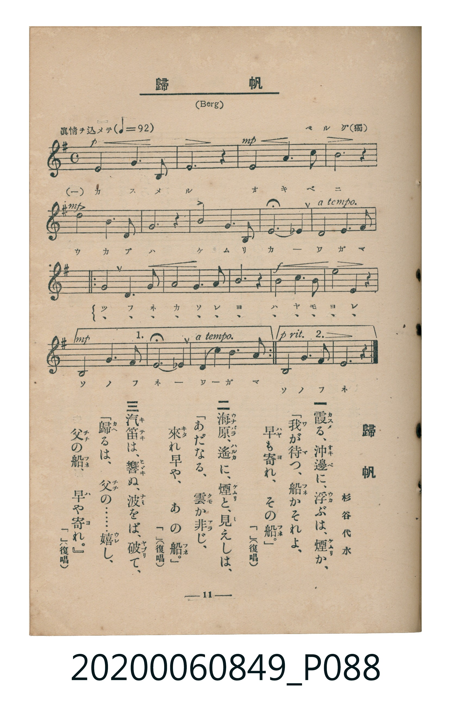

# 歸帆

<audio controls src="kihan.mp3"></audio>

- 詞：杉谷代水
- 曲：Berg（德國曲）
- 臺灣教育會公認《新定兒童唱歌》高等科女子用（2020.006.0849）

## 說明

原書資訊與歌詞全文（對應 P088.jpg，書頁 p. 11，高二第一學期第 8 首）：
調性與拍號：ト長調（1 升記號）、3/4 拍（眞情ヲ込メテ ♩=92）
勘誤註記：原譜譜頭拍號誤植為 C（4/4），且第一行誤加兩處小節線；依全曲各小節實際時值（每小節 3 拍）與樂句結構修正為 3/4 拍。

## 歌詞

```text
一
霞（かす）める、沖邊（おきべ）に、浮（うか）ぶは、煙（けむり）か、
「我（わ）が待（ま）つ、船（ふね）かそれよ、
早（はや）も寄（よ）れ、その船（ふね）。」（「」復唱）

二
海原（うなばら）、遙（はるか）に、煙（けむり）と、見（み）えしは、
「あだなる、雲（くも）か非（あら）じ、
來（きた）れ早や、あの船（ふね）。」（「」復唱）

三
汽笛（きてき）は、響（ひゞき）ぬ、波（なみ）をば、破（やぶ）りて、
「歸（かへ）るは、父（ちゝ）の……嬉（うれ）し、
父（ちゝ）の船（ふね）、早（は）や寄（よ）れ。」（「」復唱）
```

## 原書掃描頁



## 分析

```text
================================================================================
📊 TMD Song Profile: [ 歸帆 ]
================================================================================
⏱  Duration:       0:46 (47.0s), 24 measures total
🎼 Key & Tempo:    首調基準 G, != 92.0 BPM, <3/4>
   - 分析範圍：      由實際發聲的音符與和弦推測調性；播放脈絡另行呈現
🎤 人聲音域:    D4 (MIDI 62) – E5 (MIDI 76) [跨度: 14 個半音 / 1.2 個八度, 難度: moderate]
   - 最低音:  D4 in [Main #1 @ m.1, 0:01]
   - 最高音: E5 in [Main #1 @ m.3, 0:05]
   - 適合: soprano, mezzo-soprano, contralto, tenor, baritone, bass
🏛  結構:      Main (47.0s)
⚡ 編曲密度:        Peak 1 軌道同時演奏
🗝  調性診斷：       G 大調（純淨自然大調，未偵測到可信轉調）
   - 風格氣質:    純淨自然大調（陽光明朗、易唱易記，無明顯調外色彩）
   - 轉調歷程:    全曲維持單一推測調性（未偵測到可信轉調）
   - 核心骨幹音:  G, D, B, F#, A
   - 調性數值:    G 大調 [相關度: 0.91, 穩定度: High, 自然音純度: 96.9%]
   - 候選調性 (K-S): G 大調 (0.91), D 大調 (0.75), B 小調 (0.69)
   - 五度圈歷程:   +1
   - 各段落調性細節:
     • [Main #1]: G 大調 (r: 0.91, 自然音純度: 96.9%, 調外音: F)

  [ 五度圈游移軌跡 ]
               C  
         F           [G ]*
      Bb               D  
      Eb               A  
         Ab           E  
            Db       B  
               F# 
     (* = active key center)

  [ 十二半音累積音高分佈 ]
     C  : ████                       3.9%
     C# :                            0.0%
     D  : ██████████████████        19.5%
     D# :                            0.0%
     E  : ██████                     7.0%
     F  : ███                        3.1%
     F# : ███████████               11.7%
     G  : ████████████████████████  26.6%
     G# :                            0.0%
     A  : ███████████               11.7%
     A# :                            0.0%
     B  : ███████████████           16.4%
--------------------------------------------------------------------------------
Assignment 軌道音域：
  - Piano         : D4 – E5 (14 個半音 / 1.2 個八度, 56 個音符)
================================================================================
```

## ABC

```abc
X:1
T:歸帆
C:曲：Berg（德國曲）
M:3/4
L:1/16
Q:1/4=92
K:G
V:V1 name="Piano" snm="Pia"
[V:V1]
!p! g4 b6 d2 | g8 z4 | !mp! g4 c6 e2 | d8 z4 |
!mp! d4 b6 g2 | a8 z4 | d4 b6 g2 | f8 =f4 |
e4 a6 g2 | f6 d4 g2 | a4 g6 c2 | b8 z4 |
!f! d4 b4 e4 | d4 g4 z4 | !mp! d4 g6 a2 | f8 =f4 |
e4 a6 g2 | f6 d4 g2 | a4 g6 c2 | b8 z4 |
!f! d4 b4 e4 | d4 g4 z4 | !p! d4 g6 f2 | g8 z4 |
```

- [主旋律 TMD 檔案](kihan.tmd)
- [鋼琴伴奏 TMD 檔案](kihan_piano.tmd)
