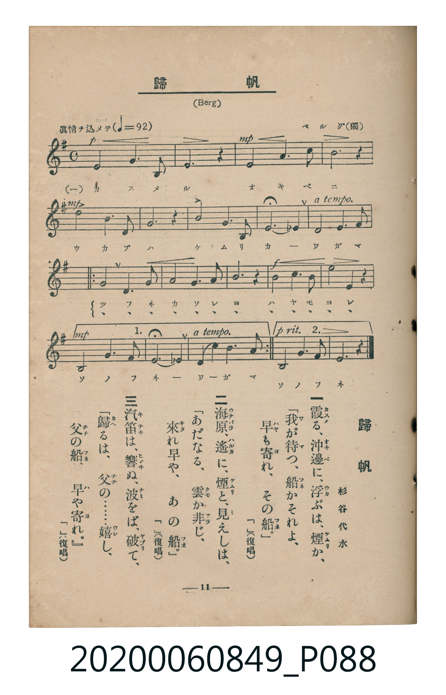

# 歸帆

> Re:Shōka 使用 AI 協助辨識與重建樂譜，可能會有錯誤。歡迎回報。

- **鋼琴伴奏版**：<br><audio controls src="kihan.mp3"></audio>
- **NEUTRINO 歌聲合成版**：<br><audio controls src="kihan_neutrino.mp3"></audio>

- 詞：杉谷代水
- 曲：ベルグ（獨）
- 臺灣教育會公認《新定兒童唱歌》高等科女子用（2020.006.0849）

## 說明

原書資訊與歌詞全文（對應 P088.jpg，書頁 p. 11，高二第一學期第 8 首）：
調性與拍號：ト長調（1 升記號）、3/4 拍（眞情ヲ込メテ ♩=92）
勘誤註記：原譜譜頭拍號誤植為 C（4/4），依全曲各小節實際時值（每小節 3 拍）修正為 3/4 拍。第 8 小節與第 16 小節第 3 拍記有臨時降記號 b7_（7,_，F♮4），上方附延長記號，次小節記 a tempo。


## 歌詞

```text
一
霞（かす）める、沖邊（おきべ）に、浮（うか）ぶは、煙（けむり）か、
「我（わ）が待（ま）つ、船（ふね）かそれよ、
早（はや）も寄（よ）れ、その船（ふね）。」（「」復唱）

二
海原（うなばら）、遙（はるか）に、煙（けむり）と、見（み）えしは、
「あだなる、雲（くも）か非（あら）じ、
來（きた）れ早や、あの船（ふね）。」（「」復唱）

三
汽笛（きてき）は、響（ひゞき）ぬ、波（なみ）をば、破（やぶ）りて、
「歸（かへ）るは、父（ちゝ）の……嬉（うれ）し、
父（ちゝ）の船（ふね）、早（は）や寄（よ）れ。」（「」復唱）
```

## ABC

<div class="abc-score" data-abc-src="kihan.abc" aria-label="五線譜載入中"></div>

[下載 ABC 原始檔](kihan.abc)

## TMD 檔案連結

- [主旋律 TMD 檔案](kihan.tmd) [[在 TMD Studio 編輯](https://tmdlang.github.io/Tmd-TS/#tmd=s7IKdvYPcrWy4qpTUCpJTLdSSM7PyUlNLsnMz7MqzsjMK0nNjM_KTMmPL87Iz05Ugisry88pzU21ys4vyY9PzyzKKY43MjAyiDcwMIs3sDCxRCgszi8tSk61Kk7OyM_PiS9JrShJys_PRpePL0hMT7UKMLCwQMgUFOWXpeYl5gF1FxSBXJIC1o5QkFqWmZIKki5OTsyLL0stykzLTE1BcmNqUTHYHxArSooS84qTizILQJ5DqMovKsnITy9KLMiotMrILC7JL8pMTsyJz07MQ_JuSUYq0LdgEwqAGrBIlKXmIJuZmZ6ZZ5WbmpmVieRnLS2FZ2t3PN3RpqClxaVoq2BpxGVvq-DOZWOsb2IH0vxi5bz3e2Y9m9v5YsP2J7sXP9uwBWzms9mbgMKPm2c-bl79uGnD-z0dz3tXvN_TCZZ80b7reePiZ1Nnvmja9GxO89PWNS9W9T5u6Ho2bcPTdbOetk56vnrp0ykbn63tedzQ_XL1jOdrO58vn_h06eanayc8nwI0pgMUc3rAmNMDxRzYWC59LQVbagEuBQWFp33zn83e8WJz-4sVXS862oGOAXr1aeuKZ9PagQ54uqH3WXunAij69bIK0t_v6QEqfrmgUaFAT8HQEMgFOvvJrp7na9Y82dHwdO2OZ3PmA9kKFgovl00DuhcYNiA7Xqza_6xhOcj07t4XM-eDQ6zj5dTtQHGgHYYKT3uBts8Ay3Q-bmgEhrkCUCUoMOfMe9bc-rh504t9ex43L3zc3KbwaOZKW0sjoEKw47tnvFi15MWK3UDtQFOBfnmxdg4QvVywFmIVUPbZkt7nTbsUnIHGmeibgB3V82TfXJAXZ296OqHl6Yb-5-sbnq5f9nLW7Gczm5427AGqfLa-HyKuYAxxSueT_euerV0MMgnqvMcNTRCvQhQCfQfiGppB-SAOWC_Qac_mdL5oXwE0_OVMEBfoLoUk83igNeY6QLLH7dHMdTCH7QCmjp0vZ7Y83b0NFEDQUOl5tmYh1JoVMxQSFUpScwvygQ7gAgUCMORB1Ms5wBTa8bix-3HjTFA4NjU-buoGhuazTdNeNnWBpboeN_Y-btwJkm1cDZLaug4s3gbUBRbc9rhxPVD8eSvQBKD4xMdNDY9BeoFSIKNA1jxu6HnWMREk3dQPluh5uq8VrHofmLsEqO5FB9AOoMjWx41roZob5z5u6nnc1AE15dn0lWAV6x83tYAd2_R0PZABNLQDzAXmiEaQnsZ16GY1ND1uACUNoDuAjKf7VgJzECg1gENiVw_Y8K3bgSkB5rNVjxs3PG4CBi4oab0EhQ3EXqCbIJ4GhQQ2H68A-WQZUA1QHJhOgSJAxnRICEFD4nFj0-PGBSA7wEH9ElQaABX1A_0D8ffLuZBIaYK6oHEGVPOTfW1gCWB8gFN9Uw8wSICBAfY30FDS_L0DnBuebdz7fM1smLHLgCTYSpB7X84H5bTHjZseN82Dia8BpYDNi8DiwEACe7FpEii0gOGxYAs4NlqAaQIsDkw6y5BSwNodsLQGZAClgQxwwukAqgaKL3zcNBdsx7pHDcuA6OkaoO_B0dHUAxafDjULUwOGvxvhaQVsUwtGQsERMEDTKS8hoUBBS5-LyzszIzHPKiAzMS_focagphpkg4KNhZYdmIGtXFaAlIsvFvYoaJhAywUdeGGqiUUD0B6QYTUK1QW1CmbxCroKhkCsq2AcDxQD80HQAIiBSnJhaozAoiZAMWNkFWCjfAxrFB43rQbyHzftBMsBC1KgSmCFBVULMgGkZhVYzVqomplgNd3IaiDmGQHFG9tAahpBOkD0BrD-TlTzGteDzYOYAEwqYDEUOyHmGYPEe8FqlkHV9sL1I5u3CSy3GUXNGhTz8EfErh5wRJiSGBGgUDaFB7IpKCLMUSMCJIMtmoClO1geqEcXJmqIEi0gD0MiBxTk08BB3o8WLRvBcgugalaBxWDB-Lh5D0RVMySwIcHxuHkeSmRNBMs1QOSausABtwItcPeDA7UDGrjTUSIAbktjE1gW6hZg9CNHITj5gM0B2TIJrH4Dml9awGq2obgEEunItoCSDLBggaoCJhwCEbujExixoMYKOO8_W7cVku2AdaYOMObQYxtYNuCLb1BEgiMMHFdIcWuEnr0UqtNqwSImYDFjUNTDNKPlv2awx5unQj0KTrvQPLkXKrYGHI1o0QJODI-bl0DVLIKrAanHyJXgvAasfaAB14QUmKCIA4l1gsVmoNoCzX3zoWp6kHIvyN3oeRUs07gQohpIg8TWgdmgUgFhwnQ0W0A6EPrWgcW2gtlr4bbgjeins2dDIhoUud1rgC0jHWCokxi_4PwMzKewDA2KZGw51gQa2cBoR8qwoNh63NwHjY-p4PgAhR56ZgSxcWVHSCYChRiI3goOB1AIoGc1sBk4MhsidkB0Bzg99WCY0Q01g8KstAvU_BzNSsMzKwEjF5qVjEjOSqg5CVgrordRiMw56K0LfDkEaxDiyAkQtbVcXLp2CuDWmwKQocwFAA)]
- [鋼琴伴奏 TMD 檔案](kihan_piano.tmd) [[在 TMD Studio 編輯](https://tmdlang.github.io/Tmd-TS/#tmd=s7IKdvYPcrWy4qpTUCpJTLdSSM7PyUlNLsnMz7MqzsjMK0nNjM_KTMmPL87Iz05Ugisry88pzU21ys4vyY9PzyzKKY43MjAyiDcwMIs3sDCxRCgszi8tSk61Kk7OyM_PiS9JrShJys_PRpePL0hMT7UKMLCwQMgUFOWXpeYl5gF1FxSBXJIC1o5QkFqWmZIKki5OTsyLL0stykzLTE1BcmNqUTHYHxArSooS84qTizILQJ5DqMovKsnITy9KLMiotMrILC7JL8pMTsyJz07MQ_JuYhFQc3pqbmpeiVVBZmJefnxicnJ-bkFiXiZIDKGwJAOoyApsVQHQZCwSZak5yJZnpmfmWeWmZmZlYgkcqHR5anFJalFefG5qTn5KpRKXlpbCs7U7nu5oe7-n42X3nucTtjzZs-Xp0v7nnR3v93QqaGlxKdoqWBpx2dsquHPZGOub2IFMfLFy3vs9s57N7XyxYfuT3YufbdgCtujZ7E1A4cfNMx83r37ctAFo5PPeFUBjwJIv2nc9b1z8bOrMF02bns1pftq65sWq3scNXc-mbXi6btbT1knPVy99OmXjs7U9jxu6X66e8Xxt5_PlE58u3fx07YTnU4DGdICShR4wWeiBkgXYWC7vzIzEPKsAUDAGeTjUGNRUcykAgY2Flh2Yoa-lYIsOFJ6vWfNkR8OLhT0KGiYKTzf0P1_foKMASjB6WQXpmlg0aOmDDatRqC6oVTCLV9BVMARiXQXjeKAYmA-CBkAMVJILU2MEFjUBihkjqwAb5WNYo_C4aTWQ_7hpJ1jucfNCoEpgwEHVgkwAqVkFVrMWqmYmWE03shqIeUZA8cY2kJpGkA4QvQGsvxPVvMb1YPMgJjxu7AaLodgJMc8YJN4LVrMMqrYXrh_ZvE1guc0oatagmIc_Inb1gCPClMSIAIWyKTyQTUERYY4aESAZbNFkrgNxOlCPLkzUECVaQB6GRA4oyKeBg7wfLVo2guUWQNWsAovBgvFx8x6IqmZIYEOC43HzPJTImgiWa4DINXWBA24FWuDuBwdqBzRwp6NEANyWxiawLNQtwOhHjkJw8gGbA7JlElj9BjS_tIDVbENxCSTSkW0BJZnHjTugqoAJh0DE7ugERiww1z7dtxKUrddthWS7Z2sW6gBjDj22QYUNnvgGRSQ4wsBxhRS3RujZS6E6rRYsYgIWMwZFPUwzWv5rBnu8eSrUo-C0C82Te6Fia8DRiBYt4MTwuHkJVM0iuBqQeoxcCc5rjxshCehxUxNSYIIiDiTWCRabgWoLNPfNh6rpQcq9IHej51WwTONCiGogDRJbB2aDSgWECdPRbAHpQOhbBxbbCmavhduCN6Kfzp4NiWhQ5HaveTFzvg4w1EmMX3B-BuZTWIYGRTK2HGsCjWxgtCNlWFBsPW7ug8bHVHB8gEIPPTOC2LiyIyQTgUIMRG8FhwMoBNCzGtgMHJkNETsgugOcnnowzOiGmkFhVtrVM5qVhm1WAkYuNCsZkZyVUHMSsFZEb6MQmXPQWxf4cgjWIMSREyBqa1Eabz7YGm-w9lY8yD-GSCTIQ0hcEMcAVogYATkgARMUCrsOqC2mQJ5RPDCkkCl0YRAPZAlh58BUAnnArAIWALER9qFJgBsvUMsgXCgHmxFATwIzJdQ-mF-hXGBmhnKgBkBdglrGoniUCA_AzIQqHWA_YHoBxoV7AkTBUjowlenaKYATWrSPYawCgmOEzDEGc5S5AA)]

## 分析

```text
================================================================================
📊 TMD Song Profile: [ 歸帆 ]
================================================================================
⏱  Duration:       0:46 (47.0s), 24 measures total
🎼 Key & Tempo:    首調基準 G, != 92.0 BPM, <3/4>
   - 分析範圍：      由實際發聲的音符與和弦推測調性；播放脈絡另行呈現
🎤 人聲音域:    B3 (MIDI 59) – E5 (MIDI 76) [跨度: 17 個半音 / 1.4 個八度, 難度: challenging]
   - 最低音:  B3 in [Kihan #1 @ m.1, 0:01]
   - 最高音: E5 in [Kihan #1 @ m.14, 0:25]
   - 適合: soprano, mezzo-soprano, contralto, tenor, baritone, bass
🏛  結構:      Kihan (47.0s)
⚡ 編曲密度:        Peak 1 軌道同時演奏
🗝  調性診斷：       E 小調（純淨自然小調，未偵測到可信轉調）
   - 風格氣質:    純淨自然小調（陰鬱抒情、旋律集中，無明顯調外色彩）
   - 轉調歷程:    全曲維持單一推測調性（未偵測到可信轉調）
   - 核心骨幹音:  E, B, A, G, D
   - 調性數值:    E 小調 [相關度: 0.83, 穩定度: High, 自然音純度: 96.9%]
   - 候選調性 (K-S): E 小調 (0.83), G 大調 (0.70), B 小調 (0.57)
   - 五度圈歷程:   +4
   - 各段落調性細節:
     • [Kihan #1]: E 小調 (r: 0.83, 自然音純度: 96.9%, 調外音: F)

  [ 五度圈游移軌跡 ]
               C  
         F            G  
      Bb               D  
      Eb               A  
         Ab          [E ]*
            Db       B  
               F# 
     (* = active key center)

  [ 十二半音累積音高分佈 ]
     C  : ███████                    6.2%
     C# :                            0.0%
     D  : ██████████████            12.5%
     D# :                            0.0%
     E  : ████████████████████████  21.1%
     F  : ████                       3.1%
     F# : ████                       3.9%
     G  : ██████████████████        15.6%
     G# :                            0.0%
     A  : ███████████████████       16.4%
     A# :                            0.0%
     B  : ████████████████████████  21.1%
--------------------------------------------------------------------------------
Assignment 軌道音域：
  - Piano         : B3 – E5 (17 個半音 / 1.4 個八度, 57 個音符)
================================================================================
```


## 原書掃描頁




