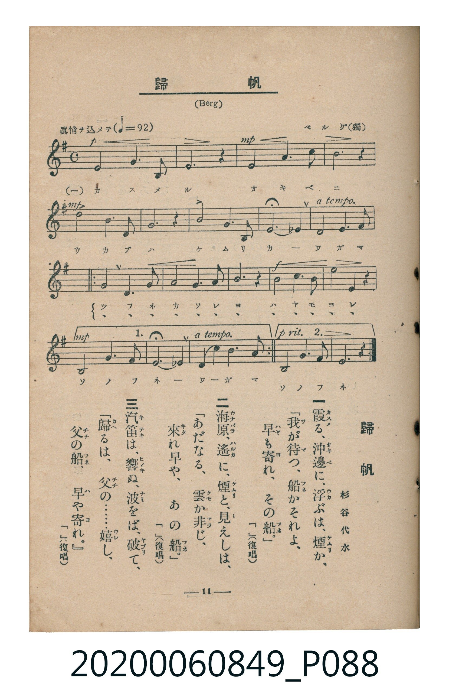

# 歸帆

> Re:Shōka 使用 AI 協助辨識與重建樂譜，可能會有錯誤。歡迎回報。

<audio controls src="kihan.mp3"></audio>

- 詞：杉谷代水
- 曲：Berg（德國曲）
- 臺灣教育會公認《新定兒童唱歌》高等科女子用（2020.006.0849）

## 說明

原書資訊與歌詞全文（對應 P088.jpg，書頁 p. 11，高二第一學期第 8 首）：
調性與拍號：ト長調（1 升記號）、3/4 拍（眞情ヲ込メテ ♩=92）
勘誤註記：原譜譜頭拍號誤植為 C（4/4），且第一行誤加兩處小節線；依全曲各小節實際時值（每小節 3 拍）與樂句結構修正為 3/4 拍。


## 歌詞

```text
一
霞（かす）める、沖邊（おきべ）に、浮（うか）ぶは、煙（けむり）か、
「我（わ）が待（ま）つ、船（ふね）かそれよ、
早（はや）も寄（よ）れ、その船（ふね）。」（「」復唱）

二
海原（うなばら）、遙（はるか）に、煙（けむり）と、見（み）えしは、
「あだなる、雲（くも）か非（あら）じ、
來（きた）れ早や、あの船（ふね）。」（「」復唱）

三
汽笛（きてき）は、響（ひゞき）ぬ、波（なみ）をば、破（やぶ）りて、
「歸（かへ）るは、父（ちゝ）の……嬉（うれ）し、
父（ちゝ）の船（ふね）、早（は）や寄（よ）れ。」（「」復唱）
```

## ABC

```abc
X:1
T:歸帆
C:曲：Berg（德國曲）
M:3/4
L:1/16
Q:1/4=92
K:G
V:V1 name="Piano" snm="Pia"
[V:V1]
!p! G4 B6 D2 | G8 z4 | !mp! G4 c6 e2 | d8 z4 |
!mp! d4 B6 G2 | A8 z4 | d4 B6 G2 | F8 =F4 |
E4 A6 G2 | F6 D4 G2 | A4 G6 c2 | B8 z4 |
!f! d4 B4 e4 | d4 G4 z4 | !mp! D4 G6 A2 | F8 =F4 |
E4 A6 G2 | F6 D4 G2 | A4 G6 c2 | B8 z4 |
!f! d4 B4 e4 | d4 G4 z4 | !p! D4 G6 F2 | G8 z4 |
```

## TMD 檔案連結

- [主旋律 TMD 檔案](kihan.tmd) [[在 TMD Studio 編輯](https://tmdlang.github.io/Tmd-TS/#tmd=s7IKdvYPcrWy4qpTUCpJTLdSSM7PyUlNLsnMz7MqzsjMK0nNjM_KTMmPL87Iz05Ugisry88pzU21ys4vyY9PzyzKKY43MjAyiDcwMIs3sDCxRCgszi8tSk61Kk7OyM_PiS9JrShJys_PRsgXFOWXpeYl5gHVFBSB7EsBK0IoSC3LTEkFSaemZJbkF2Um5iC5IrWoGOxSsCXxJUWJecXJRZkFIOcjVJVkpAKdCpYsyC9CMhouUZaKZCjQjvTMPKvc1MysTCwOhkqXpxaXpBblxeem5uSnVCpxaWkpPFu74-mONgUtLS5FWwVLIy57WwV3LhtjfRM7kOYXK-e93zPr2dzOFxu2P9m9-NmGLWAzn83eBBR2Si1Kf7-n4-m-7U_ndIOFOsGyL9p3PW9c_GzqzBdNm57NaX7auubFqt7HDV3Ppm14um7W09ZJz1cvfTpl47O1PY8bul-unvF8befz5ROfLt38dO2E51NWAI0ERYseMFr0QNECNpZLX0vBllqAS0FB4Wnf_Gezd7zY3P5iRdeLjnagY4B-fdq64tm0dpCfNvQ-a-9UCDCwsNDLKgD6sgeo-OWCRoUCPQVDQyAX6Ownu3qer1nzZEfD07U7ns2ZD2QrWCi8XDYN6F5g4IDseLFq_7OG5SDTu3tfzJwPFH3c3PFy6nagONAOQ4WnvUDbZ4BlOh83NAIDXQGoEij1fM68Z82tj5s3vdi353HzwsfNbQqPZq60tTQCKgQ7vnvGi1VLXqzYDdQONBXolxdr5wDRywVrIVYBZZ8t6X3etEvBGWicib4J2FE9T3ZMgTj5xcIeoJKnXQuetq58MXPq0w39z9c3PN8-6_2e2U_2zQUFw-xNTye0QMSfrl_2ctbsZzObnjbsAZr2bH0_RFzBGOLcTpAPVzQ97V_6fOuEZ8u7n-xf92ztYpDlUB89bmjiAjkbaDGIejkHmKg6Hjd2P26cCfJ5U-Pjpm6g_59tmvayqQss1fW4sfdx406QbONqkNTWdWDxNqAusOC2x43rgeLPW4EmAMUnPm5qeAzSC5QCGQWy5nFDz7OOiSDppn6wRM_Tfa1g1fvA3CVAdS86gHYARbY-blwL1dw493FTz-OmDqgpz6avBKtY_7ipBezYpqfrgQygoR1gLjANN4L0NK5DN6uh6XEDKDKB7gAynu5bCUzzoPgDh8SuHrDhW7cD4w7ms1WPGzc8bgLGEygxvASFDcReoJsgngaFBDYfrwD5ZBlQDVAcmLKAIkDGdEgIQUPicWPT48YFIDvAQf0SlFuBivqB_oH4--VcSKQ0QV3QOAOq-cm-NrAEMD7A6bSpBxgkwMAA-xtoKGn-3gFOv8827n2-ZjbM2GVAEmwlyL0v54PyxuPGTY-b5sHE14BSwOZFYHFgIIG92DQJFFrA8FiwBRwbLcA0ARYHJp1lSClg7Q5YWgMygNJABjjhdABVA8UXPm6aC7Zj3aOGZUD0dA3Q9-DoaOoBi0-HmoWpAcPfjfC0ArapBSOh4AgYoOmUl2lQoKClz8Xlmwgs6wMyE_PyHWoMahSqQTYo2Fho2YEZwJIUXgiAiqSm1QqPm3YqAMsZhRoguRpENq0C4rVA3kywWDfIWJBeoGEFtQqGCrrAvK8LhKbxQCEQFwQNgBioIBeqwgQsaAYUMkVWAE4HMEfs6oE5YhnQQqBDmqeBLewHO2IjkLUAiFeBeSDZPWDZ9UDeGiA9D8lZIFtB9kDcZQgUMkJxFqqceTxU0lwHxKpRMANREB1AeRQ37ugEuxFYz4Ei7Nm6rZDQe7ZmIaSkf9zcAnTLVCDuhbmzaS-Qtwbs1hVQ_zxuXgLEi6BiIFm426GOAYYlwuGQMDUB8iCOhoduGsKbZnCPgVRjBO7T2bMhDgc5tnsNpJoBhzXIdX1gN4Nc04scrkAWjrCFuA7kEiNqBOCuniEUgEDH4g1AlNyBFFJAh6FlD65aLi5dOwVQDlUA0spcXAA)]
- [鋼琴伴奏 TMD 檔案](kihan_piano.tmd) [[在 TMD Studio 編輯](https://tmdlang.github.io/Tmd-TS/#tmd=s7IKdvYPcrWy4tLSUni2dsfTHW3v93S87N7zfMKWJ3u2PF3a_7yz4_2eTgUtLS5FWwVLIy57WwV3LhtjfRM7rjoFpRcr573fM-vZ3M4XG7Y_2b342YYtSiDhZ7M3AYWdUovSgaY93bf96ZxusFAnWPZF-67njYufTZ35omnTsznNT1vXvFjV-7ih69m0DU_XzXraOun56qVPp2x8trbncUP3y9Uznq_tfL584tOlm5-unfB8ygqgkUYGRgZ6BgZmegYWJpZgY7l8EzPzrAIyE_PygzwcagxqFKq5FIDAxkLLDszQ11J4vmbNkx0NLxb2KGjpg8WAigpqFQwVdBWMgVhXwTQeKATigqABEAMV5EJVmIAFzYBCpsgKuJAN39WDajhIL0g1xHRDoJARiuGocubxUElzHRCrRsEMREF0AOVRbNrRCbQJHLYrQSG1bivEb8_WLARHFswFUCOB_kJYD_GfCZAHsRru0zSEY83gzgOpxvDo09mzIdaDrOxe82LmfBRbIf6G2Aky34gantvVQ3fPAa3E4jlUvwEdgZZkuGqRE6MPqYkxHmS6MRIJNB6JB2QbAIVM4sFMEyQSmzp8qRObTaZAY43igZ4CUyAeyDJsKoHSwBgE2gwkgWyQMjOgcqA0XAbdfiLTLKYbgBRcGOIWiOnYAqY6FxTTEJcAhYAkNKggJkBEIZrQ3EdcokZyBLWDAjOFD3xQ4MkCUDehuAxiIJBEygu6dgqg7KAApJW5uAA)]

## 分析

```text
================================================================================
📊 TMD Song Profile: [ 歸帆 ]
================================================================================
⏱  Duration:       0:46 (47.0s), 24 measures total
🎼 Key & Tempo:    首調基準 G, != 92.0 BPM, <3/4>
   - 分析範圍：      由實際發聲的音符與和弦推測調性；播放脈絡另行呈現
🎤 人聲音域:    D4 (MIDI 62) – E5 (MIDI 76) [跨度: 14 個半音 / 1.2 個八度, 難度: moderate]
   - 最低音:  D4 in [Main #1 @ m.1, 0:01]
   - 最高音: E5 in [Main #1 @ m.3, 0:05]
   - 適合: soprano, mezzo-soprano, contralto, tenor, baritone, bass
🏛  結構:      Main (47.0s)
⚡ 編曲密度:        Peak 1 軌道同時演奏
🗝  調性診斷：       G 大調（純淨自然大調，未偵測到可信轉調）
   - 風格氣質:    純淨自然大調（陽光明朗、易唱易記，無明顯調外色彩）
   - 轉調歷程:    全曲維持單一推測調性（未偵測到可信轉調）
   - 核心骨幹音:  G, D, B, F#, A
   - 調性數值:    G 大調 [相關度: 0.91, 穩定度: High, 自然音純度: 96.9%]
   - 候選調性 (K-S): G 大調 (0.91), D 大調 (0.75), B 小調 (0.69)
   - 五度圈歷程:   +1
   - 各段落調性細節:
     • [Main #1]: G 大調 (r: 0.91, 自然音純度: 96.9%, 調外音: F)

  [ 五度圈游移軌跡 ]
               C  
         F           [G ]*
      Bb               D  
      Eb               A  
         Ab           E  
            Db       B  
               F# 
     (* = active key center)

  [ 十二半音累積音高分佈 ]
     C  : ████                       3.9%
     C# :                            0.0%
     D  : ██████████████████        19.5%
     D# :                            0.0%
     E  : ██████                     7.0%
     F  : ███                        3.1%
     F# : ███████████               11.7%
     G  : ████████████████████████  26.6%
     G# :                            0.0%
     A  : ███████████               11.7%
     A# :                            0.0%
     B  : ███████████████           16.4%
--------------------------------------------------------------------------------
Assignment 軌道音域：
  - Piano         : D4 – E5 (14 個半音 / 1.2 個八度, 56 個音符)
================================================================================
```


## 原書掃描頁




