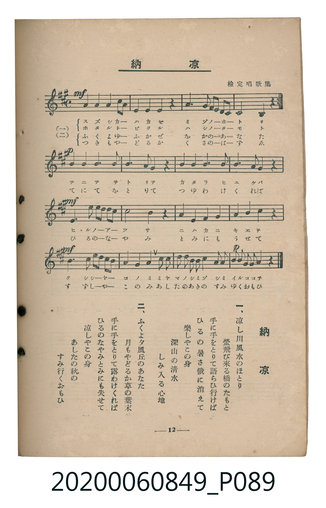

# 納涼

> Re:Shōka 使用 AI 協助辨識與重建樂譜，可能會有錯誤。歡迎回報。

- **鋼琴伴奏版**：<br><audio controls src="noryo.mp3"></audio>

- 詞：桑田春風
- 曲：獨國風曲
- 出處：檢定唱歌集
- 臺灣教育會公認《新定兒童唱歌》高等科女子用（2020.006.0849）

## 說明

原書資訊與歌詞全文（對應 P089.jpg，書頁 p. 12，高二第二學期第 1 首）：
調性與拍號：イ長調（3 升記號）、4/4 拍


## 歌詞

```text
一、
涼し川風水のほとり
螢飛び來る橋のたもと
手に手をとりて語らひ行けば
ひるの暑さ俄に消えて
樂しやこの身
深山の清水　しみ入る心地

二、
ふくよ夕風丘のあなた
月もやどるか草の葉末
手に手をとりて露わけくれば
ひるのなやみとみにも失せて
涼しやこの身
あしたの秋の　すみ行くおもひ
```

## ABC

<div class="abc-score" data-abc-src="noryo.abc" aria-label="五線譜載入中"></div>

[下載 ABC 原始檔](noryo.abc)

## TMD 檔案連結

- [主旋律 TMD 檔案](noryo.tmd) [[在 TMD Studio 編輯](https://tmdlang.github.io/Tmd-TS/#tmd=s7IKdvYPcrWy4qpTUCpJTLdSSM7PyUlNLsnMz7MqzsjMK0nNjM_KTMmPL87Iz05Ugisry88pzU21ys4vyY9PzyzKKY43MjAyiDcwMIs3sDCxRCgszi8tSk61Kk7OyM_PiS9JrShJys_PRsgXFOWXpeYl5gHVFBSB7EsBK0IoSC3LTEkFSaemZJbkF2Um5iC5IrWoGOxSsCXxJUWJecXJRZkFIOcjVJVkpAKdWpyaWJyfV0xQGGhFemaeVW5qZlYmFvdCpctTi0tSi_Lic1Nz8lMqMaRLEjOBAQYKtPLE-NzEzLycxLwUJS4tLYXnW3qfbdujoKXFpWirYGHBZW-r4MhlY6JvYgcy48XKee_3zHq2cOLzKRuezVj6ctEKsNHPZm8CCj_vXfF0TjdQDMgFCz9t3_Vi5lSQhlWLnq6b9XTKxmdre17ObgNLvmjf9bxx8bOpM180bXo2p_lp65oXq3ofN3Q9m7YBpLZ10vPVSyE6Hjd0v1w94_nazufLJz5duvnp2gnPp6x4v6cDFKN6wBjVA8Xo-z2dSlxc-loKttQCXAoKCk_75j-bvePF5vYXK7pedLQDHQMMgaetK55Nawc64OmG3mftnQoBBhaWelkF6e_39AAVv1zQqFCgp2BoBOQCnf1kV8_zNWuA5NO1O57NmQ9kKxgqvFw2DeheYMCA7Hixav-zhuUg07t7X8ycDxR93LTk5dTtQHGgHcYKT3uBts8Ay3Q-bmgERoUCUCUXSOuTHQ1AERALGGePG6c_3T4XFPwbtjxuXPe4cffjxhWPm7rAdsxb9HLx7MeNm5_sa3vc1P1sZTdYxfzHTU1ARWADOoFCq0Fk0ySIvseNy16smve4qfNx46YXC3seN0583LgBpBTIB5oBNODZLKDQ1Cf7W0A6t3U8bgSiZWDDVgCNnf64CSgxGajuxa7VYNHtG59u3AjSt6MV5MaGBpCixv1PW5cCzXu6v_npnA0Qb-0CxjnYW48btz5u7H_c1PF0yVSgz57smAF2N9D0VUDXgw2d0wHyBMiqlWBXdb_oBbp43YuJnc_mQKzF5rOXc4B-6Af7CWg80HOoPgOZDzJyP0gDiFwNtOTpEqDjgYEI8SI4wNG9CHYa0E_zgULPl4NNAvlyJtAMcBACbewCh_kmkGrK0ygUKGjpc3GFAQubVKuAzMS8fIcag5pqkA0KNhZadmAGMGeA0uGOBqA7QEm3v_fFsjYg99mahcCE-rR1o4KFwtMN_c_XNwCTGcg8qKbHTTuBeBcQbwfi1QqPm_co1ADJfgivCcKbD8QtQNwHln_cPBuurgOIV8HMq1Gozk2rVTBW0AVjIyA2VDCPB4qbxQPZQBZIQFfBAIhrwNIgbKpgAlRuBBQByYGgKUghWBHcmSArm_YDaZATQZZCrJ8MdfRUuKOB3oA5E6weom4RWBfcmdR0IXLw7-qBBL8J9rBubgPibii9CSn8QCJAHjjEQY5eCcSTwPLLgCIbgfQEpDAuqIU4FO5akBshngJBkAjYNzVYlYG5YHkcntjRid8Tk6CxAAtlUNhCQhmYRJq2glkgT0KTEJAN8tpaIF4B9ihqYgE5zAQcHUYoUQGCYAYkKlA8AeZAIgOPR57Ono3XI-CQBnoCnGRAqXoJzCNNm6HeA6V7EF4C9tQ8JPUg0VY4G6QHpBsUf0C9YP2NRHoU7jNjIASlObAkUArsK1DSg0Q5XB88fXLVcnHp2imACwYFIEOZCwA)]
- [鋼琴伴奏 TMD 檔案](noryo_piano.tmd) [[在 TMD Studio 編輯](https://tmdlang.github.io/Tmd-TS/#tmd=s7IKdvYPcrWy4tLSUni-pffZtj3v93S87N7zfMKWJ3u2PF3a_7yz4_2eTgUtLS5FWwULCy57WwVHLhsTfRM7rjoFpRcr573fM-vZwonPp2x4NmPpy0UrlEDCz2ZvAgo_713xdE43UAzIBQs_bd_1YuZUkIZVi56um_V0ysZna3tezm4DS75o3_W8cfGzqTNfNG16Nqf5aeuaF6t6Hzd0PZu2AaS2ddLz1UshOh43dL9cPeP52s7nyyc-Xbr56doJz6esADrbyMDIQM_AwEzPwMLEEuhoJS6usNSi4lSrgMzEvPwgD4cag5pqLgUgsLHQsgMzahSqc9NqFYwVdMHYCIgNFczjgeJm8UA2kAUS0FUwAOIasDQImyqYAJUbAUVAciBoClIIVgQ1lpomwlxaUAvRDjcDpBNiFQiCRMB21GBVBuaC5bEYDQoEkFITsLONUJwMgmAGxMkoxoI5EEeTYzTcLGMgBIUGWBIoBTYHFCgQb8P1wUOOqxYlcn1wRS5QsyHYOGMwaRofr2AEZgFJkCOgEmA-RCGQNABKQcXMYRqQeUAPI5kJZKPGPR0tREoaqDpQLULVD5KDxSZWXSZACqgBLgsSNlGHmIYRvfAQNgHHHIQNtxdqFFAOTGJYjGQjwtfwcEISJtFejICG2Qt1EFAQqA89lEHhiGIQUlADE5yunQI4zSkAGcpcAA)]

## 分析

```text
================================================================================
📊 TMD Song Profile: [ 納涼 ]
================================================================================
⏱  Duration:       0:54 (54.5s), 20 measures total
🎼 Key & Tempo:    首調基準 A, != 88.0 BPM, <4/4>
   - 分析範圍：      由實際發聲的音符與和弦推測調性；播放脈絡另行呈現
🎤 人聲音域:    E4 (MIDI 64) – E5 (MIDI 76) [跨度: 12 個半音 / 1.0 個八度, 難度: easy]
   - 最低音:  E4 in [Verse #1 @ m.4, 0:09]
   - 最高音: E5 in [Verse #1 @ m.3, 0:06]
   - 適合: soprano, mezzo-soprano, contralto, tenor, baritone, bass
🏛  結構:      Verse (54.5s)
⚡ 編曲密度:        Peak 1 軌道同時演奏
🗝  調性診斷：       A 大調（純淨自然大調，未偵測到可信轉調）
   - 風格氣質:    純淨自然大調（陽光明朗、易唱易記，無明顯調外色彩）
   - 轉調歷程:    全曲維持單一推測調性（未偵測到可信轉調）
   - 核心骨幹音:  A, G#, B, C#, F#
   - 調性數值:    A 大調 [相關度: 0.73, 穩定度: Moderate, 自然音純度: 100.0%]
   - 候選調性 (K-S): A 大調 (0.73), F# 小調 (0.70), E 大調 (0.65)
   - 五度圈歷程:   +3
   - 各段落調性細節:
     • [Verse #1]: A 大調 (r: 0.73, 自然音純度: 100.0%)

  [ 五度圈游移軌跡 ]
               C  
         F            G  
      Bb               D  
      Eb              [A ]*
         Ab           E  
            Db       B  
               F# 
     (* = active key center)

  [ 十二半音累積音高分佈 ]
     C  :                            0.0%
     C# : █████████████             13.2%
     D  : █████                      4.9%
     D# :                            0.0%
     E  : █████████                  9.0%
     F  :                            0.0%
     F# : █████████████             13.2%
     G  :                            0.0%
     G# : █████████████████         18.1%
     A  : ████████████████████████  25.0%
     A# :                            0.0%
     B  : ████████████████          16.7%
--------------------------------------------------------------------------------
Assignment 軌道音域：
  - Piano         : E4 – E5 (12 個半音 / 1.0 個八度, 84 個音符)
================================================================================
```


## 原書掃描頁




