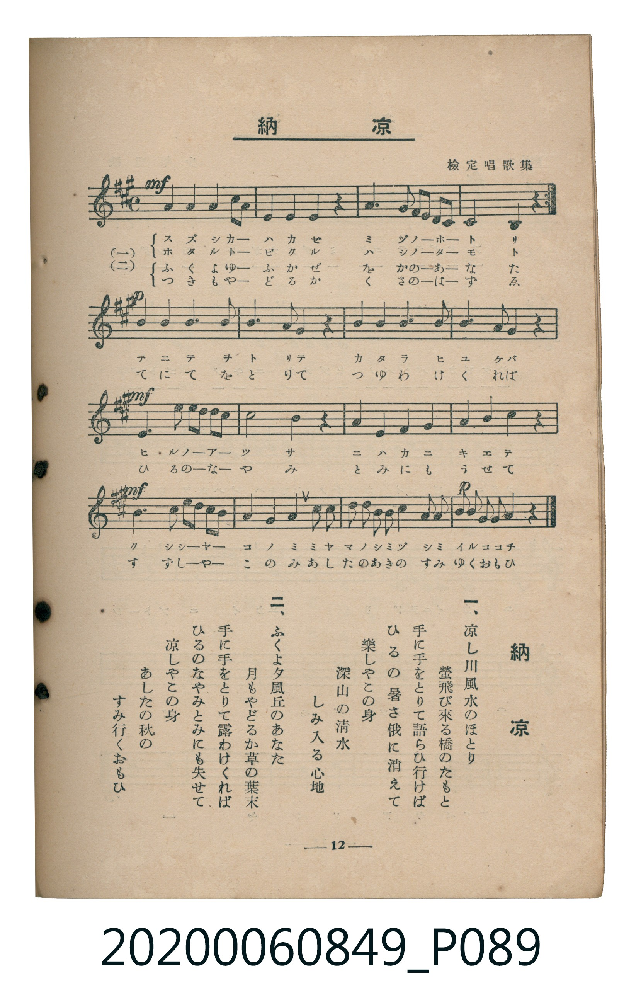

# 納涼

> Re:Shoka 使用 AI 協助辨識與重建樂譜，可能會有錯誤。歡迎回報。

<audio controls src="noryo.mp3"></audio>

- 詞：桑田春風
- 曲：獨國風曲
- 出處：檢定唱歌集
- 臺灣教育會公認《新定兒童唱歌》高等科女子用（2020.006.0849）

## 說明

原書資訊與歌詞全文（對應 P089.jpg，書頁 p. 12，高二第二學期第 1 首）：
調性與拍號：イ長調（3 升記號）、4/4 拍

## 跨冊／重複收錄參照

> 同曲＋同名異曲（《新定兒童唱歌》高等科男、女用為同曲；尋常科五年級為同名異曲）

- **[同名異曲]** 《新定兒童唱歌》尋常科第五學年用（2020.006.0847.0005）：[**〈納涼〉**](../../grade_5_2020.006.0847.0005/1_10_noryo/index.md)（`A` / `4/4` — [原始 TMD](../../grade_5_2020.006.0847.0005/1_10_noryo/noryo.tmd)）
- **[同曲]** 《新定兒童唱歌》高等科男子用（2020.006.0848）：[**〈納涼〉**](../../koto_boys_2020.006.0848/2_2_01_noryo/index.md)（`A` / `4/4` — [原始 TMD](../../koto_boys_2020.006.0848/2_2_01_noryo/noryo.tmd)）
- 總表：[跨冊重複與同名歌曲總索引](../../../duplicate_songs.md)

## 歌詞

```text
一、
涼し川風水のほとり
螢飛び來る橋のたもと
手に手をとりて語らひ行けば
ひるの暑さ俄に消えて
樂しやこの身
深山の清水　しみ入る心地

二、
ふくよ夕風丘のあなた
月もやどるか草の葉末
手に手をとりて露わけくれば
ひるのなやみとみにも失せて
涼しやこの身
あしたの秋の　すみ行くおもひ
```

## ABC

```abc
X:1
T:納涼
C:曲：獨國風曲
M:4/4
L:1/16
Q:1/4=88
K:A
V:V1 name="Piano" snm="Pia"
[V:V1]
!mf! c4 c4 B4 A2 G2 | F4 G4 A4 z4 | B4 B4 e2 d2 c2 B2 | A8 E4 z4 |
c4 c4 B4 A2 G2 | F4 G4 A4 z4 | B4 B4 e2 d2 c2 B2 | A8 E4 z4 |
!p! G4 G4 A4 B4 | c8 A4 F4 | G4 G4 A4 B4 | G4 F4 E4 z4 |
!mf! A4 d4 c2 B2 A2 G2 | F8 F4 z4 | G4 A4 B4 G4 | A4 F4 E4 z4 |
!mf! A4 d4 c2 B2 A2 G2 | F4 G4 A4 c2 c2 | B2 A2 G2 F2 E4 e2 d2 | !p! c2 B2 A2 G2 A4 z4 |
```

## TMD 檔案連結

- [主旋律 TMD 檔案](noryo.tmd) [[在 TMD Studio 編輯](https://tmdlang.github.io/Tmd-TS/#tmd=s7IKdvYPcrWy4qpTUCpJTLdSSM7PyUlNLsnMz7MqzsjMK0nNjM_KTMmPL87Iz05Ugisry88pzU21ys4vyY9PzyzKKY43MjAyiDcwMIs3sDCxRCgszi8tSk61Kk7OyM_PiS9JrShJys_PRsgXFOWXpeYl5gHVFBSB7EsBK0IoSC3LTEkFSaemZJbkF2Um5iC5IrWoGOxSsCXxJUWJecXJRZkFIOcjVJVkpAKdWpyaWJyfV4xTWEtL4fmW3mfb9ihoaXEp2ipYWHDZ2yo4ctmY6JvYgTS9WDnv_Z5ZzxZOfD5lw7MZS18uWgE269nsTUDh570rns7pBooBuWDhp-27XsycCtKwatHTdbOeTtn4bG3Py9ltYMkX7bueNy5-NnXmi6ZNz-Y0P21d82JV7-OGrmfTNoDUtk56vnopRMfjhu6Xq2c8X9v5fPnEp0s3P1074fmUFe_3dIBCWw8Y2nqg0H6_p1OJi0tfS8GWWoBLQUHhad_8Z7N3vNjc_mJF14uOdqBjgCHwtHXFs2ntQAc83dD7rL1TIcDAwlIvqyD9_Z4eoOKXCxoVCvQUDI2AXKCzn-zqeb5mDZB8unbHsznzgWwFQ4WXy6YB3QsMGJAdL1btf9awHGR6d--LmfOBoo-blrycuh0oDrTDWOFpL9D2GWCZzscNjcCoUACq5AJpfbKjASgCYgHj7HHj9Kfb54KCf8OWx43rHjfufty44nFTF9iOeYteLp79uHHzk31tj5u6n63sBquY_7ipCagIbEAnUGg1iGyaBNH3uHHZi1XzHjd1Pm7c9GJhz-PGiY8bN4CUAvlAM4AGPJsFFJr6ZH8LSOe2jseNQLQMbNgKoLHTHzcBJSYD1b3YtRosun3j040bQfp2tILc2NAAUtS4_2nrUqB5T_c3P52zAeKtXcA4B3vrcePWx439j5s6ni6ZCvTZkx0zwO4Gmr4K6HqwoXM6QJ4AWbUS7KruF71AF697MbHz2RyItdh89nIO0A_9YD8BjQd6DtVnIPNBRu4HaQCRq4GWPF0CdDwwECFeBAc4uhfBTgP6aT5Q6PlysEkgX84EmgEOQqCNXeAw3wRSTXkahQIFLX0urjBgQZBqFZCZmJfvUGNQo1ANskLBxkLLDswAZg1QQtzRAHQIKO32975Y1gbkPluzEJhSn7ZuVLBQeLqh__n6BmA6AxkI1fS4aScQ7wLi7UC8WuFx8x6FGiDZD-E1QXjzgbgFiPvA8o-bZ8PVdQDxKph5QFflptUqGCvogrEREBsqmMcDxc3igWwgCySgq2AAxDVgaRA2VTABKjcCioDkQNAUpBCsCO5MkJVN-4E0yIkgSyHWT4Y6eirc0UBvwJwJVg9RtwisC-5MaroQOfh39UCC3wR7WDe3AXE3lN6EFH4gESAPHOIgR68E4klg-WVAkY1AegJSGBfUQhwKdy3IjRBPgSBIBOybGqzKwFywPA5P7OjE74lJ0FiAhTIobCGhDEwiTVvBLJAnoUkIyAZ5bS0QrwB7FDWxgBxmAo4OI5SoAEEwAxIVKJ4AcyCRgccjT2fPxusRcEgDPQFOMqBUvQTmkabNUO-B0j0ILwF7ah6SepBoK5wN0gPSDYo_oF6w_kYiPQr3mTEQgtIcWBIoBfYVKOlBohyuD54-uWq5uHTtFMAlgwKQoczFBQA)]
- [鋼琴伴奏 TMD 檔案](noryo_piano.tmd) [[在 TMD Studio 編輯](https://tmdlang.github.io/Tmd-TS/#tmd=s7IKdvYPcrWy4tLSUni-pffZtj3v93S87N7zfMKWJ3u2PF3a_7yz4_2eTgUtLS5FWwULCy57WwVHLhsTfRM7rjoFpRcr573fM-vZwonPp2x4NmPpy0UrlEDCz2ZvAgo_713xdE43UAzIBQs_bd_1YuZUkIZVi56um_V0ysZna3tezm4DS75o3_W8cfGzqTNfNG16Nqf5aeuaF6t6Hzd0PZu2AaS2ddLz1UshOh43dL9cPeP52s7nyyc-Xbr56doJz6esADrbyMDIQM_AwEzPwMLEEuhoJS6usNSi4lSrgMzEvPwgD4cagxqFai4FILCx0LIDM4ACuWm1CsYKumBsBMSGCubxQHGzeCAbyAIJ6CoYAHENWBqETRVMgMqNgCIgORA0BSkEK4IaS00TYS4tqIVoh5sB0gmxCgRBImA7arAqA3PB8liMBgUCSKkJ2NlGKE4GQTAD4mQUY8EciKPJMRpuljEQgkIDLAmUApsDChSIt-H64CHHVYsSuz44Yxeo2xBsnjGYNI2PVzACs4AkyBVQCTAfohBIGgCloGLmMA3IPKCPkcwEslEjn44WIqUNVB2oFqHqB8nBohOrLhMgBdQAlwUJm6hDTMOIX3gIm4CjDsKG2ws1CigHJjEsRrIR4Wt4OCEJk2gvRkDD7IU6CCgI1IceyqBwRDEIKaiBKU7XTgGc6BSADGUuLgA)]

## 分析

```text
================================================================================
📊 TMD Song Profile: [ 納涼 ]
================================================================================
⏱  Duration:       0:54 (54.5s), 20 measures total
🎼 Key & Tempo:    首調基準 A, != 88.0 BPM, <4/4>
   - 分析範圍：      由實際發聲的音符與和弦推測調性；播放脈絡另行呈現
🎤 人聲音域:    E4 (MIDI 64) – E5 (MIDI 76) [跨度: 12 個半音 / 1.0 個八度, 難度: easy]
   - 最低音:  E4 in [Verse #1 @ m.4, 0:09]
   - 最高音: E5 in [Verse #1 @ m.3, 0:06]
   - 適合: soprano, mezzo-soprano, contralto, tenor, baritone, bass
🏛  結構:      Verse (54.5s)
⚡ 編曲密度:        Peak 1 軌道同時演奏
🗝  調性診斷：       A 大調（純淨自然大調，未偵測到可信轉調）
   - 風格氣質:    純淨自然大調（陽光明朗、易唱易記，無明顯調外色彩）
   - 轉調歷程:    全曲維持單一推測調性（未偵測到可信轉調）
   - 核心骨幹音:  A, G#, B, C#, F#
   - 調性數值:    A 大調 [相關度: 0.73, 穩定度: Moderate, 自然音純度: 100.0%]
   - 候選調性 (K-S): A 大調 (0.73), F# 小調 (0.70), E 大調 (0.65)
   - 五度圈歷程:   +3
   - 各段落調性細節:
     • [Verse #1]: A 大調 (r: 0.73, 自然音純度: 100.0%)

  [ 五度圈游移軌跡 ]
               C  
         F            G  
      Bb               D  
      Eb              [A ]*
         Ab           E  
            Db       B  
               F# 
     (* = active key center)

  [ 十二半音累積音高分佈 ]
     C  :                            0.0%
     C# : █████████████             13.2%
     D  : █████                      4.9%
     D# :                            0.0%
     E  : █████████                  9.0%
     F  :                            0.0%
     F# : █████████████             13.2%
     G  :                            0.0%
     G# : █████████████████         18.1%
     A  : ████████████████████████  25.0%
     A# :                            0.0%
     B  : ████████████████          16.7%
--------------------------------------------------------------------------------
Assignment 軌道音域：
  - Piano         : E4 – E5 (12 個半音 / 1.0 個八度, 84 個音符)
================================================================================
```


## 原書掃描頁




