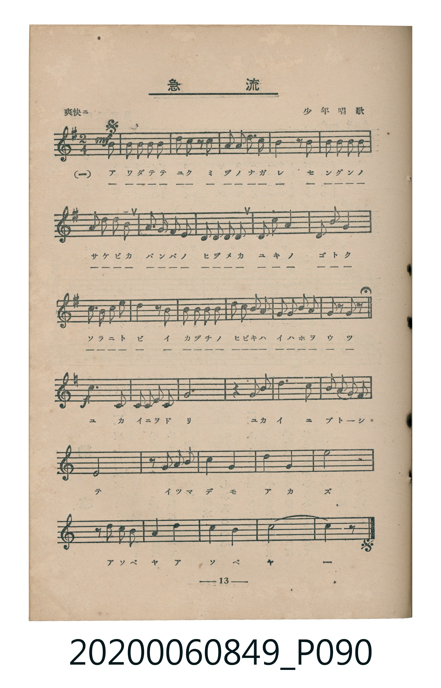
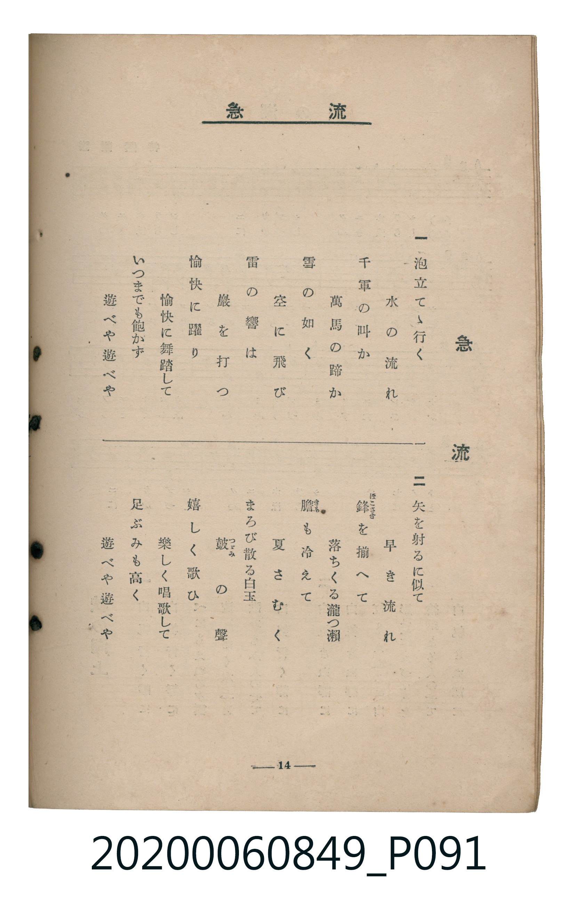

# 急流

> Re:Shoka 使用 AI 協助辨識與重建樂譜，可能會有錯誤。歡迎回報。

<audio controls src="kyuryu.mp3"></audio>

- 詞：大和田建樹
- 曲：獨國風歌
- 出處：少年唱歌
- 臺灣教育會公認《新定兒童唱歌》高等科女子用（2020.006.0849）

## 說明

原書資訊與歌詞全文（對應 P090–P091.jpg，書頁 pp. 13–14，高二第二學期第 2 首）：
調性與拍號：ト長調（1 升記號）轉ハ長調（無升降記號）、2/4 拍（爽快ニ ♩=108）

## 跨冊／重複收錄參照

> 同曲（《新定兒童唱歌》高等科男、女共用教材）

- **[同曲]** 《新定兒童唱歌》高等科男子用（2020.006.0848）：[**〈急流〉**](../../koto_boys_2020.006.0848/2_2_03_kyuryu/index.md)（`G` / `2/4` — [原始 TMD](../../koto_boys_2020.006.0848/2_2_03_kyuryu/kyuryu.tmd)）
- 總表：[跨冊重複與同名歌曲總索引](../../../duplicate_songs.md)

## 歌詞

```text
一
泡立てゝ行く　水の流れ
千軍の叫か　萬馬の蹄か
雪の如く　空に飛び
雷の響は　巖を打つ
愉快に躍り　愉快に舞踏して
いつまでも飽かず　遊べや遊べや

二
矢を射るに似て　早き流れ
鋒（ほこさき）を揃へて　落ちくる瀧つ瀨
膽（きも）も冷えて　夏さむく
まろび散る白玉　皷（つゞみ）の聲
嬉しく歌ひ　楽しく唱歌して
足ぶみも高く　遊べや遊べや
```

## ABC

```abc
X:1
T:急流
C:曲：獨國風歌
M:2/4
L:1/16
Q:1/4=108
K:G
V:V1 name="Piano" snm="Pia"
[V:V1]
!mf! z4 z2 d2 | B2 B2 B2 B2 | d2 B2 z2 d2 | A3 B c2 A2 |
B4 z2 B2 | B2 B2 B2 B2 | G2 B2 d2 B2 | A3 B A2 G2 |
F2 E2 F2 G2 | D2 d4 c2 | D2 d4 c2 | B2 A2 B2 c2 |
d4 z2 d2 | d2 c2 B2 d2 | e2 d2 c2 B2 | A2 G2 A2 B2 |
G2 z2 G2 z2 | [K:C] !f! E,2 E,2 F, E, F, G, | A,8 | z4 G,2 G,2 |
C6 B,2 | A,2 G,2 F,2 E,2 | D,8 | z2 G,2 G,2 G,2 |
C4 G,4 | D4 G,4 | E8 | z2 G,2 G,2 G,2 |
A,4 D4 | C4 B,4 | C8 | C4 z4 |
```

## TMD 檔案連結

- [主旋律 TMD 檔案](kyuryu.tmd) [[在 TMD Studio 編輯](https://tmdlang.github.io/Tmd-TS/#tmd=s7IKdvYPcrWy4qpTUCpJTLdSSM7PyUlNLsnMz7MqzsjMK0nNjM_KTMmPL87Iz05Ugisry88pzU21ys4vyY9PzyzKKY43MjAyiDcwMIs3sDCxRCgszi8tSk61Kk7OyM_PiS9JrShJys_PRsgXFOWXpeYl5gHVFBSB7EsBK0IoSC3LTEkFSaemZJbkF2Um5iC5IrWoGOxSsCXxJUWJecXJRZkFIOcjVJVkpAKdWp5YklqkxKWlpfCsYemzrY0KWlpcirYKhgYWXPa2Cu5cNkb6JnYgPS9Wznu_Z9bTJcufTup5PmXD0927nq3YCTbt2exNQJnnvSuezul-uWjFs7U9YOGn7btezJwK0rNh4tOdW55O2QiTedG-63nj4mdTZ75o2vRsTvPT1jUvVvU-buh6Nm3D03WznrZOer56KUT544bul6tnPF_b-Xz5xKdLNz9dO-H5lBXv93SAQlUPGKp6oFB9v6dTiYtLX0vBllqAS0FB4Wnf_Gezd7zY3P5iRdeLjnagY4Ah8LR1xbNp7UAHPN3Q-6y9UyHAwNLgUcNkIGWol1WQ_n5PD1DPywWNCgUFegqGxkApQxOgINAPT3b1PF-zBkg-Xbvj2Zz5QLaCkcLLZdOAjgcGEcjCF6v2P2tYDrKqu_fFzPlA0cfNHS-nbgeKAy00VHjaC3TKDLBM54u9nY-b--GSz1sWAmVfzuyFK3jc0AiMOAWgUSDpjr1P969-3Nyt8GjmSltg1AIVcIGsfLKjAUQ927zw-erux43LHjfNfbGw53Fj_-OGhmcbtjxuXAdMEY-besDh0dv8YncvUOhp_-rHjd1AFS8mrHm5bA1Q5MXOFqAISNHL2atAKpY1Qcx4vnLX48bVLxfPfty4GSK9HSj9cv7-x43rgdJPt0973DTpWefkx41LwO5o6QS5s3H1i129j5u6QI6Ai3TMe7Gj_3HjdKArQUofNwKtXPK4cd_jxuWPm5peLt4LclPjLKCel41djxt3Pm5qgTMgft0F9sbz-YuAdj7d0PK4Cah-9ZM9e0D-Bto0feXjxl6Ed192TwKG3OPG3Y8bgc6bCpQDhSrQtf3Njxt3QPS8mAC0dSHIq03dzxuWAx30vGEFOCrb9oI1A33RBNbW9LQN6HOgCEjb0yVAj0x93NQA1Anxy77HTcCQ3fxs6mKQSTP3Pu8DRmDD81nbwaYsedw073EjMJ47QWHduAkcG2uAHGBg9IMySeMmkAeWAh0DEoHmHHhQvdi2-XHjNqABoHBaPQMSM1gCCaiU8pwDBQpa-lxcAYlFJY5WAZmJefkONQY1CtUgKxRsDM207MAsYI59umfji63bn27of76-AZSr9vU87e0CJtqXDZueti4F-hhkEEhtjYKBgi4Ygujq3LRaBVMgowYctSCTQJlrRwMw9QKNMVWAmQjXD1TxuHk9EDcAcRsY1wDJZQqPm0Ci88G8ViDuA-IuoOgasMgaIGs3mLUZyNoAoYFq4K4yBjoCGdeAnQVigdwJdiIwn4PcbaxgAiRBbIgumF8gujDMQfHYrh68HmvaCsQbgQ6bDKRXg507AepUEN0HFpkE9eBCuBqQ59fC5Ju2AFkd4OCAe84Q6hiYlxBeAdEg2RoF83ggZQYiwCyIoCmICdIFgiBvYxNCjbpOiA_NcPhwL9B1K4G4G-xKkOtBfl0CdvlqqM8aUfwKkgf5rh-sZgmY9bh5NhBvAosAfd_cghqRIF-BaKiLkSIJEpEgEiQHC5MaBTMoCyYKCSFQIMDMgoQiyAwYXcNVC8kbTnjyRjWw8nWuRQqhp7Nno6eBHtRaADWtgyIXGDBgj4MCbRMQd4IDZxU88sHJAKoCJDYNkgSa9wBFtyOCphqY2YxB0QcmTOJBNJAExigwAEBCyBCRUSExDiIgYQCD4HQC1QmWBpoFNRst1U_Bn53BWRjs_BYgngf2QjsQLwKLL4J7cBfCK0bYnYtwKpp7wVyIOkjSRxGCZWO4YcjOf9q6Fn-mBTkQlKxngh0O9AZQBORcZDEQuQe1DMRwKzwKYC5EOB8c1KhCCI_DRGDxBU6XunYK4GJbAcpwAjGUubgA)]
- [鋼琴伴奏 TMD 檔案](kyuryu_piano.tmd) [[在 TMD Studio 編輯](https://tmdlang.github.io/Tmd-TS/#tmd=s7IKdvYPcrWy4tLSUnjWsPTZ1sb3ezpedu95PmHLkz1bni7tf97Z8X5Pp4KWFpeirYKhgQWXva2CO5eNkb6JHVedgtKLlfPe75n1dMnyp5N6nk_Z8HT3rmcrdiqBZJ7N3gSUed674umc7peLVjxb2wMWftq-68XMqSA9GyY-3bnl6ZSNMJkX7bueNy5-NnXmi6ZNz-Y0P21d82JV7-OGrmfTNjxdN-tp66Tnq5dClD9u6H65esbztZ3Pl098unTz07UTnk9ZAXS3kYGRgZ6BgZmegYWJJdDVSlxcAYlFJY5WAZmJeflBHg41BjUK1VwKQGBjaKZlB2bVKBgo6IIhiK7OTatVMAUyaqCSxkA2Mq4By4JYIOVglQpGYO3GCiZAEsSG6IIZCdGFYQ7UfEMoH2YqwjQQDZKtUTCPB1JmIALMggiagpggXSAIshmbEJInQMaBaKhSJAdCPAEiQXIwx9QomEFZMFGI00C2w8yCOB9kBoyu4apFCXQflEC3QAlziHoIvzq3oFbBMB7kBWMwCTQaTANJA7DX4hWM4oH-B1Nokij6YOGKYhZUO5AN1o3GBZkKEoLRWERQTAWSYH1A04FMIIlwBIRfo2ACZkJIDPvAzoa4HRZcTnjTaDUw0znXwoIKmEKBdgBjAEQArQDSQBLsT3AiQYaI1A1JHCACEmswCE5SUJ1gaaBZULNhvgY6GpupCBPRjAVzIeogiRlFCJY34IYhJQkMI-EeghmEsAXscFQhhPtgIjDfowc09nSJGs6gogAYS9CECgwXlDhFcEGxbwzhQVIEkiSEDzURPRGD-DDTUdMrJN1B0wzOBI7mMiMgZQZOviCDwapRcgtSxkLKrLp2CuD8qgBlOIEYylxcAA)]

## 分析

```text
================================================================================
📊 TMD Song Profile: [ 急流 ]
================================================================================
⏱  Duration:       0:35 (35.6s), 32 measures total
🎼 Key & Tempo:    首調基準 G, != 108.0 BPM, <2/4>
   - 分析範圍：      由實際發聲的音符與和弦推測調性；播放脈絡另行呈現
🎤 人聲音域:    D3 (MIDI 50) – E5 (MIDI 76) [跨度: 26 個半音 / 2.2 個八度, 難度: difficult]
   - 最低音:  D3 in [PartB #1 @ m.23, 0:24]
   - 最高音: E5 in [PartA #1 @ m.15, 0:15]
   - 適合: contralto, bass
🏛  結構:      PartA (18.9s) -> PartB (16.7s)
⚡ 編曲密度:        Peak 1 軌道同時演奏
🗝  調性診斷：       G 大調（推測轉調經歷 1 次）
   - 風格氣質:    純淨自然大調（陽光明朗、易唱易記，無明顯調外色彩）
   - 轉調歷程:    G 大調起奏 ➔ [PartB] 轉至 C 大調 (-11 半音 / 五度圈 -5 步)
   - 核心骨幹音:  D, B, G, C, A
   - 調性數值:    G 大調 [相關度: 0.88, 穩定度: High, 自然音純度: 98.2%]
   - 候選調性 (K-S): G 大調 (0.88), D 大調 (0.60), B 小調 (0.60)
   - 五度圈歷程:   +5 -> +0
   - 各段落調性細節:
     • [PartA #1]: B 小調 (r: 0.82, 自然音純度: 90.0%, 調外音: C)
     • [PartB #1]: C 大調 (r: 0.91, 自然音純度: 100.0%)

  [ 五度圈游移軌跡 ]
              [C ]*
         F            G  
      Bb               D  
      Eb               A  
         Ab           E  
            Db      [B ]*
               F# 
     (* = active key center)

  [ 十二半音累積音高分佈 ]
     C  : ███████████████████       16.7%
     C# :                            0.0%
     D  : ████████████████████████  21.1%
     D# :                            0.0%
     E  : ██████████                 8.3%
     F  : ██                         1.8%
     F# : ██                         1.8%
     G  : ████████████████████      17.1%
     G# :                            0.0%
     A  : ███████████████           13.2%
     A# :                            0.0%
     B  : ███████████████████████   20.2%
--------------------------------------------------------------------------------
Assignment 軌道音域：
  - Piano         : D3 – E5 (26 個半音 / 2.2 個八度, 89 個音符)
================================================================================
```


## 原書掃描頁






