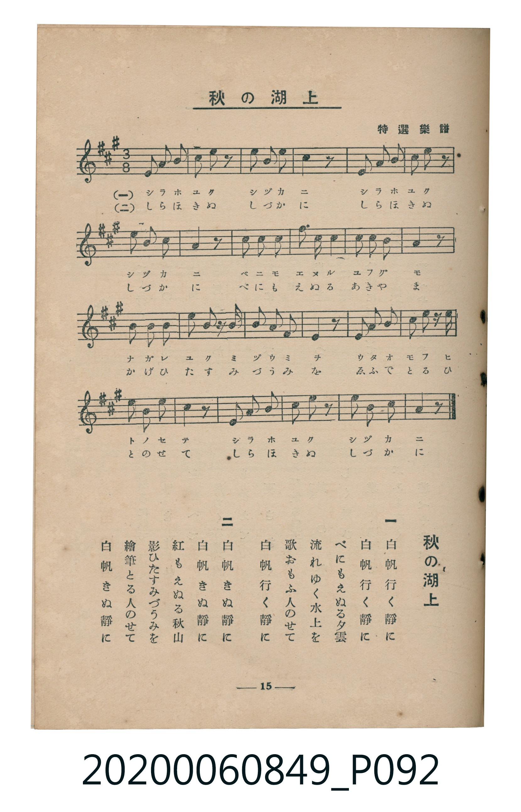

# 秋の湖上

<audio controls src="aki_no_kojo.mp3"></audio>

- 出處：特選樂譜
- 臺灣教育會公認《新定兒童唱歌》高等科女子用（2020.006.0849）

## 說明

原書資訊與歌詞全文（對應 P092.jpg，書頁 p. 15，高二第二學期第 3 首）：
調性與拍號：イ長調（3 升記號）、3/8 拍

## 歌詞

```text
一
白帆行く靜に
白帆行く靜に
べにもえぬる夕雲
流れゆく水上を
歌おもふ人のせて
白帆行く靜に

二
白帆きぬ靜に
白帆きぬ靜に
紅もえぬる秋山
影ひたすみづうみを
繪筆とる人のせて
白帆きぬ靜に
```

## ABC

```abc
X:1
T:秋の湖上
C:TMD (Chen, Chih-Han / aguai)
M:3/8
L:1/16
Q:1/8=108
K:A
V:V1 name="Piano" snm="Pia"
[V:V1]
!mp! E2 A2 B2 | c2 d2 z2 | e2 B2 d2 | c4 z2 |
E2 A2 B2 | c2 d2 z2 | e2 E2 G2 | A4 z2 |
!mf! B2 B2 B2 | c2 c2 c2 | d2 c2 B2 | A4 z2 |
G2 A2 B2 | e2 G2 ^A2 | B2 F2 G2 | E4 z2 |
F2 G2 A2 | e2 c2 B2 | A2 G2 A2 | B4 z2 |
!mp! E2 A2 B2 | c2 d2 z2 | e2 E2 G2 | A4 z2 |
```

## TMD 檔案連結

- [主旋律 TMD 檔案](aki_no_kojo.tmd)
- [鋼琴伴奏 TMD 檔案](aki_no_kojo_piano.tmd)

## 分析

```text
================================================================================
📊 TMD Song Profile: [ 秋の湖上 ]
================================================================================
⏱  Duration:       0:40 (40.0s), 24 measures total
🎼 Key & Tempo:    首調基準 A, != 54.0 BPM, <3/8>
   - 分析範圍：      由實際發聲的音符與和弦推測調性；播放脈絡另行呈現
🎤 人聲音域:    E4 (MIDI 64) – E5 (MIDI 76) [跨度: 12 個半音 / 1.0 個八度, 難度: easy]
   - 最低音:  E4 in [Main #1 @ m.1, 0:00]
   - 最高音: E5 in [Main #1 @ m.3, 0:03]
   - 適合: soprano, mezzo-soprano, contralto, tenor, baritone, bass
🏛  結構:      Main (40.0s)
⚡ 編曲密度:        Peak 1 軌道同時演奏
🗝  調性診斷：       E 調性不明確（流行色彩大調，未偵測到可信轉調）
   - 風格氣質:    流行大調（略帶和弦色彩音與裝飾副屬和弦）
   - 轉調歷程:    全曲維持單一推測調性（未偵測到可信轉調）
   - 核心骨幹音:  A, B, E, C#, G#
   - 調性數值:    E 調性不明確 [相關度: 0.83, 穩定度: Ambiguous, 自然音純度: 90.5%]
   - 候選調性 (K-S): E 大調 (0.83), A 大調 (0.81), C# 小調 (0.63)
   - 五度圈歷程:   +4
   - 各段落調性細節:
     • [Main #1]: E 調性不明確 (r: 0.83, 自然音純度: 90.5%, 調外音: D, A#)

  [ 五度圈游移軌跡 ]
               C  
         F            G  
      Bb               D  
      Eb               A  
         Ab          [E ]*
            Db       B  
               F# 
     (* = active key center)

  [ 十二半音累積音高分佈 ]
     C  :                            0.0%
     C# : ██████████████████        15.9%
     D  : █████████                  7.9%
     D# :                            0.0%
     E  : ██████████████████████    19.0%
     F  :                            0.0%
     F# : ████                       3.2%
     G  :                            0.0%
     G# : █████████████             11.1%
     A  : ████████████████████████  20.6%
     A# : ██                         1.6%
     B  : ████████████████████████  20.6%
--------------------------------------------------------------------------------
Assignment 軌道音域：
  - Piano         : E4 – E5 (12 個半音 / 1.0 個八度, 57 個音符)
================================================================================
```


## 原書掃描頁




