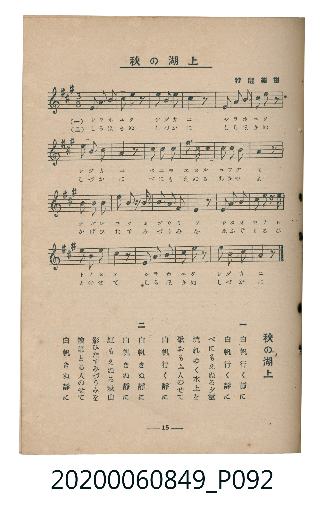

# 秋の湖上

> Re:Shōka 使用 AI 協助辨識與重建樂譜，可能會有錯誤。歡迎回報。

- **鋼琴伴奏版**：<br><audio controls src="aki_no_kojo.mp3"></audio>

- 出處：特選樂譜
- 臺灣教育會公認《新定兒童唱歌》高等科女子用（2020.006.0849）

## 說明

原書資訊與歌詞全文（對應 P092.jpg，書頁 p. 15，高二第二學期第 3 首）：
調性與拍號：イ長調（3 升記號）、3/8 拍


## 歌詞

```text
一
白帆行く靜に
白帆行く靜に
べにもえぬる夕雲
流れゆく水上を
歌おもふ人のせて
白帆行く靜に

二
白帆きぬ靜に
白帆きぬ靜に
紅もえぬる秋山
影ひたすみづうみを
繪筆とる人のせて
白帆きぬ靜に
```

## ABC

```abc
X:1
T:秋の湖上
M:3/8
L:1/16
Q:1/8=108
K:A
V:V1 name="Piano" snm="Pia"
[V:V1]
!mp! E2 A2 B2 | c2 e2 z2 | e2 B2 e2 | c4 z2 |
E2 A2 B2 | c2 e2 z2 | e2 B2 c2 | A4 z2 |
!mf! c2 c2 c2 | f3 c c2 | c2 c2 B2 | A4 z2 |
!f! B2 B2 B2 | e2 B2 z B | B2 A2 F2 | E4 z2 |
!mp! E2 A2 B2 | c2 e2 z e | e2 B2 e2 | c4 z2 |
!p! E2 A2 B2 | c2 e2 z2 | !pp! e2 B2 c2 | A4 z2 |
```

## TMD 檔案連結

- [主旋律 TMD 檔案](aki_no_kojo.tmd) [[在 TMD Studio 編輯](https://tmdlang.github.io/Tmd-TS/#tmd=s7IKdvYPcrWy4qpTUCpJTLdSSM7PyUlNLsnMz7MqzsjMK0nNjM_KTMmPL87Iz05Ugisry88pzU21ys4vyY9PzyzKKY43MjAyiDcwMIs3sDCxRCgszi8tSk61Kk7OyM_PiS9JrShJys_PRsgXFOWXpeYl5gHVFBSB7EsBK0IoSC3LTEkFSaemZJbkF2Um5iC5IrWoGOxSsCXxJUWJecXJRZkFIOcjVJVkpAKdWpyaWJyfV0ykcFpibmZOJUIUaHF6Zp5VSWImMCBAgVGeGJ-bmJmXk5iXosSlpaXwfHn348Z1z3ZOe7KjS0FLi0vRVsHUhMveVsGRy8ZY38IOZNLT9l0vZk59v2fW886dLxt3PFvR9GLtHLAdL9p3PW9c_GzqzBdNm57NaX7auubFqt7HDV3Ppm14um7W09ZJz1cvfTpl47O1PY8bul-unvF8befz5ROfLt38dO2E51NWvN_TAQp-PWDw64GC__2eTiUuLn0tBVtqAS4FBYWnffOfzd7xYnP7ixVdLzragY55sXLe09YVz6a1Ax3wdEPvs_ZOhQADSyO9rIL093t6gIpfLmhUKNBTMDQFcoHOfrKr5_maNUDy6dodz-bMB7IVjBVeLpsGdC8wVEB2vFi1_1nDcpDp3b0vZs4Hij5uWvJy6nagONAOY4WnvUDbZ4BlOh83NAJDVgGokguk9cmOBhD1fObepzvaXizsedzY_3LunMeNq3GLPm7cCWQ9bmp63NjxuHHN46bup0umvpy9CST3bGvj46aex01tQB3PNmwBRuvjpklgCWAkNAI5QE1bn-zaBYz1x42zHzcuw2EN2Gm7ehCyjxt7gXahOw1DdEsrsruAyevpxo3gWNi78XHjpseN8x83znzcuP9x49LHjUDd-6Gue75z1fO1QP4KoCbsrkO3ifLEAQUKWvpcXL7ATGEVkJmYl-9QY1CjUA2yQcHG0EzLDswCpklQCtjRAAwjcORuV3jcvBKIZyvUAMllCo-b1oNYYPFWIL0aLN4NF0NXC7QTZC7QptyCWgXTeAVdBUMgNgLiGmDi0lUwBWIDMA_EAomDaIgcCELl8GgERyHM5bt6kF2O5sLmmWDW4-ZFYPeuALJ6gBiiAuje5qlA0Q1g3iKEy2HuAllaA3YEwl3VuWm1YAkYrlEwA0sbQ3kwcYi7UTSjuHtHJ9TdzV1AN6wBumANUig-bp4P5oH8A3InhLcJ7AuQiv1AvArqbrAvmichhTzQiSDrYRjhIwMgWQNmgRxmBgpjaFAj-xBfvJmieuPp7Nkwb3QAHdEHdNZusLPacCYQbIkJI-ixJYlqQumpugCkAnfkcdVycenaKYByhAKQVubiAgA)]
- [鋼琴伴奏 TMD 檔案](aki_no_kojo_piano.tmd) [[在 TMD Studio 編輯](https://tmdlang.github.io/Tmd-TS/#tmd=s7IKdvYPcrWy4tLSUni-vPtx47pnO6c92dH1fk_Hy-49zydsebJny9Ol_c87O97v6VTQ0uJStFUwNeGyt1Vw5LIx1rew46pTUHravuvFzKnv98x63rnzZeOOZyuaXqydowSSedG-63nj4mdTZ75o2vRsTvPT1jUvVvU-buh6Nm3D03WznrZOer566dMpG5-t7Xnc0P1y9YznazufL5_4dOnmp2snPJ-yAugKIwMjAz0DAzM9AwsTS6AblLi4fBMz86wCMhPz8oM8HGoMahSquRSAwMbQTMsOzNIH-mXNmic7Gl4s7FHQ0geLAVXlFtQqmMYr6CoYArERENcoGGobA2ljbVMgaQAWMY8Hc0DSUCZMFQhC1BAyhAvZFbt6UFwBNRRIQa0A6QUZqQ0yEGFHdW5aLdRkZBJkmxlYmTGSCELeVB1icI2CGZqJKI7a0YkaNEC7EC5CotDdawD0MtBoqCUgGmSHGSg8ahSMgEpBLGRPEApyU1SHPZ09G1to4Y2NamKitboAqApP2KOayVWLnMp8SEplQHsMQa4xjUeQQBchOGAmyFYQbYRfETEm4UttRFkCjiUzsIgxiIAwaxRMEIpgQsZgGqYWIobMA7Ix3YSe2EApG4vDsAgZIVkHlkBRhYh-UoMJPZkRF0ygJERR1KKkL107BVASUwDSylxcAA)]

## 分析

```text
================================================================================
📊 TMD Song Profile: [ 秋の湖上 ]
================================================================================
⏱  Duration:       0:40 (40.0s), 24 measures total
🎼 Key & Tempo:    首調基準 A, != 54.0 BPM, <3/8>
   - 分析範圍：      由實際發聲的音符與和弦推測調性；播放脈絡另行呈現
🎤 人聲音域:    E4 (MIDI 64) – F#5 (MIDI 78) [跨度: 14 個半音 / 1.2 個八度, 難度: moderate]
   - 最低音:  E4 in [Main #1 @ m.1, 0:00]
   - 最高音: F#5 in [Main #1 @ m.10, 0:15]
   - 適合: soprano, mezzo-soprano, tenor, baritone
🏛  結構:      Main (40.0s)
⚡ 編曲密度:        Peak 1 軌道同時演奏
🗝  調性診斷：       E 大調（純淨自然大調，未偵測到可信轉調）
   - 風格氣質:    純淨自然大調（陽光明朗、易唱易記，無明顯調外色彩）
   - 轉調歷程:    全曲維持單一推測調性（未偵測到可信轉調）
   - 核心骨幹音:  E, C#, B, A, F#
   - 調性數值:    E 大調 [相關度: 0.79, 穩定度: Moderate, 自然音純度: 100.0%]
   - 候選調性 (K-S): E 大調 (0.79), A 大調 (0.72), C# 小調 (0.71)
   - 五度圈歷程:   +4
   - 各段落調性細節:
     • [Main #1]: E 大調 (r: 0.79, 自然音純度: 100.0%)

  [ 五度圈游移軌跡 ]
               C  
         F            G  
      Bb               D  
      Eb               A  
         Ab          [E ]*
            Db       B  
               F# 
     (* = active key center)

  [ 十二半音累積音高分佈 ]
     C  :                            0.0%
     C# : ███████████████████████   26.6%
     D  :                            0.0%
     D# :                            0.0%
     E  : ████████████████████████  28.2%
     F  :                            0.0%
     F# : ███                        4.0%
     G  :                            0.0%
     G# :                            0.0%
     A  : ███████████████           17.7%
     A# :                            0.0%
     B  : ████████████████████      23.4%
--------------------------------------------------------------------------------
Assignment 軌道音域：
  - Piano         : E4 – F#5 (14 個半音 / 1.2 個八度, 57 個音符)
================================================================================
```


## 原書掃描頁




