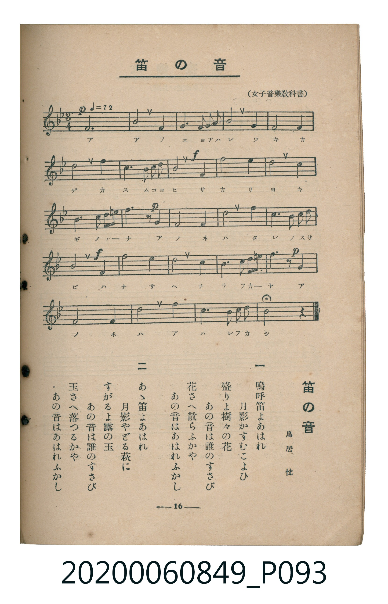

# 笛の音

> Re:Shōka 使用 AI 協助辨識與重建樂譜，可能會有錯誤。歡迎回報。

- **鋼琴伴奏版**：<br><audio controls src="fue_no_ne.mp3"></audio>
- **NEUTRINO 歌聲合成版**：<br><audio controls src="fue_no_ne_neutrino.mp3"></audio>

- 詞：鳥居忱
- 出處：女子音樂教科書
- 臺灣教育會公認《新定兒童唱歌》高等科女子用（2020.006.0849）

## 說明

原書資訊與歌詞全文（對應 P093.jpg，書頁 p. 16，高二第二學期第 4 首）：
調性與拍號：變ロ長調（2 降記號）、3/4 拍（♩=72）
出處註記：（女子音樂教科書）


## 歌詞

```text
一
嗚呼（ああ）笛（ふえ）よあはれ
月影（つきかげ）かすむこよひ
盛（さか）りよ樹々（きぎ）の花（はな）
あの音（ね）は誰（たれ）のすさび
花（はな）さへ散（ち）らふかや
あの音（ね）はあはれふかし

二
あゝ笛よあはれ
月影やどる萩（はぎ）に
すがるよ露（つゆ）の玉（たま）
あの音は誰のすさび
玉さへ落（お）つるかや
あの音はあはれふかし
```

## ABC

<div class="abc-score" data-abc-src="fue_no_ne.abc" aria-label="五線譜載入中"></div>

[下載 ABC 原始檔](fue_no_ne.abc)

## TMD 檔案連結

- [主旋律 TMD 檔案](fue_no_ne.tmd) [[在 TMD Studio 編輯](https://tmdlang.github.io/Tmd-TS/#tmd=s7IKdvYPcrWy4qpTUCpJTLdSSM7PyUlNLsnMz7MqzsjMK0nNjM_KTMmPL87Iz05Ugisry88pzU21ys4vyY9PzyzKKY43MjAyiDcwMIs3sDCxRCgszi8tSk61Kk7OyM_PiS9JrShJys_PRpePL0hMT7UKMLA0RsgUFOWXpeYl5gF1FxSBXJIC1o5QkFqWmZIKki5OTsyLL0stykzLTE1BcmNqUTHYHxArSooS84qTizILQJ5DqMovKsnITy9KLMiotMrILC7JL8pMTsyJz07MQ_JuSUYq0Le5pcWZyeiCxamJxfl5xcgGZqZn5lnlpmZmZWLxMFS6JDETGKSgYC1PjM9NzMzLScwDul1LS-H5mtmPG9e9nL9ZQUuLS9FWwdyIy95WwUmHy8ZY38QOZM6LlfPe75n1cvPSpxtbn-7fCDb7afuuFzOnAoWfLt38dO0EoPZnK5qeTZ35fPnEZ7N3gJW8aN_1vHExUOxF06Znc5qftq55sar3cUPXs2kbnq6b9bR10vPVS59O2fhsbc_jhu6Xq2c8X9sJ1A0x7_mUFe_3dIDiWA8Yx3qgOH6_p1OJi0tfS8GWWoBLQUHhad98oHtfbG5_saLrRUc70DFA3z5tXfFsWjvQAU839D5r71QAJRS9rIL093t6gIpfLmhUKNBTMDQDcoHOfrKr5_maNUDy6dodz-bMB7IVTBReLpsGdC8weEB2vFi1_1nDcpDp3b0vZs4Hir5Y1_W4ee3LqduBUiB_Kryc2ftixQywZOfjhkZgyCsAFQOlHs1caWtuBBQFOxYc6C9W7AaqBZoCciC20AepBil_sqMBrGv6rKcT9wAVP25sAiKgLDDKwdytjxs7QBY2QaTWP27qAWl4Nqfj6d6NYBVLHjf2Pm7sftw4CaQOxJj5uKnhceNksJ5NINXPZ0MMmwqUBhvWBZR7tmLn44ZWsDhQfx9Y87oXXRBD1z9uXAX1EdheUOIDS6wFq1v_YtUGMHc-0D0QnSBrQRZsBgcnqjFgiR3Ppi4GCy4EOwEoCPRb9-OmFpyWwH0MVdo4HRJmu8BBAJJtmgvKGljDBmjw48aVj5u6X0xYCXMLxJOrIbqBzu0BSgN1v5yzCRqSTW0QzzzvAyYMsPca96EHA8T36D4G6oD48sWEvWCtXWCTgEYC3Y3hS-yeA6qgPMdAgYKWPheXL7AQsQrITMzLd6gxqKkGWaBgY2imZQdmYcunwKJmDTBNvljYo6BhqvB0Q__z9Q068MyliUUD0B6oYY-bFinUgMnHzVPBrBVAFhCDRfpBIs1rgLgFLLcWiFfDdNcoVBfUKpjGK-hihTUKhmgicKU1CmbIusDiYBFzEIGpEa66BtM6hKFgR_kYQnyDy02YciB_I2RXoMiAeBAdoLAAqwCGBrr-FiT9a9FlgeGF4j6jwes-_AlsVw-ZCWwT2BKQ5TuBjlkApDeDnQ5y7CQgbytYbjWQtwosBkp8axGJzBjNxSZw3xghiYKSDIgPUo2ZgKrTkBIqMBHhNBLdMpgVyIlrE-4gBPsROegXgOU3g9mgyIL4GV3_ViT9MLMQZqxCyILNQNW7FtWF4OSF4cLmJUhmdKLIgOyDJJ7HTeugKroxbIH5CmQ6ZgJD8j-mCxHJj0AC29FJZgJbB7SkD-yJx817wI7ogpVrYPFeMAso27QfXp4BxUHJERj08ISGnGhgSclEHewt5ARjAMSggo-4Qomc5IuU1kAxggjJPjAJjiugRyHh3YWkAmQrogCBeB89NnqRZEEmocgCAwghixzPULvB6QCSXpHSW_MyLCpBJiFcOW_AXIk3zT2dPZu8NNc8GV47gtIauAhrngHEjWDWSnCpDSnUIClyCdjLWNMaCFJeQJGffBHJDegr9IiABT56UoNEBFLBBfQ9ut5GJNmVKDKgGg1S1CGSCKyIAkG0JIKU1DBciJIYkJMZES5sQi5aYcUUxIVgt5HgQgJ15xRwMjMhOZmhFl-QIg1UzIGKMEgCA5US2xEJi8pFEUZCBSUfpDgBpxpSsy9y1keWhWRm5NQB8RyqfrR0C04VA-WCWi4uXTsFUItdAUgrcwEA)]
- [鋼琴伴奏 TMD 檔案](fue_no_ne_piano.tmd) [[在 TMD Studio 編輯](https://tmdlang.github.io/Tmd-TS/#tmd=s7IKdvYPcrWy4qpTUCpJTLdSSM7PyUlNLsnMz7MqzsjMK0nNjM_KTMmPL87Iz05Ugisry88pzU21ys4vyY9PzyzKKY43MjAyiDcwMIs3sDCxRCgszi8tSk61Kk7OyM_PiS9JrShJys_PRpePL0hMT7UKMLA0RsgUFOWXpeYl5gF1FxSBXJIC1o5QkFqWmZIKki5OTsyLL0stykzLTE1BcmNqUTHYHxArSooS84qTizILQJ5DqMovKsnITy9KLMiotMrILC7JL8pMTsyJz07MQ_JuYhFQc3pqbmpeiVVBZmJefnxicnJ-bkFiXiZIDKGwJAOoyCq3tDgzGV2wODWxOD-vGNnmzPTMPKvc1MysTCwhA5UuScwEhj0o_MsT43MTM_NyEvOAntTSUni-ZvbjxnUv529-v6fjZfee5xO2PNmz5enS_uedHe_3dCpoaXEp2iqYG3HZ2yo46XDZGOub2IEMf7Fy3vs9s15uXvp0Y-vT_RvBFj5t3_Vi5lSg8NOlm5-unQA089mKpmdTZz5fPvHZ7B1gJS_adz1vXAwUe9G06dmc5qeta16s6n3c0PVs2oan62Y9bZ30fPXSp1M2Plvb87ih--XqGc_XdgJ1Q8x7PmUF0I2gFKIHTCF6oBQCdKESF5cv0D9WAaAADfJwqDGoqeZSAAIbQzMtOzBLH-TLNU92NLxY2KOgpQ8Wq1GoLqhVMI1X0MUKaxQM0UTgSmsUzJB1gcXBIuYgAlMjXHUNpnUIQ8GO8jGsUXjctAinmzDlHjdPRZJdgSID4kF0PG7uh6hoXoOhvwVJ_1p02abVqO4zGrzuQ47pXT0oMW2Mps0EbqQRkigo3kB8kGrMWKxOQ0otwJjEaSS6ZTArkGN4E25_ANk7kWWaF4DlN4PZoBADhdIkDP1bkfTDzEKYsQohCzYDVe9aVBeC4xjDhc1LkMzoRJEB2QeJwcdN66AqujFsgfkKZDpmLCP5H9OFiDSAEss7OlFiGTnGYPFoog42Ezm2DIAYlPWJy5bkpB2kiAYFB8IbfWASHFDNe6Ce7UJSAbIVkYVAsiAdqEHRiyQLMglFtmk_kixyIEPtBkcCJLEgRXbzMiwqQSYhXDlvwFyJFOFPZ8_GGeEgSHkWJT8NIeK8eTKa6YgQQI9vSGggZd3mGRh6G5FkV6LIgApWSGZHxBMsk4IgWjwhxTeGC1FiBDmuiXBhE3LhAsuoEBeC3UaCC1GK8CkocU3lLIqRdkAxihRM4IgkNVkjZwlkWUgiR44wUNGwHU0_WlICR9RAuaAWuU3lg9ymsiDYpDKMB8WNMRIJDG0kHpBtAIqaeFDuMQGTpvHxID6qOjOgIJAFinqwLFAITIK146vtkQ0xASoH8rEYgmEfqPSAug2rCciCMAPwVkdI6oFq0VxhAA4r3M7D6QysHsFbSlLoR5I8gj8LU-RHqFIgCcmt4FSqa6cASqgKQFqZCwA)]

## 分析

```text
================================================================================
📊 TMD Song Profile: [ 笛の音 ]
================================================================================
⏱  Duration:       1:00 (60.0s), 24 measures total
🎼 Key & Tempo:    首調基準 B,, != 72.0 BPM, <3/4>
   - 分析範圍：      由實際發聲的音符與和弦推測調性；播放脈絡另行呈現
🎤 人聲音域:    F4 (MIDI 65) – F5 (MIDI 77) [跨度: 12 個半音 / 1.0 個八度, 難度: easy]
   - 最低音:  F4 in [Main #1 @ m.1, 0:00]
   - 最高音: F5 in [Main #1 @ m.9, 0:20]
   - 適合: soprano, mezzo-soprano, contralto, tenor, baritone, bass
🏛  結構:      Main (60.0s)
⚡ 編曲密度:        Peak 1 軌道同時演奏
🗝  調性診斷：       A# 大調（純淨自然大調，未偵測到可信轉調）
   - 風格氣質:    純淨自然大調（陽光明朗、易唱易記，無明顯調外色彩）
   - 轉調歷程:    全曲維持單一推測調性（未偵測到可信轉調）
   - 核心骨幹音:  F, A#, D, C, D#
   - 調性數值:    A# 大調 [相關度: 0.88, 穩定度: Moderate, 自然音純度: 98.6%]
   - 候選調性 (K-S): A# 大調 (0.88), F 大調 (0.79), D 小調 (0.67)
   - 五度圈歷程:   -2
   - 各段落調性細節:
     • [Main #1]: A# 大調 (r: 0.88, 自然音純度: 98.6%, 調外音: E)

  [ 五度圈游移軌跡 ]
               C  
         F            G  
     [Bb]*              D  
      Eb               A  
         Ab           E  
            Db       B  
               F# 
     (* = active key center)

  [ 十二半音累積音高分佈 ]
     C  : ██████████                12.9%
     C# :                            0.0%
     D  : █████████████             17.9%
     D# : █████                      7.1%
     E  : █                          1.4%
     F  : ████████████████████████  32.1%
     F# :                            0.0%
     G  : █████                      7.1%
     G# :                            0.0%
     A  : █                          0.7%
     A# : ███████████████           20.7%
     B  :                            0.0%
--------------------------------------------------------------------------------
Assignment 軌道音域：
  - Piano         : F4 – F5 (12 個半音 / 1.0 個八度, 58 個音符)
================================================================================
```


## 原書掃描頁




