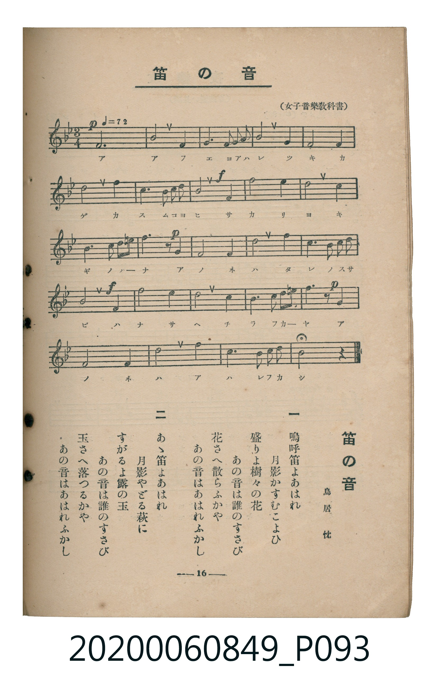

# 笛の音

<audio controls src="fue_no_ne.mp3"></audio>

- 詞：鳥居忱
- 出處：女子音樂教科書
- 臺灣教育會公認《新定兒童唱歌》高等科女子用（2020.006.0849）

## 說明

原書資訊與歌詞全文（對應 P093.jpg，書頁 p. 16，高二第二學期第 4 首）：
調性與拍號：變ロ長調（2 降記號）、3/4 拍（♩=72）

## 歌詞

```text
一
嗚呼笛よあはれ
月影かすむこよひ
盛りよ樹々の花
あの音は誰のすさび
花さへ散らふかや
あの音はあはれふかし

二
あゝ笛よあはれ
月影やどる萩に
すがるよ露の玉
あの音は誰のすさび
玉さへ落つるかや
あの音はあはれふかし
```

## ABC

```abc
X:1
T:笛の音
C:TMD (Chen, Chih-Han / aguai)
M:3/4
L:1/16
Q:1/4=72
K:Bb
V:V1 name="Piano" snm="Pia"
[V:V1]
!p! F12 | B8 F4 | G6 A2 B2 c2 | d8 B4 |
F8 F4 | d8 e4 | c4 F2 G2 A2 B2 | !f! c8 F4 |
f8 e4 | d8 d4 | c6 c2 d3 e | !p! f6 z2 F4 |
G8 A4 | B8 f4 | d6 c2 d2 e2 | !f! c8 F4 |
f8 d4 | c8 A4 | B6 c2 d3 =e | !p! f6 z2 F4 |
G8 A4 | d8 g4 | c6 B2 c2 d2 | B8 z4 |
```

## TMD 檔案連結

- [主旋律 TMD 檔案](fue_no_ne.tmd)
- [鋼琴伴奏 TMD 檔案](fue_no_ne_piano.tmd)

## 分析

```text
================================================================================
📊 TMD Song Profile: [ 笛の音 ]
================================================================================
⏱  Duration:       1:00 (60.0s), 24 measures total
🎼 Key & Tempo:    首調基準 B,, != 72.0 BPM, <3/4>
   - 分析範圍：      由實際發聲的音符與和弦推測調性；播放脈絡另行呈現
🎤 人聲音域:    F4 (MIDI 65) – G5 (MIDI 79) [跨度: 14 個半音 / 1.2 個八度, 難度: moderate]
   - 最低音:  F4 in [Main #1 @ m.1, 0:00]
   - 最高音: G5 in [Main #1 @ m.22, 0:54]
   - 適合: soprano, mezzo-soprano, tenor, baritone
🏛  結構:      Main (60.0s)
⚡ 編曲密度:        Peak 1 軌道同時演奏
🗝  調性診斷：       F 大調（純淨自然大調，未偵測到可信轉調）
   - 風格氣質:    純淨自然大調（陽光明朗、易唱易記，無明顯調外色彩）
   - 轉調歷程:    全曲維持單一推測調性（未偵測到可信轉調）
   - 核心骨幹音:  F, D, C, A#, G
   - 調性數值:    F 大調 [相關度: 0.88, 穩定度: Moderate, 自然音純度: 96.1%]
   - 候選調性 (K-S): F 大調 (0.88), A# 大調 (0.77), D 小調 (0.76)
   - 五度圈歷程:   -1
   - 各段落調性細節:
     • [Main #1]: F 大調 (r: 0.88, 自然音純度: 96.1%, 調外音: D#)

  [ 五度圈游移軌跡 ]
               C  
        [F ]*          G  
      Bb               D  
      Eb               A  
         Ab           E  
            Db       B  
               F# 
     (* = active key center)

  [ 十二半音累積音高分佈 ]
     C  : ███████████████           17.9%
     C# :                            0.0%
     D  : █████████████████         20.0%
     D# : ███                        3.9%
     E  :                            0.4%
     F  : ████████████████████████  27.9%
     F# :                            0.0%
     G  : █████████                 10.0%
     G# :                            0.0%
     A  : █████                      5.7%
     A# : ████████████              14.3%
     B  :                            0.0%
--------------------------------------------------------------------------------
Assignment 軌道音域：
  - Piano         : F4 – G5 (14 個半音 / 1.2 個八度, 59 個音符)
================================================================================
```


## 原書掃描頁




