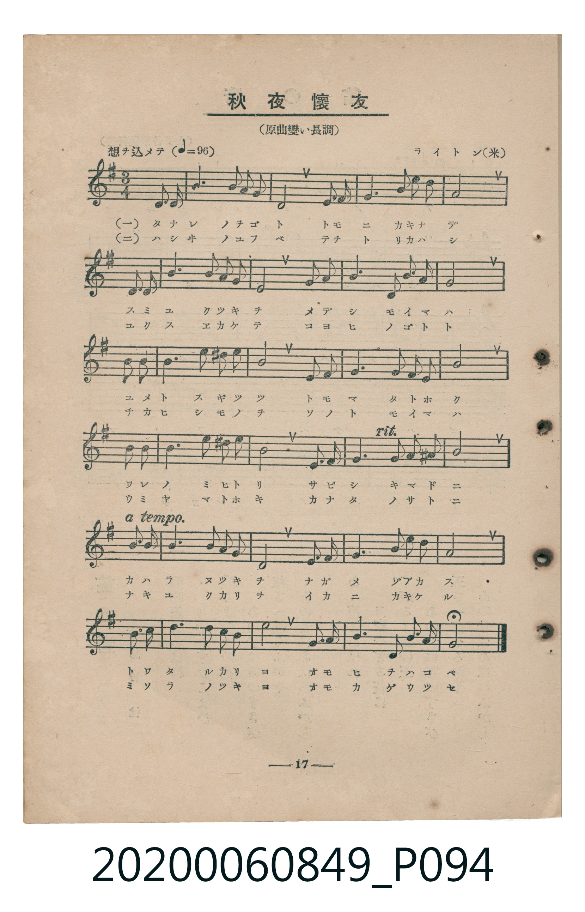
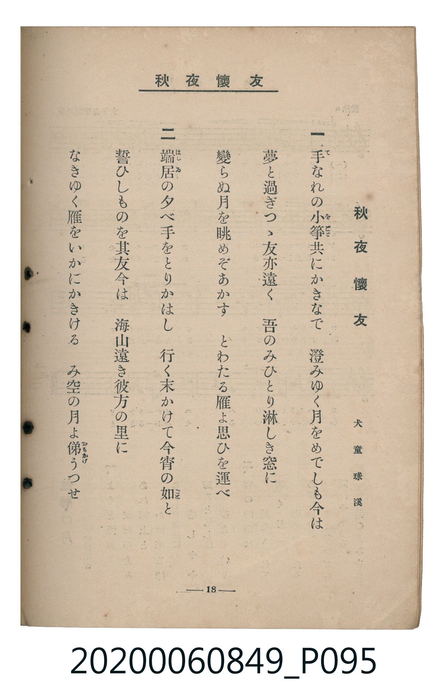

# 秋夜懷友

<audio controls src="shuya_kaiyu.mp3"></audio>

- 詞：犬童球溪
- 曲：Wrighton（美國曲）
- 臺灣教育會公認《新定兒童唱歌》高等科女子用（2020.006.0849）

## 說明

原書資訊與歌詞全文（對應 P094–P095.jpg，書頁 pp. 17–18，高二第二學期第 5 首）：
調性與拍號：ト長調（1 升記號，原曲變イ長調）、3/4 拍（想ヲ込メテ ♩=96，弱起第 3 拍進入）

## 歌詞

```text
一
手（て）なれの小箏（をごと）共にかきなで
澄みゆく月をめでしも今は
夢と過ぎつゝ友亦遠く
吾のみひとり淋しき窓に
變らぬ月を眺めぞあかす
とわたる雁よ思ひを運べ

二
端居（はしゐ）の夕べ手をとりかはし
行く末かけて今宵の如（ごと）と
誓ひしものを其友今は
海山遠き彼方の里に
なきゆく雁をいかにかきける
み空の月よ俤（おもかげ）うつせ
```

## ABC

```abc
X:1
T:秋夜懷友
C:曲：Wrighton（美國曲）
M:3/4
L:1/16
Q:1/4=96
K:G
V:V1 name="Piano" snm="Pia"
[V:V1]
!mp! z4 z4 D2 D2 | B6 c B A2 G2 | D8 G2 A2 | B6 B2 B2 c2 |
A8 D2 D2 | B6 c B A2 G2 | E8 E2 F2 | G6 E2 G2 A2 |
!mf! G8 B2 c2 | d6 B2 d2 c2 | B8 G2 G2 | A6 A2 F2 G2 |
A8 B2 c2 | d6 B2 e2 d2 | c8 A2 A2 | B6 B2 A2 ^G2 |
A8 d2 c2 | B6 c B A2 G2 | D8 G2 A2 | B6 B2 B2 c2 |
A8 B2 c2 | d6 c2 B2 A2 | e8 G2 A2 | B6 D2 B2 A2 |
G8 z4 |
```

## TMD 檔案連結

- [主旋律 TMD 檔案](shuya_kaiyu.tmd) [[在 TMD Studio 編輯](https://tmdlang.github.io/Tmd-TS/#tmd=s7IKdvYPcrWy4tLSUni-vPvpkjnP2rc_7e9W0NLiUrRVsDTjsrdVcOeyMdY3seOqU1B6sXLe-z2znneteb566fMJzc92rVICCT-bvQkoHF6UmZ5Rkp_3fk_H8319T-d0g4U7wSpetO963rj42dSZL5o2PZvT_LR1zYtVvY8bup5N2_B03aynrZOABj6dsvHZ2p7HDd0vV894vrbz-fKJT5dufrp2wvMpK4BGGhkYGegZGJjpGViYWIKN5dLXUrClFuBSUFB42jf_2ewdLza3v1jR9aKjHegYoH-ftq54Nq0d6ICnG3qftXcqBBhYmjxqmAykTPWyCtLf7-kB6nm5oFGhoEBPwdAcKGVoARQE-uHJrp7na9YAyadrdzybMx_IVjBVeLlsGtDxwNACWfhi1f5nDctBVnX3vpg5Hyj6uLnj5dTtQHGghYYKT3uBTpkBlukBO27Ti3Vdj5uWwJR0Pm5oBEaNAlA7UP2z5s2Pmze92LfncfPCx81tCo9mrrS1NANp3bPxxdbtIPuNQUpfNmx62roUqJsL5IYnOxpA1LPObqARjxuXgUxtXPW4qedx47qnG_qfr-sHiTdNetw45XEjMCI6n7ZufNy4-nFj9-PGXpDKxuVg_ftaHjfuf9zU9rix_9kcsIamRqDc48bpj5uanuzuety4HhzGSxYBjXnZ2PcYhJY8bpoLTG5Pdi172bgAqBOsYsI-oNUgwxo3AZU-bup6th1o13Sgdc9XTQZaDQ45UDgAHboGYtfzObvA1s173NgEdtlMkCKw7v7HjfMfN3W_nN34uKnjWcNckKlNk16CFO2EBMCuHhD1fPX6pxtbwWGwHuzoCeCQWPd0yVSgSmDwgMMA5BywBSA1YIcsBAYU0MeQAJkIDECgX5-u2wrSuawJbBw03IAkJM6BfgB6DBQsIH82TXraug0UBvAgerZ1-9ONG8EB0vt0755n03YC1b1sB9oD9jo4zHshIQ32FdBZwLAH2g6PlIlAD0OU7n--chdQNziUOp7sXwJ2EDDoIKE0CewsoEFLHjfOBmmgPB9BgYKWPheXb2JmnlVAZmJevkONQY1CNcgGBRtDMy07MAuYfSEpE5TM1jeAUn_TfoXHzV0gzSAFNQoGCrpgCKOrcwtqFUzjgSwwUQOOQJBBoIy2owEYGeA8tAZoSh8Qb1J43LQFaAwwV0HxIjCvGyi-GojXgm0DibQraDxu2glkzNdE2G4MtRUETYA8IyBtCLIWYjsyBAmDpFE1gdggbAKWAckjQ1z-2NUD88cyoBvXAx3VAnYryJ1AHzUvBLsXyGvaDvYRsEAA0vPA8v1Af4C0NS8kyh9m6P4AC5iD3QRWgiKO8CSyFCRe0moRPkWNlU6Yb4DhDwripnVgH4FcC_QXUqzMA8qB4h8kMhvsv_Ug34ACYA2Sb0zRAhjEhwQwsj9hkQLxJ3LQg9hgH2JKwYzE8MXT2bNhvgClq_lAPAnsUpC7VwFduhVIT4bFCThdAX3T3AlNbcC0BUxuzf14fGEG9UkN2HJkCHIg9qQFjkd1rL6ABwpqypoC88VKoHN6MFJWF5C3BswDprGmfUAMSl2rwf7aCYoLUNSsp18OwR4XrWuhvgCnFlA-BgXuKrC7VwB5wPiApihQHIH81Q8U3QwWmYk9BkCWwEIUmCuIcjrYhwhN6FkCVmTVcNVycenaKYAKQwUgrczFBQA)]
- [鋼琴伴奏 TMD 檔案](shuya_kaiyu_piano.tmd) [[在 TMD Studio 編輯](https://tmdlang.github.io/Tmd-TS/#tmd=s7IKdvYPcrWy4tLSUni-vPvpkjnP2rc_7e9-v6fjZfee5xO2PNmz5enS_uedHe_3dCpoaXEp2ipYmnHZ2yq4c9kY65vYcdUpKL1YOe_9nlnPu9Y8X730-YTmZ7tWKYGEn83eBBQOL8pMzyjJzwOa-Hxf39M53WDhTrCKF-27njcufjZ15oumTc_mND9tXfNiVe_jhq5n0zY8XTfraeskoIFPp2x8trbncUP3y9Uznq_tfL584tOlm5-unfB8ygqgkUYGRgZ6BgZmegYWJpZgY7l8EzPzrAIyE_PygzwcagxqFKq5FIDAxtBMyw7M0tdSeLpn44ut259u6H--vkFBSx8sXKNgoKALhjC6OregVsE0HsgCEzVcMO3P16x5sqPhxcIehF5jqB4QNAHyjIC0IUgTRC8yBAmDpFE1gdggbAKWAckjQ1yu2NVDpCvM0F0BFjAHmwhWgiKOcCKyFCRM0moR7kQNkU4Ut5iieQ7Eh3gO2ZWwAIG4EtnbIDbYfZhSMCMx3PB09my8bjCDuqMGrBUZgozHHingMFTH6ga4l1DjZAo9Uwb2cGhdizMcQIph_gKmC6KcAHYpQhN6ooBlmBquWuT854OS_yyIyX4wjDevVQOzpWE8yFHGSCQoPOMVjMBsMBkPNAnoViQlZkAxIAu7Snz5CpttJkBtQHETKAmxDWQWUAFQBKwMbD6qdiAb3TK0jAMtdsB6zVEobCahqYTbCSSAWRnoOiAJZKPZiZ5R0MwFBxJWDxoDaZBVQHUgCsRFcgSeAEXNFLSPQvQsQJUoBJKw9AlM6bp2CqDErgCklbm4AA)]

## 分析

```text
================================================================================
📊 TMD Song Profile: [ 秋夜懷友 ]
================================================================================
⏱  Duration:       0:46 (46.9s), 25 measures total
🎼 Key & Tempo:    首調基準 G, != 96.0 BPM, <3/4>
   - 分析範圍：      由實際發聲的音符與和弦推測調性；播放脈絡另行呈現
🎤 人聲音域:    D4 (MIDI 62) – E5 (MIDI 76) [跨度: 14 個半音 / 1.2 個八度, 難度: moderate]
   - 最低音:  D4 in [Main #1 @ m.1, 0:01]
   - 最高音: E5 in [Main #1 @ m.14, 0:25]
   - 適合: soprano, mezzo-soprano, contralto, tenor, baritone, bass
🏛  結構:      Main (46.9s)
⚡ 編曲密度:        Peak 1 軌道同時演奏
🗝  調性診斷：       G 大調（純淨自然大調，未偵測到可信轉調）
   - 風格氣質:    純淨自然大調（陽光明朗、易唱易記，無明顯調外色彩）
   - 轉調歷程:    全曲維持單一推測調性（未偵測到可信轉調）
   - 核心骨幹音:  B, A, D, G, C
   - 調性數值:    G 大調 [相關度: 0.71, 穩定度: Moderate, 自然音純度: 99.3%]
   - 候選調性 (K-S): G 大調 (0.71), B 小調 (0.66), D 大調 (0.64)
   - 五度圈歷程:   +1
   - 各段落調性細節:
     • [Main #1]: G 大調 (r: 0.71, 自然音純度: 99.3%, 調外音: G#)

  [ 五度圈游移軌跡 ]
               C  
         F           [G ]*
      Bb               D  
      Eb               A  
         Ab           E  
            Db       B  
               F# 
     (* = active key center)

  [ 十二半音累積音高分佈 ]
     C  : ████████                   9.4%
     C# :                            0.0%
     D  : ████████████████          17.4%
     D# :                            0.0%
     E  : ███████                    7.6%
     F  :                            0.0%
     F# : █                          1.4%
     G  : █████████████             14.6%
     G# : █                          0.7%
     A  : ████████████████████      22.2%
     A# :                            0.0%
     B  : ████████████████████████  26.7%
--------------------------------------------------------------------------------
Assignment 軌道音域：
  - Piano         : D4 – E5 (14 個半音 / 1.2 個八度, 87 個音符)
================================================================================
```


## 原書掃描頁






