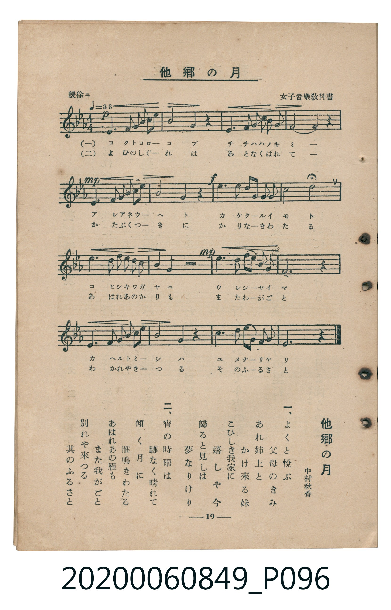

# 他郷の月

> Re:Shōka 使用 AI 協助辨識與重建樂譜，可能會有錯誤。歡迎回報。

- **鋼琴伴奏版**：<br><audio controls src="takyo_no_tsuki.mp3"></audio>

- 詞：中村秋香
- 出處：女子音樂教科書
- 臺灣教育會公認《新定兒童唱歌》高等科女子用（2020.006.0849）

## 說明

原書資訊與歌詞全文（對應 P096.jpg，書頁 p. 19，高二第二學期第 6 首）：
調性與拍號：變ホ長調（3 降記號）、4/4 拍（緩徐ニ ♩=88）
出處註記：女子音樂教科書
註：五線譜下第一段第三句印作「コヒシキワガヤニ」，底欄歌詞印作「こひしき我家（わがいへ）に」。


## 歌詞

```text
一、
よくと悅（よろこ）ぶ　父母（ちちはは）のきみ
あれ姉上（あねうへ）と　かけ來（く）る妹（いもと）
こひしき我家（わがや）に　嬉（うれ）しや今（いま）
歸（かへ）ると見（み）しは　夢（ゆめ）なりけり

二、
宵（よひ）の時雨（しぐれ）は　跡（あと）なく晴（は）れて
傾（かたぶ）く月（つき）に　雁（かり）鳴（な）きわたる
あはれあの雁も　また我（わ）がごと
別（わか）れや來（き）つる　其（そ）のふるさと
```

## ABC

<div class="abc-score" data-abc-src="takyo_no_tsuki.abc" aria-label="五線譜載入中"></div>

[下載 ABC 原始檔](takyo_no_tsuki.abc)

## TMD 檔案連結

- [主旋律 TMD 檔案](takyo_no_tsuki.tmd) [[在 TMD Studio 編輯](https://tmdlang.github.io/Tmd-TS/#tmd=s7IKdvYPcrWy4qpTUCpJTLdSSM7PyUlNLsnMz7MqzsjMK0nNjM_KTMmPL87Iz05Ugisry88pzU21ys4vyY9PzyzKKY43MjAyiDcwMIs3sDCxRCgszi8tSk61Kk7OyM_PiS9JrShJys_PRpePL0hMT7UKMLA0Q8gUFOWXpeYl5gF1FxSBXJIC1o5QkFqWmZIKki5OTsyLL0stykzLTE1BcmNqUTHYHxArSooS84qTizILQJ5DqMovKsnITy9KLMiotMrILC7JL8pMTsyJz07MQ_JuSUYq0Ld5iSWlRanoommJuZk5lcgGZqZn5lnlpmZmZWLxMFS6JDETGKSgYC1PjM9NzMzLScwDul1LS-HJ7mkvm7c_blz3bE6HgpYWl6KtgoUFl72tgqsOl42JvokdyKgXK-e93zPryY61z-ZOfL68--WymWAbnrbvejFzKlDm6dLNT9dOeDl_87MVTc-mzny-fOKz2TvASl6073reuBgo9qJp07M5zU9b17xY1fu4oevZtA1P18162jrp-eqlT6dsfLa253FD98vVM56v7QTqhpj3fMqK93s6QDGtB4xpPVBMv9_TqcTFpa-lYEstwKWgoPC0bz7QvS82t79Y0fWiox3oGKCHn7aueDatHeiApxt6n7V3KoCSi15WQfr7PT1AxS8XNCoU6CkYAl3UA3T2k109z9esAZJP1-54Nmc-kK1gpvBy2TSge4HBA7Ljxar9zxqWg0zv7n0xcz5Q9MW6rsfNs19O3Q6UAlpjrPByZu-LFTPAkp2PGxqBga8AVAyUer595dN9Ex43dys8mrnS1sICKA92Njj4X6zYDdSFKxLAVq_YDYq9XVOeb5_1Yu2cJzu6QW7d0fBs3VYwo_Np_9KnvRue7J3zuKHncdPmx82THjdtf9y09nHz-sdNax43LwFa_bgB6JKep7umPlvTAg0guJbGyY8bNz1unP64sfdZx8Sn67YB3fy4qf9xI1Cq5XHjDpB_GlcDTXjc0MQFchHQcqAHQazHTR2PG4EqVzxragXrAqJeoIFgLdseNzQ879j2bD0oEB43LgSj9UAEll0HtO5x436wKY1Nj5t6ni7vfLKjC6y06XHj2seNbTC7VwANetzY_bhx4pN9bWAF_SDxpu6ny3aCuS2Pm4BagMkNHLD4PNTUAvNNw9M1wMgFam4D2g0WnA6UfbIb4gKgv_dBjXu2FugKoBDQfrBzmoCMFS-WdYMFgVEP1gn0F9DEJYvANgFNbASLr3rc1AV0NZCEhNsuYDYBh9vTdVuhwdW4CRIaz2Y2vZwNyjBg0ybA3AQy9sX2hbBQAXkRZGxj_7OZW8CC4MBsAsbUMrC5TUBXQ9w6HxgBYNX9wKIBLLgEGB5w37-cDXQiWGUT0MedLzdDjFsFVtALDq35QK_CogfoEJAlQMY6oE5QcIOiZB9QETCEIcEL1glUMwXoTLBbOpbCwh0YVmBHAsMXGoEQhywBBSYw3FrBMdQ4F5YwtoIDeSrUIMpLCShQ0NLn4vIFFp9WAZmJefkONQY11SALFGwMzbTswCxsZZMCJL-9WNijoGGi8HRD__P1DTrwAkUTiwagPVDDHjevAGaS9UC6A8JuXgvEexRqgKKbgaxpIFZzIxT3Q3EfUHYtWGY-WDXUvBqF6oJaBUMFXTg0AmJjIDYFYjMgNowDEjVgLjIEKQFBAyhdg9UQkAEgnSB2DVgUG4SbAXaSjyHIlSuQ5EG-BZJA_4JIkAzIzyByD9hckL9RTQSFAoQVD3cfKDyQVYB4oLBBkH1gu0AmQ8IJu2vhJkJca4Th2uZJSKZtB5MbkF3bvAbDtSD70VzbtAhFBcTvXWDTIKEBcTPILJCZbQRdiz8x7uohLzECnQlyBITuBdLLYImxeQbY2SCvrAbijdBEuweIQfwlYDUgXcBWBjwx5lIrNVanAQ0CKYZBMMccqhaGa8CGIkOQCmSIlCbRYgQU8hAxkMdB7GVgNiyWZ6CZBIlD9FhejawCGEiI-AWZAwoqkMgSqJnILkA1E829oFSJZvZ-sHpQvoDZ0ILsXnC6RzW7m5B7m1eBSXCqhLgXbAqwlQBVDbIT1Uxk_RD3EigkO8lMl6CicBI4A4IcBXISsOUCDsQlYK-BnAdKq6C0C1QDTpdAGWi6nIdIkyipCJQ8jEAC8OQESkCIBImeEJESJDhp4zaLrGISpeCDFjzQIgcRESB_Q5IPKBlhj1rkKAYlY4SZkGQONhOaJEGmIJLkPByuxVJMomUgRAEGy0aQIhOUREAmgxIXRCVMHxbXotgPS-RIGQjs98dNW6Cq0bMLpmvxJsens2eTmRyBRR64QATRoHobUguDAgWU-PrBjgMlx4Xg_ARJjqvAJQIkKBDJEcnVZJeOyKUeKBmCNYKUwUxEtQcZYkuFqIUCqOCDFlzQagtUlSIKGlBaQoZYqz9gYCCrWAgmkQoaSNEDLjCR0wrueEVU1qDUATcZ7HZoKoSm7LXIrgUXkqiuhfkWOc_sRVEBTsfNU5FcCynGt0LNJJwKa7m4dO0UQA1LBSCtzAUA)]
- [鋼琴伴奏 TMD 檔案](takyo_no_tsuki_piano.tmd) [[在 TMD Studio 編輯](https://tmdlang.github.io/Tmd-TS/#tmd=s7IKdvYPcrWy4qpTUCpJTLdSSM7PyUlNLsnMz7MqzsjMK0nNjM_KTMmPL87Iz05Ugisry88pzU21ys4vyY9PzyzKKY43MjAyiDcwMIs3sDCxRCgszi8tSk61Kk7OyM_PiS9JrShJys_PRpePL0hMT7UKMLA0Q8gUFOWXpeYl5gF1FxSBXJIC1o5QkFqWmZIKki5OTsyLL0stykzLTE1BcmNqUTHYHxArSooS84qTizILQJ5DqMovKsnITy9KLMiotMrILC7JL8pMTsyJz07MQ_JuYhFQc3pqbmpeiVVBZmJefnxicnJ-bkFiXiZIDKGwJAOoyCovsaS0KBVdNC0xNzOnEtnmzPTMPKvc1MysTCwhA5UuScwEhj0o_MsT43MTM_NyEvOAntTSUniye9rL5u2PG9c9m9Pxfk_Hy-49zydsebJny9Ol_c87gSKdClpaXIq2ChYWXPa2Cq46XDYm-iZ2IPNfrJz3fs-sJzvWPps78fny7pfLZoKtfdq-68XMqUCZp0s3P1074eX8zc9WND2bOvP58onPZu8AK3nRvut542Kg2IumTc_mND9tXfNiVe_jhq5n0zY8XTfraeuk56uXPp2y8dnanscN3S9Xz3i-thOoG2Le8ykrgM4EpRM9YDrRA6UToCOVuLh8gb6yCgAFa5CHQ41BTTWXAhDYGJpp2YFZ-loKz9esebKj4cXCHgUtfbBYjUJ1Qa2CoYIuHBoBsTEQmwKxGRAbxgGJGjAXGYKUgKABlK7BagjIAJBOELsGLIoNws0AO8nHsEbhcfMKJPnHTetBZHMHmATJPG5eCyb3gM193LQZzcTHzdOgrHi4-x43N6KoAPEeN_cjkX1gu0Amg1TPx-FauIkQ1xphuLZ5EpJp28HkBmTXNq_BcC3IfjTXNi1CUQHxexfYNEhoQNwMMgtkZhtB1yKngV09qGkgl1qJoDoNaBBIMQyCOeZQtTBcAzYUGYJUIEOkpIAWECAPQ8QeN_eC2cvAbFjgzkAzCRJ06IG7GllF00YwCQlWkDmPm0Hyj5uWQM1EdgGqmWjuBSUGNLP3g9WDkiPMhhZk94KTG6rZ3YTc27wKTIITA8S9YFMeN4PMB6kG2YlqJrJ-iHtRioROlOSAEoGgmDECCcBjEhR3iLSAngaQ0gI4VeE2i6yCASWrQ7MaNJMhwuBxEyxbgGIQe6gihy4oBSHMhKQwsJnQ1AAyBZEa5uFwLZaCAS3tIrIsLAVDCglQ7IBMBsUrRCVMHxbXotgPS19IaRfs98dNW6Cq0VMqpmuRUsLT2bNRUwKSBrLLBOS8DkoBYI0gZTATUe1BhtgSAGpWAGV3aHaFlpGgchuRvUDRiAyxlrXNqAlgIZhEyl6QDAcuJpCjCXeQImoGUMTATQa7HZoAoIlqLbJrwUUDqmthvkVOrntRVICTUPNUJNdCCq-tUDMJJ4Ba5LaDD3LbwYJw0yFewTRewRhMQtgm8WAWMFJRpSCxiSEMZwOTElCnEZgNJuFaCFddJDsCVE-ZAdUAJczApDGQYw4RAFE1MBNMoCYiuQx_2QlWBVWP1S1wV0BdgvAAii5SAgUj25IcHlB5FBdAOSjuBkGI9cBEo2unAEo3CkBamQsA)]

## 分析

```text
================================================================================
📊 TMD Song Profile: [ 他郷の月 ]
================================================================================
⏱  Duration:       0:43 (43.6s), 16 measures total
🎼 Key & Tempo:    首調基準 E,, != 88.0 BPM, <4/4>
   - 分析範圍：      由實際發聲的音符與和弦推測調性；播放脈絡另行呈現
🎤 人聲音域:    D#4 (MIDI 63) – F5 (MIDI 77) [跨度: 14 個半音 / 1.2 個八度, 難度: moderate]
   - 最低音:  D#4 in [Main #1 @ m.1, 0:00]
   - 最高音: F5 in [Main #1 @ m.9, 0:23]
   - 適合: soprano, mezzo-soprano, contralto, tenor, baritone, bass
🏛  結構:      Main (43.6s)
⚡ 編曲密度:        Peak 1 軌道同時演奏
🗝  調性診斷：       D# 大調（純淨自然大調，未偵測到可信轉調）
   - 風格氣質:    純淨自然大調（陽光明朗、易唱易記，無明顯調外色彩）
   - 轉調歷程:    全曲維持單一推測調性（未偵測到可信轉調）
   - 核心骨幹音:  D#, F, G, A#, C
   - 調性數值:    D# 大調 [相關度: 0.87, 穩定度: High, 自然音純度: 100.0%]
   - 候選調性 (K-S): D# 大調 (0.87), A# 大調 (0.72), C 小調 (0.64)
   - 五度圈歷程:   -3
   - 各段落調性細節:
     • [Main #1]: D# 大調 (r: 0.87, 自然音純度: 100.0%)

  [ 五度圈游移軌跡 ]
               C  
         F            G  
      Bb               D  
     [Eb]*              A  
         Ab           E  
            Db       B  
               F# 
     (* = active key center)

  [ 十二半音累積音高分佈 ]
     C  : ████████                  10.7%
     C# :                            0.0%
     D  : ██████                     8.0%
     D# : ████████████████████████  30.4%
     E  :                            0.0%
     F  : █████████████             17.0%
     F# :                            0.0%
     G  : █████████████             17.0%
     G# :                            0.0%
     A  :                            0.0%
     A# : █████████████             17.0%
     B  :                            0.0%
--------------------------------------------------------------------------------
Assignment 軌道音域：
  - Piano         : D#4 – F5 (14 個半音 / 1.2 個八度, 61 個音符)
================================================================================
```


## 原書掃描頁




