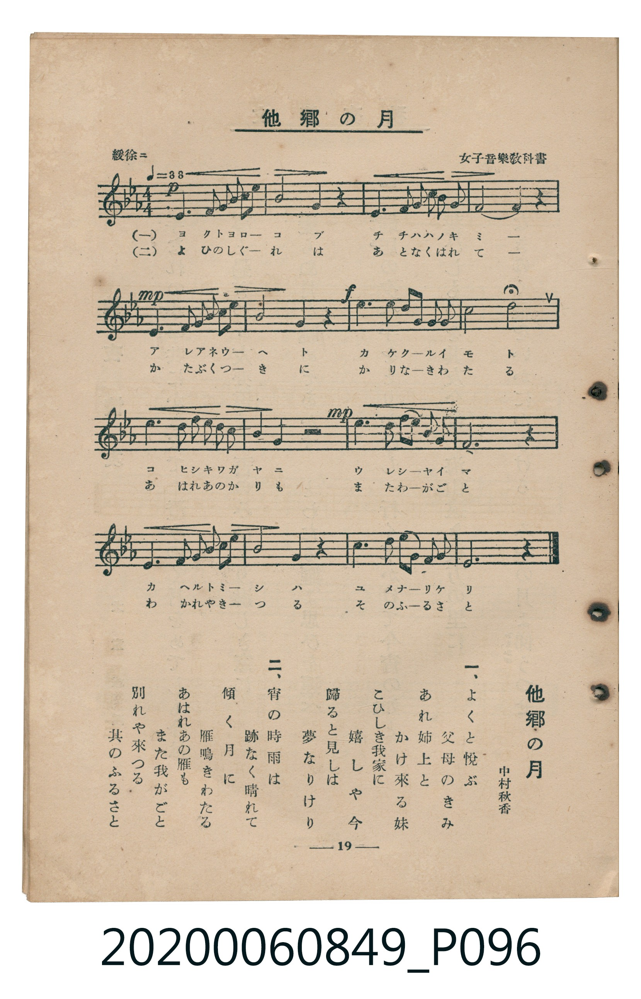

# 他郷の月

<audio controls src="takyo_no_tsuki.mp3"></audio>

- 詞：中村秋香
- 臺灣教育會公認《新定兒童唱歌》高等科女子用（2020.006.0849）

## 說明

原書資訊與歌詞全文（對應 P096.jpg，書頁 p. 19，高二第二學期第 6 首）：
調性與拍號：變ホ長調（3 降記號）、4/4 拍（緩徐ニ ♩=88）
出處註記：女子音樂教科書

## 歌詞

```text
一、
よくと悅ぶ　父母のきみ
あれ姉上と　かけ來る妹（いもと）
こひしき我家（わがいへ）に　嬉しや今
歸ると見しは　夢なりけり

二、
宵の時雨は　跡なく晴れて
傾（かたぶ）く月に　雁（かり）鳴きわたる
あはれあの雁も　また我がごと
別れや來つる　其のふるさと
```

## ABC

```abc
X:1
T:他郷の月
M:4/4
L:1/16
Q:1/4=88
K:Eb
V:V1 name="Piano" snm="Pia"
[V:V1]
!p! E6 F2 G2 B2 A2 G2 | G4 F4 z4 z4 | E6 G2 B2 G2 F2 E2 | D12 z4 |
!mp! E6 F2 G2 B2 A2 G2 | c4 B4 z4 z4 | !f! e6 d2 c2 e2 B2 G2 | A8 B8 |
!mf! c6 c2 B2 G2 A2 B2 | A4 G4 z4 z4 | !mp! e6 d2 c2 B2 A2 G2 | F12 z4 |
E6 F2 G2 B2 A2 G2 | c4 F4 z4 z4 | B6 c2 B2 G2 E2 F2 | E12 z4 |
```

## TMD 檔案連結

- [主旋律 TMD 檔案](takyo_no_tsuki.tmd) [[在 TMD Studio 編輯](https://tmdlang.github.io/Tmd-TS/#tmd=s7IKdvYPcrWy4tLSUniye9rL5u2PG9c9m9OhoKXFpWirYGHBZW-r4KrDZWOib2LHVaeg9GLlvPd7Zj3ZsfbZ3InPl3e_XDZTCSzcvut54-JnU2e-aNr0bE7z09Y1L1b1Pm7oejZtw9N1s562Tnq-eunTKRufre153ND9cvWM52s7ny-f-HTp5qdrJzyfsuL9ng4jAyMDPQMDMz0DCxPL93s6lbi49LUUbKkFuBQUFJ72zX82e8eLze0vVnS96GgHOgbom6etK55Nawc64OmG3mftnQoBBpZmelkF6e_39AAVv1zQqFCgp2AIdFEP0NlPdvU8X7MGSD5du-PZnPlAtoKZwstl04DuBYYKyI4Xq_Y_a1gOMr2798XM-UDRF-u6HjfPfjl1O1AKaI2xwsuZvS9WzABLdj5uaASGrAJQMVDq-faVT_dNeNzcrfBo5kpbCwugPNjZ7btezJz6YsVuoC6geZBAezl_87MVTcAABwYj0J1cIIVPdjQAzQOxHjd1PG7sf9y44llT6-PGbY8bGp53bHu2vhcYuY8bgeR-sKLGpsdNPU-Xdz7Z0QVUClT0uLH7cePEJ_vaHjd1P122E-ikx40tj5uagLJQtzxunPy4cdPjxulAY551THy6bhtIURPQqh6Q0sYdID81rgaa9XQNkDH9cVPLk91dIJ3P1u4Amgo06cUyIAnUvx6kaMmix42rHjcB7Z8IJCG-2AVMI2BfPF23FZQaZza9nL0Cov7F9oUg9Y39z2ZuAbr9ceMysLqmfWCnAs2dD_Qt2An9wEQMccjL2Y1Q2aYuoNTLzVtAQQBy8nygg2ABATQeZB6QsQ6oAeRnUHDsAyoCehPsuylAt4Nt61gKUgr0GDCcGpeAPAX0SOs2cNhuBftxKlQp5ckWChS09Lm4fBMz86wCMhPz8h1qDGoUqkE2KNgYmmnZgVnA3AJKmzsaXizsAakHiQFVFdQqGCrowqEREBsDsSkQm0DZNWASJguCBmh0DYoZMP0gGqQDJFejYB6PpAQZwg0BRy_Mnbt6UN2ZS5RDzaCyIFHsDq1OA5oTh2SQORCDtIEFYc6uAZuJDGEmwiCqa3d0orkWaAvMLSAIYsPMBpkMYiPsgAUvFteCvY3Nuaj-hkUMUWH7dPZsFNcSH6y44x85eJA9CzIbpAvVFuxOrOXi0rVTACVjBSCtzMUFAA)]
- [鋼琴伴奏 TMD 檔案](takyo_no_tsuki_piano.tmd) [[在 TMD Studio 編輯](https://tmdlang.github.io/Tmd-TS/#tmd=s7IKdvYPcrWy4tLSUniye9rL5u2PG9c9m9Pxfk_Hy-49zydsebJny9Ol_c87gSKdClpaXIq2ChYWXPa2Cq46XDYm-iZ2XHUKSi9Wznu_Z9aTHWufzZ34fHn3y2UzlcDC7bueNy5-NnXmi6ZNz-Y0P21d82JV7-OGrmfTNjxdN-tp66Tnq5c-nbLx2dqexw3dL1fPeL628_nyiU-Xbn66dsLzKSuAbjAyMDLQMzAw0zOwMLEEukCJi8s3MTPPKiAzMS8_yMOhxqBGoZpLAQhsDM207MAsfS2F52vWPNnR8GJhj4KWPlgMqKqgVsFQQRcOjYDYGIhNgdgEyq4BkzBZEDRAo2tQzIDpB9EgHSC5GgXzeCQlyBBuCBeyO3f1oLozlyiHmkFlQaLYHVqdBjQnDskgcyAGaQMLwpxdAzYTGcJMhEFU1-7oRHMt0BaYW0AQxIaZDTIZxEbYAQteLK4Fexubc1H9DYsYosL26ezZKK4lPlhxxz9y8CB7FmQ2SBeqLdidWIucin1QUrEF4UQcr2Aar2AMJpHZQKfFxysYgdlgEpQMQXYCXUSyFsIpFKeRJkBTgCImYBKIYI4ApUczoBxQHVQJqj6gA8zA2oAkirMIJ0B0KzE9CBFEdg3IE9icAxUjLmgwEhihUIF4EkjC3AG1BcUJUDGYcWBXwxIQOPHo2imA0o8CkFbm4gIA)]

## 分析

```text
================================================================================
📊 TMD Song Profile: [ 他郷の月 ]
================================================================================
⏱  Duration:       0:43 (43.6s), 16 measures total
🎼 Key & Tempo:    首調基準 E,, != 88.0 BPM, <4/4>
   - 分析範圍：      由實際發聲的音符與和弦推測調性；播放脈絡另行呈現
🎤 人聲音域:    D4 (MIDI 62) – D#5 (MIDI 75) [跨度: 13 個半音 / 1.1 個八度, 難度: moderate]
   - 最低音:  D4 in [Main #1 @ m.4, 0:08]
   - 最高音: D#5 in [Main #1 @ m.7, 0:16]
   - 適合: soprano, mezzo-soprano, contralto, tenor, baritone, bass
🏛  結構:      Main (43.6s)
⚡ 編曲密度:        Peak 1 軌道同時演奏
🗝  調性診斷：       D# 大調（純淨自然大調，未偵測到可信轉調）
   - 風格氣質:    純淨自然大調（陽光明朗、易唱易記，無明顯調外色彩）
   - 轉調歷程:    全曲維持單一推測調性（未偵測到可信轉調）
   - 核心骨幹音:  D#, A#, G, F, C
   - 調性數值:    D# 大調 [相關度: 0.96, 穩定度: High, 自然音純度: 100.0%]
   - 候選調性 (K-S): D# 大調 (0.96), A# 大調 (0.69), C 小調 (0.69)
   - 五度圈歷程:   -3
   - 各段落調性細節:
     • [Main #1]: D# 大調 (r: 0.96, 自然音純度: 100.0%)

  [ 五度圈游移軌跡 ]
               C  
         F            G  
      Bb               D  
     [Eb]*              A  
         Ab           E  
            Db       B  
               F# 
     (* = active key center)

  [ 十二半音累積音高分佈 ]
     C  : ██████████                10.4%
     C# :                            0.0%
     D  : ███████                    7.5%
     D# : ████████████████████████  25.5%
     E  :                            0.0%
     F  : █████████████             14.2%
     F# :                            0.0%
     G  : ██████████████            15.1%
     G# : ██████████                10.4%
     A  :                            0.0%
     A# : ████████████████          17.0%
     B  :                            0.0%
--------------------------------------------------------------------------------
Assignment 軌道音域：
  - Piano         : D4 – D#5 (13 個半音 / 1.1 個八度, 61 個音符)
================================================================================
```


## 原書掃描頁




