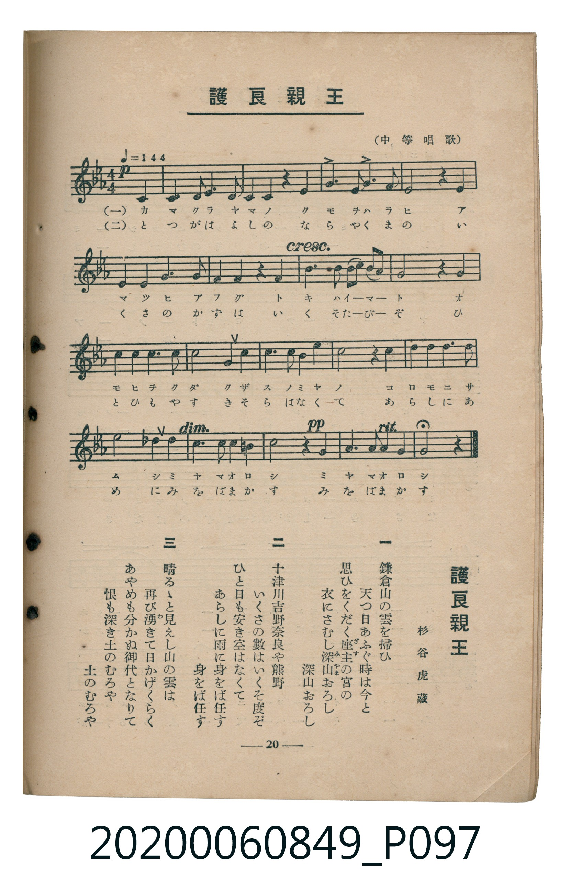

# 護良親王

<audio controls src="morinaga_shinno.mp3"></audio>

- 詞：杉谷虎藏
- 臺灣教育會公認《新定兒童唱歌》高等科女子用（2020.006.0849）

## 說明

原書資訊與歌詞全文（對應 P097.jpg，書頁 p. 20，高二第二學期第 7 首）：
調性與拍號：ハ短調（3 降記號）、4/4 拍（♩=144，弱起第 4 拍進入）
出處註記：（中等唱歌）

## 歌詞

```text
一
鎌倉山の雲を掃ひ
天つ日あふぐ時は今と
思ひをくだく座主（ざす）の宮の
衣にさむし深山（みやま）おろし
深山おろし

二
十津川吉野奈良や熊野
いくさの數はいくそ度ぞ
ひと日も安き空はなくて
あらしに雨に身をば任す
身をば任す

三
晴るゝと見えし山の雲は
再び湧（わ）きて日かげくらく
あやめも分かぬ御代となりて
恨も深き土のむろや
土のむろや
```

## ABC

```abc
X:1
T:護良親王
C:TMD (Chen, Chih-Han / aguai)
M:4/4
L:1/16
Q:1/4=144
K:Eb
V:V1 name="Piano" snm="Pia"
[V:V1]
!p! z4 z4 z4 C4 | C4 D2 E2 F4 C4 | G8 z4 G4 | A4 G2 F2 G4 c4 |
G8 z4 C4 | C4 D2 E2 F4 C4 | G8 z4 G4 | c4 B2 c2 d4 =B4 |
c8 z4 G4 | !f! c4 c4 d4 =B4 | c6 d2 e4 c4 | B4 G4 F4 E4 |
G8 z4 G2 G2 | c6 __B2 A4 F4 | G6 A2 F4 =B4 | !pp! c8 z4 G4 |
G6 A2 F4 D4 | C8 z4 z4 |
```

## TMD 檔案連結

- [主旋律 TMD 檔案](morinaga_shinno.tmd) [[在 TMD Studio 編輯](https://tmdlang.github.io/Tmd-TS/#tmd=s7IKdvYPcrWy4tLSUnixdvuLzvUvlq163tetoKXFpWirYGhiwmVvq-Cqw2Vjom9ix1WnoPRi5bz3e2Y9m9v5YsP2FzP7XkzvVwILt-963rj42dSZL5o2PZvT_LR1zYtVvY8bup5N2_B03aynrZOer176dMrGZ2t7Hjd0v1w94_nazufLJz5duvnp2gnPp6x4v6fDyMDIQM_AwEzPwMLE8v2eTiUuLn0tBVtqAS4FBYWnffOfzd7xYnP7ixVdLzragY4B-uZp64pn09qBDni6ofdZe6dCgIGluV5WQfr7PT1AxS8XNCoU6CkYGQC5QGc_2dXzfM0aIPl07Y5nc-YD2QrmCi-XTQO6FxgqIDterNr_rGE5yPTu3hcz5wNFHzf3P5-_FigOtMNY4eXM3hcrZoBlOh83NAKDVQGoEij1aOZKW2B4A-15umfji63bQWaD5V42bHrauhSoHOyF9l0vZk59sWI30BCg2UB9T3asBQYmJGxBikCqnuxoAFEv-3qeNnQ-3bjxceO6l7M3PW6a9Kyv-XHjJrBBS1Y-blzybPrSx41Njxu3Pm6c8GwmkLH-ye6ux40rQCqeNcwFqgVqetzY_7hxAZB8umv5kx27gXY-bpz2uHEmyAeN656uWwckwV5fuPhx4-rHjVMfNzU8bpz-bPtGoNVg1fsfN7U8btwH1tD1uKkXKAu2AawCIQR2-q4esPN6G59tWfp0-9ynEzpftvc9XdoBTJtAU563dQG5IBWPG4FGAh02FWj7s6k7gE6Hicx9umvZ48Z5EEWbgL4B-bKp6ek6oO29z1fuAitdBVa6DKKo6XETUG460PUvZ68Aki92rQb7e8OT3buBHgV7Dk0IEszgOHk2c8vjpu7HTcDgWvFiWffjRqCPpyNCvXE92ENtQC9ufrZzOShAmvrBQQEUWQaOAaAecCiDXNEPd1LL46ZGkLs72sAq1jzdt_DJbmAQA1246nETMJrArn8G5Dc1AYMSaN7TOfOBloKCHxigTS1gezGFKM9MUKCgpc_F5ZuYmWcVkJmYl-9QY1CjUA2yQcHGQssOzABmYUhyfrqh__n6BpAOkHCNgoGCLhxXF9QqmMUDGTXgYAVpAuWyHQ0vFvYgdIBVmMcrGCoYARkQ9QrGQBIEQcaA2DXAPANiGYF5ZhhqsFizq4cca0BGmwJJcxCtDhdCUYTqm04Ua6rTgH6GOhHDDHMFwzi4802hxoGcY4jFNcaoFj2dPRvVP2ClpjrggAGZAdNvAuZhcXt1ATA-IL5EVgkME7BKEAVTCsI1XLVcXLp2CqCEoACklbm4AA)]
- [鋼琴伴奏 TMD 檔案](morinaga_shinno_piano.tmd) [[在 TMD Studio 編輯](https://tmdlang.github.io/Tmd-TS/#tmd=s7IKdvYPcrWy4tLSUnixdvuLzvUvlq163tf9fk_Hy-49zydsebJny9Ol_c87O97v6VTQ0uJStFUwNDHhsrdVcNXhsjHRN7HjqlNQerFy3vs9s57N7XyxYfuLmX0vpvcrgYXbdz1vXPxs6swXTZuezWl-2rrmxarexw1dz6ZteLpu1tPWSc9XL306ZeOztT2PG7pfrp7xfG3n8-UTny7d_HTthOdTVgAdYWRgZKBnYGCmZ2BhYgl0ghIXl29iZp5VQGZiXn6Qh0ONQY1CNZcCENhYaNmBGfpaCk_3bHyxdfvTDf3P1zcoaOmDhWsUDBR04bi6oFbBLB7IqOGCaXq-Zs2THQ0vFvYgdIBVmMcrGCoYARkQ9QrGQBIEQcaA2DUKJmCWEZhnhqEGizW7esixBmS0KZA0B9HqcCEURai-6USxpjoN6GeoEzHMMFcwjIM73xRqHMg5hlhcY4xq0dPZs1H9A1ZqqgMOGJAZMP0mYB4Wt1cXAOMD4ktklcAwAasEUTClIFzDVYucDnxQ0oEJ4XQAgXijHpJA4hWizeJzYxWMgAwjEAPoPiDTOD4WRAONQMggFKOrwR_1hK1AVQOSQBYDsTD8giXi4RpgpiMbYgJkmIDFDIEsw1gFU5CUKVgEt2cw4h2XZ3DaC3U8NP7xqYREGDDade0UQDGvAKSVubgA)]

## 分析

```text
================================================================================
📊 TMD Song Profile: [ 護良親王 ]
================================================================================
⏱  Duration:       0:30 (30.0s), 18 measures total
🎼 Key & Tempo:    首調基準 E,, != 144.0 BPM, <4/4>
   - 分析範圍：      由實際發聲的音符與和弦推測調性；播放脈絡另行呈現
🎤 人聲音域:    C4 (MIDI 60) – D#5 (MIDI 75) [跨度: 15 個半音 / 1.2 個八度, 難度: moderate]
   - 最低音:  C4 in [Main #1 @ m.1, 0:01]
   - 最高音: D#5 in [Main #1 @ m.11, 0:17]
   - 適合: soprano, mezzo-soprano, contralto, tenor, baritone, bass
🏛  結構:      Main (30.0s)
⚡ 編曲密度:        Peak 1 軌道同時演奏
🗝  調性診斷：       C 調性不明確（流行色彩大調，未偵測到可信轉調）
   - 風格氣質:    流行大調（略帶和弦色彩音與裝飾副屬和弦）
   - 轉調歷程:    全曲維持單一推測調性（未偵測到可信轉調）
   - 核心骨幹音:  C, G, F, D, D#
   - 調性數值:    C 調性不明確 [相關度: 0.82, 穩定度: Ambiguous, 自然音純度: 87.7%]
   - 候選調性 (K-S): C 大調 (0.82), C 小調 (0.79), G 大調 (0.58)
   - 五度圈歷程:   +0
   - 各段落調性細節:
     • [Main #1]: C 調性不明確 (r: 0.82, 自然音純度: 87.7%, 調外音: D#, G#, A#)

  [ 五度圈游移軌跡 ]
              [C ]*
         F            G  
      Bb               D  
      Eb               A  
         Ab           E  
            Db       B  
               F# 
     (* = active key center)

  [ 十二半音累積音高分佈 ]
     C  : ████████████████████████  33.6%
     C# :                            0.0%
     D  : █████                      7.4%
     D# : ████                       4.9%
     E  :                            0.0%
     F  : ████████                  10.7%
     F# :                            0.0%
     G  : ██████████████████████    30.3%
     G# : ████                       4.9%
     A  : █                          0.8%
     A# : ██                         2.5%
     B  : ████                       4.9%
--------------------------------------------------------------------------------
Assignment 軌道音域：
  - Piano         : C4 – D#5 (15 個半音 / 1.2 個八度, 59 個音符)
================================================================================
```


## 原書掃描頁




