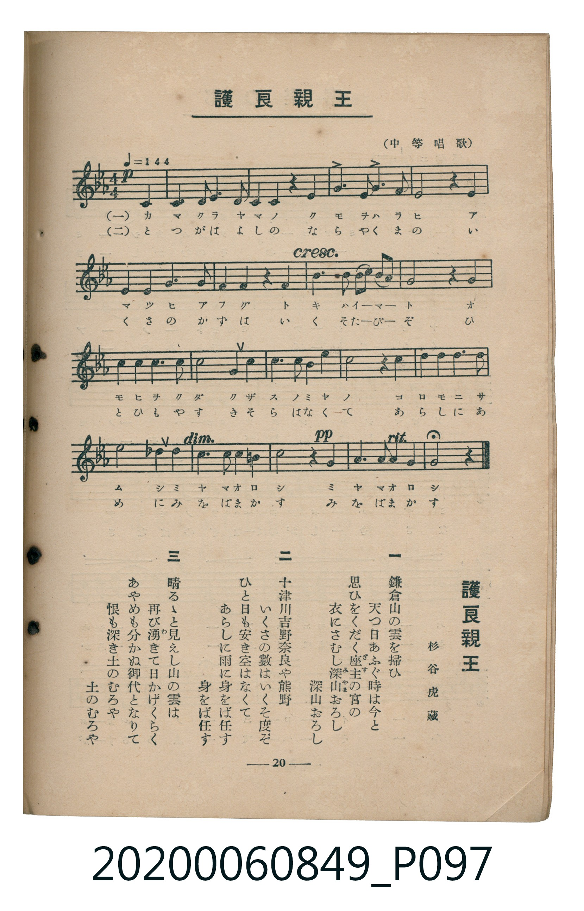

# 護良親王

> Re:Shōka 使用 AI 協助辨識與重建樂譜，可能會有錯誤。歡迎回報。

- **鋼琴伴奏版**：<br><audio controls src="morinaga_shinno.mp3"></audio>

- 詞：杉谷虎藏
- 臺灣教育會公認《新定兒童唱歌》高等科女子用（2020.006.0849）

## 說明

原書資訊與歌詞全文（對應 P097.jpg，書頁 p. 20，高二第二學期第 7 首）：
調性與拍號：ハ短調（3 降記號）、4/4 拍（♩=144，弱起第 4 拍進入）
出處註記：（中等唱歌）


## 歌詞

```text
一
鎌倉山の雲を掃ひ
天つ日あふぐ時は今と
思ひをくだく座主（ざす）の宮の
衣にさむし深山（みやま）おろし
深山おろし

二
十津川吉野奈良や熊野
いくさの數はいくそ度ぞ
ひと日も安き空はなくて
あらしに雨に身をば任す
身をば任す

三
晴るゝと見えし山の雲は
再び湧（わ）きて日かげくらく
あやめも分かぬ御代となりて
恨も深き土のむろや
土のむろや
```

## ABC

<div class="abc-score" data-abc-src="morinaga_shinno.abc" aria-label="五線譜載入中"></div>

[下載 ABC 原始檔](morinaga_shinno.abc)

## TMD 檔案連結

- [主旋律 TMD 檔案](morinaga_shinno.tmd) [[在 TMD Studio 編輯](https://tmdlang.github.io/Tmd-TS/#tmd=s7IKdvYPcrWy4qpTUCpJTLdSSM7PyUlNLsnMz7MqzsjMK0nNjM_KTMmPL87Iz05Ugisry88pzU21ys4vyY9PzyzKKY43MjAyiDcwMIs3sDCxRCgszi8tSk61Kk7OyM_PiS9JrShJys_PRsgXFOWXpeYl5gHVFBSB7EsBK0IoSC3LTEkFSaemZJbkF2Um5iC5IrWoGOxSsCXxJUWJecXJRZkFIOcjVJVkpAKdmplbkIqqG2hYemaeVW5qZlYmksu0tBRerN3-onP9i2Wrnvd1K2hpcSnaKhiamHDZ2yq46nDZmOib2IEMebFy3vs9s57N7XyxYfuLmX0vpveDzX7Rvut54-JnU2e-aNr0bE7z09Y1L1b1Pm7oejZtw9N1s562Tnq-eunTKRufre153ND9cvWM52s7ny-f-HTp5qdrJzyfsuL9ng5QUOoBg1IPFJTv93QqcXHpaynYUgtwKSgoPO2b_2z2jheb21-s6HrR0Q50DNA3T1tXPJvWDnTA0w29z9o7FQIMLM31sgrS3-_pASp-uaBRoUBPwcgAyAU6-8munudr1gDJp2t3PJszH8hWMFd4uWwa0L3AUAHZ8WLV_mcNy0Gmd_e-mDkfKPq4uf_5_LVAcaAdxgovZ_a-WDEDLNP5uKERGKwKQJVAqUczV9oCwxtoz9M9G19s3Q4yGyz3smHT09alQOVgL7TvejFz6osVu4GGAM0G6nuyYy0wMCFhC1IEUvVkRwOIetnX87Sh8-nGjY8b172cvelx06Rnfc2PGzeBDVqy8nHjkmfTlz5ubHrcuPVx44RnM4GM9U92dz1uXAFS8axhLlAtUNPjxv7HjQuA5NNdy5_s2A2083HjtMeNM0E-aFz3dN06IAn2-sLFjxtXP26c-rip4XHj9GfbNwKtBqve_7ip5XHjPrCGrsdNvUBZsA1gFQghsNN39YCd19v4bMvSp9vnPp3Q-bK97-nSDmDaBJryvK0LyAWpeNwINBLosKlA259N3QF0Okxk7tNdyx43zoMo2gT0DciXTU1P1wFt732-chdY6Sqw0mUQRU2Pm4By04Gufzl7BZB8sWs12N8bnuzeDfQo2HNoQpBgBsfJs5lbHjd1P24CBteKF8u6HzcCfTwdEeqN68EeagN6cfOznctBAdLUDw4KoMgycAwA9YBDGeSKfriTWh43NYLc3dEGVrHm6b6FT3YDgxjowlWPm4DRBHb9MyC_qQkYlEDzns6ZD7QUFPzAAG1qAduLKUR5ZoICBS19Li7fRGBxEpCZmJfvUGNQo1ANskHBxkLLDswAZmFIcn66of_5-gaQDpBwjYKBgi4cVxfUKpjFAxk14GAFaQLlsh0NLxb2IHSAVZjHKxgqGAEZEPUKxkASBEHGgNg1wDwDYhmBeWYYarBYs6uHHGtARpsCSXMQrQ4XQlGE6ptOFGuq04B-hjoRwwxzBcM4uPNNocaBnGOIxTXGqBY9nT0b1T9gpaY64IABmQHTbwLmYXF7dQEwPiC-RFYJDBOwShAFUwrCNVy1XFy6dgqghKAApJW5uAA)]
- [鋼琴伴奏 TMD 檔案](morinaga_shinno_piano.tmd) [[在 TMD Studio 編輯](https://tmdlang.github.io/Tmd-TS/#tmd=s7IKdvYPcrWy4tLSUnixdvuLzvUvlq163tf9fk_Hy-49zydsebJny9Ol_c87O97v6VTQ0uJStFUwNDHhsrdVcNXhsjHRN7HjqlNQerFy3vs9s57N7XyxYfuLmX0vpvcrgYXbdz1vXPxs6swXTZuezWl-2rrmxarexw1dz6ZteLpu1tPWSc9XL306ZeOztT2PG7pfrp7xfG3n8-UTny7d_HTthOdTVgAdYWRgZKBnYGCmZ2BhYgl0ghIXl29iZp5VQGZiXn6Qh0ONQY1CNZcCENhYaNmBGfpaCk_3bHyxdfvTDf3P1zcoaOmDhWsUDBR04bi6oFbBLB7IqOGCaXq-Zs2THQ0vFvYgdIBVmMcrGCoYARkQ9QrGQBIEQcaA2DUKJmCWEZhnhqEGizW7esixBmS0KZA0B9HqcCEURai-6USxpjoN6GeoEzHMMFcwjIM73xRqHMg5hlhcY4xq0dPZs1H9A1ZqqgMOGJAZMP0mYB4Wt1cXAOMD4ktklcAwAasEUTClIFzDVYucDnxQ0oEJ4XQAgXijHpJA4hWizeJzYxWMgAwjEAPoPiDTOD4WRAONQMggFKOrwR_1hK1AVQOSQBYDsTD8giXi4RpgpiMbYgJkmIDFDIEsw1gFU5CUKVgEt2cw4h2XZ3DaC3U8NP7xqYREGDDade0UQDGvAKSVubgA)]

## 分析

```text
================================================================================
📊 TMD Song Profile: [ 護良親王 ]
================================================================================
⏱  Duration:       0:30 (30.0s), 18 measures total
🎼 Key & Tempo:    首調基準 E,, != 144.0 BPM, <4/4>
   - 分析範圍：      由實際發聲的音符與和弦推測調性；播放脈絡另行呈現
🎤 人聲音域:    C4 (MIDI 60) – D#5 (MIDI 75) [跨度: 15 個半音 / 1.2 個八度, 難度: moderate]
   - 最低音:  C4 in [Main #1 @ m.1, 0:01]
   - 最高音: D#5 in [Main #1 @ m.11, 0:17]
   - 適合: soprano, mezzo-soprano, contralto, tenor, baritone, bass
🏛  結構:      Main (30.0s)
⚡ 編曲密度:        Peak 1 軌道同時演奏
🗝  調性診斷：       C 調性不明確（流行色彩大調，未偵測到可信轉調）
   - 風格氣質:    流行大調（略帶和弦色彩音與裝飾副屬和弦）
   - 轉調歷程:    全曲維持單一推測調性（未偵測到可信轉調）
   - 核心骨幹音:  C, G, F, D, D#
   - 調性數值:    C 調性不明確 [相關度: 0.82, 穩定度: Ambiguous, 自然音純度: 87.7%]
   - 候選調性 (K-S): C 大調 (0.82), C 小調 (0.79), G 大調 (0.58)
   - 五度圈歷程:   +0
   - 各段落調性細節:
     • [Main #1]: C 調性不明確 (r: 0.82, 自然音純度: 87.7%, 調外音: D#, G#, A#)

  [ 五度圈游移軌跡 ]
              [C ]*
         F            G  
      Bb               D  
      Eb               A  
         Ab           E  
            Db       B  
               F# 
     (* = active key center)

  [ 十二半音累積音高分佈 ]
     C  : ████████████████████████  33.6%
     C# :                            0.0%
     D  : █████                      7.4%
     D# : ████                       4.9%
     E  :                            0.0%
     F  : ████████                  10.7%
     F# :                            0.0%
     G  : ██████████████████████    30.3%
     G# : ████                       4.9%
     A  : █                          0.8%
     A# : ██                         2.5%
     B  : ████                       4.9%
--------------------------------------------------------------------------------
Assignment 軌道音域：
  - Piano         : C4 – D#5 (15 個半音 / 1.2 個八度, 59 個音符)
================================================================================
```


## 原書掃描頁




