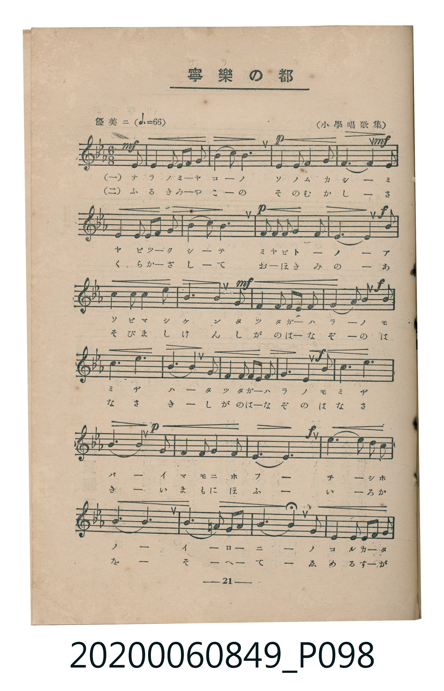
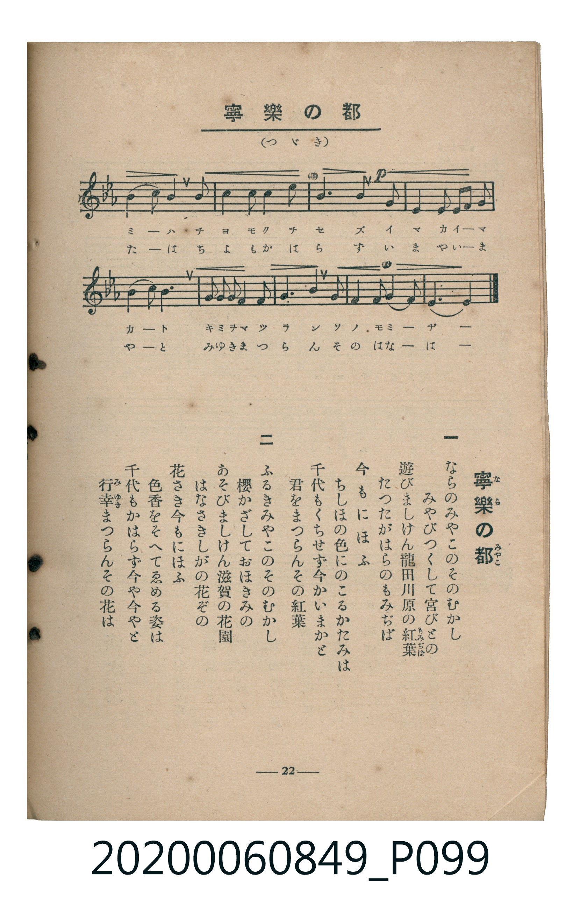

# 寧樂の都

> Re:Shoka 使用 AI 辨識樂譜，可能會有錯誤。歡迎回報。

<audio controls src="nara_no_miyako.mp3"></audio>

- 臺灣教育會公認《新定兒童唱歌》高等科女子用（2020.006.0849）

## 說明

原書資訊與歌詞全文（對應 P098–P099.jpg，書頁 pp. 21–22，高二第二學期第 8 首）：
調性與拍號：變ホ長調（3 降記號）、6/8 拍（優美ニ ♩.=66，弱起最後 1 八分音符進入）
出處註記：（小學唱歌集）

## 歌詞

```text
一
ならのみやこのそのむかし
みやびつくして宮びとの
遊びましけん龍田川原の紅葉（もみぢば）
たつたがはらのもみぢば
今もにほふ
ちしほの色にのこるかたみは
千代もくちせず今かいまかと
君をまつらんその紅葉

二
ふるきみやこのそのむかし
櫻かざしておほきみの
あそびましけん滋賀の花園
はなさきしがの花ぞの
花さき今もにほふ
色香をそへてゑめる姿は
千代もかはらず今や今やと
行幸（みゆき）まつらんその花は
```

## ABC

```abc
X:1
T:寧樂の都
M:6/8
L:1/16
Q:3/8=44
K:Eb
V:V1 name="Piano" snm="Pia"
[V:V1]
!mf! z2 z2 z2 z2 z2 B2 | B4 G2 B2 A2 F2 | !p! E6 E4 E2 | F4 F2 F2 G2 A2 |
!mf! B6 B4 B2 | B4 G2 B2 A2 F2 | !p! E6 E4 E2 | F2 G2 A2 B4 D2 |
!f! E6 E4 E2 | c4 c2 B4 e2 | !mf! d6 c4 c2 | B4 G2 G2 A2 F2 |
!f! E6 B,4 B2 | c6 e6 | e6 B4 c2 | B4 G2 G2 A2 F2 |
E4 G2 B4 c2 | !p! B6 B4 B2 | A4 F2 B4 A2 | G6 E6 |
!f! c6 c4 B2 | A6 F6 | B6 B,2 C2 D2 | E6 F4 G2 |
A2 G2 F2 E2 D2 C2 | B,6 B4 B2 | A4 F2 B4 A2 | !p! G6 B4 B2 |
B4 E2 E2 F2 G2 | F6 B,4 B,2 | E2 F2 G2 A4 c2 | B4 G2 E2 F3 G |
E6 E4 z2 |
```

## TMD 檔案連結

- [主旋律 TMD 檔案](nara_no_miyako.tmd) [[在 TMD Studio 編輯](https://tmdlang.github.io/Tmd-TS/#tmd=s7IKdvYPcrWy4qpTUCpJTLdSSM7PyUlNLsnMz7MqzsjMK0nNjM_KTMmPL87Iz05Ugisry88pzU21ys4vyY9PzyzKKY43MjAyiDcwMIs3sDCxRCgszi8tSk61Kk7OyM_PiS9JrShJys_PRsgXFOWXpeYl5gHVFBSB7EsBK0IoSC3LTEkFSaemZJbkF2Um5iC5IrWoGOxSsCXxJUWJecXJRZkFIOcjVJVkpAKdmpFZDNReiS5ckJOYnKrEpaWl8HT98mcrmh43rnvZvFdBS4tL0VbBzIzL3lbBVYfLxkzfwg6k80X7rueNi59NnfmiadOzOc1PW9e8WNX7uKHr2bQNT9fNeto66fnqpU-nbHy2tudxQ_fL1TOer-18vnzi06Wbn66d8HzKivd7OkDhpAcMJz1QOL3f06nExaWvpWBLLcCloKDwtG_-s9k7Xmxuf7Gi60VHO9AxL1bOe9q64tm0dqADnm7ofdbeqRBgYGnxqGEykLLUyypIf7-nB6jn5YJGhYICPQUjQ6CUkRFQEOiHJ7t6nq9ZAySfrt3xbM58IFvBQuHlsmlAx7_fMwtk4YtV-581LAdZ1d37YuZ8oOiLdV2Pm2e_nLodKAW001jh5czeFytmgCU7Hzc0AsNTAagY5JyWVc_39T1u7lZ4NHOlnq2ZGdDSp3s2vti6_dmchqf7ehQMFZ62rn7a0fZy_ubna5a9bNj0tHUp0BCwR9t3vZg59cWK3UCjgZaCPdcPdCUkBl7ObgOpAyl8sqMBRD1uXPW4qRMYxY8b9z9uanncOBnMngsimxoeN3Y_bpwOUQeR3vy4ccnjxn6g6OPGZU_XAZUCRVYAVYMUvWzsAvP3gaUnPm6a_HJf7_MpG55unwuMAKCi51taX0wEBlHH4yZgstr_uHHR48YNUJc_bgSqAJoNJHseN66HugpJHdjVu7vAQqsfN-5-3LgVom8h2Dogf92Lzk1gOaCzJj9uArodiIDmAQ1YDw6c3uYnuxeDDQD6AKht9uPGWSAjQeqAngO6G8hYAVY6YfbjpklgoSUgpzQBwwUUKBAfQEJwVw_E_q1gq3oJhOCz1UAXAjnTIGH3GBRWQBGwNkjwPW4EOgyoDyUEn-3ufrEZaMy6F10bn86ZBFG3HhRtjVPBuoHqgOEFkn7cOA9qEpgDksYSXsAwerlsJthzQLt2gJzSBLSoEeiJp8uxhBTQyZDIAIdUUwuEhAbTi4U9T3fuAEUoyPNtQBtBiRkj1MDuARtMeXaGAgUtfS4u38TMPKuAzMS8fIcagxqFapANCjaGZlp2YBawFIHkG2AeeL6-AaQFJFyjYKCgi4Grc9NqFUyBjBpw7II0g_L4jgagHxE6QQpA0BiIQWwTIDYCaQJmSogMCMLY1QW1YHYNWA0IgmgQBukH6UWYCIIwNg637Oqhmltg9sPMMI_HrRHoFrBG1HDpRHGLGVQxiIaZaRgHNtMcyUyYMrAHQRxUX8BchekLU5D7YK7BCJmns2djdQ3cFTAINBSZC7ObWJfAQhquBzV6pmCNHpSIBUYC2PVgw0EQZAFMFpIgQJagxwHE7SC_I3sNxsYMj9a1KE6BWQazEGEkiiNBYWwGIrCkBpg2kOsgBoJYIFGQKrAGsFa0VNIMdAeweADVkEZGCsDKFFg-IAURLFaRw4iU8MEMV3jig2JYYkcLn9Uo4YMcJnA3gRmQQEDOMbCAR00vMFUgHvZsBCpjarhqubh07RRA5ZYCkFbm4gIA)]
- [鋼琴伴奏 TMD 檔案](nara_no_miyako_piano.tmd) [[在 TMD Studio 編輯](https://tmdlang.github.io/Tmd-TS/#tmd=s7IKdvYPcrWy4tLSUni6fvmzFU2PG9e9bN77fk_Hy-49zydsebJny9Ol_c87O97v6VTQ0uJStFUwM-Oyt1Vw1eGyMdO3sOOqU1B60b7reePiZ1Nnvmja9GxO89PWNS9W9T5u6Ho2bcPTdbOetk56vnrp0ykbn63tedzQ_XL1jOdrO58vn_h06eanayc8n7ICaJmRgZGBnoGBmZ6BhYkl0ColLi7fxMw8q4DMxLz8IA-HGoMahWouBSCwMTTTsgOz9IFO3rPxxdbtTzf0P1_foKClDxauUTBQ0MXA1blptQqmQEYNF0zz8zVrnuxoeLGwB6ETpAAEjYEYxDYBYiOQJgVDqAwIwtjVBbVgdg1YDQiCaBAG6QfpRZgIgjA2Drfs6qGaW2D2w8wwj8etEegWsEbUcOlEcYsZVDGIhplpGAc20xzJTJgysAdBHFRfwFyF6QtTkPtgrsEImaezZ2N1DdwVMAg0FJkLs5tYl8BCGq4HNXqmYI0elIgFRgLY9WDDQRBkAUwWkiBAlqDHAcTtIL8jew3GxgyP1rUoToFZBrMQYSSKI0FhbAYisKQGmDaQ6yAGglggUZAqsAawVrRU0owaJLBYRA4TUsIDMxzhiQ2KYYkbLTxWo7gDOQzgbgIzIJ5GziGwgEZNHzBVIB72bAMqU2q4apGLKR-UYsqCcCmFgHgLpepcUN6OB_nAGETGKxiBOUCHwQSBDJCTgGpBIQdXgVctvrKHVCtNgCqAAiakWIlWxIBSP8IYuFZQqoKZiJAGuRBUbhHlQnxFCaqtyBYgGwO1G-IWIB-vjWCVeEsOlPghJd6ADCCJw9UgGXylBHbjsTkGPVjBdkJtgXBBEmYY_sQoDjCNJjJtQqozmCjIJjCFP9vj9Ao0oBBxiy8aISEJSTjA7K1rpwDK4QpAWpmLCwA)]

## 分析

```text
================================================================================
📊 TMD Song Profile: [ 寧樂の都 ]
================================================================================
⏱  Duration:       1:29 (90.0s), 33 measures total
🎼 Key & Tempo:    首調基準 E,, != 66.0 BPM, <6/8>
   - 分析範圍：      由實際發聲的音符與和弦推測調性；播放脈絡另行呈現
🎤 人聲音域:    A#3 (MIDI 58) – D#5 (MIDI 75) [跨度: 17 個半音 / 1.4 個八度, 難度: challenging]
   - 最低音:  A#3 in [Main #1 @ m.13, 0:34]
   - 最高音: D#5 in [Main #1 @ m.10, 0:26]
   - 適合: soprano, mezzo-soprano, contralto, tenor, baritone, bass
🏛  結構:      Main (90.0s)
⚡ 編曲密度:        Peak 1 軌道同時演奏
🗝  調性診斷：       D# 大調（純淨自然大調，未偵測到可信轉調）
   - 風格氣質:    純淨自然大調（陽光明朗、易唱易記，無明顯調外色彩）
   - 轉調歷程:    全曲維持單一推測調性（未偵測到可信轉調）
   - 核心骨幹音:  A#, D#, F, G, C
   - 調性數值:    D# 大調 [相關度: 0.92, 穩定度: High, 自然音純度: 100.0%]
   - 候選調性 (K-S): D# 大調 (0.92), A# 大調 (0.79), G 小調 (0.54)
   - 五度圈歷程:   -3
   - 各段落調性細節:
     • [Main #1]: D# 大調 (r: 0.92, 自然音純度: 100.0%)

  [ 五度圈游移軌跡 ]
               C  
         F            G  
      Bb               D  
     [Eb]*              A  
         Ab           E  
            Db       B  
               F# 
     (* = active key center)

  [ 十二半音累積音高分佈 ]
     C  : ████████                   9.9%
     C# :                            0.0%
     D  : ██                         3.1%
     D# : ███████████████████       24.0%
     E  :                            0.0%
     F  : ██████████                12.2%
     F# :                            0.0%
     G  : ████████                  10.7%
     G# : ███████                    9.4%
     A  :                            0.0%
     A# : ████████████████████████  30.7%
     B  :                            0.0%
--------------------------------------------------------------------------------
Assignment 軌道音域：
  - Piano         : A#3 – D#5 (17 個半音 / 1.4 個八度, 119 個音符)
================================================================================
```


## 原書掃描頁






