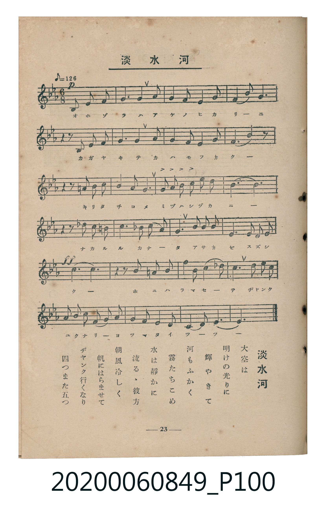

# 淡水河

> Re:Shōka 使用 AI 協助辨識與重建樂譜，可能會有錯誤。歡迎回報。

- **鋼琴伴奏版**：<br><audio controls src="tansuigawa.mp3"></audio>

- 臺灣教育會公認《新定兒童唱歌》高等科女子用（2020.006.0849）

## 說明

原書資訊與歌詞全文（對應 P100.jpg，書頁 p. 23，高二第二學期第 9 首）：
調性與拍號：變ホ長調（3 降記號）、6/8 拍（♪=126，折合附點四分音符 ♩.=63）


## 歌詞

```text
大空（おほぞら）は　明（あ）けの光（ひかり）に
輝（かが）やきて　河（かは）もふかく
霧（きり）たちこめ　水（みづ）は靜（しづ）かに
流（なが）るゝ彼方（かなた）　朝風（あさかぜ）冷（すず）しく
帆（ほ）にはらませて　ヂャンク行（ゆ）くなり
四（よ）つまた五（いつ）つ
```

## ABC

<div class="abc-score" data-abc-src="tansuigawa.abc" aria-label="五線譜載入中"></div>

[下載 ABC 原始檔](tansuigawa.abc)

## TMD 檔案連結

- [主旋律 TMD 檔案](tansuigawa.tmd) [[在 TMD Studio 編輯](https://tmdlang.github.io/Tmd-TS/#tmd=s7IKdvYPcrWy4qpTUCpJTLdSSM7PyUlNLsnMz7MqzsjMK0nNjM_KTMmPL87Iz05Ugisry88pzU21ys4vyY9PzyzKKY43MjAyiDcwMIs3sDCxRCgszi8tSk61Kk7OyM_PiS9JrShJys_PRsgXFOWXpeYl5gHVFBSB7EsBK0IoSC3LTEkFSaemZJbkF2Um5iC5IrWoGOxSsCXxJUWJecXJRZkFIOcjVJVkpAKdWp5YklqELliQk5icihAEGp-emWdVkphZnpgXn5-WlpkMtk9LS-HZ9oXPNmx5tmmzgpYWl6Ktgpkxl72tgqsOl42ZvoUdyIQX7bueNy5-NnXmi6ZNz-Y0P21d82JV7-OGrmfTNjxdN-tp66Tnq5c-nbLx2dqexw3dL1fPeL628_nyiU-Xbn66dsLzKSve7-kABaEeMAj1QEH4fk-nEheXvpaCLbUAl4KCwtO--c9m73ixuf3Fiq4XHe1Ax7xYOe9p64pn09qBDni6ofdZe6dCgKGBgV5WQfr7PT1AxS8XNCoU6CkYGQO5QGc_2dXzfM0aIPl07Y5nc-YD2QqWCi-XTQO69_2eWSA7Xqza_6xhOcj07t4XM-cDRV-s63rcPPvl1O1AKaA1xgovZ_a-WDEDLNn5uKERGIQKQMVAqUczV9kaGpmBbO6a8XRCx8uZLS93z3s6e_bTjraX8zc_X7NM4dHMlXq2ZkDXdHKBfbRk-fOVu4BaHzd2PW7c_bhx3uMmoEs6Hzeuf9zQ8GxGH1iqCSwy8XHjuqetQFmgyKbHjd2Pm7rA4qvBzt4zFyzR_bixByTa1PK4sfdx4zKQKZs2w6TWg6WaHjduBXP7QTpfzlkOlu6FmTf_cePCx42THzc1gjRv2AKW3f-4cSnEXS_nzgGLTIeJAA0CO-HZ1kawxCqYE4AunPt0755n03bC7AdKQQKt4dmcuS8XgZIN0HePG6eCZYHmdj5t2w4WnPm4cRbYdKA1YGc-3dEGltgN8TMogJqAjH2PG2dDvPm4uelx8-LHzZsfN61_sRDogo7HTUAtQDX9IIubusCmzJ4NlugASywB65__ZNcUsNHAIFsCEQcppTzJQoGClj4Xl28iMGsGZCbm5TvUGNRUgyxQsLHQsgMzgPkElCp3NIDdPetx0yoFYIpTeNy0T6EGyFoJxP1A3iIQr2kjkNcHxJOA7NVgeZDqPUDcDbIJZF6NQnVBrYJpvIKugiEQ6ioYAYWMgbQumDSG8ozApAmQZwqkzcCkrkINOGHC3LSrB-am1UD71gBtWQJ2xVogqw3uAqDrmhcB8VSYSNN6sJvg7jEAGmwAdArIyhqglchOMQI70xzi2hoFMxADAg3QHLOjE-YYkPVAbzftB1vfCGRtBtILwbz5QNwKDbLtEDbUmd3YHGWiDvS4GTxIQMEFDAQgzwQsbq5gGAfkmsMdhRZCwBQFdVRzF9iix80Qy0DhBeIBRUGxA3EqMA4fN22FhxJIfCcQ7wI7Fc1h5uAogYSWsYKROthJNVAHQpwHCTxQuIEDFjXmpsACCxIXIDcB0xQ4EPrh6Woe0ObdcHlgjIJzEZAChidQIyJBpaXVAt2DFAjowQdKPYZgJSBXQlIbJABRw6t1LSy8lkHTCSiEYGl4BdgdLVCX7QdicHoDi0DcCGHBHQbxugkohKCBA2KhJCUwBUxfsLCDxWItF5eunQIoZyoAaWUuAA)]
- [鋼琴伴奏 TMD 檔案](tansuigawa_piano.tmd) [[在 TMD Studio 編輯](https://tmdlang.github.io/Tmd-TS/#tmd=s7IKdvYPcrWy4tLSUni2feGzDVuebdr8fk_Hy-49zydsebJny9Ol_c87O97v6VTQ0uJStFUwM-ayt1Vw1eGyMdO3sOOqU1B60b7reePiZ1Nnvmja9GxO89PWNS9W9T5u6Ho2bcPTdbOetk56vnrp0ykbn63tedzQ_XL1jOdrO58vn_h06eanayc8n7ICaJmRgZGBnoGBmZ6BhYkl0ColLi7fxMw8q4DMxLz8IA-HGoOaai4FILCx0LIDM_S1FJ6vWfNkR8OLhT0KWvpgsRqF6oJaBdN4BV0FQyDUVTACChkDaV0waQzlGYFJEyDPFEibgUldhRouZHN39aCYawBUYAA0EqS1BqgV2UgjsHXmEFtrFMxADAg0QDN0RycWQ03UgQ4wgzsN5GygY4A8E7C4uYJhHJBrDjcUzaVPZ8_GYqg52FsQlxorGKmDjauBGg4xGuJwkJvBnkL1_RTUUE1LqwUaiOQCdLeDgtAQrARkDSTIIa5HdWzrWhSDIXabgJwIdR2IhRKOYAoYuDDHw4KgFjmF-JCWQgzjQYnEOB7BAJqORcw0Pl7BKB5oOzZRIBfBwpt4sBltAjHThLDJwBCAaQaxCKYqoDZgmJmogw2AspCNxuZnhGuI8B56isPuaoSRyKJ4QhlfeKIlx1xgckSYj-x4IyAbFEpAU5CYOHwKF8TlUfTUSqwhRHgenoh17RRA6VgBSCtzAQA)]

## 分析

```text
================================================================================
📊 TMD Song Profile: [ 淡水河 ]
================================================================================
⏱  Duration:       1:08 (68.6s), 24 measures total
🎼 Key & Tempo:    首調基準 E,, != 63.0 BPM, <6/8>
   - 分析範圍：      由實際發聲的音符與和弦推測調性；播放脈絡另行呈現
🎤 人聲音域:    A#3 (MIDI 58) – D#5 (MIDI 75) [跨度: 17 個半音 / 1.4 個八度, 難度: challenging]
   - 最低音:  A#3 in [Main #1 @ m.1, 0:00]
   - 最高音: D#5 in [Main #1 @ m.11, 0:30]
   - 適合: soprano, mezzo-soprano, contralto, tenor, baritone, bass
🏛  結構:      Main (68.6s)
⚡ 編曲密度:        Peak 1 軌道同時演奏
🗝  調性診斷：       C 小調（純淨自然小調，未偵測到可信轉調）
   - 風格氣質:    純淨自然小調（陰鬱抒情、旋律集中，無明顯調外色彩）
   - 轉調歷程:    全曲維持單一推測調性（未偵測到可信轉調）
   - 核心骨幹音:  G, D#, C, A#, F
   - 調性數值:    C 小調 [相關度: 0.89, 穩定度: Moderate, 自然音純度: 97.7%]
   - 候選調性 (K-S): C 小調 (0.89), D# 大調 (0.81), G 小調 (0.68)
   - 五度圈歷程:   +0
   - 各段落調性細節:
     • [Main #1]: C 小調 (r: 0.89, 自然音純度: 97.7%, 調外音: F#, A)

  [ 五度圈游移軌跡 ]
              [C ]*
         F            G  
      Bb               D  
      Eb               A  
         Ab           E  
            Db       B  
               F# 
     (* = active key center)

  [ 十二半音累積音高分佈 ]
     C  : █████████████████████     18.3%
     C# :                            0.0%
     D  : ███████████                9.2%
     D# : ██████████████████████    19.1%
     E  :                            0.0%
     F  : ████████████              10.7%
     F# : █                          0.8%
     G  : ████████████████████████  20.6%
     G# : ██████████                 8.4%
     A  : ██                         1.5%
     A# : █████████████             11.5%
     B  :                            0.0%
--------------------------------------------------------------------------------
Assignment 軌道音域：
  - Piano         : A#3 – D#5 (17 個半音 / 1.4 個八度, 80 個音符)
================================================================================
```


## 原書掃描頁




