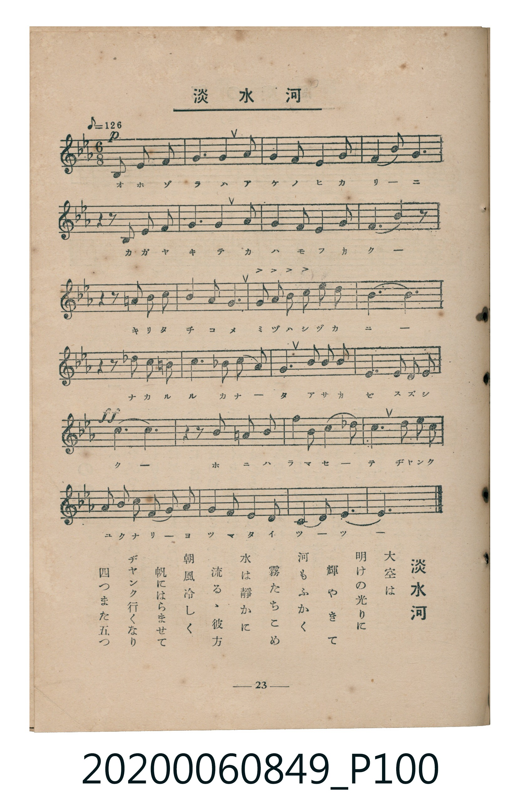

# 淡水河

<audio controls src="tansuigawa.mp3"></audio>

- 臺灣教育會公認《新定兒童唱歌》高等科女子用（2020.006.0849）

## 說明

原書資訊與歌詞全文（對應 P100.jpg，書頁 p. 23，高二第二學期第 9 首）：
調性與拍號：變ホ長調（3 降記號）、6/8 拍（♪=126，折合附點四分音符 ♩.=63）

## 歌詞

```text
大空（おほぞら）は　明（あ）けの光（ひかり）に
輝（かが）やきて　河（かは）もふかく
霧（きり）たちこめ　水（みづ）は靜（しづ）かに
流（なが）るゝ彼方（かなた）　朝風（あさかぜ）冷（すず）しく
帆（ほ）にはらませて　ヂャンク行（ゆ）くなり
四（よ）つまた五（いつ）つ
```

## ABC

```abc
X:1
T:淡水河
C:TMD (Chen, Chih-Han / aguai)
M:6/8
L:1/16
Q:3/8=42
K:Eb
V:V1 name="Piano" snm="Pia"
[V:V1]
!p! B,4 E2 E4 F2 | G6 G4 G2 | G4 F2 G4 A2 | B4 c2 B6 |
z4 z2 E2 F2 G2 | A6 G4 G2 | F4 E2 D4 E2 | C10 z2 |
z4 z2 =A2 B2 c2 | G4 F2 E6 | G2 A2 B2 c2 d2 e2 | d12 |
z4 z2 d2 c2 B2 | A4 G2 ^F2 G2 A2 | E6 G2 A2 B2 | F6 E2 F2 G2 |
!ff! c12 | z4 z2 =A2 B2 c2 | B4 E2 c4 A2 | G6 B2 c2 d2 |
E2 F2 G2 A2 G2 F2 | E4 G2 F4 E2 | C6 C4 D2 | E12 |
```

## TMD 檔案連結

- [主旋律 TMD 檔案](tansuigawa.tmd)
- [鋼琴伴奏 TMD 檔案](tansuigawa_piano.tmd)

## 分析

```text
================================================================================
📊 TMD Song Profile: [ 淡水河 ]
================================================================================
⏱  Duration:       1:08 (68.6s), 24 measures total
🎼 Key & Tempo:    首調基準 E,, != 63.0 BPM, <6/8>
   - 分析範圍：      由實際發聲的音符與和弦推測調性；播放脈絡另行呈現
🎤 人聲音域:    A#3 (MIDI 58) – D#5 (MIDI 75) [跨度: 17 個半音 / 1.4 個八度, 難度: challenging]
   - 最低音:  A#3 in [Main #1 @ m.1, 0:00]
   - 最高音: D#5 in [Main #1 @ m.11, 0:30]
   - 適合: soprano, mezzo-soprano, contralto, tenor, baritone, bass
🏛  結構:      Main (68.6s)
⚡ 編曲密度:        Peak 1 軌道同時演奏
🗝  調性診斷：       C 小調（純淨自然小調，未偵測到可信轉調）
   - 風格氣質:    純淨自然小調（陰鬱抒情、旋律集中，無明顯調外色彩）
   - 轉調歷程:    全曲維持單一推測調性（未偵測到可信轉調）
   - 核心骨幹音:  G, D#, C, A#, F
   - 調性數值:    C 小調 [相關度: 0.89, 穩定度: Moderate, 自然音純度: 97.7%]
   - 候選調性 (K-S): C 小調 (0.89), D# 大調 (0.81), G 小調 (0.68)
   - 五度圈歷程:   +0
   - 各段落調性細節:
     • [Main #1]: C 小調 (r: 0.89, 自然音純度: 97.7%, 調外音: F#, A)

  [ 五度圈游移軌跡 ]
              [C ]*
         F            G  
      Bb               D  
      Eb               A  
         Ab           E  
            Db       B  
               F# 
     (* = active key center)

  [ 十二半音累積音高分佈 ]
     C  : █████████████████████     18.3%
     C# :                            0.0%
     D  : ███████████                9.2%
     D# : ██████████████████████    19.1%
     E  :                            0.0%
     F  : ████████████              10.7%
     F# : █                          0.8%
     G  : ████████████████████████  20.6%
     G# : ██████████                 8.4%
     A  : ██                         1.5%
     A# : █████████████             11.5%
     B  :                            0.0%
--------------------------------------------------------------------------------
Assignment 軌道音域：
  - Piano         : A#3 – D#5 (17 個半音 / 1.4 個八度, 80 個音符)
================================================================================
```


## 原書掃描頁




