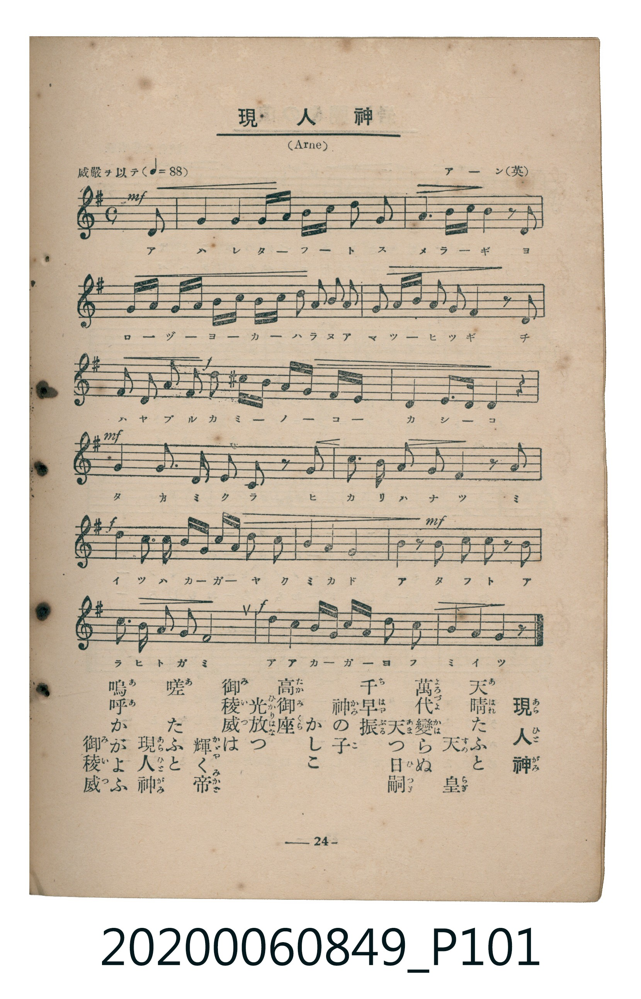

# 現人神

> Re:Shoka 使用 AI 辨識樂譜，可能會有錯誤。歡迎回報。

<audio controls src="arahitogami.mp3"></audio>

- 詞：鳥居忱
- 曲：アーン（英）（Arne）
- 臺灣教育會公認《新定兒童唱歌》高等科女子用（2020.006.0849）

## 說明

原書資訊與歌詞全文（對應 P101.jpg，書頁 p. 24，高二第三學期第 1 首）：
調性與拍號：ト長調（1 升記號）、4/4 拍（威嚴ヲ以テ ♩=88，弱起最後半拍進入）

## 跨冊／重複收錄參照

> 同曲（《新定兒童唱歌》高等科男、女共用教材）

- **[同曲]** 《新定兒童唱歌》高等科男子用（2020.006.0848）：[**〈現人神〉**](../../koto_boys_2020.006.0848/2_3_03_arahitogami/index.md)（`G` / `4/4` — [原始 TMD](../../koto_boys_2020.006.0848/2_3_03_arahitogami/arahitogami.tmd)）
- 總表：[跨冊重複與同名歌曲總索引](../../../duplicate_songs.md)

## 歌詞

```text
天晴（あはれ）たふと、天皇（すめらぎ）、
萬代（よろづよ）變（かは）らぬ、天（あま）つ日嗣（ひつぎ）。
千早振（ちはやぶる）神（かみ）の子（こ）　かしこ。
高御座（たかみくら）、光放（ひかりはな）つ、
御稜威（みいつ）は輝（かがや）く帝（みかど）。
嗟（あ）、たふと、現人神（あらひとがみ）
嗚呼（ああ）かがよふ　御稜威（みいつ）。
```

## ABC

```abc
X:1
T:現人神
C:曲：アーン（英）（Arne）
M:4/4
L:1/16
Q:1/4=88
K:G
V:V1 name="Piano" snm="Pia"
[V:V1]
!mf! z4 z4 z4 z2 D2 | G4 G4 G A B c d2 G2 | A6 c d B4 z2 D2 | G A B c G A B c d2 g2 f2 e2 |
d2 e f g2 A2 d4 z2 A2 | !f! d2 B2 g2 e2 d2 ^c d e d c B | A4 E3 E D4 z4 | !mf! G4 D3 D G2 D2 z2 G2 |
c3 c B2 G2 A4 z2 A2 | !f! d4 d3 d B d g c B2 A2 | G4 F4 G8 | !mf! d4 z2 d2 c2 B2 z2 c2 |
d3 c B2 A2 G8 | !f! d4 g4 B d g c B2 A2 | G4 F4 G6 z2 |
```

## TMD 檔案連結

- [主旋律 TMD 檔案](arahitogami.tmd) [[在 TMD Studio 編輯](https://tmdlang.github.io/Tmd-TS/#tmd=s7IKdvYPcrWy4qpTUCpJTLdSSM7PyUlNLsnMz7MqzsjMK0nNjM_KTMmPL87Iz05Ugisry88pzU21ys4vyY9PzyzKKY43MjAyiDcwMIs3sDCxRCgszi8tSk61Kk7OyM_PiS9JrShJys_PRsgXFOWXpeYl5gHVFBSB7EsBK0IoSC3LTEkFSaemZJbkF2Um5iC5IrWoGOxSsCXxJUWJecXJRZkFIOcjVJVkpAKdmplbkArRraWl8Lx_35Ndu54vnaegpcWlaKtgYcFlb6vgzmVjom9iB9L4YuW893tmvdy89OnG1qf7N4INezZ7E1DscdOix817Hjdvfr-n40X3xvd7OoEMx6K8VCALrOxF-67njYufTZ35omnTsznNT1vXvFjV-7ih69m0DU_XzXraOun56qVPp2x8trbncUP3y9Uznq_tfL584tOlm5-unfB8ygqgaaCg1AMGpR4oKMHGculrKdhSC3ApKCg87Zv_bPaOF5vbX6zoetHRDnQM0MdPW1c8m9YOdMDTDb3P2jsVAgwNDPWyCtLf7-kBKn65oFGhQE_ByATIBTr7ya6e52vWPNnR-XTtjmdz5gPZCoYKL5dNAwfILJAdL1btf9awHGR6d--LmfNBYdfc8XLqdqA40A5Dhae9QNtngGU6Hzc0AoNeAagSZP2Kxqeztjxu3vRk99LHzW0Kj2autLWwAFr7dM_GF1u3P5vT8HRfz9PeLqDqlw2bnrYuBRrABfbVkpXPZm4BmvC4selx4_rHTT0goxvnP27c-rhxBdAOoILns0A-fNw483FT4-MmoGwfxHqwiyesebJ7MUi6CYh6HzcuBTKA0i_WdYH1dAMNBakGaVsDMQ5m2T6wTUueTV_6dDrYhMZNQC7M9Caw63qbn01f-awHaARQeiHYgS2PG7c9buoGKgImRpgdwOABmrUOmB7AIpPBRjSApaYDuVDjgHHwdN_Cp7uWgxUB_QjS-bixH-g6iI-etnY-mwJ0F8Qt3Y-bukBWNq6CuBTqZaARz1fMAYY4WB1QP9BFS8Aq1r_YMxfmoh6gS8GC_U93QASBKoHiQO_DfTcdGI-gsIBYjhzq8NwGDSxQ8AFdtAJkLtizEP2znk7cAwtOsClQm4EiW4H-x-lSiP2U5wsoUNDS5-LyTczMswrITMzLd6gxqFGoBtmgYGNopmUHZgGzIyQtPt3Q_3x9A6RYAGkESdYoGCjogiE2ujo3rVbBNB7IqgGnWZBZ4IzU8GJhj4KGkQLESE1wdulXeNy8RuFx035gkQNkToVQHUCRnUBrHjcvBOKVYMGmdUDmCoQTDKFWImgjBWMFEwVTqFgNkA-RAUGQuDGSI7G4b1cPFvethTioFUKtgLhkNYQHcvtKIO4BCi0Cu3YeELdAJCeBmFBXNyK7GuJKFNfGAQlzIDYDOxskZAbkg4VBfgAJwNwN4qMFayeOYF0CxNOAeDXIxUB6PsRhfRA_bAZRQDeDpJq2Q8UQ7gTZCQovsCNA7qoGRSooINWBlBkQAxnGSIFsBgpQMAUOWuREgeLep7NnY7q3aT_MjUB6PTRYJ8Gc17wKGthdkDAFqoK7E5zYYEkAajOQAomAeSA3QFKDCTQdgH0FDUncobprCtiVxiiuBIUoyH6gW6BpoGkNJFCBMkB3g5IAyAcgN3eCXb8IlLRB6RqaqJGyECxAwS6GksZADAxxiCPBjoL7zRwWqjABGITEFWrmA3sUEoEgQRAbNRJa12J6DxroEIcC8yTQKzAvgDCqh1eAPQXzMCRgUBIPLKhBvsB0MrLnwUkMBEn1PchrNVy1XFy6dgqg4kwBSCtzcQEA)]
- [鋼琴伴奏 TMD 檔案](arahitogami_piano.tmd) [[在 TMD Studio 編輯](https://tmdlang.github.io/Tmd-TS/#tmd=s7IKdvYPcrWy4tLSUnjev-_Jrl3Pl857v6fjZfee5xO2PNmz5enS_uedHe_3dCpoaXEp2ipYWHDZ2yq4c9mY6JvYcdUpKL1YCVQ_6-XmpU83tj7dv1EJJPZs9iag2OOmRY-b9zxu3gw070X3RqAZQIZjUV4qkAVW9qJ91_PGxc-mznzRtOnZnOanrWterOp93ND1bNqGp-tmPW2d9Hz10qdTNj5b2_O4ofvl6hnP13Y-Xz7x6dLNT9dOeD5lBdA0IwMjAz0DAzM9AwsTS7CxXL6JmXlWAZmJeflBHg41BjUK1VwKQGBjaKZlB2bpayk83bPxxdbtTzf0P1_foKClDxauUTBQ0AVDbHR1blqtgmk8kFXDBTPl-Zo1T3Y0vFjYgzDCEKoFQRspGCuYKJhCxWqAfIgMCILEjZEswWL-rh408yHmoZgbByTMgdgMbAFIyAzIBwuDbAMJwGwA8dE80IliAUgxyElg3SADq0H-BrlVHUiZATGQYYzkDzOQm8EU2PXI4YZi0dPZs1EsAgcoLJigWoEUSATMAxkCCTETaFiBnQX1A27_7JqCag3U-WDjoaQxEAP9BzERbALcIeYwP8AEYBASMqipAewqSHCBBEFsVC-3rsUIW5hHQNZi2oHsWnAMgCCpzgW5pYarFjkn-KDkBBPCGQECa_Cl9HiFaMNYBWMIBYwlIMMoPjcWGHtAlmk8UAxfOoZoM4IphZkDF8CTRKF6zUD2mIFsBCZGsOU47EZPeVD9UArichOgHqx2oyUnuAVwf8N0wY3DUIInReDWDHIUuvmgCAFGq66dAihmFYC0MhcXAA)]

## 分析

```text
================================================================================
📊 TMD Song Profile: [ 現人神 ]
================================================================================
⏱  Duration:       0:40 (40.9s), 15 measures total
🎼 Key & Tempo:    首調基準 G, != 88.0 BPM, <4/4>
   - 分析範圍：      由實際發聲的音符與和弦推測調性；播放脈絡另行呈現
🎤 人聲音域:    D4 (MIDI 62) – G5 (MIDI 79) [跨度: 17 個半音 / 1.4 個八度, 難度: challenging]
   - 最低音:  D4 in [Main #1 @ m.1, 0:02]
   - 最高音: G5 in [Main #1 @ m.4, 0:09]
   - 適合: soprano, mezzo-soprano, tenor, baritone
🏛  結構:      Main (40.9s)
⚡ 編曲密度:        Peak 1 軌道同時演奏
🗝  調性診斷：       G 大調（純淨自然大調，未偵測到可信轉調）
   - 風格氣質:    純淨自然大調（陽光明朗、易唱易記，無明顯調外色彩）
   - 轉調歷程:    全曲維持單一推測調性（未偵測到可信轉調）
   - 核心骨幹音:  G, D, A, B, C
   - 調性數值:    G 大調 [相關度: 0.94, 穩定度: High, 自然音純度: 99.0%]
   - 候選調性 (K-S): G 大調 (0.94), D 大調 (0.75), G 小調 (0.60)
   - 五度圈歷程:   +1
   - 各段落調性細節:
     • [Main #1]: G 大調 (r: 0.94, 自然音純度: 99.0%, 調外音: C#)

  [ 五度圈游移軌跡 ]
               C  
         F           [G ]*
      Bb               D  
      Eb               A  
         Ab           E  
            Db       B  
               F# 
     (* = active key center)

  [ 十二半音累積音高分佈 ]
     C  : ██████                     7.2%
     C# : █                          1.0%
     D  : ████████████████████      26.0%
     D# :                            0.0%
     E  : ████                       4.8%
     F  :                            0.0%
     F# : ████                       5.3%
     G  : ████████████████████████  31.2%
     G# :                            0.0%
     A  : ███████████               13.9%
     A# :                            0.0%
     B  : ████████                  10.6%
--------------------------------------------------------------------------------
Assignment 軌道音域：
  - Piano         : D4 – G5 (17 個半音 / 1.4 個八度, 93 個音符)
================================================================================
```


## 原書掃描頁




