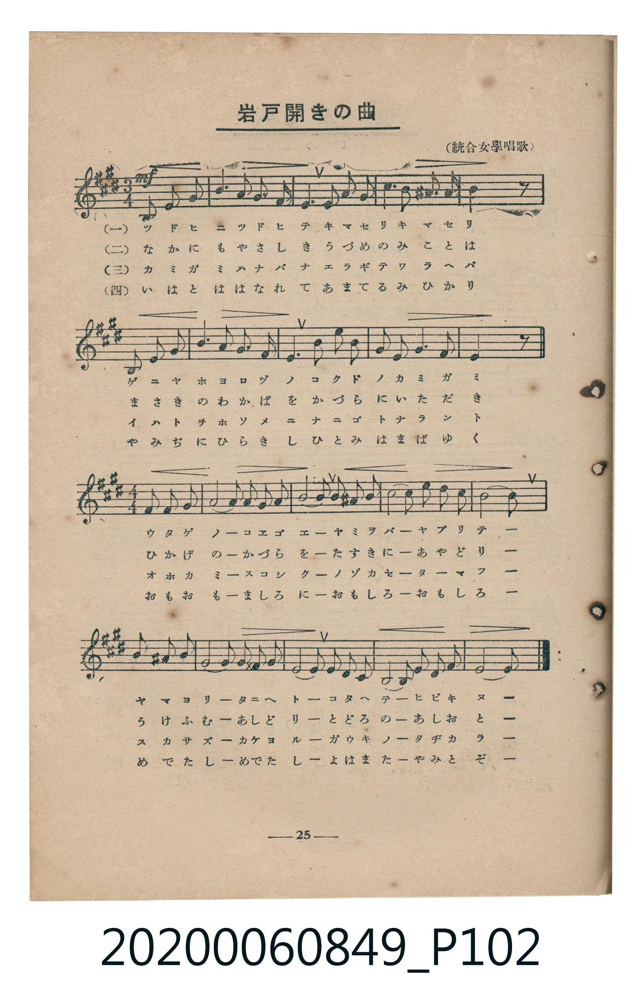
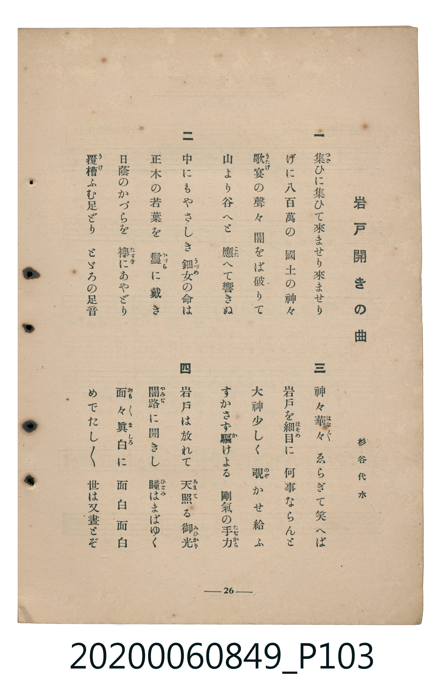

# 岩戸開きの曲

> Re:Shōka 使用 AI 協助辨識與重建樂譜，可能會有錯誤。歡迎回報。

<audio controls src="iwato_biraki_no_kyoku.mp3"></audio>

- 詞：杉谷代水
- 臺灣教育會公認《新定兒童唱歌》高等科女子用（2020.006.0849）

## 說明

原書資訊與歌詞全文（對應 P102–P103.jpg，書頁 pp. 25–26，高二第三學期第 2 首）：
調性與拍號：イ長調（3 升記號）、前二行 3/4 拍、後二行轉 4/4 拍（以 1/4 拍記譜以對齊變拍號）
出處註記：（統合女學唱歌）


## 歌詞

```text
一
集（つど）ひに集ひて來ませり來ませり
げに八百萬の　國土の神々
歌宴（うたげ）の聲々　闇をば破りて
山より谷へと　應（こた）へて響きぬ

二
中にもやさしき　鈿女（うづめ）の命は
正木の若葉を　鬘（かづら）に戴き
日蔭のかづらを　襷（たすき）にあやどり
覆槽（うけ）ふむ足どり　とどろの足音

三
神々華（はな）々　ゑらぎて笑へば
岩戸を細目（ほそめ）に　何事ならんと
大神少しく　覗（のぞ）かせ給ふ
すかさず驅（か）けよる　剛氣の手力（たちから）

四
岩戸は放れて　天照（あまて）る御光（みひかり）
闇路（やみぢ）に開きし　瞳（ひとみ）はまばゆく
面（おも）々眞白（ましろ）に　面白面白
めでたしめでたし　世は又晝とぞ
```

## ABC

```abc
X:1
T:岩戸開きの曲
M:1/4
L:1/16
Q:1/4=96
K:A
V:V1 name="Piano" snm="Pia"
[V:V1]
!mf! A4 | A4 | A4 | c3 B |
A2 B2 | c4 | B2 c2 | e4 |
B4 | B2 ^A2 | B2 c2- | c2 z2 |
A4 | A4 | A4 | c3 B |
A2 B2 | F4 | A2 B2 | c4- |
c2 B2 | A2 F2 | E2 F2- | F2 z2 |
E4 | E4 | F4 | A4- |
A2 B2 | A4 | F4 | B4- |
B2 c2 | c2 B2 | A4 | e4 |
c4 | e4 | c2 B2 | A4- |
A4- | A4 | A4 | c4 |
G4 | A4 | F4- | F4 |
F2 F2 | E2 F2 | A4- | A4 |
A2 A2 | B2 A2 | F4 | D4 |
E4 | A2 B2 | A4- | A4- |
A4 | A4 |
```

## TMD 檔案連結

- [主旋律 TMD 檔案](iwato_biraki_no_kyoku.tmd) [[在 TMD Studio 編輯](https://tmdlang.github.io/Tmd-TS/#tmd=s7IKdvYPcrWy4qpTUCpJTLdSSM7PyUlNLsnMz7MqzsjMK0nNjM_KTMmPL87Iz05Ugisry88pzU21ys4vyY9PzyzKKY43MjAyiDcwMIs3sDCxRCgszi8tSk61Kk7OyM_PiS9JrShJys_PRsgXFOWXpeYl5gHVFBSB7EsBK0IoSC3LTEkFSaemZJbkF2Um5iC5IrWoGOxSsCXxJUWJecXJRZkFIOcjVJVkpAKdmpafk52TX5SKLl6UmpOZjqIeaEl6Zp5VbmpmViaSi7W0FJ5uWvmsY8fLad2PG3sfN657NnuTgpYWl6KtgqUZl72tgiOXjaG-iR3IoBcr573fM-vZ3M4XG7Y_2b342YYtYPNftO963rj42dSZL5o2PZvT_LR1zYtVvY8bup5N2_B03aynrZOer176dMrGZ2t7Hjd0v1w94_nazufLJz5duvnp2gnPp6x4v6cDFMx6wGDWAwXz-z2dSlxc-loKttQCXAoKCk_75j-bvePF5vYXK7pedLQDHQP0zdPWFc-mtQMd8HRD77P2ToUAQwOjRw2TgZSxXlZB-vs9PUA9Lxc0KhQU6CkYmQKljMyAgkA_PNnV83zNmic7Op-u3fFsznwgW8FI4eWyaUDHA4MIZOGLVfufNSwHWdXd-2LmfKDo46YlL6duB4oDLTRWeNoLdMoMsEzn44bGp529QDNfLOxRMNY3UQDqAYnt64GIvdjbqWACEQbqfbJ7qQIwSkA8kAlr5wAFgB54ubfrxboumG2dYE-373oxc-qLFbuB6oAOAOp9vnXj0wkd4LDfAYkTkFKQ2ic7GkDUy9ltQGWPG5c8blwJclnjpseNq4GCYMayJ_uAjH2PG2c_bupCZoN0Pm6cBFT6tHX185n7XkxYA0xKjxsans7pfjpnPpD9fOm8xw2tIHVAO5-u2wK2BGgAUG4S2J51L4A2NLQC9byc3v64CWjWhucLtgDNBloL9svGjY-bOoB8YOJ73LjjceMKoFJgpIENmgw0CGwKUHzZy_n7wUl5DcRfu3og3lsLdN3jpqbHTS2PG6c-bpwOUgO0rGM_MDRgrln6uKkR4pqnE_c-blwPce_iZ3NWgBzYvfTFxE6Q04Da1gADFKgHmGmAeoCOAOpZ_axjC9BQsJ7pS19MAVq4Dq4Cou3F0u1gbUBfzwQqhWh73Ahx1EpoQL5Y1vZs-V6YkyaCFW193NTwYttmiCKgQSDvg9igHAsUfzl_MzQSwfEOCewX_evBhqx_3LgKnMhAgfu4aSLINY19wIB6vmYiOMQ2gMMXXAwAnfl8y4bns9eBde5-3DgXFiKrgZqf7J36ZBfQQ6vAHgIG-gqwziXLgRY-3QA0DBio_SBvLpsO1g_0PrDEAGoG6pn9fOsyoD8gKQXoeaAQMBZmvVzZCglIsDqg24BR3A1KOJ2zn21YDCqPOrufds2GhdpCkEZweIP9-3T2bCS3N65_NmXf46YeoNdAJixZ-bx1OVhjEzihLgNZ0dT9dN_Cp62QZANMJ8BUDTSwC5phgEnvxXZwqIEiBCi9COJ3WOk4HWju83mQ5ALUCYwDYGYGKgAGMdCCDY-bgBHWDzZoLlAnUFEXMMVBwv75nHnPZ0JiFah0OjDq4MEKVAyUgpDg8GlqfNy4HOxfoDokNjAGdkwD2va0v-PZzLlg--eBNFBeREKBgpY-F5dvIrCiCMhMzMt3qDGoUagG2aBgY2imZQdmAUtmcNHXACyYQCUZpCRSODxdwUTh6Yb-5-sbgB4DGQRSDNSem1arYKigC4Y12FhQhcZgnhFUxgisBiKGUAMSBYnVKJjCzQGJoasxVIdLQZSDFBiAFSH7AVy4EuEHcp1vFo-mCIvPoNpQ1YA1Aj0JoqBs7D7Y0QnxAUoNMevpno0vtm4H2gHylDZMAqf3wNZAHIPExOp4NCcjiWEoh8cLmIREA4hE0whzA1w1ImRQxdDDCGE2OgthNlJQAYsKSFCRHUwIh5kjQgndH4hgQHIQWBAzTvF4BiQGwtDkjN0CE6zxBk9jJIZVLReXrp0CKPMrAGllLi4A)]
- [鋼琴伴奏 TMD 檔案](iwato_biraki_no_kyoku_piano.tmd) [[在 TMD Studio 編輯](https://tmdlang.github.io/Tmd-TS/#tmd=s7IKdvYPcrWy4tLSUni6aeWzjh0vp3U_bux93Lju2exN7_d0vOze83zClid7tjxd2v-8s-P9nk4FLS0uRVsFSzMue1sFRy4bQ30TO646BaUXK-e93zPr2dzOFxu2P9m9-NmGLUpg4fZdzxsXP5s680XTpmdzmp-2rnmxqvdxQ9ezaRuerpv1tHXS89VLn07Z-Gxtz-OG7perZzxf2_l8-cSnSzc_XTvh-ZQVQCcYGRgZ6BkYmOkZWJhYAh2gxMXlm5iZZxWQmZiXH-ThUGNQo1DNpQAENoZmWnZglr6WwvM1a57saHixsAdohLG-icKz7l6Fw9MVTBSebuh_vr4B7BN9sGKg9ty0WgVDBV0wrMHGgio0BvOMoDJGYDUQMYQakChIrEbBFG4OSAxdjaE6XAqiHKTAAKwI2Q-7eojzA7nON4tHU4TFZ1BtqGrAGoGeBFFQNnYf7OiE-ODF3k4FE4gvUFwONgFiDxITq7vQXIMkhqEcHuRgEhLCIBJNI8wNcNUIT6OKoXsfYTY6C2E2Uig8nT0bEgrYQgBhpzkiANCdiPAhkl1gQcyYwONOkBgIQxMhdgtMsEYJPGWQGAy1yDnWByXHmmDJsMj5sgCYL-OBrGjDWBgJsxwhbBYPZMMTE1jcNB6sHkzBAhkkAVYKTKNY8hhSViJoowmSjUjCYMvhoQkWN4vPBcmg2wjOE0gJAKzWGOxoHGaDhRWiTZB8hOJXhFIc7kINDSRZMBPNgZDkihYkiBCEiiK7CZsD0S1Bdh5EuRGIINJ5wGSka6cASkkKQFqZiwsA)]

## 分析

```text
================================================================================
📊 TMD Song Profile: [ 岩戸開きの曲 ]
================================================================================
⏱  Duration:       0:38 (38.8s), 62 measures total
🎼 Key & Tempo:    首調基準 A, != 96.0 BPM, <1/4>
   - 分析範圍：      由實際發聲的音符與和弦推測調性；播放脈絡另行呈現
🎤 人聲音域:    D4 (MIDI 62) – E5 (MIDI 76) [跨度: 14 個半音 / 1.2 個八度, 難度: moderate]
   - 最低音:  D4 in [Main #1 @ m.56, 0:34]
   - 最高音: E5 in [Main #1 @ m.8, 0:04]
   - 適合: soprano, mezzo-soprano, contralto, tenor, baritone, bass
🏛  結構:      Main (38.8s)
⚡ 編曲密度:        Peak 1 軌道同時演奏
🗝  調性診斷：       A 大調（純淨自然大調，未偵測到可信轉調）
   - 風格氣質:    純淨自然大調（陽光明朗、易唱易記，無明顯調外色彩）
   - 轉調歷程:    全曲維持單一推測調性（未偵測到可信轉調）
   - 核心骨幹音:  A, C#, F#, B, E
   - 調性數值:    A 大調 [相關度: 0.86, 穩定度: High, 自然音純度: 99.2%]
   - 候選調性 (K-S): A 大調 (0.86), F# 小調 (0.72), A 小調 (0.51)
   - 五度圈歷程:   +3
   - 各段落調性細節:
     • [Main #1]: A 大調 (r: 0.86, 自然音純度: 99.2%, 調外音: A#)

  [ 五度圈游移軌跡 ]
               C  
         F            G  
      Bb               D  
      Eb              [A ]*
         Ab           E  
            Db       B  
               F# 
     (* = active key center)

  [ 十二半音累積音高分佈 ]
     C  :                            0.0%
     C# : █████████                 14.8%
     D  : █                          1.6%
     D# :                            0.0%
     E  : ███████                   11.5%
     F  :                            0.0%
     F# : █████████                 14.8%
     G  :                            0.0%
     G# : █                          1.6%
     A  : ████████████████████████  40.2%
     A# :                            0.8%
     B  : █████████                 14.8%
--------------------------------------------------------------------------------
Assignment 軌道音域：
  - Piano         : D4 – E5 (14 個半音 / 1.2 個八度, 71 個音符)
================================================================================
```


## 原書掃描頁






