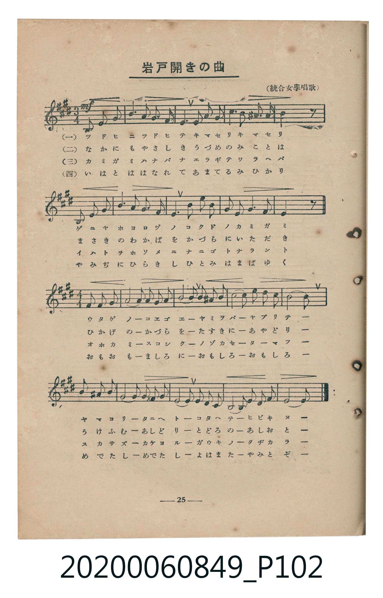
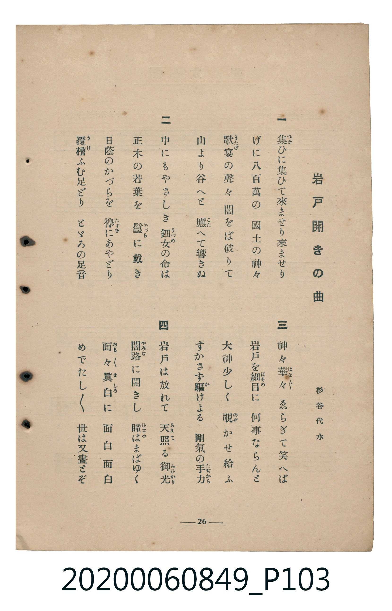

# 岩戸開きの曲

<audio controls src="iwato_biraki_no_kyoku.mp3"></audio>

- 詞：杉谷代水
- 臺灣教育會公認《新定兒童唱歌》高等科女子用（2020.006.0849）

- note

原書資訊與歌詞全文（對應 P102–P103.jpg，書頁 pp. 25–26，高二第三學期第 2 首）：
調性與拍號：イ長調（3 升記號）、前二行 3/4 拍、後二行轉 4/4 拍（以 1/4 拍記譜以對齊變拍號）
出處註記：（統合女學唱歌）

## 歌詞

```text
一
集（つど）ひに集ひて來ませり來ませり
げに八百萬の　國土の神々
歌宴（うたげ）の聲々　闇をば破りて
山より谷へと　應（こた）へて響きぬ

二
中にもやさしき　鈿女（うづめ）の命は
正木の若葉を　鬘（かづら）に戴き
日蔭のかづらを　襷（たすき）にあやどり
覆槽（うけ）ふむ足どり　とどろの足音

三
神々華（はな）々　ゑらぎて笑へば
岩戸を細目（ほそめ）に　何事ならんと
大神少しく　覗（のぞ）かせ給ふ
すかさず驅（か）けよる　剛氣の手力（たちから）

四
岩戸は放れて　天照（あまて）る御光（みひかり）
闇路（やみぢ）に開きし　瞳（ひとみ）はまばゆく
面（おも）々眞白（ましろ）に　面白面白
めでたしめでたし　世は又晝とぞ
```

## 原書掃描頁





## 調性分析

```text
================================================================================
📊 TMD Song Profile: [ 岩戸開きの曲 ]
================================================================================
⏱  Duration:       0:38 (38.8s), 62 measures total
🎼 Key & Tempo:    首調基準 A, != 96.0 BPM, <1/4>
   - 分析範圍：      由實際發聲的音符與和弦推測調性；播放脈絡另行呈現
🎤 人聲音域:    D4 (MIDI 62) – E5 (MIDI 76) [跨度: 14 個半音 / 1.2 個八度, 難度: moderate]
   - 最低音:  D4 in [Main #1 @ m.56, 0:34]
   - 最高音: E5 in [Main #1 @ m.8, 0:04]
   - 適合: soprano, mezzo-soprano, contralto, tenor, baritone, bass
🏛  結構:      Main (38.8s)
⚡ 編曲密度:        Peak 1 軌道同時演奏
🗝  調性診斷：       A 大調（純淨自然大調，未偵測到可信轉調）
   - 風格氣質:    純淨自然大調（陽光明朗、易唱易記，無明顯調外色彩）
   - 轉調歷程:    全曲維持單一推測調性（未偵測到可信轉調）
   - 核心骨幹音:  A, C#, F#, B, E
   - 調性數值:    A 大調 [相關度: 0.86, 穩定度: High, 自然音純度: 99.2%]
   - 候選調性 (K-S): A 大調 (0.86), F# 小調 (0.72), A 小調 (0.51)
   - 五度圈歷程:   +3
   - 各段落調性細節:
     • [Main #1]: A 大調 (r: 0.86, 自然音純度: 99.2%, 調外音: A#)

  [ 五度圈游移軌跡 ]
               C  
         F            G  
      Bb               D  
      Eb              [A ]*
         Ab           E  
            Db       B  
               F# 
     (* = active key center)

  [ 十二半音累積音高分佈 ]
     C  :                            0.0%
     C# : █████████                 14.8%
     D  : █                          1.6%
     D# :                            0.0%
     E  : ███████                   11.5%
     F  :                            0.0%
     F# : █████████                 14.8%
     G  :                            0.0%
     G# : █                          1.6%
     A  : ████████████████████████  40.2%
     A# :                            0.8%
     B  : █████████                 14.8%
--------------------------------------------------------------------------------
Assignment 軌道音域：
  - Piano         : D4 – E5 (14 個半音 / 1.2 個八度, 71 個音符)
================================================================================
```

## ABC

```abc
X:1
T:岩戸開きの曲
C:TMD (Chen, Chih-Han / aguai)
M:1/4
L:1/16
Q:1/4=96
K:A

V:V1 name="Piano" snm="Pia"

[V:V1]
!mf! a4 | a4 | a4 | c3 b |
a2 b2 | c4 | b2 c2 | e4 |
b4 | b2 ^a2 | b2 c2- | c2 z2 |
a4 | a4 | a4 | c3 b |
a2 b2 | f4 | a2 b2 | c4- |
c2 b2 | a2 f2 | e2 f2- | f2 z2 |
e4 | e4 | f4 | a4- |
a2 b2 | a4 | f4 | b4- |
b2 c2 | c2 b2 | a4 | e4 |
c4 | e4 | c2 b2 | a4- |
a4- | a4 | a4 | c4 |
g4 | a4 | f4- | f4 |
f2 f2 | e2 f2 | a4- | a4 |
a2 a2 | b2 a2 | f4 | d4 |
e4 | a2 b2 | a4- | a4- |
a4 | a4 |
```

- [主旋律 TMD 檔案](iwato_biraki_no_kyoku.tmd)
- [鋼琴伴奏 TMD 檔案](iwato_biraki_no_kyoku_piano.tmd)
