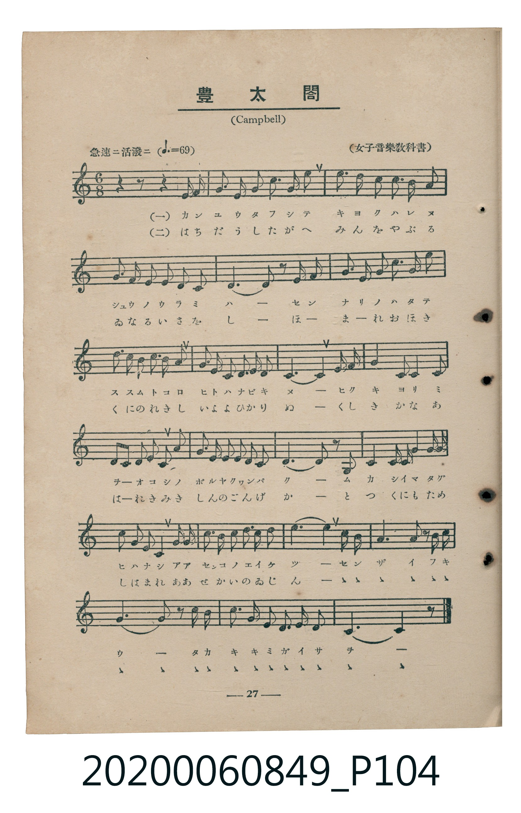
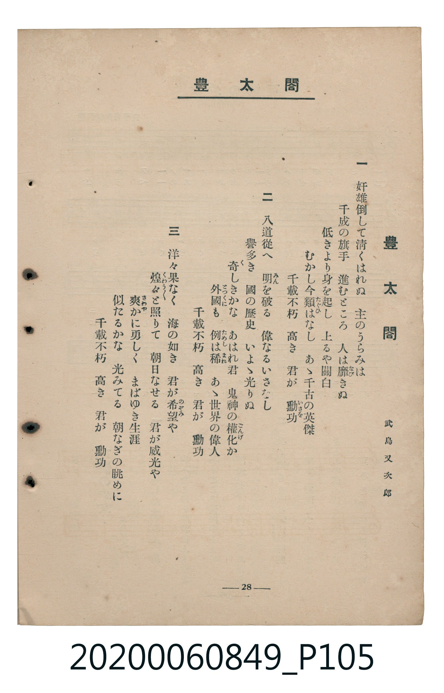

# 豐太閤

<audio controls src="ho_taiko.mp3"></audio>

- 詞：武島又次郎
- 曲：Campbell
- 臺灣教育會公認《新定兒童唱歌》高等科女子用（2020.006.0849）

## 說明

原書資訊與歌詞全文（對應 P104–P105.jpg，書頁 pp. 27–28，高二第三學期第 3 首）：
調性與拍號：ハ長調（無升降記號）、6/8 拍（急速ニ活潑ニ ♩.=69，弱起最後 1 八分音符進入）
出處註記：（女子音樂教科書）

## 跨冊／重複收錄參照

> 同名異曲（各冊收錄之不同詞曲版本）

- **[同名異曲]** 《新定兒童唱歌》高等科男子用（2020.006.0848）：[**〈豐太閤〉**](../../koto_boys_2020.006.0848/2_2_08_ho_taiko/index.md)（`F` / `4/4` — [原始 TMD](../../koto_boys_2020.006.0848/2_2_08_ho_taiko/ho_taiko.tmd)）
- 總表：[跨冊重複與同名歌曲總索引](../../../duplicate_songs.md)

## 歌詞

```text
一
奸雄倒して清くはれぬ　主のうらみは
千成の旗手　進むところ　人は靡（なび）きぬ
低きより身を起し　上るや關白
むかし今類（たぐひ）はなし　あゝ千古の英傑
千載不朽　高き　君が　勳功（いさを）

二
八道從へ　明（みん）を破る　偉なるいさをし
譽多き　國の歷史　いよゝ光りぬ
奇（く）しきかな　あはれ君　鬼神の權化（ごんげ）か
外國（とつくに）も　例（ためし）は稀（まれ）　あゝ世界の偉人
千載不朽　高き　君が　勳功

三
洋々果なく　海の如き　君が希望（のぞみ）や
煌（くわう）々と照りて　朝日なせる　君が威光や
爽（さわや）かに勇しく　まばゆき生涯
似たるかな　光みてる　朝なぎの眺めに
千載不朽　高き　君が　勳功
```

## ABC

```abc
X:1
T:豐太閤
C:曲：Campbell
M:6/8
L:1/16
Q:3/8=46
K:C
V:V1 name="Piano" snm="Pia"
[V:V1]
!mf! z2 z2 z2 z2 z2 G,2 | C4 B,2 C6 | D4 E2 F4 G2 | A2 G2 F2 E2 D2 C2 |
B,2 C2 D2 E2 F2 D2 | E6 E2 z2 E F | G2 E2 A2 G2 c3 B | B2 A2 G2 A2 B2 G2 |
c2 G2 E2 C2 F2 D2 | C6 C4 G, G, | C6 C4 D E | F2 D2 E2 F2 G2 A2 |
B2 G2 E2 C2 D2 E2 | D6 D2 z2 G,2 | C4 C2 E2 E2 G G | G2 E2 G2 C4 E E |
F2 E2 F2 G2 A2 B2 | c6 c4 A F | E6 D4 G F | C6 C2 E2 G2 |
c3 B A2 G2 E2 D2 | C6 C4 z2 |
```

## TMD 檔案連結

- [主旋律 TMD 檔案](ho_taiko.tmd) [[在 TMD Studio 編輯](https://tmdlang.github.io/Tmd-TS/#tmd=s7IKdvYPcrWy4tLSUnixccLTJateTluioKXFpWirYGbJZW-r4MxlY6ZvYcdVp6D0YuW893tmPVu77OnmbU_7O56tWfiyuU8JJPNs9iagjHNibkFSak4OWOhF-67njYufTZ35omnTsznNT1vXvFjV-7ih69m0DU_XzXraOun56qVPp2x8trbncUP3y9Uznq_tfL584tOlm5-unfB8yor3ezqMDIwM9AwMzPQMLEws3-_pVOLi0tdSsKUW4FJQUHjaN__Z7B0vNre_WNH1oqMd6BigH5-2rng2rR3ogKcbep-1dyoEGBqYPGqYDKRM9bIK0t_v6QHqebmgUaGgQE_ByBwoZWQBFAT64cmunudr1jzZ0fl07Y5nc-YD2QrGCi-XTQM6Hhg8IAtfrNr_rGE5yKru3hcz5wNFHzf3v5y6HSgOtPB5y8Knve0vZ_a-WDEDLNv5uKERGPoKQNVA6WcNS182zH_c3P1sy-5neycCGQqPZq7UszUDhk7P0z0bX2zd_mxOw9N9PQqGCk9bVz_taHs5f_PzNcteNmx62roUaBrYy-27Xsyc-mLFbqAdQOtB3gSHOVDpsxVNwPgCxgLQfyDVIOVPdjSAdS3d8XJ2y9OGSY8bpz9uXPZsR-vjxv7HjesfN_U8blzzuKHhyY7djxvXPW5se9zU-bhxP1AKrK23-VnHBKDEs-nTn3V2A9UB3fK4qeFx44rHjZMfNwETRMOTXbuAql_OXQh0yuPGVY8bN4P83dgLNBfsgL19IE5Tx-Omrhe7Vj9umgT0JsgVIDu7Hjd1P25qeTl9zvOZe0GqwWZ3A6Wf7O56uRCYXIFGzn_cCHQCMIECTV0PtgGk-XFj0-OmuUAHPu1fAnTgi-6NT5smQt38Yk_nkx29z-bsBTl49QyQ_Q0NTyfMftwITKwNT7s3P-0CRg7Q6JbHjVOBLoIH1q4esAmtq182Tn66b97jxh1A9c9m9IEV73_cNBnkiKZJzxdsATkcaFQj0E2rQGyYUUDHgdPJ2r1Pl8yCWjwHKL3u2drtT_s3gR3eAg6NuU9bgWZ1QYPp6VJQigVGCtibwDgChh9Q2yqoT8ExBfIB0ENr9jxfCnTaumdrup72ANMmUNcUoNMeN4L8AdQFNm7JNKC1YDlgTAEDCBjZq8GObwIF_D6I1PzHTY1AyyAh-3xFA1hwH9AmcMqFBvGTHdOeTwWmknVAzwLjmoQghiZAcLJ9tgUYXq3P5s0BR2A_KFhByWDd02VAzyH0Pt3R82zObLA7gIkR6EtgtgI6ugVkxPNWoLtAQfS4CeibNrAbgcl4xfPW5eBwXAYydM7cZ9OXgu2YDY0iiLkrGsHBDTGoYy_YIGB8Ac1qgYQaMHyedreDgx7kOlA4NG543NQGdN3zKfOfbQPnhyd79oBDDagaGjkgU0HZZRnENqD9YMuBaX7d8zm7wOG7mpQgAyqlvGiEAgUtfS4u38TMPKuAzMS8fIcagxqFapANCjaGZlp2YBawRIaUPE839D9f3wDSAhKuUTBQ0MXA1blptQqm8UBWDThuQbrBBWbDi4U9CK2GQAUgaA5SCeOAYI2CEZRlDMQmULYpWMYMygKJgmRBKkF6UW3a1YNiE9wGkGqYmSB2DZgHgyA2yP3GQPkasC0gEZiNhnEQ16J7qhPVKiQdIBrEh7gcrB9mKMgxCEcgex7GBoYfEGGXMwKageKKp7Nno7gCZjTMrzDXQNyH7AiYKkSYQyyAhAQkEuH2gmiQYhA2BUK0QJ-C4gaYLeCwgxpgDHI4PO6QXQZyFzSM4L6FcczA8YEcUzC3moJkUAKidS3WNIbseqToANkLiy1YasIe5KDQqOGq5eLStVMA5RUFIK3MxQUA)]
- [鋼琴伴奏 TMD 檔案](ho_taiko_piano.tmd) [[在 TMD Studio 編輯](https://tmdlang.github.io/Tmd-TS/#tmd=s7IKdvYPcrWy4tLSUnixccLTJateTlvyfk_Hy-49zydsebJny9Ol_c87O97v6VTQ0uJStFUws-Syt1Vw5rIx07ew46pTUHqxct77PbOerV32dPO2p_0dz9YsfNncpwSSeTZ7E1DGOTG3ICk1Jwcs9KJ91_PGxc-mznzRtOnZnOanrWterOp93ND1bNqGp-tmPW2d9Hz10qdTNj5b2_O4ofvl6hnP13Y-Xz7x6dLNT9dOeD5lBdBhRgZGBnoGBmZ6BhYmlkBnKXFx-SZm5lkFZCbm5Qd5ONQY1ChUcykAgY2hmZYdmKWvpfB0z8YXW7c_3dD_fH2DgpY-WLhGwUBBFwNX56bVKpjGA1k1XDDdz9esebKj4cXCHoRWQ6ACEDQHqYRxQLBGwQjKMgZiEyjbFCxjBmWBREGyIJUgvag27epBsQluA0g1zEwQuwbMg0EQG-R-Y6B8DdgWkAjMRsM4iGvRPdWJahWSDhAN4kNcDtYPMxTkGIQjkD0PYwPDD4iwyxkBzUBxxdPZs1FcATMa5leYayDuQ3YETBUizCEWQEICEolwe0E0SDEImwIhWqBPQXEDzBZw2EENMAY5HB53yC4DuQsaRnDfwjhm4PhAjimYW01BMigB0boWaxpDdj1SdIDshcUWLDVhD3JQaNRw1SJnFR-UrGJBOKcgIN58UZ1bUKtgCI5-43gEAxii8fEKRmAuggUMTSAbqMgEqhRM4c0N2I1BthDsRGxOwJfyCRgLciZIAoRRzQYFLhYRfOkbYQPW4DGDsEAUuruI8xpaUsYWGYhgxxWKwAQOdwCQCxREUok30WIEDj7LgCQ8yIDpU9dOAZREFYC0MhcXAA)]

## 分析

```text
================================================================================
📊 TMD Song Profile: [ 豐太閤 ]
================================================================================
⏱  Duration:       0:57 (57.4s), 22 measures total
🎼 Key & Tempo:    首調基準 C, != 69.0 BPM, <6/8>
   - 分析範圍：      由實際發聲的音符與和弦推測調性；播放脈絡另行呈現
🎤 人聲音域:    G3 (MIDI 55) – C5 (MIDI 72) [跨度: 17 個半音 / 1.4 個八度, 難度: challenging]
   - 最低音:  G3 in [Main #1 @ m.1, 0:02]
   - 最高音: C5 in [Main #1 @ m.7, 0:17]
   - 適合: mezzo-soprano, contralto, tenor, baritone, bass
🏛  結構:      Main (57.4s)
⚡ 編曲密度:        Peak 1 軌道同時演奏
🗝  調性診斷：       C 大調（純淨自然大調，未偵測到可信轉調）
   - 風格氣質:    純淨自然大調（陽光明朗、易唱易記，無明顯調外色彩）
   - 轉調歷程:    全曲維持單一推測調性（未偵測到可信轉調）
   - 核心骨幹音:  C, E, G, D, F
   - 調性數值:    C 大調 [相關度: 0.95, 穩定度: High, 自然音純度: 100.0%]
   - 候選調性 (K-S): C 大調 (0.95), A 小調 (0.62), G 大調 (0.55)
   - 五度圈歷程:   +0
   - 各段落調性細節:
     • [Main #1]: C 大調 (r: 0.95, 自然音純度: 100.0%)

  [ 五度圈游移軌跡 ]
              [C ]*
         F            G  
      Bb               D  
      Eb               A  
         Ab           E  
            Db       B  
               F# 
     (* = active key center)

  [ 十二半音累積音高分佈 ]
     C  : ████████████████████████  33.9%
     C# :                            0.0%
     D  : █████████                 12.5%
     D# :                            0.0%
     E  : █████████████             18.5%
     F  : ██████                     8.5%
     F# :                            0.0%
     G  : ███████████               14.9%
     G# :                            0.0%
     A  : ████                       6.0%
     A# :                            0.0%
     B  : ████                       5.6%
--------------------------------------------------------------------------------
Assignment 軌道音域：
  - Piano         : G3 – C5 (17 個半音 / 1.4 個八度, 103 個音符)
================================================================================
```


## 原書掃描頁






