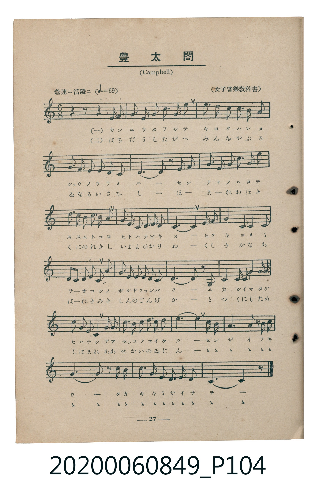
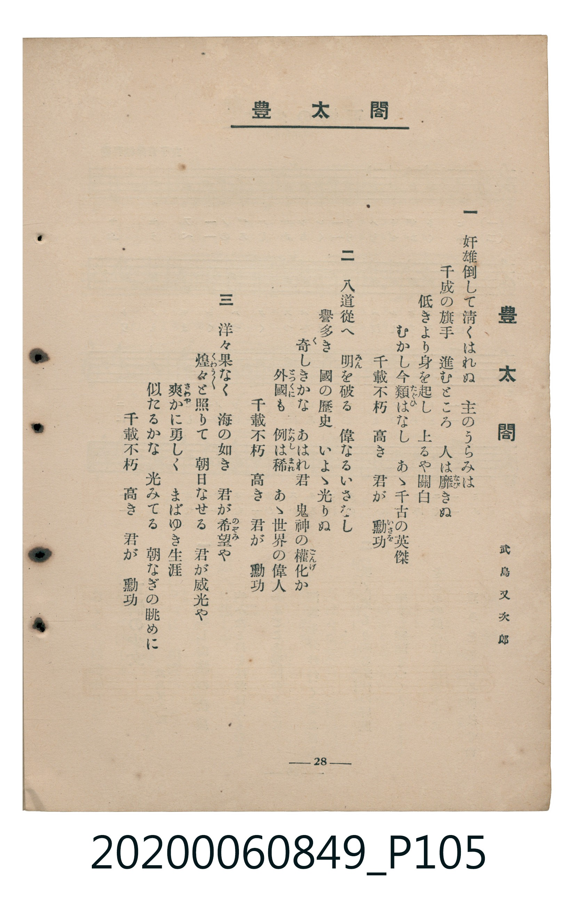

# 豐太閤

> Re:Shōka 使用 AI 協助辨識與重建樂譜，可能會有錯誤。歡迎回報。

- **鋼琴伴奏版**：<br><audio controls src="ho_taiko.mp3"></audio>

- 詞：武島又次郎
- 曲：Campbell
- 臺灣教育會公認《新定兒童唱歌》高等科女子用（2020.006.0849）

## 說明

原書資訊與歌詞全文（對應 P104–P105.jpg，書頁 pp. 27–28，高二第三學期第 3 首）：
調性與拍號：ハ長調（無升降記號）、6/8 拍（急速ニ活潑ニ ♩.=69，弱起最後 1 八分音符進入）
出處註記：（女子音樂教科書）


## 歌詞

```text
一
奸雄倒して清くはれぬ　主のうらみは
千成の旗手　進むところ　人は靡（なび）きぬ
低きより身を起し　上るや關白
むかし今類（たぐひ）はなし　あゝ千古の英傑
千載不朽　高き　君が　勳功（いさを）

二
八道從へ　明（みん）を破る　偉なるいさをし
譽多き　國の歷史　いよゝ光りぬ
奇（く）しきかな　あはれ君　鬼神の權化（ごんげ）か
外國（とつくに）も　例（ためし）は稀（まれ）　あゝ世界の偉人
千載不朽　高き　君が　勳功

三
洋々果なく　海の如き　君が希望（のぞみ）や
煌（くわう）々と照りて　朝日なせる　君が威光や
爽（さわや）かに勇しく　まばゆき生涯
似たるかな　光みてる　朝なぎの眺めに
千載不朽　高き　君が　勳功
```

## ABC

<div class="abc-score" data-abc-src="ho_taiko.abc" aria-label="五線譜載入中"></div>

[下載 ABC 原始檔](ho_taiko.abc)

## TMD 檔案連結

- [主旋律 TMD 檔案](ho_taiko.tmd) [[在 TMD Studio 編輯](https://tmdlang.github.io/Tmd-TS/#tmd=s7IKdvYPcrWy4qpTUCpJTLdSSM7PyUlNLsnMz7MqzsjMK0nNjM_KTMmPL87Iz05Ugisry88pzU21ys4vyY9PzyzKKY43MjAyiDcwMIs3sDCxRCgszi8tSk61Kk7OyM_PiS9JrShJys_PRsgXFOWXpeYl5gHVFBSB7EsBK0IoSC3LTEkFSaemZJbkF2Um5iC5IrWoGOxSsCXxJUWJecXJRZkFIOcjVJVkpAKdmpafk52TX5SKEAcalp6ZZ5WbmpmVicVlUOny1OKS1KK8-NzUnPyUSgzpksRMYNCAgqc8MT43MTMvJzEvRYlLS0vhxcYJT5esejltiYKWFpeirYKZJZe9rYIzl42ZvoUdyJgXK-e93zPr2dplTzdve9rf8WzNwpfNfWALns3eBJRxTswtSErNgfj3Rfuu542Ln02d-aJp07M5zU9b17xY1fu4oevZtA1P18162jrp-eqlT6dsfLa253FD98vVM56v7Xy-fOLTpZufrp3wfMqK93s6QBGkB4wgPVAEvd_TqcTFpa-lYEstwKWgoPC0b_6z2TtebG5_saLrRUc70DFAPz5tXfFsWjvQAU839D5r71QIMDQwedQwGUiZ6mUVpL_f0wPU83JBo0JBgZ6CkTlQysgCKAj0w5NdPc_XrHmyo_Pp2h3P5swHshWMFV4umwZ0PDB4QBa-WLX_WcNykFXdvS9mzgeKPm7ufzl1O1AcaOHzloVPe9tfzux9sWIGWLbzcUMjMPQVgKqB0s8alr5smP-4ufvZlt3P9k4EMhQezVypZ2sGDJ2ep3s2vti6_dmchqf7ehQMFZ62rn7a0fZy_ubna5a9bNj0tHUp0DSwl9t3vZg59cWK3UA7gNaDvAkOc6DSZyuagPEFjAWg_0CqQcqf7GgA61q64-XslqcNkx43Tn_cuOzZjtbHjf2PG9c_bup53LjmcUPDkx27Hzeue9zY9rip83HjfqAUWFtv87OOCUCJZ9OnP-vsBqoDuuVxU8PjxhWPGyc_bgImiIYnu3YBVb-cuxDolMeNqx43bgb5u7EXaC7YAXv7QJymjsdNXS92rX7cNAnoTZArQHZ2PW7qftzU8nL6nOcz94JUg83uBko_2d31ciEwuQKNnP-4EegEYAIFmroebANI8-PGpsdNc4EOfNq_BOjAF90bnzZNhLr5xZ7OJzt6n83ZC3Lw6hkg-xsank6Y_bgRmFgbnnZvftoFjByg0S2PG6cCXQQPrF09YBNaV79snPx037zHjTuA6p_N6AMr3v-4aTLIEU2Tni_YAnI40KhGoJtWgdgwo4COA6eTtXufLpkFtXgOUHrds7Xbn_ZvAju8BRwac5-2As3qggbT06WgFAuMFLA3gXEEDD-gtlVQn4JjCuQDoIfW7Hm-FOi0dc_WdD3tAaZNoK4pQKc9bgT5A6gLbNySaUBrwXLAmAIGEDCyV4Md3wQK-H0QqfmPmxqBlkFC9vmKBrDgPqBN4JQLDeInO6Y9nwpMJeuAngXGNQlBDE2A4GT7bAswvFqfzZsDjsB-ULCCksG6p8uAnkPofbqj59mc2WB3ABMj0JfAbAV0dAvIiOetQHeBguhxE9A3bWA3ApPxiuety8HhuAxk6Jy5z6YvBdsxGxpFEHNXNIKDG2JQx16wQcD4AprVAgk1YPg87W4HBz3IdaBwaNzwuKkN6LrnU-Y_2wbOD0_27AGHGlA1NHJApoKyyzKIbUD7wZYD0_y653N2gcN3NSlBBlRKedEIBQpa-lxcvsAqwiogMzEv36HGoEahGmSDgo2hmZYdmAUskSElz9MN_c_XN4C0gIRrFAwUdDFwdW5arYJpPJBVA45bkG5wgdnwYmEPQqshUAEImoNUwjggWKNgBGUZA7EJlG0KljGDskCiIFmQSpBeVJt29aDYBLcBpBpmJohdA-bBIIgNcr8xUL4GbAtIBGajYRzEteie6kS1CkkHiAbxIS4H64cZCnIMwhHInoexgeEHRNjljIBmoLji6ezZKK6AGQ3zK8w1EPchOwKmChHmEAsgIQGJRLi9IBqkGIRNgRAt0KeguAFmCzjsoAYYgxwOjztkl4HcBQ0juG9hHDNwfCDHFMytpiAZlIBoXYs1jSG7Hik6QPbCYguWmrAHOSg0arhqubh07RRAeUUBSCtzcQEA)]
- [鋼琴伴奏 TMD 檔案](ho_taiko_piano.tmd) [[在 TMD Studio 編輯](https://tmdlang.github.io/Tmd-TS/#tmd=s7IKdvYPcrWy4tLSUnixccLTJateTlvyfk_Hy-49zydsebJny9Ol_c87O97v6VTQ0uJStFUws-Syt1Vw5rIx07ew46pTUHqxct77PbOerV32dPO2p_0dz9YsfNncpwSSeTZ7E1DGOTG3ICk1Jwcs9KJ91_PGxc-mznzRtOnZnOanrWterOp93ND1bNqGp-tmPW2d9Hz10qdTNj5b2_O4ofvl6hnP13Y-Xz7x6dLNT9dOeD5lBdBhRgZGBnoGBmZ6BhYmlkBnKXFx-SZm5lkFZCbm5Qd5ONQY1ChUcykAgY2hmZYdmKWvpfB0z8YXW7c_3dD_fH2DgpY-WLhGwUBBFwNX56bVKpjGA1k1XDDdz9esebKj4cXCHoRWQ6ACEDQHqYRxQLBGwQjKMgZiEyjbFCxjBmWBREGyIJUgvag27epBsQluA0g1zEwQuwbMg0EQG-R-Y6B8DdgWkAjMRsM4iGvRPdWJahWSDhAN4kNcDtYPMxTkGIQjkD0PYwPDD4iwyxkBzUBxxdPZs1FcATMa5leYayDuQ3YETBUizCEWQEICEolwe0E0SDEImwIhWqBPQXEDzBZw2EENMAY5HB53yC4DuQsaRnDfwjhm4PhAjimYW01BMigB0boWaxpDdj1SdIDshcUWLDVhD3JQaNRw1SJnFR-UrGJBOKcgIN58UZ1bUKtgCI5-43gEAxii8fEKRmAuggUMTSAbqMgEqhRM4c0N2I1BthDsRGxOwJfyCRgLciZIAoRRzQYFLhYRfOkbYQPW4DGDsEAUuruI8xpaUsYWGYhgxxWKwAQOdwCQCxREUok30WIEDj7LgCQ8yIDpU9dOAZREFYC0MhcXAA)]

## 分析

```text
================================================================================
📊 TMD Song Profile: [ 豐太閤 ]
================================================================================
⏱  Duration:       0:57 (57.4s), 22 measures total
🎼 Key & Tempo:    首調基準 C, != 69.0 BPM, <6/8>
   - 分析範圍：      由實際發聲的音符與和弦推測調性；播放脈絡另行呈現
🎤 人聲音域:    G3 (MIDI 55) – C5 (MIDI 72) [跨度: 17 個半音 / 1.4 個八度, 難度: challenging]
   - 最低音:  G3 in [Main #1 @ m.1, 0:02]
   - 最高音: C5 in [Main #1 @ m.7, 0:17]
   - 適合: mezzo-soprano, contralto, tenor, baritone, bass
🏛  結構:      Main (57.4s)
⚡ 編曲密度:        Peak 1 軌道同時演奏
🗝  調性診斷：       C 大調（純淨自然大調，未偵測到可信轉調）
   - 風格氣質:    純淨自然大調（陽光明朗、易唱易記，無明顯調外色彩）
   - 轉調歷程:    全曲維持單一推測調性（未偵測到可信轉調）
   - 核心骨幹音:  C, E, G, D, F
   - 調性數值:    C 大調 [相關度: 0.95, 穩定度: High, 自然音純度: 100.0%]
   - 候選調性 (K-S): C 大調 (0.95), A 小調 (0.62), G 大調 (0.55)
   - 五度圈歷程:   +0
   - 各段落調性細節:
     • [Main #1]: C 大調 (r: 0.95, 自然音純度: 100.0%)

  [ 五度圈游移軌跡 ]
              [C ]*
         F            G  
      Bb               D  
      Eb               A  
         Ab           E  
            Db       B  
               F# 
     (* = active key center)

  [ 十二半音累積音高分佈 ]
     C  : ████████████████████████  33.9%
     C# :                            0.0%
     D  : █████████                 12.5%
     D# :                            0.0%
     E  : █████████████             18.5%
     F  : ██████                     8.5%
     F# :                            0.0%
     G  : ███████████               14.9%
     G# :                            0.0%
     A  : ████                       6.0%
     A# :                            0.0%
     B  : ████                       5.6%
--------------------------------------------------------------------------------
Assignment 軌道音域：
  - Piano         : G3 – C5 (17 個半音 / 1.4 個八度, 103 個音符)
================================================================================
```


## 原書掃描頁






