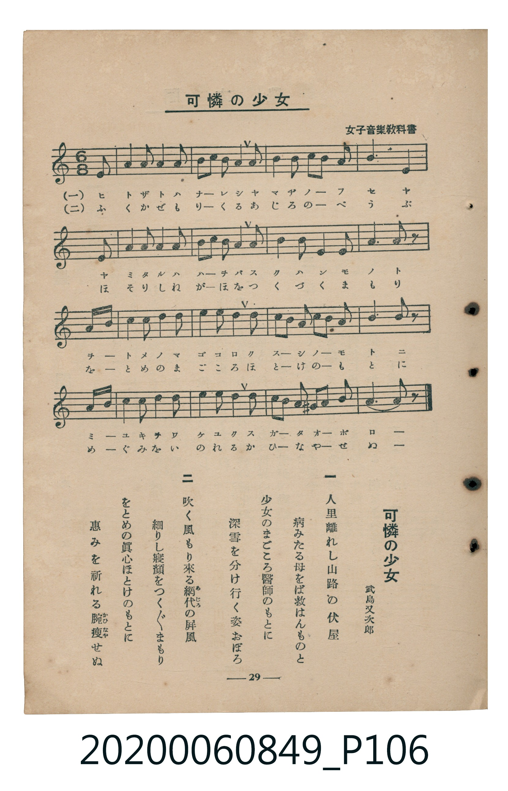

# 可憐の少女

> Re:Shōka 使用 AI 協助辨識與重建樂譜，可能會有錯誤。歡迎回報。

- **鋼琴伴奏版**：<br><audio controls src="karen_no_shojo.mp3"></audio>

- 詞：武島又次郎
- 臺灣教育會公認《新定兒童唱歌》高等科女子用（2020.006.0849）

## 說明

原書資訊與歌詞全文（對應 P106.jpg，書頁 p. 29，高二第三學期第 4 首）：
調性與拍號：イ短調（無升降記號）、6/8 拍（每行皆以最後 1 拍八分音符或 2 個十六分音符弱起進入）
出處註記：女子音樂教科書
校勘註記：原譜將每行起首之第 6 拍弱起音獨立排於每行左端小節線前，並將上一行末尾記為 5 拍八分音符，合併後恰為完整 6/8 拍小節。


## 歌詞

```text
一
人里離れし山路の伏屋
病みたる母をば救はんものと
少女のまごころ醫師のもとに
深雪を分け行く姿おぼろ

二
吹く風もり來る網代（あじろ）の屏風
細りし寢顔をつくづくまもり
をとめの眞心ほとけのもとに
惠みを祈れる腕（かひな）痩せぬ
```

## ABC

<div class="abc-score" data-abc-src="karen_no_shojo.abc" aria-label="五線譜載入中"></div>

[下載 ABC 原始檔](karen_no_shojo.abc)

## TMD 檔案連結

- [主旋律 TMD 檔案](karen_no_shojo.tmd) [[在 TMD Studio 編輯](https://tmdlang.github.io/Tmd-TS/#tmd=s7IKdvYPcrWy4qpTUCpJTLdSSM7PyUlNLsnMz7MqzsjMK0nNjM_KTMmPL87Iz05Ugisry88pzU21ys4vyY9PzyzKKY43MjAyiDcwMIs3sDCxRCgszi8tSk61Kk7OyM_PiS9JrShJys_PRpePL0hMT7UKMDQwQ8gUFOWXpeYl5gF1FxSBXJIC1o5QkFqWmZIKki5OTsyLL0stykzLTE1BcmNqUTHYHxArSooS84qTizILQJ5DqMovKsnITy9KLMiotMrILC7JL8pMTsyJz07MQ_JuSUYq0LepufnoejPTM_OsclMzszKx-A0qXZKYCQw9UAiWJ8bnJmbm5STmAZ2ppaXwtH_9s7YJjxvXPd0w8enSzQpaWlyKtgrmRlz2tgrOXNmplbYKiblcNmb6FnYgQ1-snPd-z6xna5c93bztaX_HszULXzb3ga170b7reePiZ1Nnvmja9GxO89PWNS9W9T5u6Ho2bcPTdbOetk56vnrp0ykbn63tedzQ_XL1jOdrO58vB1n5dO2E51NWvN_TAYo-PWD06YGi7_2eTiUuLn0tBVtqAS4FBYWnffOfzd7xYnP7ixVdLzragY4Beuhp64pn09qBDni6ofdZe6cCKA3oZRWkv9_TA1T8ckGjQoGeghHQRT1AZz_Z1fN8zZonOzqfrt3xbM58IFvBROHlsmlA9wIDBmTHi1X7nzUsB5ne3fti5nyg6OOmJc_nrwWKA-143rLwaW_7y5m9L1bMAMt2Pm5oBIauAlA1UPrZ-v4XC3uez2p7snvpszkNT_f1KBiCpJ62rn7a0fZy_ubna5Y965imYKTwtKH7aW_j09a1cPGneza-2Lr9ZcOmp61LgeaC_du-68XMqS9W7AbaBnQIJLSBqp-taALGFDD8gR4EqXu2YOHT7hkIdX3zX6yd83RDO8Q5IFOXTXuysxvkWzOwcyBWAa3tXfF8dfezvknPpu2BKH66fdnz1eufbuh_vr7h-fZZTzuB3up5smMZ0LQnO7qe7GgAqnk2Z_XTDfuAdj1v2qVgiu4_oPqnEzqe7N0K9P2zxg1ANU_X9TybukUBGkwQsx83NHGBnA40EUzt2vWyvefl7EWPm3oeN05_unHji-3rgcn6yZ7-pxu7QSqeT2993Lj_ceP8x03dz9b3Pm6a9Lhxw7OpEx83rn_cNPlxUxNQ9ePGFeBgA-cFMH_f48YpjxuB0r0v21Y_3bEaJAhSuuJx42pwyG3f-HL2KqBhQOc_bpwI9Nzjxv6ny4H2dD1u3APUBnHkrh6wuRN2AmVfLloBMqKp68m-NqBbnm_b9GT3YmDcP24EmjsDqAWUKIAZciNIJdjlWzYAVYN8tX7Ry4VTwC5fAjToceNSMLkPYhxIKVgOaHwj0IDnc-Y93d_8uHE32LVAf6K5vHkBKDyaJj1f2gEKtKbuF61Twc7ofty46XHjKqAznk9f-bhx9uPGNSANlGdBKFDQ0ufi8k4sSs3zyw_OyM_KtwrITMzLd6jRNaypBtmkYGNopmUHZmErARTAORCUkBQ0IClRQRuYCyHpQgeefzWx6ATaDDK1RsFAQRcDGwNxDTCB64IhiEZm1yiYA0nDOCABYmBKgSCGEoQUCIJsgNE1YJf4GNYoxAN56Phx8ySw7sfNHVA9j5u2gcXh_OZ-qIouMG8PmFwDVrkdrmYJVM08uEgTmOxD0jMVoqZpN5JLITqRzIC41giHaxu3QsxoBLkJrKuxG0zOgbseZC_IFiTXglUDEx5cD1RN4wy4rl6w-DokPTuhatqQXdsIChsIC-SLGnCuw514dvWAEw-JaYbilIES_XB1MLWgJGgGVIdIGI-b58MDYj84CFbD-PDIBwchNCI3gckJcD3QoGpaj6LrcfNmOH8R1BRQckBEPSiJQRLhJrDZiMh_3DgXbjo4Ihunw_iNayFmNfYgXASODGARA1cDTY5IyWQpmETw90HdDEoKcBeB7QK7CGgWxEUESodOciIYHIUgCGYYwXhgRo2CMYwPZqDLokQ_niIAxMYW04hsvRBMwmIEknVBIbIFHhqg-HvcDApvCB8UvyAVoPiGhjy4CEDN5rC4htkEMR2U-SBxPR8jrlfAbWgEkeBsiBJLjVPgIpPB6nrhfHA2hJoBSw0T4abAXAnL8DCbIHpBqRwS243ExPbT2bMHNLZN1cFSoBjFla9BGDm2l8FDFhSLkJwLiQ9YXG6Ei4DUIuVheK4GF_XQcASXDk2roDr2ADGo4AXZBEslMBlEoY0c0_AyoxFiEiLHtkDMQcR9Ezh_IxXaIBZIBaT0gcQ0yCWPm0B6oe5pnA1VBXI1LvfUcnHp2ikgtwwUgHxlLgA)]
- [鋼琴伴奏 TMD 檔案](karen_no_shojo_piano.tmd) [[在 TMD Studio 編輯](https://tmdlang.github.io/Tmd-TS/#tmd=s7IKdvYPcrWy4qpTUCpJTLdSSM7PyUlNLsnMz7MqzsjMK0nNjM_KTMmPL87Iz05Ugisry88pzU21ys4vyY9PzyzKKY43MjAyiDcwMIs3sDCxRCgszi8tSk61Kk7OyM_PiS9JrShJys_PRpePL0hMT7UKMDQwQ8gUFOWXpeYl5gF1FxSBXJIC1o5QkFqWmZIKki5OTsyLL0stykzLTE1BcmNqUTHYHxArSooS84qTizILQJ5DqMovKsnITy9KLMiotMrILC7JL8pMTsyJz07MQ_JuYhFQc3pqbmpeiVVBZmJefnxicnJ-bkFiXiZIDKGwJAOoyCo1Nx_dksz0zDyr3NTMrEwsgQCVLknMBAYzKKjLE-NzEzPzchLzgP7R0lJ42r_-WduEx43rnm6Y-HTp5vd7Ol5273k-YcuTPVueLu1_3tnxfk-ngpYWl6KtgrkRl72tgjNXdmqlrUJiLpeNmb6FHcimFyvnvd8z69naZU83b3va3_FszcKXzX1gN7xo3_W8cfGzqTNfNG16Nqf5aeuaF6t6Hzd0PZu24em6WU9bJz1fvfTplI3P1vY8buh-uXrG87Wdz5eD3PF07YTnU1YAXQOKfD1g5OuBIh_oFiUuLu_EotQ8v_zgjPysfKsAUJgFeTjU6BrWVHMpAIGNoZmWHZilr6Vgiw4Unq9Z82RHw4uFPQoaT_dsfLF1u4K2gonC0w39z9c36CiAEopeVkG6JhadWvpgU2sUDBR0MbAxENcomAFJEATRyOwaBXMgaRgHJEAMTCkQxFCCkAJBkA0wugbsEh_DGoV4IA8dP26eBNb9uLkDqudx0zawOJzf3A9V0QXm7QGTa8Aqt8PVLIGqmQcXaQKTfUh6pkLUNO1GcilEJ5IZENca4XBt41aIGY0gN4F1NXaDyTlw14PsBdmC5Fqw6sdNIJUQPVA1jTPgunrB4uuQ9OyEqmlDdm0jKGwgLJAvarjwJ55dPeDEQ2KaoThloEQ_XB1MLSgJmgHVIRLG4-b58IDYDw6C1TA-PPLBQQiNyE1gcgJcDzSomtaj6HrcvBnOXwQ1BZQcEFEPSmKQRLgJbDYi8h83zoWbDo7IxukwfuNaiFmNPQgXgSPjcRMoKUPUQJMjUjJZCiYR_H1QN4OSAtxFYLvALgKaBXERgdKhk5wIBkchCIIZRjAemFGjYAzjgxnosijRj6cIALGxxTQiWy8Ek7AYgWRdUIhsgYcGKP4eN4PCG8IHxS9IBSi-oSEPLgJQszksrmE2QUwHZT5IXM_HiOsVcBsaQSQ4G6LEUuMUuMhksLpeOB-cDaFmwFLDRLgpMFfCMjzMJoheUCqHxHYjMbH9dPbsAY1tU3WwFChGceVrEEaO7WXwkAXFIiTnQuIDFpcb4SIgtUh5GJ6rwUU9NBzBpUPTKqiOPUAMKnhBNsFSCUwGUWgjxzS8zGiEmITIsS0QcxBx3wTO30iFNogFUgEpfSAxDXLJ4yaQXqh7GmdDVYFcjcs9tdgaBj4oDQML4toFeKLdAAkCIys-XsE4XsEwHokFjHwg2ygeGLGYwuYQKWzCQD6ICYpt4iogPK4k111IbkE3BOxhospNotxlCrEQZBkwP4D4IAkUUdyeQAouIpwFzeDUdxZSwGEPLWCK1LVTQE6U0T6GsQoYYkZgMWUuAA)]

## 分析

```text
================================================================================
📊 TMD Song Profile: [ 可憐の少女 ]
================================================================================
⏱  Duration:       0:40 (40.0s), 16 measures total
🎼 Key & Tempo:    首調基準 C, != 72.0 BPM, <6/8>
   - 分析範圍：      由實際發聲的音符與和弦推測調性；播放脈絡另行呈現
🎤 人聲音域:    E4 (MIDI 64) – E5 (MIDI 76) [跨度: 12 個半音 / 1.0 個八度, 難度: easy]
   - 最低音:  E4 in [KarenNoShojo #1 @ m.1, 0:02]
   - 最高音: E5 in [KarenNoShojo #1 @ m.11, 0:25]
   - 適合: soprano, mezzo-soprano, contralto, tenor, baritone, bass
🏛  結構:      KarenNoShojo (40.0s)
⚡ 編曲密度:        Peak 1 軌道同時演奏
🗝  調性診斷：       A 小調（純淨自然小調，未偵測到可信轉調）
   - 風格氣質:    純淨自然小調（陰鬱抒情、旋律集中，無明顯調外色彩）
   - 轉調歷程:    全曲維持單一推測調性（未偵測到可信轉調）
   - 核心骨幹音:  A, B, E, C, D
   - 調性數值:    A 小調 [相關度: 0.77, 穩定度: Moderate, 自然音純度: 98.4%]
   - 候選調性 (K-S): A 小調 (0.77), A 大調 (0.68), D 大調 (0.49)
   - 五度圈歷程:   +3
   - 各段落調性細節:
     • [KarenNoShojo #1]: A 小調 (r: 0.75, 自然音純度: 98.3%, 調外音: G#)

  [ 五度圈游移軌跡 ]
               C  
         F            G  
      Bb               D  
      Eb              [A ]*
         Ab           E  
            Db       B  
               F# 
     (* = active key center)

  [ 十二半音累積音高分佈 ]
     C  : █████████                 12.9%
     C# :                            0.0%
     D  : █████████                 12.9%
     D# :                            0.0%
     E  : ██████████                14.0%
     F  :                            0.0%
     F# :                            0.0%
     G  :                            0.0%
     G# : █                          1.6%
     A  : ████████████████████████  33.9%
     A# :                            0.0%
     B  : ██████████████████        24.7%
--------------------------------------------------------------------------------
Assignment 軌道音域：
  - Piano         : E4 – E5 (12 個半音 / 1.0 個八度, 69 個音符)
================================================================================
```


## 原書掃描頁




