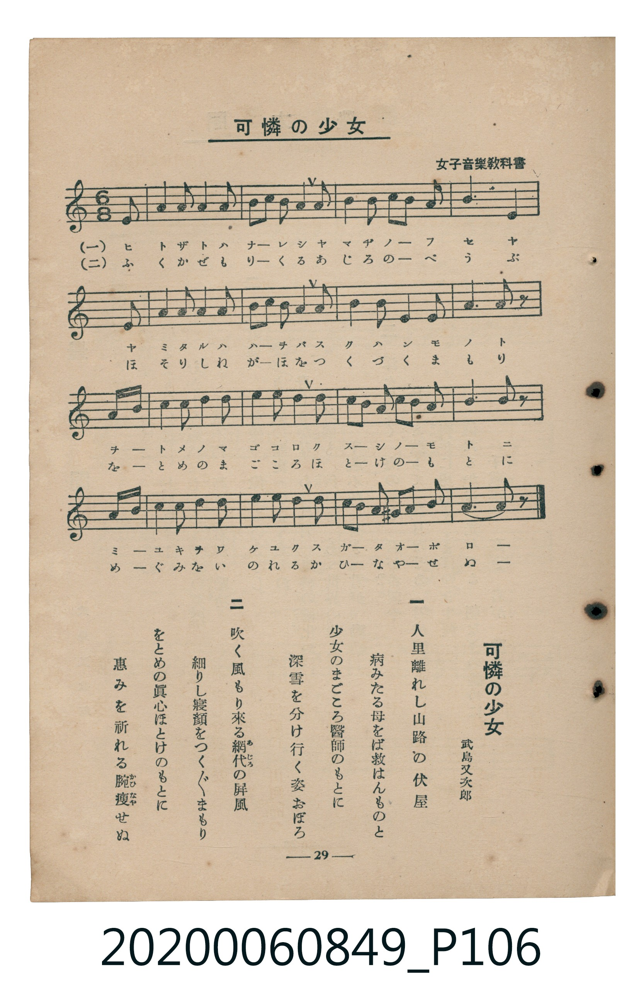

# 可憐の少女

> Re:Shoka 使用 AI 辨識樂譜，可能會有錯誤。歡迎回報。

<audio controls src="karen_no_shojo.mp3"></audio>

- 詞：武島又次郎
- 臺灣教育會公認《新定兒童唱歌》高等科女子用（2020.006.0849）

## 說明

原書資訊與歌詞全文（對應 P106.jpg，書頁 p. 29，高二第三學期第 4 首）：
調性與拍號：イ短調（無升降記號）、6/8 拍（弱起最後 1 八分音符進入）
出處註記：女子音樂教科書

## 歌詞

```text
一
人里離れし山路の伏屋
病みたる母をば救はんものと
少女のまごころ醫師のもとに
深雪を分け行く姿おぼろ

二
吹く風もり來る網代（あじろ）の屏風
細りし寢顔をつくづくまもり
をとめの眞心ほとけのもとに
惠みを祈れる腕（かひな）痩せぬ
```

## ABC

```abc
X:1
T:可憐の少女
M:6/8
L:1/16
Q:3/8=48
K:C
V:V1 name="Piano" snm="Pia"
[V:V1]
!mp! z2 z2 z2 z2 z2 E,2 | A,4 B,2 C4 D2 | E2 D2 C2 B,2 A,2 B,2 | C4 B,2 A,2 B,2 C2 |
B,6 E,4 E,2 | A,4 B,2 C4 D2 | E2 D2 C2 B,2 A,2 B,2 | C4 B,2 A,4 B,2 |
A,6 A,4 z2 | !mf! E2 F2 E2 D4 B,2 | C4 A,2 E4 E2 | D2 C2 B,2 C2 D2 E2 |
A,6 A,4 z2 | !mp! C2 B,2 A,2 G,4 A,2 | B,4 C2 D4 B,2 | C2 B,2 A,2 ^G,2 A,2 B,2 |
A,6 A,4 z2 |
```

## TMD 檔案連結

- [主旋律 TMD 檔案](karen_no_shojo.tmd) [[在 TMD Studio 編輯](https://tmdlang.github.io/Tmd-TS/#tmd=s7IKdvYPcrWy4qpTUCpJTLdSSM7PyUlNLsnMz7MqzsjMK0nNjM_KTMmPL87Iz05Ugisry88pzU21ys4vyY9PzyzKKY43MjAyiDcwMIs3sDCxRCgszi8tSk61Kk7OyM_PiS9JrShJys_PRsgXFOWXpeYl5gHVFBSB7EsBK0IoSC3LTEkFSaemZJbkF2Um5iC5IrWoGOxSsCXxJUWJecXJRZkFIOcjVJVkpAKdmpqbDxHW0lJ42r_-WduEx43rnm6Y-HTpZgUtLS5FWwVzIy57WwVnLhszfQs7kO4XK-e93zPr2dplTzdve9rf8WzNwpfNfWBzX7Tvet64-NnUmS-aNj2b0_y0dc2LVb2PG7qeTdvwdN2sp62Tnq9e-nTKxmdrex43dL9cPeP52s7ny0FWPV074fmUFe_3dICCSw8YXHqg4Hq_p1OJi0tfS8GWWoBLQUHhad_8Z7N3vNjc_mJF14uOdqBjgB562rri2bR2oAOebuh91t6pEGAIdENWQfr7PT1AxS8XNCoU6CkYAV3UA3T2k109z9esebKj8-naHc_mzAeyFUwUXi6bBnQvMGBAdrxYtf9Zw3KQ6d29L2bOB4o-blryfP5aoDjQjuctC5_2tr-c2ftixQywbOfjhkZg6CoAVYOcsGfji63bn81peLqvR8FQ4Wnr6qcdbS_nb36-ZtnLhk1PW5cCNYA90r7rxcypL1bsBhoDtAESjEB1z1Y0AaMAGLBAl3OBFD7Z0QCmdu162d7zcvaix009jxunP9248cX29cDYfrKn_-nGbpCK59NbHzfuf9w4_3FT97P1vY-bJj1u3PBs6sTHjesfN01-3NQEVP24cQXYcnASAfP3PW6c8rgRKN37sm310x2rQYIgpSseN64GKX22fePL2auAhgG98bhx4ouFQNv7ny4H2tP1uHEPUBvEkbt6wOZO2AmUfbloBciIpq4n-9qAbnm-bdOT3YuBQfO4EWjuDKAWUJgB0-lGkEqwy7dsAKoG-Wr9opcLp4BdvgRo0OPGpWByH8Q4kFKwHND4RqABz-fMe7q_-XHjbrBrgf5Ec3nzAlB4NE16vrQDFGhN3S9ap4Kd0f24cdPjxlVAZzyfvvJx4-zHjWtAGihPoVCgoKXPxeWbmJlnFZCZmJfvUGNQo1ANskHBxtBMyw7MAmYMSFJ5uqH_-foGkBaQcI2CgYIuBq7OLahVMI4HsmrAwQ3SDU7EDcD4QGg1A6kAQXMQwxDKMQJpUzCGskCiYGmwYjCrBq4UTQIkXANhwiDYEXAGqmt29dDKNXAekqkgCOeAAgktaDpRHFOdmwYMQaAqE5DbobYjGQuzE2wiSB7sR7AUijtBDJAARIpIxzydPRvNMcDoRPW6KUwzmIcU6DAL0dyKpFMdPfzwuaqWi0vXTgGUNhWAtDIXFwA)]
- [鋼琴伴奏 TMD 檔案](karen_no_shojo_piano.tmd) [[在 TMD Studio 編輯](https://tmdlang.github.io/Tmd-TS/#tmd=s7IKdvYPcrWy4tLSUnjav_5Z24THjeuebpj4dOnm93s6XnbveT5hy5M9W54u7X_e2fF-T6eClhaXoq2CuRGXva2CM5eNmb6FHVedgtKLlfPe75n1bO2yp5u3Pe3veLZm4cvmPiWwTPuu542Ln02d-aJp07M5zU9b17xY1fu4oevZtA1P18162jrp-eqlT6dsfLa253FD98vVM56v7Xy-HGT_07UTnk9ZAXSFkYGRgZ6BgZmegYWJJdANSlxcvomZeVYBmYl5-UEeDjUGNQrVXApAYGNopmUHZukDvbNn44ut259u6H--vkFBSx8sXKNgoKCLgatzC2oVjOOBrBoumO7na9Y82dHwYmEPQqsZSAUImoMYhlCOEUibgjGUBRIFS4MVg1k1cKVoEiDhGggTBsGOgDNQXbOrh1augfOQTAVBOAcUSGhB04nimOrcNGAIAlWZgNwOtR3JWJidYBNB8mA_gqVQ3AligAQgUkQ65uns2WiOAUYnqtdNYZrBPKRAh1mI5lYknero4YfPVbXISdMHJWlaEE6ZCIg3HVYDvWcWHw9KI4bxSCxgvAPZ5hA-sjCCbQJkgSlUxSAmyAsEEhwJViIsQlKAbgamlRjJChST8aDoA-oyBWoxAnNwOQYoC4wQEi3FSD4owQu3vQbJfuwuwWYpiELYCkweunYKoBSiAKSVubgA)]

## 分析

```text
================================================================================
📊 TMD Song Profile: [ 可憐の少女 ]
================================================================================
⏱  Duration:       0:42 (42.5s), 17 measures total
🎼 Key & Tempo:    首調基準 C, != 72.0 BPM, <6/8>
   - 分析範圍：      由實際發聲的音符與和弦推測調性；播放脈絡另行呈現
🎤 人聲音域:    E3 (MIDI 52) – F4 (MIDI 65) [跨度: 13 個半音 / 1.1 個八度, 難度: moderate]
   - 最低音:  E3 in [Main #1 @ m.1, 0:02]
   - 最高音: F4 in [Main #1 @ m.10, 0:22]
   - 適合: contralto, tenor, baritone, bass
🏛  結構:      Main (42.5s)
⚡ 編曲密度:        Peak 1 軌道同時演奏
🗝  調性診斷：       A 小調（純淨自然小調，未偵測到可信轉調）
   - 風格氣質:    純淨自然小調（陰鬱抒情、旋律集中，無明顯調外色彩）
   - 轉調歷程:    全曲維持單一推測調性（未偵測到可信轉調）
   - 核心骨幹音:  A, B, C, E, D
   - 調性數值:    A 小調 [相關度: 0.84, 穩定度: High, 自然音純度: 98.9%]
   - 候選調性 (K-S): A 小調 (0.84), A 大調 (0.58), D 大調 (0.41)
   - 五度圈歷程:   +3
   - 各段落調性細節:
     • [Main #1]: A 小調 (r: 0.84, 自然音純度: 98.9%, 調外音: G#)

  [ 五度圈游移軌跡 ]
               C  
         F            G  
      Bb               D  
      Eb              [A ]*
         Ab           E  
            Db       B  
               F# 
     (* = active key center)

  [ 十二半音累積音高分佈 ]
     C  : ███████████████           19.1%
     C# :                            0.0%
     D  : ████████                  10.6%
     D# :                            0.0%
     E  : ██████████                12.8%
     F  : █                          1.1%
     F# :                            0.0%
     G  : ██                         2.1%
     G# : █                          1.1%
     A  : ████████████████████████  30.9%
     A# :                            0.0%
     B  : █████████████████         22.3%
--------------------------------------------------------------------------------
Assignment 軌道音域：
  - Piano         : E3 – F4 (13 個半音 / 1.1 個八度, 69 個音符)
================================================================================
```


## 原書掃描頁




