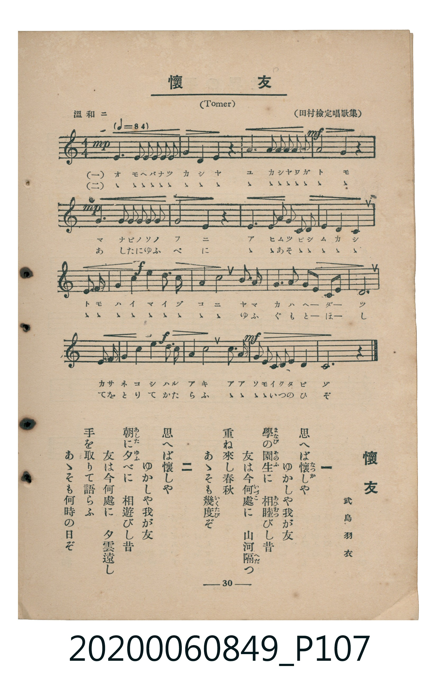

# 懷友

> Re:Shōka 使用 AI 協助辨識與重建樂譜，可能會有錯誤。歡迎回報。

- **鋼琴伴奏版**：<br><audio controls src="kaiyu.mp3"></audio>

- 詞：武島羽衣
- 曲：Tomer
- 臺灣教育會公認《新定兒童唱歌》高等科女子用（2020.006.0849）

## 說明

原書資訊與歌詞全文（對應 P107.jpg，書頁 p. 30，高二第三學期第 5 首）：
調性與拍號：ハ長調（無升降記號）、4/4 拍（溫和ニ ♩=84）
出處註記：（田村檢定唱歌集）
校勘註記：原譜將第三行、第四行起首之第 4 拍弱起音（附點八分音符＋十六分音符 `3. 4`）獨立排於行首小節線前，並將上一行末尾記為 3 拍，合併後恰為完整 4/4 拍小節（全曲共 16 小節）。


## 歌詞

```text
一
思へば懷（なつか）しや　ゆかしや我が友
學（まなび）の園生（そのふ）に　相睦（あひむつ）びし昔
友は今何處（いづこ）に　山河隔（へだ）つ
重ね來し春秋　あゝそも幾度（いくたび）ぞ

二
思へば懷しや　ゆかしや我が友
朝（あした）に夕（ゆふ）べに　相遊びし昔
友は今何處に　夕雲遠し
手を取りて語らふ　あゝそも何時の日ぞ
```

## ABC

<div class="abc-score" data-abc-src="kaiyu.abc" aria-label="五線譜載入中"></div>

[下載 ABC 原始檔](kaiyu.abc)

## TMD 檔案連結

- [主旋律 TMD 檔案](kaiyu.tmd) [[在 TMD Studio 編輯](https://tmdlang.github.io/Tmd-TS/#tmd=s7IKdvYPcrWy4qpTUCpJTLdSSM7PyUlNLsnMz7MqzsjMK0nNjM_KTMmPL87Iz05Ugisry88pzU21ys4vyY9PzyzKKY43MjAyiDcwMIs3sDCxRCgszi8tSk61Kk7OyM_PiS9JrShJys_PRpePL0hMT7UKMDQwR8gUFOWXpeYl5gF1FxSBXJIC1o5QkFqWmZIKki5OTsyLL0stykzLTE1BcmNqUTHYHxArSooS84qTizILQJ5DqMovKsnITy9KLMiotMrILC7JL8pMTsyJz07MQ_JuSUYq0LdpRZmpeSnAYClAl0nNzUc3NTM9M88qNzUzKxOLr6HS5anFJalFefG5qTn5KZVKXFpaCs_atz_t71bQ0uJStFWwMOGyt1Vw5rIx0TexA2l-sXLe-z2znq1d9nTztuf79r5YuBhs5rPZm4DCIfm5qUVg_ov2Xc8bFz-bOvNF06Znc5qftq55sar3cUPXs2kbnq6b9bR10vPVS59O2fhsbc_jhu6Xq2c8X9v5fPnEp0s3P1074fmUFe_3dIBiUw8Ym3qg2Hy_p1OJi0tfS8GWWoBLQUHhad_8Z7N3vNjc_mJF14uOdqBjgL572rri2bR2oAOebuh91t6pAEoSelkF6e_39AAVv1zQqFCgp2BsAOQCnf1kV8_zNWue7Oh8unbHsznzgWwFU4WXy6YB3QsMDpAdL1btf9awHGR6d--LmfOBoo-b-19O3Q4UB9rxvGXh0972lzN7X6yYAZbtfNzQCAxqBaBqoPSzXaufTup53Nyt8GjmSlsLE6A82N3tu17MnPpixW6gLqCBIHOmbHg2d-KzVYtAgQsO1pez26Cqny1Y-LR7Blw10NMv1s55uqEd4vAXC4Ex0AhkP509G8h-sXU70PlPdnaDvAJ2xtM9G0GC8zcDrXk5s-XlbmAIrX7a0QYUeb5m2fs93U97G5-2roWLKCQY6ymYJAAtf9674vnq7md9k55N2wM0Gmju0w39z9c3PN8-62kn0Hs9T3YsA7rjyY6uJzsagAqezVn9dMM-oCufN-1SMIYEQc_TCR1P9m59uq_nWeMGoPjTdT3Ppm5RgAYRxDxQXAEjbfamp60bFQzNFGCiwLBs4gKFANB4cEA0zH3cuONx4wZgCgfqedy46nHjkseN3SCVjdMfN7U8bmh43NQGFIFwn3VMfNzYA8wL4DBfuwOsZx9YGzAwgHrWPZ0z6fkUYKwBxYFGr3vcuBUsvhpo0PPZO57PBQYPUKrpceOmx00NQMvAspuBpj-bMQVsaD_QqvVPdnc92TsVGKNg1S2PG5c-bpwMN-jpxo3PNm1-OWsKWBbo_AVgqSUg_S_bex83rn2yD-hmoJFLny_vBnkBaGET0DlzHzc1Pd257-kuiCuA5vY_bpwPc_s8SMjs6kEPGcJB8WzOXJi_pgNNhLj06RKw80F6IIGwEx4OLxu78Pka6s0lU1_O3vSycQFQHdiSzu7HTZOe9k973ATUvezFqnmPm4CmbkXzINCIZzOBDln3bDow1OaBdFJeNkCBgpY-F5d3YmZlqVVAZmJevkONQU01yAYFG0MzLTswC1uRpADOWaAUraBhAk2NOvByRBOLBqBFIMNqFKpzC2qBSV8XDkFsdFwDLGMgskZIqkDQAErXKJghmQFio2OQVWm1KMpAEGYw3CCwu3wMaxQeN61CUve4eRGYnAEmJ4DJLjDZAjb8cdNqmMqm7XA9S6CseLgzHzcvQzYVrAuiA6L6cfN6sMgaqOoONPdC3IFiJsTFRkDVjSAXIcxuApGNO8DkBjAJ8hEwJ0HMbuyGqWycDtcD8g2ai5vakE0F64LogKh-3NQPFumBmroC3cVgd6C6GH9K2tVDdkqCRScsatExIiXBIGZKQk-NoCQD0mUIxKD0h1ABS40gGYRZJsiJqHkeclBAk8xkMNkHDpy9cDZI9VQ014FqQswIgSUBiIpJYHIBmARHCMR8cKICmQmSgUQEtiQKSWCgZIWckGBRBolycGQ3zgeTkAQLShLAsgliQ-NOdFeDVaG5Gs3MTWASkkTngsnNcLtAfmyAq8SSTKGJDJS0CCUmcIVPcmKCpRLDOCijGlh2GMM4RhAGUBJR7sBVwqA5mDRDS3KwxARKKqBkAyneYAkJHWJLUKDcBvE8rHRBJDKY2OPmVnAggoIUwocFIjwCoGUTSC9y6QURA-doaFm3B0yCogPCBrkBVkqgQ5g5j5u2oiQnUJkGFm-E6QS2K9DEgK0AcDIBJV4IH9lNEFMhJREo4YFUgkphhBwkKYESBtTNjbuR3QxPPBhuboSUyMDKl1BigrQYByIxQQVAqQlcjSEnIVDiQS-RauBlEjrEUtE198KCApFgkEoISIJ73Lwapex53LQWzWSYHIgGqYSUbOBqE5wsHzdBqrb9cJNhUQ1SDUsO6BBbNQerYoAtJRgLGomI8gJUXoHM7YSLg0orFPdCSyQQDTIVXApBkxG4HAVXlMCWFlw9qMyCurcRuVzH7t5aLi5dOwVwc0oByFDmAgA)]
- [鋼琴伴奏 TMD 檔案](kaiyu_piano.tmd) [[在 TMD Studio 編輯](https://tmdlang.github.io/Tmd-TS/#tmd=s7IKdvYPcrWy4qpTUCpJTLdSSM7PyUlNLsnMz7MqzsjMK0nNjM_KTMmPL87Iz05Ugisry88pzU21ys4vyY9PzyzKKY43MjAyiDcwMIs3sDCxRCgszi8tSk61Kk7OyM_PiS9JrShJys_PRpePL0hMT7UKMDQwR8gUFOWXpeYl5gF1FxSBXJIC1o5QkFqWmZIKki5OTsyLL0stykzLTE1BcmNqUTHYHxArSooS84qTizILQJ5DqMovKsnITy9KLMiotMrILC7JL8pMTsyJz07MQ_JuYhFQc3pqbmpeiVVBZmJefnxicnJ-bkFiXiZIDKGwJAOoyCqtKDM1LwUYfgXoMqm5-ejWZ6Zn5lnlpmZmZWIJHqh0eWpxSWpRXnxuak5-SqUSl5aWwrP27U_7u9_v6XjZvef5hC1P9mx5urT_eWfH-z2dClpaXIq2ChYmXPa2Cs5cNib6JnYgE1-snPd-z6xna5c93bzt-b69LxYuBlv0bPYmoHBIfm5qEZj_on3X88bFz6bOfNG06dmc5qeta16s6n3c0PVs2oan62Y9bZ30fPXSp1M2Plvb87ih--XqGc_Xdj5fPvHp0s1P1054PmUF0EmgtKAHTAt6oLQAdJASF5d3YmZlqVUAKOyCPBxqDGqquRSAwMbQTMsOzNLXUrBFBwrP16x5sqPhxcIeBQ0Thacb-p-vb9BRACUTvayCdE0sGrT0wYbVKFTnFtQqGCvowiGIjY5rFEyhskZIqkDQAErXKJghmQFio2OQVWm1KMpAEGYw3CCwu3wMaxQeN61CUve4eRGYnAEmJ4DJLjDZAjb8cdNqmMqm7XA9S6CseLgzHzcvQzYVrAuiA6L6cfN6sMgaqOoONPdC3IFiJsTFRkDVjSAXIcxuApGNO8DkBjAJ8tHjRpA9INXdMJWN0-F6QL5Bc3FTG7KpYF0QHRDVj5v6wSI9UFNXoLsY7A5UF-NPSbt6yE5JsOiERS06RqQkGMRMSeipEZRkQLoMgRiU_hAqYKkRJIMwywQ5ETXPQw4KaJKZDCb7wIGzF84GqZ6K5rrHzbBIQo4QWBKAqJgEJheASXCEQMwHJyqQmSAZSERgS6KQBAZKVsgJCRZlkCgHR3bjfDAJSbCgJPG4cSvEhsad6K4Gq0JzNZqZm8AkJInOBZOb4XaB_NgAV4klmUITGShpEUpMOzrJSUywVGIYB2VUA8sOYxjHCMIASiLKHbhKGDQHk2ZoSQ6WmEBJBZRsIMUbLCGhQ2wJCpTbIJ6HlS6IRAYTe9zcCg5EUJBC-LBAhEcAtGwC6UUuvSBi4BwNLev2gElQdEDYIDfASgl0CDPncdNWlOQEKtPA4o0wnY8b96GJPW5cCk4moMQL4SO7CWIqpCQCJTyQSlApjJCDJCVQwoC6uXE3spvhiQfDzY2QEvlx0yRCienp7NkDlJigAqDUBK7GkJMQKPGgl0g18DIJHWKp6Jp7YUGBSDBIJQQkwT1uXo1S9jxuWotmMkwORINUQko2cLUJTpaPmyBV2364ybCoBqmGJQd0iK2ag1Uxj5tgFR4sEhHlBai8ApnbCRcHlVYo7oWWSCAaZCq4FIImI3A5Cq4oHzeug6sHlVlQ9zYil-vY3VuL0pryQW5NmRDXmMKTpqqBlZ1hvEK0YSyMAqazeCDLNB4sYgDkm4D4JkA-nAGtJeF8iEKiqmMS3YLgg1wC5YHsBTkSLABiEGU_pATHYz_UdFCugpqL5ne4ndiDC8Qg6Axo3qfEGfAoQKiAK0QJL1DS0bVTAKeeaB-gMIJjBOYocwEA)]

## 分析

```text
================================================================================
📊 TMD Song Profile: [ 懷友 ]
================================================================================
⏱  Duration:       0:45 (45.7s), 16 measures total
🎼 Key & Tempo:    首調基準 C, != 84.0 BPM, <4/4>
   - 分析範圍：      由實際發聲的音符與和弦推測調性；播放脈絡另行呈現
🎤 人聲音域:    C4 (MIDI 60) – E5 (MIDI 76) [跨度: 16 個半音 / 1.3 個八度, 難度: moderate]
   - 最低音:  C4 in [Kaiyu #1 @ m.7, 0:19]
   - 最高音: E5 in [Kaiyu #1 @ m.9, 0:24]
   - 適合: soprano, mezzo-soprano, contralto, tenor, baritone, bass
🏛  結構:      Kaiyu (45.7s)
⚡ 編曲密度:        Peak 1 軌道同時演奏
🗝  調性診斷：       C 大調（純淨自然大調，未偵測到可信轉調）
   - 風格氣質:    純淨自然大調（陽光明朗、易唱易記，無明顯調外色彩）
   - 轉調歷程:    全曲維持單一推測調性（未偵測到可信轉調）
   - 核心骨幹音:  E, G, C, A, D
   - 調性數值:    C 大調 [相關度: 0.82, 穩定度: Moderate, 自然音純度: 100.0%]
   - 候選調性 (K-S): C 大調 (0.82), E 小調 (0.73), G 大調 (0.69)
   - 五度圈歷程:   +0
   - 各段落調性細節:
     • [Kaiyu #1]: C 大調 (r: 0.82, 自然音純度: 100.0%)

  [ 五度圈游移軌跡 ]
              [C ]*
         F            G  
      Bb               D  
      Eb               A  
         Ab           E  
            Db       B  
               F# 
     (* = active key center)

  [ 十二半音累積音高分佈 ]
     C  : ████████████████████      21.2%
     C# :                            0.0%
     D  : ██████████████            14.2%
     D# :                            0.0%
     E  : ████████████████████████  25.0%
     F  : █                          0.8%
     F# :                            0.0%
     G  : █████████████████████     21.7%
     G# :                            0.0%
     A  : ███████████████           15.8%
     A# :                            0.0%
     B  : █                          1.2%
--------------------------------------------------------------------------------
Assignment 軌道音域：
  - Piano         : C4 – E5 (16 個半音 / 1.3 個八度, 70 個音符)
================================================================================
```


## 原書掃描頁




