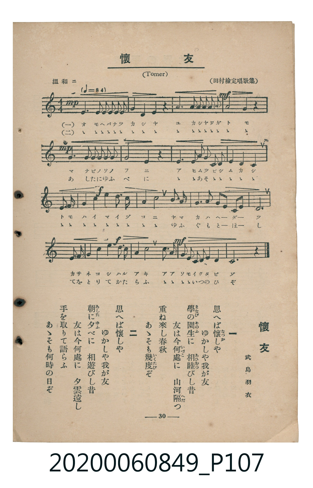

# 懷友

<audio controls src="kaiyu.mp3"></audio>

- 詞：武島羽衣
- 曲：Tomer
- 臺灣教育會公認《新定兒童唱歌》高等科女子用（2020.006.0849）

## 說明

原書資訊與歌詞全文（對應 P107.jpg，書頁 p. 30，高二第三學期第 5 首）：
調性與拍號：ハ長調（無升降記號）、4/4 拍（溫和ニ ♩=84）
出處註記：（田村檢定唱歌集）

## 跨冊／重複收錄參照

> 同曲（〈懷友〉；收錄於《新定兒童唱歌》高等科女子用與《唱歌帖》P206《小公學校唱歌教材集》抄譜）

- **[同曲]** 楊金土手抄《唱歌帖》第 10 冊・X（2020.006.0843）：[**〈懐友 (懷友)〉**](../../../shokacho/vol_10/p206_kaiyu/index.md)（`F` / `4/4` — [原始 TMD](../../../shokacho/vol_10/p206_kaiyu/kaiyu.tmd)）
- 總表：[跨冊重複與同名歌曲總索引](../../../duplicate_songs.md)

## 歌詞

```text
一
思へば懷（なつか）しや　ゆかしや我が友
學（まなび）の園生（そのふ）に　相睦（あひむつ）びし昔
友は今何處（いづこ）に　山河隔（へだ）つ
重ね來し春秋　あゝそも幾度（いくたび）ぞ

二
思へば懷しや　ゆかしや我が友
朝（あした）に夕（ゆふ）べに　相遊びし昔
友は今何處に　夕雲遠し
手を取りて語らふ　あゝそも何時の日ぞ
```

## ABC

```abc
X:1
T:懷友
C:曲：Tomer
M:4/4
L:1/16
Q:1/4=84
K:C
V:V1 name="Piano" snm="Pia"
[V:V1]
!mp! E4 E2 E2 E2 E2 E2 E2 | G3 A G4 E4 z4 | C4 C2 C2 C2 C2 C2 C2 | !mf! E8 D4 z4 |
!mp! E4 E2 E2 E2 E2 E2 E2 | G8 E4 z4 | C4 E2 G2 c3 B c2 A2 | G4 E4 C6 z2 |
!f! E3 F G2 c2 d3 c B2 A2 | G4 c4 c6 z2 | B3 A G2 G2 G4 F2 D2 | E14 z2 |
!f! E3 D C2 D2 E4 c3 A | G4 E4 D6 z2 | !mf! F3 G A2 F2 E2 C2 D3 C | C12 z4 |
```

## TMD 檔案連結

- [主旋律 TMD 檔案](kaiyu.tmd) [[在 TMD Studio 編輯](https://tmdlang.github.io/Tmd-TS/#tmd=s7IKdvYPcrWy4tLSUnjWvv1pf7eClhaXoq2ChQmXva2CM5eNib6JHVedgtKLlfPe75n1bO2yp5u3Pd-398XCxUog4WezNwGFQ_JzU4vA_Bftu543Ln42deaLpk3P5jQ_bV3zYlXv44auZ9M2PF0362nrpOerlz6dsvHZ2p7HDd0vV894vrbz-fKJT5dufrp2wvMpK97v6TAyMDLQMzAw0zOwMLF8v6dTiYtLX0vBllqAS0FB4Wnf_Gezd7zY3P5iRdeLjnagY4C-e9q64tm0dqADnm7ofdbeqRBgaGCul1WQ_n5PD1DxywWNCgV6CsYGQC7Q2U929Txfs-bJjs6na3c8mzMfyFYwVXi5bBrQvcDgANnxYtX-Zw3LQaZ3976YOR8o-ri5_-XU7UBxoB3PWxY-7W1_ObP3xYoZYNnOxw2NwKBWAKoGSj_btfrppJ7Hzd0Kj2autLUwAcqD3d2-68XMqS9W7AbqAhoIMmfKhmdzJz5btQgUuOBgfTm7DaQapPzJjgYQ9axh7uPGHY8bNwAjGKjlceOqx41LHjd2gyxtnP64qeVxQ8PjpjagCIT7rGPi48YeYFIAW7l2B1jPPrC2zWA9657OmfR8CtDRQHGg0eseN24Fi68GGvR89o7nc5eBpZoeN2563NQAtAwsuxlo-rMZU8CG9gOtWv9kd9eTvVOBHgKrbnncuPRx42S4QU83bny2afPLWVPAskDnLwBLLQHpf9ne-7hx7ZN9QDcDjVz6fHk3yAtAC5uAzpn7uKnp6c59T3dBXAE0t_9x43yY2-dBQmZXD3rIEA6KZ3Pmwvw1HWgixKVPl4CdD9IDCYSd8HB42diFz9dQby6Z-nL2ppeNC4DqwJZ0dj9umvS0f9rjJqDuZS9WzXvcBDR1K5oHgUY8mwl0yLpn04GhNg-kk_KsAQUKWvpcXL6JmXlWAZmJefkONQY1CtUgGxRsDM207MAsYI4Ep_-GFwt7QOpBYkBVuQW1CsYKumAIorHhGmBOAcmbQWmIKAgaQOkaBUMoC0RjwyCr0hBWwaARukHgyIY5dlcP-Y5FQNyOBcmAVBvGgbnmEIYZiikw3TA9MJNQXbqjE8WlEE0mCMOrgX43gtgC5Jtj2AJ1ARIDbg9YNSzwYRhiPCT8YNZhhxhufTp7Nha3GoE9CDIOZhjIyVDXmGEJD1jMIdwJcg_IdeCIBnkPJABSDjMZxEIEPjaHgqOHq5aLS9dOAZSeFYC0MhcXAA)]
- [鋼琴伴奏 TMD 檔案](kaiyu_piano.tmd) [[在 TMD Studio 編輯](https://tmdlang.github.io/Tmd-TS/#tmd=s7IKdvYPcrWy4tLSUnjWvv1pf_f7PR0vu_c8n7DlyZ4tT5f2P-_seL-nU0FLi0vRVsHChMveVsGZy8ZE38SOq05B6cXKee_3zHq2dtnTzdue79v7YuFiJZDws9mbgMIh-bmpRWD-i_ZdzxsXP5s680XTpmdzmp-2rnmxqvdxQ9ezaRuerpv1tHXS89VLn07Z-Gxtz-OG7perZzxf2_l8-cSnSzc_XTvh-ZQVQCcZGRgZ6BkYmOkZWJhYAh2kxMXlm5iZZxWQmZiXH-ThUGNQo1DNpQAENoZmWnZglr6WwvM1a57saHixsEdBSx8sBlSVW1CrYKygC4YgGhuuUTAFy5tBaYgoCBpA6RoFQygLRGPDIKvSEFbBoBG6QVzIjt3VQ75jERC3Y0EyINWGcWCuOYRhhmIKTDdMD8wkVJfu6ERxKUSTCcLwaqDfjSC2APnmGLZAXYDEgNsDVg0LfBiGGA8JP5h12CGGW5_Ono3FrUZgD4KMgxkGcjLUNWZYwgMWcwh3gtwDch04okHeAwmAlMNMBrEQgY_NoeDo4apFTs4-KMnZBH9qBqYPw3iFaMNYGAW0Ds43ALkxHsg1iY9FMKDJCqrMFCgMVIc3FRK0BMpDsgJkLEIBvpQD1QsKfLAmU7B-VPPhErhU4ItuJAuQHIjqfUgUwqVxWgOMKF07BVBcKQBpZS4uAA)]

## 分析

```text
================================================================================
📊 TMD Song Profile: [ 懷友 ]
================================================================================
⏱  Duration:       0:45 (45.7s), 16 measures total
🎼 Key & Tempo:    首調基準 C, != 84.0 BPM, <4/4>
   - 分析範圍：      由實際發聲的音符與和弦推測調性；播放脈絡另行呈現
🎤 人聲音域:    C4 (MIDI 60) – D5 (MIDI 74) [跨度: 14 個半音 / 1.2 個八度, 難度: moderate]
   - 最低音:  C4 in [Main #1 @ m.3, 0:05]
   - 最高音: D5 in [Main #1 @ m.9, 0:24]
   - 適合: soprano, mezzo-soprano, contralto, tenor, baritone, bass
🏛  結構:      Main (45.7s)
⚡ 編曲密度:        Peak 1 軌道同時演奏
🗝  調性診斷：       C 調性不明確（純淨自然大調，未偵測到可信轉調）
   - 風格氣質:    純淨自然大調（陽光明朗、易唱易記，無明顯調外色彩）
   - 轉調歷程:    全曲維持單一推測調性（未偵測到可信轉調）
   - 核心骨幹音:  E, C, G, D, A
   - 調性數值:    C 調性不明確 [相關度: 0.80, 穩定度: Ambiguous, 自然音純度: 100.0%]
   - 候選調性 (K-S): C 大調 (0.80), E 小調 (0.78), A 小調 (0.53)
   - 五度圈歷程:   +0
   - 各段落調性細節:
     • [Main #1]: C 調性不明確 (r: 0.80, 自然音純度: 100.0%)

  [ 五度圈游移軌跡 ]
              [C ]*
         F            G  
      Bb               D  
      Eb               A  
         Ab           E  
            Db       B  
               F# 
     (* = active key center)

  [ 十二半音累積音高分佈 ]
     C  : ██████████████████        27.6%
     C# :                            0.0%
     D  : ██████                     9.1%
     D# :                            0.0%
     E  : ████████████████████████  36.2%
     F  : ██                         3.4%
     F# :                            0.0%
     G  : ███████████               17.2%
     G# :                            0.0%
     A  : ███                        3.9%
     A# :                            0.0%
     B  : ██                         2.6%
--------------------------------------------------------------------------------
Assignment 軌道音域：
  - Piano         : C4 – D5 (14 個半音 / 1.2 個八度, 77 個音符)
================================================================================
```


## 原書掃描頁




