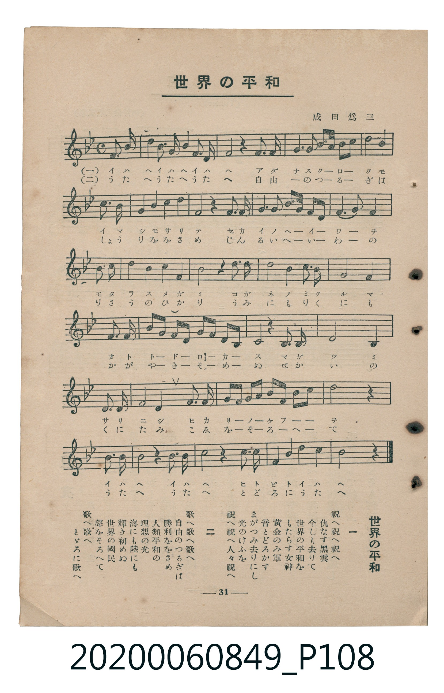

# 世界の平和

> Re:Shōka 使用 AI 協助辨識與重建樂譜，可能會有錯誤。歡迎回報。

- **鋼琴伴奏版**：<br><audio controls src="sekai_no_heiwa.mp3"></audio>
- **NEUTRINO 歌聲合成版**：<br><audio controls src="sekai_no_heiwa_neutrino.mp3"></audio>

- 曲：成田爲三
- 臺灣教育會公認《新定兒童唱歌》高等科女子用（2020.006.0849）

## 說明

原書資訊與歌詞全文（對應 P108.jpg，書頁 p. 31，高二第三學期第 6 首）：
調性與拍號：變ロ長調（2 降記號）、4/4 拍（每行皆以第 4 拍附點八分音符＋十六分音符弱起進入）
校勘註記：


## 歌詞

```text
1. 原譜將每行起首之第 4 拍弱起音獨立排於每行左端小節線前，並將上一行末尾記為 3 拍，合併後恰為完整 4/4 拍小節（全曲共弱起 + 22 小節）。
2. 第一段「黃金のみ車」於譜下假名作「コガネノミクルマ」，下方歌詞欄漢字誤植作「黃金のみ軍」；第二段首句譜下假名直接印漢字「自由ーの」。

一
祝へ祝へ祝へ　仇なす黑雲
今しも去りて　世界の平和を
もたらす女神　黃金のみ車
音とどろかす　まがつみ去りにし
光のけふを　祝へ祝へ人々祝へ

二
歌へ歌へ歌へ　自由のつるぎは
勝利ををさめ　人類平和の
理想の光　海にも陸にも
輝き初めぬ　世界の國民
聲をそろへて　歌へ歌へとどろに歌へ
```

## ABC

<div class="abc-score" data-abc-src="sekai_no_heiwa.abc" aria-label="五線譜載入中"></div>

[下載 ABC 原始檔](sekai_no_heiwa.abc)

## TMD 檔案連結

- [主旋律 TMD 檔案](sekai_no_heiwa.tmd) [[在 TMD Studio 編輯](https://tmdlang.github.io/Tmd-TS/#tmd=s7IKdvYPcrWy4qpTUCpJTLdSSM7PyUlNLsnMz7MqzsjMK0nNjM_KTMmPL87Iz05Ugisry88pzU21ys4vyY9PzyzKKY43MjAyiDcwMIs3sDCxRCgszi8tSk61Kk7OyM_PiS9JrShJys_PRpePL0hMT7UKMDSwQMgUFOWXpeYl5gF1FxSBXJIC1o5QkFqWmZIKki5OTsyLL0stykzLTE1BcmNqUTHYHxArSooS84qTizILQJ5DqMovKsnITy9KLMiotMrILC7JL8pMTsyJz07MQ_JuSUYq0LepufnoejPTM_OsShIzgcEDCqLyxPjcxMy8nMQ8oDu0tBSe7Jj2fGrP48Z1T3dufjqpR0FLi0vRVgHoTS57WwUnHS4bE30TO5Bxz2Zver9n1rOOCc-nbHjesenJjk6wLS_adz1vXPxs6swXTZuezWl-2rrmxarexw1dz6ZteLpu1tPWSc9XL306ZeOztT2PG7pfrp7xfG3n8-UTny7d_HQt0KQV7_d0gKJFDxgteqBoeb8HaCyXvpaCLbUAl4KCwtO--c9m73ixuf3Fiq4XHe1Ax7xYOe9p64pn09qBDni6ofdZe6cCKG71sgrS3-_pASp-uaBRoUBPwdgQyAU6-8munudr1gA9_XTtjmdz5gPZCmYKL5dNA7oXGCogO16s2v-sYTnI9O7eFzPnA0VfrOt63Lz25dTtQCmQPxVezux9sWIGWLLzcUMjMGQVgIqBUs_W979Y2PN8VtuT3UtBRoPFX85sebkb6MrVTzvaXs7f_HzNsvd7up_2Nj5tXQsXebpn44ut2182bHrauhRoKMgdzxYsfNo948WK3UCroE4z1AOFwIu1c55uaIdYBdK0bNqTnd1w26AmAU3tXfF8dfezvknPpu2BKH66fdnz1eufbuh_vr7h-fZZTzuBTu55smMZ0LQnO7qe7GgAqnk2Z_XTDfuAVj5v2qVgDPFWz9MJHU_2bn26r-dZ4wag-NN1Pc-mblGAehtiHij4gfEwG-iBjRAnKGgrGBkpwGSB4dQE8oKRngI4_Buerdv6uKHn5e7ml-0Tgan2ceP-F7u7Hjf0Al0L9OCTHd1PG9ufTuh9sncOUNnjps2Pm9Y8bu593Nz3uHn-46b1j5tXP26eB1QP9kL3s2k7IYnh2ZqWZ3sWPV07_cWqJc-WQLWj2gJM1UBds0HO2NUDdAYwAJ_2L0W29PnsLc_6lj7t3QAxCmjCi_ZVz6dsfNy8B2RIA9CEJi6Qb4D-AFHPl8593LgDmXzc0PBkd_vjxlWPG2e-3D3x5exNYOVAHzZOf9zU9LRv9-MmIHsZSB1qxn3cNAmkFKjocSPQo51AA4CZ7PlSoF8b0EILpA4Y0Y8bVzxuXPm4qfdxYzdQNVDd48Z9jxuBRi4BqoNZtRpoMzgLtQKNBBoANGYr0C6gamR3P9m163FDK4QN8eGuHnBiBGb7xh3IJFAjNFBApi153AS0u-9x43qwHd1zn3YAXTQJhBqnPm5qBPlz166XC-dBPdm4DhxuE9qeNQPdvw7kqIaGZ1u3g9zZ1PRy5g4IA5wf9wAd0_u0Yy7ImMY1KCE2p_vZholgRY2bwHYBFQGDAagbFLIozkUE0mqICEgb5aUSFCho6XNxBadmJ2b65XukZpYnWgVkJublO9ToGtZUg2xSsDE007IDs7AVitBMAcyAChrw7GMCzT068CJNE4tOoM0gU2sUDBR0wRCdNo0HU4ZAJcZQIUMwaRYPZcDVGMcDFUHZCIhmEJCqAelFKABzIEaZQ8w0AmKEdTAIsw0kC3YQ2OU-hjUKMNPQ6cdNSyB0cz_QvMfNM7CIYxdFVg2DCFMXQdU1gNV1Ial53LQTTK6HqtgDxGuhLJCfYDJIOpohpiHbPw_mNyM8fmtsg9LzQeY27sAijl0UWTWG3xohvn7c1AZWB9EFk1sHJmGuBPqtqRvZb4196H5rhPkWXHC1w51SAy4dcKflXT3gtExiEoanKtSUAkyYUJrC1AlkgpUB0zmGWWBlcBGIeiOkJPq4aTssKJAifCtcbBXciY-bkQMdJXKadkPp1eCkBIkImAmgwIclWkjkgOThkdOMnPAgoo-bN6G56XHTfqSkByz54TZPwmQ1TkW4uakRl5vhCWoyWB0owcBd0dgCJiGJEexmiAg8s_RjuhmcCCEmQlwHcgeh9LSjk5z0hFreIZITPJpr4FIwCEtOEK3GxJRiqMkNxXykRIlISM0r4QEAKmsgQbMQLrYG7jZgUwfNYERC2gxXDVLXi6YOkpggLIgZoHILpHI1hsp5cDMhSfhxcwdyEoKXIEgR1whPdo2w5ICc2DBcCy-7gIkTSGK4oakJzoIlCXAJjk8l1GZgQ4dQ4nk6ezY48RiTlnhA8YwoFMBFBhrXEFKMGOEqkqASQAqYitAVgTWDIFQGVPcipZEOkN-gmbwTib0WwQYWIshZDZaWMEIfGsOwtALKoChhCk9lsOIMVJghFyKILA1siSGx5yK5BVR8IOoRWBrGcEvjbCjdDVaH4RakNAYpOkBpgGBlM4Wc-MWoSeBRhKUqAbKhLGgLByyEu6kDSwIQpchNncfNyCUoJNgRNQukbIbWD9A6BdIIgWRoSL2wEcqeCk8WsDoCljExAh65aYSUudELGFAWhbEmQ3VOBCcvqMvAZTwo4mFu6UUSB9UDiESwDJdbkJsyBLJu61pyyn1chTo8NuA1AboKiDiw3kdvCiDaIDCtuK2B0ciRjrstSmSbFZY0QKUzkIREDoSPahLELJgbcZsIrwORkgPuViWxrc8VUHolONH0wsVhJTlyfQJLfPhMRLiylotL104BuZOlAOQrcwEA)]
- [鋼琴伴奏 TMD 檔案](sekai_no_heiwa_piano.tmd) [[在 TMD Studio 編輯](https://tmdlang.github.io/Tmd-TS/#tmd=s7IKdvYPcrWy4qpTUCpJTLdSSM7PyUlNLsnMz7MqzsjMK0nNjM_KTMmPL87Iz05Ugisry88pzU21ys4vyY9PzyzKKY43MjAyiDcwMIs3sDCxRCgszi8tSk61Kk7OyM_PiS9JrShJys_PRpePL0hMT7UKMDSwQMgUFOWXpeYl5gF1FxSBXJIC1o5QkFqWmZIKki5OTsyLL0stykzLTE1BcmNqUTHYHxArSooS84qTizILQJ5DqMovKsnITy9KLMiotMrILC7JL8pMTsyJz07MQ_JuYhFQc3pqbmpeiVVBZmJefnxicnJ-bkFiXiZIDKGwJAOoyCo1Nx_dksz0zDyrksRMYDiCwrI8MT43MTMvJzEP6GAtLYUnO6Y9n9rzuHHd052bn07qeb-n42X3nucTtjzZs-Xp0v7nnR3v93QqaGlxKdoqAAOJy95WwUmHy8ZE38QOZMez2Zve75n1rGPC8ykbnndserKjE2z1i_ZdzxsXP5s680XTpmdzmp-2rnmxqvdxQ9ezaRuerpv1tHXS89VLn07Z-Gxtz-OG7perZzxf2_l8-cSnSzc_XQs0aQXQEaBI1QNGqh4oUoFOUOLiCk7NTsz0y_dIzSxPtAoAhUWQh0ONrmFNNZcCENgYmmnZgVn6Wgq26EDh-Zo1T3Y0vFjYo6DxdM_GF1u3K2grmCg83dD_fH2DjgIoAehlFaRrYtGppQ82tUbBQEEXDNFp03gwZQhUYgwVMgSTZvFQBlyNcTxQEZSNgGgGAakakF6EAjAHYpQ5xEwjIEZYB4Mw20CyYAeBXe5jWKMAMw2dfty0BEI39wPNe9w8A4s4dlFk1TCIMHURVF0DWF0XkprHTTvB5Hqoij1AvBbKAvkJJoOkoxliGrL982B-M8Ljt8Y2KD0fZG7jDizi2EWRVWP4rRHi68dNbWB1EF0wuXVgEuZKoN-aupH91tiH7rdGmG8fN05_3NQOd0oNF_60vKsHnJZJTMLwVIWaUoAJE0pTmDqBTLAyYDrHMAusDC4CUW-ElEQfN22HBQVShG-Fi62CO_FxM3Kgo0RO024ovRqclCARATMBFPiwRAuJHJA8PHKakRMeRPRx8yY0Nz1u2o-U9B43wZL246ZJmKzGqQg3NzXicjM8QU0GqwMlGLgrGlvAJCQxgt0MEYFnln5MN4MTIcREiOtA7iCUnnZ0kpOeUMs7RHKCR3MNXAoGYckJotWYmFIMNbmhmI-UKBEJqXklPABAZQ0kaBbCxdbA3fa4eT6awYiEtBmuGqSuF00dJDFBWBAzQOUWSOVqDJXz4GZCkvDj5g7kJAQvQZAirhGe7BphyQE5sWG4Fl52ARMnkMRwQ1MTnAVLEuASHJ9KqM2PG3sIJZ6ns2eDE48xaYkHFM-IQgFcZKBxDSHFiBGuIgkqAaSAqQhdEVgzCEJlQHUvUhrpAPkNmsk7kdhrEWxgIYKc1WBpCSP0oTEMSyugDIoSpvBUBivOQIUZciGCyNKPG3uR2HOR3AIqPhD1CCwNY7ilcTaU7garw3ALUhqDFB2gNECwsplCTvxi1CTwKMJSlQDZUBa0hQMWwt3UgSUBiFLkps7jZuQSFBLsiJoFUjZD6wdonQJphEAyNKRe2AhlT4UnC1gdAcuYGAGP3DRCytzoBQwoi8JYk6E6J4KTF9Rl4DIeFPEwt_QiiYPqAUQiWIbLLchNGQJZt3UtOeU-rkIdHhvwmgBdBUQcWO-jNwUQbRCYVtzWwGjkSMfdFiWyzQpLGqDSGUhCIgfCRzUJYhbMjbhNhNeBSMkBd6uS2NbnCii9EpxoeuHisJIcuT6BJT58JiJcWYutj-WD0scyIa6LhSflGEAhMHKB2RuGQKkhXiHaND4WKmkC4poAuSBxEAarjzaMBVFABUS1jvE4A2Q-0CSQyXitR3YeSBBEE7Ye0pjCYz3EWAy_wQMG6lGIJJJbCVoNrYoJWg01E8PjJAUyuFbAYxXcbIhxYEuRPIPqbaLKKfz-QgQhmq-g0YzdXmCy17VTQE750T5ASQwxI7CYMhcA)]

## 分析

```text
================================================================================
📊 TMD Song Profile: [ 世界の平和 ]
================================================================================
⏱  Duration:       0:48 (48.9s), 22 measures total
🎼 Key & Tempo:    首調基準 B,, != 108.0 BPM, <4/4>
   - 分析範圍：      由實際發聲的音符與和弦推測調性；播放脈絡另行呈現
🎤 人聲音域:    A#3 (MIDI 58) – D5 (MIDI 74) [跨度: 16 個半音 / 1.3 個八度, 難度: moderate]
   - 最低音:  A#3 in [SekaiNoHeiwa #1 @ m.14, 0:30]
   - 最高音: D5 in [SekaiNoHeiwa #1 @ m.2, 0:02]
   - 適合: soprano, mezzo-soprano, contralto, tenor, baritone, bass
🏛  結構:      SekaiNoHeiwa (48.9s)
⚡ 編曲密度:        Peak 1 軌道同時演奏
🗝  調性診斷：       A# 大調（純淨自然大調，未偵測到可信轉調）
   - 風格氣質:    純淨自然大調（陽光明朗、易唱易記，無明顯調外色彩）
   - 轉調歷程:    全曲維持單一推測調性（未偵測到可信轉調）
   - 核心骨幹音:  A#, F, D, C, G
   - 調性數值:    A# 大調 [相關度: 0.88, 穩定度: High, 自然音純度: 100.0%]
   - 候選調性 (K-S): A# 大調 (0.88), F 大調 (0.73), D 小調 (0.66)
   - 五度圈歷程:   -2
   - 各段落調性細節:
     • [SekaiNoHeiwa #1]: A# 大調 (r: 0.87, 自然音純度: 100.0%)

  [ 五度圈游移軌跡 ]
               C  
         F            G  
     [Bb]*              D  
      Eb               A  
         Ab           E  
            Db       B  
               F# 
     (* = active key center)

  [ 十二半音累積音高分佈 ]
     C  : █████████████             14.7%
     C# :                            0.0%
     D  : ███████████████████       20.9%
     D# :                            0.0%
     E  :                            0.0%
     F  : █████████████████████     23.7%
     F# :                            0.0%
     G  : ████████████              13.1%
     G# :                            0.0%
     A  : █                          0.6%
     A# : ████████████████████████  26.9%
     B  :                            0.0%
--------------------------------------------------------------------------------
Assignment 軌道音域：
  - Piano         : A#3 – D5 (16 個半音 / 1.3 個八度, 95 個音符)
================================================================================
```


## 原書掃描頁




