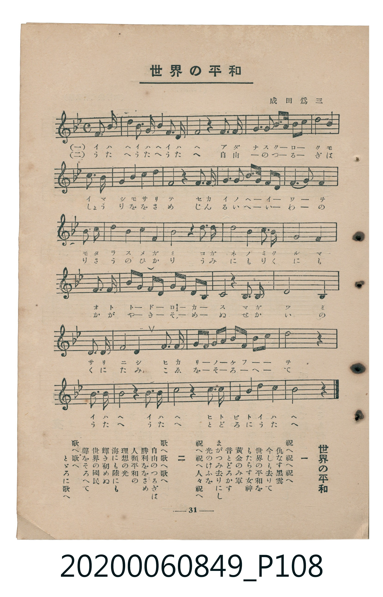

# 世界の平和

<audio controls src="sekai_no_heiwa.mp3"></audio>

- 曲：成田爲三
- 臺灣教育會公認《新定兒童唱歌》高等科女子用（2020.006.0849）

## 說明

原書資訊與歌詞全文（對應 P108.jpg，書頁 p. 31，高二第三學期第 6 首）：
調性與拍號：變ロ長調（2 降記號）、4/4 拍（弱起第 4 拍進入）

## 歌詞

```text
一
祝へ祝へ祝へ　仇なす黑雲
今しも去りて　世界の平和を
もたらす女神　黃金のみ車
音とどろかす　まがつみ去りにし
光のけふを　祝へ祝へ人々祝へ

二
歌へ歌へ歌へ　自由のつるぎは
勝利ををさめ　人類平和の
理想の光　海にも陸にも
輝き初めぬ　世界の國民
聲をそろへて　歌へ歌へとどろに歌へ
```

## ABC

```abc
X:1
T:世界の平和
C:曲：成田爲三
M:4/4
L:1/16
Q:1/4=108
K:Bb
V:V1 name="Piano" snm="Pia"
[V:V1]
!mf! z4 z4 z4 F2 B2 | c4 F2 c2 d4 F2 d2 | e4 z4 z4 d2 c2 | B3 c d2 f2 c4 d4 |
f12 F2 B2 | c4 F2 c2 d4 c2 d2 | e4 z4 z4 c2 d2 | e3 e e2 A2 d4 c4 |
B8 F4 F2 f2 | f4 d4 B4 c2 d2 | c12 z4 | G4 A4 B4 G4 |
c4 B4 G4 E4 | F4 B4 A3 B c4 | _d3 c B2 A2 B4 G4 | F8 z4 G2 F2 |
D8 =E4 C4 | F4 F2 G2 A4 A2 B2 | c8 F4 c2 c2 | !f! g3 f e2 c2 B4 A4 |
B12 z4 | z4 F2 B2 c8 | z4 G2 c2 d8 | z4 f2 d2 B4 c2 A2 |
B12 z4 |
```

## TMD 檔案連結

- [主旋律 TMD 檔案](sekai_no_heiwa.tmd)
- [鋼琴伴奏 TMD 檔案](sekai_no_heiwa_piano.tmd)

## 分析

```text
================================================================================
📊 TMD Song Profile: [ 世界の平和 ]
================================================================================
⏱  Duration:       0:55 (55.6s), 25 measures total
🎼 Key & Tempo:    首調基準 B,, != 108.0 BPM, <4/4>
   - 分析範圍：      由實際發聲的音符與和弦推測調性；播放脈絡另行呈現
🎤 人聲音域:    C4 (MIDI 60) – G5 (MIDI 79) [跨度: 19 個半音 / 1.6 個八度, 難度: challenging]
   - 最低音:  C4 in [Main #1 @ m.17, 0:37]
   - 最高音: G5 in [Main #1 @ m.20, 0:42]
   - 適合: soprano, mezzo-soprano, tenor, baritone
🏛  結構:      Main (55.6s)
⚡ 編曲密度:        Peak 1 軌道同時演奏
🗝  調性診斷：       F 調性不明確（流行色彩大調，未偵測到可信轉調）
   - 風格氣質:    流行大調（略帶和弦色彩音與裝飾副屬和弦）
   - 轉調歷程:    全曲維持單一推測調性（未偵測到可信轉調）
   - 核心骨幹音:  C, A#, F, D, G
   - 調性數值:    F 調性不明確 [相關度: 0.83, 穩定度: Ambiguous, 自然音純度: 93.3%]
   - 候選調性 (K-S): F 大調 (0.83), A# 大調 (0.82), D 小調 (0.56)
   - 五度圈歷程:   -1
   - 各段落調性細節:
     • [Main #1]: F 調性不明確 (r: 0.83, 自然音純度: 93.3%, 調外音: C#, D#)

  [ 五度圈游移軌跡 ]
               C  
        [F ]*          G  
      Bb               D  
      Eb               A  
         Ab           E  
            Db       B  
               F# 
     (* = active key center)

  [ 十二半音累積音高分佈 ]
     C  : ████████████████████████  23.3%
     C# : █                          0.9%
     D  : ███████████████           14.5%
     D# : ██████                     5.8%
     E  : █                          1.2%
     F  : ████████████████████      18.9%
     F# :                            0.0%
     G  : ████████                   7.3%
     G# :                            0.0%
     A  : ███████                    6.7%
     A# : ██████████████████████    21.5%
     B  :                            0.0%
--------------------------------------------------------------------------------
Assignment 軌道音域：
  - Piano         : C4 – G5 (19 個半音 / 1.6 個八度, 99 個音符)
================================================================================
```


## 原書掃描頁




