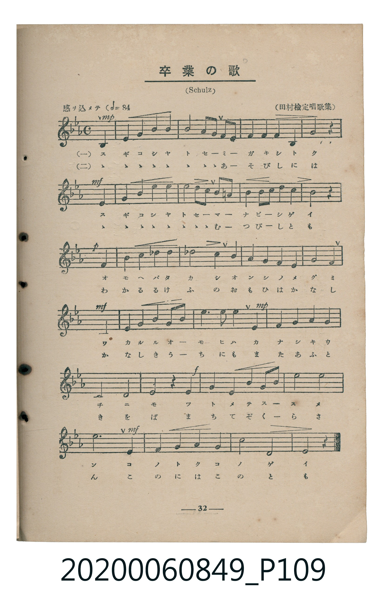
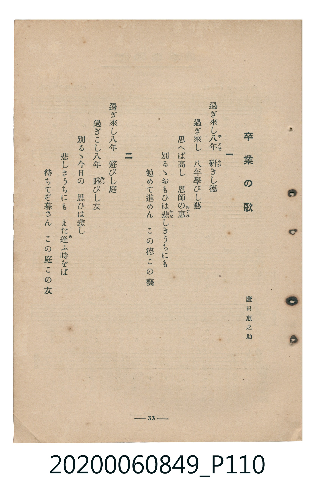

# 卒業の歌

<audio controls src="sotsugyo_no_uta.mp3"></audio>

- 詞：蘆田惠之助
- 曲：Schulz
- 臺灣教育會公認《新定兒童唱歌》高等科女子用（2020.006.0849）

## 說明

原書資訊與歌詞全文（對應 P109–P110.jpg，書頁 pp. 32–33，高二第三學期第 7 首）：
調性與拍號：變ホ長調（3 降記號）、4/4 拍（感ヲ込メテ ♩=84，弱起第 4 拍進入）
出處註記：（田村檢定唱歌集）

## 跨冊／重複收錄參照

> 同曲（蘆田惠之助作詞、Schulz 作曲〈卒業の歌〉；收錄於《新定兒童唱歌》高等科女子用與《唱歌帖》P201）

- **[同曲]** 楊金土手抄《唱歌帖》第 10 冊・X（2020.006.0843）：[**〈卒業の歌 (畢業之歌)〉**](../../../shokacho/vol_10/p201_sotsugyo_no_uta/index.md)（`E,` / `4/4` — [原始 TMD](../../../shokacho/vol_10/p201_sotsugyo_no_uta/sotsugyo_no_uta.tmd)）
- 總表：[跨冊重複與同名歌曲總索引](../../../duplicate_songs.md)

## 歌詞

```text
一
過ぎ來し八年（やとせ）　研（みが）きし德
過ぎ來し　八年學びし藝
思へば高し　恩師の惠（めぐみ）
別るゝおもひは悲（かな）しきうちにも
勉めて進めん　この德この藝

二
過ぎ來し八年　遊びし庭
過ぎこし八年　睦（むつ）びし友
別るゝ今日の　思ひは悲し
悲しきうちにも　また逢（あ）ふ時をば
待ちてぞ暮さん　この庭この友
```

## ABC

```abc
X:1
T:卒業の歌
C:曲：Schulz
M:4/4
L:1/16
Q:1/4=84
K:Eb
V:V1 name="Piano" snm="Pia"
[V:V1]
!mp! z4 z4 z4 B,4 | E4 F4 G4 A4 | B8 c2 B2 A2 G2 | F4 G4 A4 F4 |
!mf! G8 z4 B,4 | E4 F4 G4 A4 | B8 c2 B2 =A2 G2 | F4 G2 =A2 B4 A4 |
!p! B8 z4 B,4 | F4 F4 A4 A4 | A8 G4 B4 | B4 A4 G4 F4 |
!mf! F4 E8 B,4 | E4 G4 B4 c2 d2 | !mp! e6 d2 e4 B4 | c4 B4 A4 G4 |
E8 F8 | !f! G4 z4 B8 | G4 B4 c4 d2 e2 | d8 f8 |
!mf! e12 B,4 | E4 F4 G4 A4 | B8 B,8 | E12 z4 |
```

## TMD 檔案連結

- [主旋律 TMD 檔案](sotsugyo_no_uta.tmd) [[在 TMD Studio 編輯](https://tmdlang.github.io/Tmd-TS/#tmd=s7IKdvYPcrWy4qpTUCpJTLdSSM7PyUlNLsnMz7MqzsjMK0nNjM_KTMmPL87Iz05Ugisry88pzU21ys4vyY9PzyzKKY43MjAyiDcwMIs3sDCxRCgszi8tSk61Kk7OyM_PiS9JrShJys_PRsgXFOWXpeYl5gHVFBSB7EsBK0IoSC3LTEkFSaemZJbkF2Um5iC5IrWoGOxSsCXxJUWJecXJRZkFIOcjVJVkpAKdCnVBTmZaKrpUWmpxSWYZssEQ8eTUotTc_DywlVpaCk97Jz1buvZx47pna3sUtLS4FG0VLEy47G0VXHW4bEz0TexA2l-snPd-z6wXM9qeT9nwrHnBk53dT7tWgg1-NnsTUCY4OaM0pwos8KJ91_PGxc-mznzRtOnZnOanrWterOp93ND1bNqGp-tmPW2d9Hz10qdTNgJte9zQ_XL1jOdrO58vn_h06eanayc8n7Li_Z4OUJjrAcNcDxTm7_d0KnFx6Wsp2FILcCkoKDztm_9s9o4Xm9tfrOh60dEOdAzQh09bVzyb1g50wNMNvc_aOxUCDA0sHzVMDjA0NNDLKkh_v6cHqOflgkaFggI9BWMjoJSxMVAQ6Icnu3qer1nzZEfn07U7ns2ZD2QrmCu8XDYN6Hhg4IAsfLFq_7OG5SCruntfzJwPCsx1XY-bZ7-cuh0oBbTTWOHlzN4XK2aAJTsfNzQCg14BqBgo9axl_uPmTS_27XncvPBxc5vCo5krbS1MgDY_3bPxxdbtINvASl82bHrauhSoG-zD9l0vZk59sWI30EygbUBjQFE3d-KzVYtA0QCOgJez20CqQcqf7GgAUS8b-x439j3Z1_a4cfrT1tVPd24Banzc1PK4ccXjxtlghzU8XzAFJNi4_3FjD0iksRekeN92dP1ApRAjgIHyuHEzUOTF9LkgRc8a5j5uBAptAIYcRN2zxpVPd6wGpcHmBWALGx83TgDaAPNLx9LHTd2Pm4Dauh43NT1u3PS4cf2zJmDCAzqj-3HjKrAzpoNdArR54ePG1UBlYJ3dnWDDlgHDBsRomgy07XHjZKBVQBdDGCBXgYNgVw_2IABqeQm0GOyFp7vWIhSB9SMUPZ-7DOx4oAVLwC4Ca-jvRvHCk91dz6YvBVoL8jYoIKB-ASoFhw2YheYTsJv3PW6c_7JhEdjPTWDjtz6b2fS4aRIwIME27GsFa1j2uHHes1nrHjdORfHtLmAWBzMg7qE8G0GBgpY-F5dvYmaeVUBmYl6-Q41BjUI1yAYFG0MzLTswC5h7IUn16Yb-5-sbQFpAwjUKBgq6YIhOV-cW1CqYxkN5NeDoAZkCzmQNLxYCCyqYEYZQRUZQ2hhKm8A0K5hCWTBoBsQgMZAKkOoanHph4jVwGRhEODQNp0N39VDLoepYXQoWhukBc7AbA3crnjDtRHEqzBYYDXMiwqkwFgzCPAOzG-EKmEqYCkSYwliwgIFBPGH6dPZsrGGKbj0o5MzBlhjGIZkMEoILQNIY3DUgLchGoLsbLW6nYHUHDMK8BoOIBASPDJAfcapC9geKw2vATBSrkD2IGWCta1Ediq4aBtECnYzUCteM8A56sMAgLBBquGq5uHTtFEDFhwKQVubiAgA)]
- [鋼琴伴奏 TMD 檔案](sotsugyo_no_uta_piano.tmd) [[在 TMD Studio 編輯](https://tmdlang.github.io/Tmd-TS/#tmd=s7IKdvYPcrWy4tLSUnjaO-nZ0rWPG9c9W9vzfk_Hy-49zydsebJny9Ol_c87O97v6VTQ0uJStFWwMOGyt1Vw1eGyMdE3seOqU1B6sXLe-z2zXsxoez5lw7PmBU92dj_tWqkEknk2exNQJjg5ozSnCizwon3X88bFz6bOfNG06dmc5qeta16s6n3c0PVs2oan62Y9bZ30fPXSp1M2Ap3wuKH75eoZz9d2Pl8-8enSzU_XTng-ZQXQXUYGRgZ6BgZmegYWJpZAVylxcfkmZuZZBWQm5uUHeTjUGNQoVHMpAIGNoZmWHZilD_Tdno0vtm5_uqH_-foGBS19sHCNgoGCLhii09W5BbUKpvFQXg0XzJTna9Y82dHwYmEPwghDqCIjKG0MpU1gmhVMoSwYNANikBhIBUh1DU69MPEauAwMIhyahtOhu3qo5VB1rC4FC8P0gDnYjYG7FU-YdqI4FWYLjIY5EeFUGAsGYZ6B2Y1wBUwlTAUiTGEsWMDAIJ4wfTp7NtYwRbceFHLmYEsM45BMBgnBBSBpDO4akBZkI9DdjRa3U7C6AwZhXoNBRAKCRwbIjzhVIfsDxeE1YCaKVcgexAyw1rWoDkVXDYNogU5GaoVrRngHPVhgEBYINVy1yKWHD0rpYUK48IBAvMUDKNEbxitEG8bCKKCzIAyTeJiAKYhlGh-LYMAVASl0G9DyNTgd4bDCDGSeWXwuSMgIyDQCGg2j0azF8AdqloRkXnzOJMMr6NkJq1fAwWQCNAi3CL6sAVeM6iADSA7AcCRcOVav4E3ayL5E8Qq6mUAhnKEDTJC6dgqgNKkApJW5uAA)]

## 分析

```text
================================================================================
📊 TMD Song Profile: [ 卒業の歌 ]
================================================================================
⏱  Duration:       1:08 (68.6s), 24 measures total
🎼 Key & Tempo:    首調基準 E,, != 84.0 BPM, <4/4>
   - 分析範圍：      由實際發聲的音符與和弦推測調性；播放脈絡另行呈現
🎤 人聲音域:    A#3 (MIDI 58) – F5 (MIDI 77) [跨度: 19 個半音 / 1.6 個八度, 難度: challenging]
   - 最低音:  A#3 in [Main #1 @ m.1, 0:02]
   - 最高音: F5 in [Main #1 @ m.20, 0:55]
   - 適合: soprano, mezzo-soprano, contralto, tenor, baritone, bass
🏛  結構:      Main (68.6s)
⚡ 編曲密度:        Peak 1 軌道同時演奏
🗝  調性診斷：       D# 大調（純淨自然大調，未偵測到可信轉調）
   - 風格氣質:    純淨自然大調（陽光明朗、易唱易記，無明顯調外色彩）
   - 轉調歷程:    全曲維持單一推測調性（未偵測到可信轉調）
   - 核心骨幹音:  A#, D#, F, G, G#
   - 調性數值:    D# 大調 [相關度: 0.88, 穩定度: Moderate, 自然音純度: 97.8%]
   - 候選調性 (K-S): D# 大調 (0.88), A# 大調 (0.80), G 小調 (0.62)
   - 五度圈歷程:   -3
   - 各段落調性細節:
     • [Main #1]: D# 大調 (r: 0.88, 自然音純度: 97.8%, 調外音: A)

  [ 五度圈游移軌跡 ]
               C  
         F            G  
      Bb               D  
     [Eb]*              A  
         Ab           E  
            Db       B  
               F# 
     (* = active key center)

  [ 十二半音累積音高分佈 ]
     C  : ███                        3.9%
     C# :                            0.0%
     D  : ███                        3.9%
     D# : ████████████████          19.1%
     E  :                            0.0%
     F  : █████████████             15.7%
     F# :                            0.0%
     G  : █████████████             15.2%
     G# : ██████████                11.8%
     A  : ██                         2.2%
     A# : ████████████████████████  28.1%
     B  :                            0.0%
--------------------------------------------------------------------------------
Assignment 軌道音域：
  - Piano         : A#3 – F5 (19 個半音 / 1.6 個八度, 79 個音符)
================================================================================
```


## 原書掃描頁






