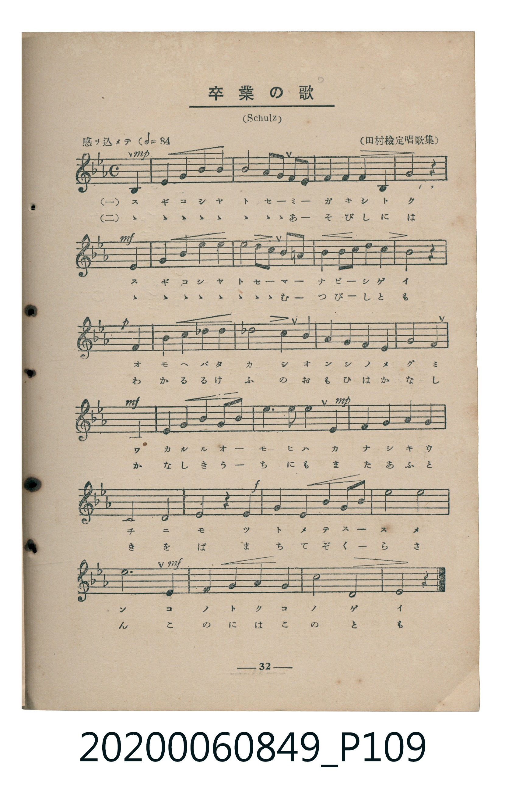
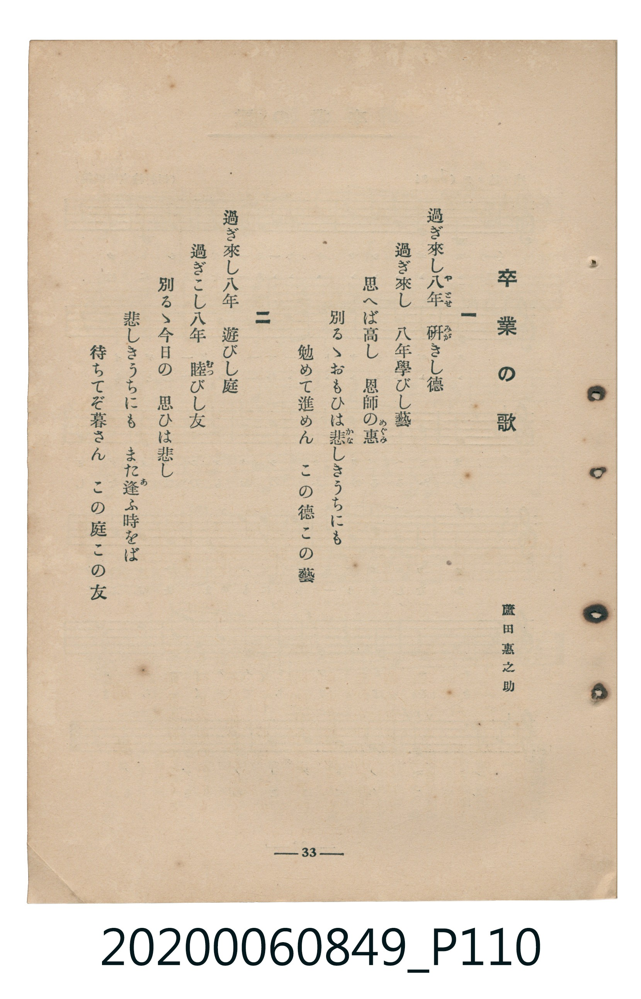

# 卒業の歌

> Re:Shōka 使用 AI 協助辨識與重建樂譜，可能會有錯誤。歡迎回報。

- **鋼琴伴奏版**：<br><audio controls src="sotsugyo_no_uta.mp3"></audio>

- 詞：蘆田惠之助
- 曲：Schulz
- 臺灣教育會公認《新定兒童唱歌》高等科女子用（2020.006.0849）

## 說明

原書資訊與歌詞全文（對應 P109–P110.jpg，書頁 pp. 32–33，高二第三學期第 7 首）：
調性與拍號：變ホ長調（3 降記號）、4/4 拍（感ヲ込メテ ♩=84，弱起第 4 拍進入）
出處註記：（田村檢定唱歌集）


## 歌詞

```text
一
過ぎ來し八年（やとせ）　研（みが）きし德
過ぎ來し　八年學びし藝
思へば高し　恩師の惠（めぐみ）
別るゝおもひは悲（かな）しきうちにも
勉めて進めん　この德この藝

二
過ぎ來し八年　遊びし庭
過ぎこし八年　睦（むつ）びし友
別るゝ今日の　思ひは悲し
悲しきうちにも　また逢（あ）ふ時をば
待ちてぞ暮さん　この庭この友
```

## ABC

<div class="abc-score" data-abc-src="sotsugyo_no_uta.abc" aria-label="五線譜載入中"></div>

[下載 ABC 原始檔](sotsugyo_no_uta.abc)

## TMD 檔案連結

- [主旋律 TMD 檔案](sotsugyo_no_uta.tmd) [[在 TMD Studio 編輯](https://tmdlang.github.io/Tmd-TS/#tmd=s7IKdvYPcrWy4qpTUCpJTLdSSM7PyUlNLsnMz7MqzsjMK0nNjM_KTMmPL87Iz05Ugisry88pzU21ys4vyY9PzyzKKY43MjAyiDcwMIs3sDCxRCgszi8tSk61Kk7OyM_PiS9JrShJys_PRsgXFOWXpeYl5gHVFBSB7EsBK0IoSC3LTEkFSaemZJbkF2Um5iC5IrWoGOxSsCXxJUWJecXJRZkFIOcjVJVkpAKdCnVBTmZaKrpUWmpxSWYZssEQ8eTUotTc_DwUK4EuSM_Ms8pNzczKxOIdqHQ50MTUorz43NSc_JRKJS4tLYWnvZOeLV37uHHds7U9ClpaXIq2ChYmXPa2Cq46XDYm-iZ2IDNerJz3fs-sFzPank_Z8Kx5wZOd3U-7VoJNfzZ7E1AmODmjNKcKLPCifdfzxsXPps580bTp2Zzmp61rXqzqfdzQ9WzahqfrZj1tnfR89dKnUzYCbXvc0P1y9YznazufL5_4dOnmp2snPJ-y4v2eDlCM6QFjTA8UY-_3dCpxcelrKdhSC3ApKCg87Zv_bPaOF5vbX6zoetHRDnQM0IdPW1c8m9YOdMDTDb3P2jsVAgwNLB81TA4wNDTQyypIf7-nB6jn5YJGhYICPQVjI6CUsTFQEOiHJ7t6nq9Z82RH59O1O57NmQ9kK5grvFw2Deh4YOCALHyxav-zhuUgq7p7X8ycDwrMdV2Pm2e_nLodKAW001jh5czeFytmgCU7Hzc0AoNeAagYKPWsZf7j5k0v9u153LzwcXObwqOZK20tTIA2P92z8cXW7SDbwEpfNmx62roUqBvsw_ZdL2ZOfbFiN9BMoG1AY0BRN3fis1WLQNEAjoCXs9tAqkHKn-xoAFEvG_seN_Y92df2uHH609bVT3duAWp83NTyuHHF48bZYIc1PF8wBSTYuP9xYw9IpLEXpHjfdnT9QKUQI4CB8rhxM1DkxfS5IEXPGuY-bgQKbQCGHETds8aVT3esBqXB5gVgCxsfN04A2gDzS8fSx03dj5uA2roeNzU9btz0uHH9syZgwgM6o_tx4yqwM6aDXQK0eeHjxtVAZWCd3Z1gw5YBwwbEaJoMtO1x42SgVUAXQxggV4GDYFcP9iAAankJtBjshae71iIUgfUjFD2fuwzseKAFS8AuAmvo70bxwpPdXc-mLwVaC_I2KCCgfgEqBYcNmIXmE7Cb9z1unP-yYRHYz01g47c-m9n0uGkSMCDBNuxrBWtY9rhx3rNZ6x43TkXx7S5gFgczIO6hPBtBgYKWPheXbyKwbAnITMzLd6gxqKkGWaBgY2imZQdmATMvJKU-3dD_fH0DSAdIuEbBQEEXDNHp6tyCWgXTeCivBhw7IFPAeazhxUJgOQUzwhCqyAhKG0NpE5hmBVMoCwbNgBgkBlIBUl2DUy9MvAYuA4MIh6bhdOiuHmo5VB2rS8HCMD1gDnZj4G7FE6adKE6F2QKjYU5EOBXGgkGYZ2B2I1wBUwlTgQhTGAsWMDCIJ0yfzp6NNUzRrQeFnDnYEsM4JJNBQnABSBqDuwakBdkIdHejxe0UrO6AQZjXYBCRgOCRAfIjTlXI_kBxeA2YiWIVsgcxA6x1LapD0VXDIFqgk5Fa4ZoR3kEPFhiEBUINVy0Xl66dAqj0UADSylwA)]
- [鋼琴伴奏 TMD 檔案](sotsugyo_no_uta_piano.tmd) [[在 TMD Studio 編輯](https://tmdlang.github.io/Tmd-TS/#tmd=s7IKdvYPcrWy4tLSUnjaO-nZ0rWPG9c9W9vzfk_Hy-49zydsebJny9Ol_c87O97v6VTQ0uJStFWwMOGyt1Vw1eGyMdE3seOqU1B6sXLe-z2zXsxoez5lw7PmBU92dj_tWqkEknk2exNQJjg5ozSnCizwon3X88bFz6bOfNG06dmc5qeta16s6n3c0PVs2oan62Y9bZ30fPXSp1M2Ap3wuKH75eoZz9d2Pl8-8enSzU_XTng-ZQXQXUYGRgZ6BgZmegYWJpZAVylxcfkmZuZZBWQm5uUHeTjUGNRUcykAgY2hmZYdmKUP9NyejS-2bn-6of_5-gYFLX2wcI2CgYIuGKLT1bkFtQqm8VBeDRfMlOdr1jzZ0fBiYQ_CCEOoIiMobQylTWCaFUyhLBg0A2KQGEgFSHUNTr0w8Rq4DAwiHJqG06G7eqjlUHWsLgULw_SAOdiNgbsVT5h2ojgVZguMhjkR4VQYCwZhnoHZjXAFTCVMBSJMYSxYwMAgnjB9Ons21jBFtx4UcuZgSwzjkEwGCcEFIGkM7hqQFmQj0N2NFrdTsLoDBmFeg0FEAoJHBsiPOFUh-wPF4TVgJopVyB7EDLDWtagORVcNg2iBTkZqhWtGeAc9WGAQFgg1XLXIhYcPcuFhQrjsgEC8pQMozRvGK0QbxsIooKsgDJN4mIApiGUaH4tgwBUBKXQb0LI1OBnhsMIMZJ5ZfC5IyAjINAIaDaPRrMXwB2qOhORdfM4kwyvouQmrV8DBZAI0CLcIvpwBV4zqIANIBsBwJFw5Vq_gTdnIvkTxCrqZQCGcoQNMj7p2CqAkqQCklbkA)]

## 分析

```text
================================================================================
📊 TMD Song Profile: [ 卒業の歌 ]
================================================================================
⏱  Duration:       1:08 (68.6s), 24 measures total
🎼 Key & Tempo:    首調基準 E,, != 84.0 BPM, <4/4>
   - 分析範圍：      由實際發聲的音符與和弦推測調性；播放脈絡另行呈現
🎤 人聲音域:    A#3 (MIDI 58) – F5 (MIDI 77) [跨度: 19 個半音 / 1.6 個八度, 難度: challenging]
   - 最低音:  A#3 in [Main #1 @ m.1, 0:02]
   - 最高音: F5 in [Main #1 @ m.20, 0:55]
   - 適合: soprano, mezzo-soprano, contralto, tenor, baritone, bass
🏛  結構:      Main (68.6s)
⚡ 編曲密度:        Peak 1 軌道同時演奏
🗝  調性診斷：       D# 大調（純淨自然大調，未偵測到可信轉調）
   - 風格氣質:    純淨自然大調（陽光明朗、易唱易記，無明顯調外色彩）
   - 轉調歷程:    全曲維持單一推測調性（未偵測到可信轉調）
   - 核心骨幹音:  A#, D#, F, G, G#
   - 調性數值:    D# 大調 [相關度: 0.88, 穩定度: Moderate, 自然音純度: 97.8%]
   - 候選調性 (K-S): D# 大調 (0.88), A# 大調 (0.80), G 小調 (0.62)
   - 五度圈歷程:   -3
   - 各段落調性細節:
     • [Main #1]: D# 大調 (r: 0.88, 自然音純度: 97.8%, 調外音: A)

  [ 五度圈游移軌跡 ]
               C  
         F            G  
      Bb               D  
     [Eb]*              A  
         Ab           E  
            Db       B  
               F# 
     (* = active key center)

  [ 十二半音累積音高分佈 ]
     C  : ███                        3.9%
     C# :                            0.0%
     D  : ███                        3.9%
     D# : ████████████████          19.1%
     E  :                            0.0%
     F  : █████████████             15.7%
     F# :                            0.0%
     G  : █████████████             15.2%
     G# : ██████████                11.8%
     A  : ██                         2.2%
     A# : ████████████████████████  28.1%
     B  :                            0.0%
--------------------------------------------------------------------------------
Assignment 軌道音域：
  - Piano         : A#3 – F5 (19 個半音 / 1.6 個八度, 79 個音符)
================================================================================
```


## 原書掃描頁






